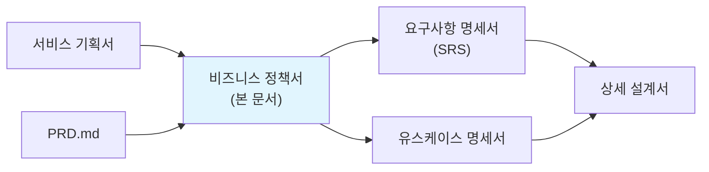
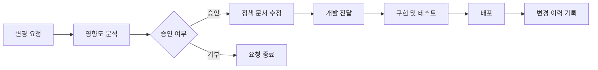

# 비즈니스 정책서 (Business Policy Document)

> 숙박숙박 Phase 0 기획 산출물이다. 규칙 값의 출처는 PRD.md v0.1(저장소 PR #2)과 2026-11-24 사용자 결정이며, PRD에 없는 값은 "초안"으로 표시하고 15장 미결 목록과 [서비스 기획서](서비스기획서.md) 7.3에 연결했다.

> 이 문서는 서비스의 비즈니스 동작 규칙을 독립적으로 정의하는 문서이다.
> "이런 상황에서 시스템은 어떻게 동작해야 하는가"를 **목적 / 규칙 / 예시** 구조로 명확히 기술하여, AI(Claude Code 등)가 바이브코딩 시 비즈니스 규칙을 정확히 구현하도록 한다.
> SRS의 기능 요구사항(FR)에 비즈니스 규칙이 흩어져 있으면 누락되기 쉬우므로, 이 문서에서 한곳에 모아 관리한다.

| 항목 | 내용 |
|------|------|
| **프로젝트명** | 숙박숙박 (SookbakSookbak) |
| **문서 ID** | BPD-SOOKBAK-v0.1 |
| **문서 버전** | v0.1 |
| **작성일** | 2026-11-24 |
| **작성자** | 이유나 (기획) / Claude (초안 작성 지원) |
| **승인자** | 이유나 (기획 책임자) |
| **문서 상태** | 초안 |

---

## 변경 이력

| 버전 | 날짜 | 작성자 | 변경 내용 |
|------|------|--------|-----------|
| v0.1 | 2026-11-24 | 이유나 / Claude | 초안 작성. 템플릿의 과금·광고·리셋 정책은 해당 없음으로 삭제하고 매물·가격·위치·채팅·신고·거래 비개입 정책을 추가 |
| v1.0 | [미정] | 이유나 | G0 검토 후 최종 승인 |

---

## 목차

1. [문서 개요](#1-문서-개요)
2. [정책 목록 및 요약](#2-정책-목록-및-요약)
3. [인증/권한 정책](#3-인증권한-정책)
4. [매물 등록·노출 정책](#4-매물-등록노출-정책)
5. [가격 정보 정책](#5-가격-정보-정책)
6. [위치·개인정보 공개 정책](#6-위치개인정보-공개-정책)
7. [찜·채팅 정책](#7-찜채팅-정책)
8. [신고·제재 정책](#8-신고제재-정책)
9. [거래 비개입·안전 안내 정책](#9-거래-비개입안전-안내-정책)
10. [알림 정책](#10-알림-정책)
11. [오프라인/에러 처리 정책](#11-오프라인에러-처리-정책)
12. [통계/카운팅 정책](#12-통계카운팅-정책)
13. [MVP 정책 적용 범위](#13-mvp-정책-적용-범위)
14. [정책 변경 관리](#14-정책-변경-관리)
15. [미결 정책 결정](#15-미결-정책-결정)

---

## 1. 문서 개요

### 1.1 목적

이 문서는 **숙박숙박** 서비스의 비즈니스 동작 규칙을 한곳에 모아 정의한다.

**이 문서가 필요한 이유:**

- SRS에 비즈니스 규칙이 기능별로 흩어져 있으면, AI 코딩 도구가 규칙을 누락하거나 잘못 해석하기 쉽다
- 비즈니스 규칙을 독립 문서로 관리하면 기획/개발/QA 모두 동일한 규칙을 참조할 수 있다
- "목적 / 규칙 / 예시" 구조는 AI가 가장 명확하게 이해하고 구현할 수 있는 형식이다

**이 문서의 대상 독자:**

| 독자 | 활용 방법 |
|------|-----------|
| AI 코딩 도구 (Claude Code 등) | 구현 시 비즈니스 규칙 참조. 예시의 "상황 -> 결과"를 테스트 케이스로 활용 |
| 개발 | 비즈니스 로직 구현의 기준 문서 |
| QA | 테스트 케이스 도출의 기반. 예시를 경계값 테스트에 활용 |
| 기획·운영 | 비즈니스 규칙 변경 관리, 검수·신고 처리 기준 |

### 1.2 정책 작성 가이드

> **모든 정책은 반드시 아래 4가지 요소를 포함해야 한다.**

| 요소 | 설명 | 작성 팁 |
|------|------|---------|
| **목적** | 이 정책이 존재하는 이유 | "왜 이 규칙이 필요한가"를 1~2문장으로 |
| **규칙** | 구체적인 동작 규칙 | 조건절 + 결과를 명확히. 모호한 표현("적절히", "필요 시") 금지 |
| **예시** | "상황 -> 결과" 형태의 구체적 시나리오 | 정상 케이스 + 경계 케이스 + 에러 케이스를 포함 |
| **변경이력** | 이 정책의 변경 기록 | 14장 통합 테이블에 기록 |

**공통 규칙:**

| 규칙 ID | 규칙 |
|---------|------|
| BP-COMMON-1 | 서비스 기준 시간대는 KST(UTC+9)다. 모든 기한·만료·재인증 기간은 KST로 계산한다 |
| BP-COMMON-2 | 금액 단위는 만 원, 면적 단위는 ㎡(평 병기)다 |
| BP-COMMON-3 | "영업일"은 토·일·법정공휴일을 제외한 날이다 |

### 1.3 관련 문서

| 문서명 | 관계 |
|--------|------|
| [서비스 기획서](서비스기획서.md) | 사용자 문제, 서비스 목표, MVP 범위 (MVP-ID) |
| PRD.md (저장소 PR #2) | 규칙 값의 원천 (7~8장, 12장) |
| DESIGN.md (저장소 PR #1) | 가격 표기, 태그·배지 표시 |
| [요구사항 명세서 (SRS)](../01-요구사항분석/요구사항명세서-SRS.md) | 요구사항의 출처에 개별 규칙 ID 기재 |
| [유스케이스 명세서](../01-요구사항분석/유스케이스명세서.md) | 정상·예외 흐름에 적용된 규칙 ID 참조 |



---

## 2. 정책 목록 및 요약

| 정책 ID | 정책 카테고리 | 핵심 규칙 요약 | MVP 적용 | 섹션 |
|---------|-------------|---------------|----------|------|
| BP-AUTH | 인증/권한 | 학교 이메일 인증 → 열람·찜, 학생증 인증(정회원) → 올리기·채팅. 매 학기(3월·9월) 재인증 | Y | [3장](#3-인증권한-정책) |
| BP-LISTING | 매물 등록·노출 | 정회원만 등록, 필수 필드 완비 시 게시, 공개 매물 1인 3건, 거래가능→예약중→거래완료 | Y | [4장](#4-매물-등록노출-정책) |
| BP-PRICE | 가격 정보 | 거래 방식별 필수 가격 필드, 만 원 단위, 고정 표기 형식, 월 예상 비용 | Y | [5장](#5-가격-정보-정책) |
| BP-PRIVACY | 위치·개인정보 공개 | 호수 미수집, 동·반경 위치만 공개, 실명·학번·이메일 비공개, 학생증 원본 즉시 삭제 | Y | [6장](#6-위치개인정보-공개-정책) |
| BP-CHAT | 찜·채팅 | 매물×상대당 채팅방 1개, 찜한 사람 비공개, 연락처·계좌 패턴 안내, 차단 | Y | [7장](#7-찜채팅-정책) |
| BP-MOD | 신고·제재 | 신고 3건 자동 숨김, 경고 → 7일 정지 → 영구 정지, 사기·중개업자 즉시 영구 정지 | Y | [8장](#8-신고제재-정책) |
| BP-DEAL | 거래 비개입·안전 안내 | 결제·계약·수수료 없음, 상세·채팅·등록에 비개입 고지 | Y | [9장](#9-거래-비개입안전-안내-정책) |
| BP-NOTI | 알림 | 채팅·찜 매물 변경·인증 결과·재인증 안내만 발송, 마케팅 알림 없음 | Y | [10장](#10-알림-정책) |
| BP-ERROR | 오프라인/에러 | 작성 중 임시 저장, 채팅 재접속 동기화, 상태별 오류 메시지 | Y | [11장](#11-오프라인에러-처리-정책) |
| BP-STAT | 통계/카운팅 | 조회는 24시간 내 1인 1회, 찜·채팅 수 실시간 | Y | [12장](#12-통계카운팅-정책) |

> 템플릿의 과금/결제(BP-PAY), 콘텐츠 해금(BP-CONTENT), 데이터 리셋(BP-RESET), 광고(BP-AD) 정책은 숙박숙박에 해당하지 않아 삭제했다. 결제가 없다는 사실은 BP-DEAL에, 시간대는 BP-COMMON-1에, 학기별 재인증은 BP-AUTH-004에 담았다.

---

## 3. 인증/권한 정책

### 3.1 목적

숙명여대 학생만 매물을 올리고 연락할 수 있는 안전한 공간을 만든다. 구경은 학교 이메일 인증만으로 열어 가입 장벽을 낮추고, 다른 사람과 연결되는 행동(올리기·채팅)에는 학생증 인증을 요구한다.

### 3.2 규칙

#### BP-AUTH-001: 가입과 학교 이메일 인증 (1단계)

| 규칙 ID | 규칙 | 비고 |
|---------|------|------|
| BP-AUTH-001-1 | 가입 이메일은 `@sookmyung.ac.kr` 도메인만 받는다. 다른 도메인은 "숙명여대 학교 이메일(@sookmyung.ac.kr)만 사용할 수 있어요"를 표시하고 진행을 막는다 | PRD 7.1 |
| BP-AUTH-001-2 | 학교 이메일 1개에는 계정 1개만 만들 수 있다. 이미 가입된 이메일이면 "이미 가입된 학교 이메일이에요. 로그인해 주세요"를 표시한다 | PRD 7.1 |
| BP-AUTH-001-3 | 6자리 숫자 인증번호를 메일로 보내고, 발송 후 10분 동안만 유효하다. 재발송하면 이전 번호는 즉시 무효가 된다 | PRD 7.1. 재발송 무효화는 초안 |
| BP-AUTH-001-4 | 인증번호를 5회 틀리면 해당 이메일은 30분 동안 인증번호를 다시 요청할 수 없다 | PRD 7.1 |
| BP-AUTH-001-5 | 인증번호 재발송은 직전 발송 60초 후부터 가능하다 | 초안 (메일 남용 방지) |
| BP-AUTH-001-6 | 가입 시 닉네임(2~10자, 한글·영문·숫자, 중복 불가)을 정한다. 닉네임만 다른 사용자에게 공개된다 | 초안 (PRD 7.1 "닉네임만 공개") |

#### BP-AUTH-002: 학생증·재학증명서 인증 (2단계, 정회원)

| 규칙 ID | 규칙 | 비고 |
|---------|------|------|
| BP-AUTH-002-1 | 이메일 인증 회원만 제출할 수 있다. 제출 자료는 모바일 학생증 캡처, 실물 학생증 사진, 재학증명서(발급일 30일 이내) 중 하나다 | PRD 7.1 |
| BP-AUTH-002-2 | 관리자가 이름·학번·학적 상태를 직접 확인하고 승인 또는 반려한다. 반려 시 사유(식별 불가·재학 확인 불가·발급일 초과·타인 자료 의심·기타)를 선택하고 사용자에게 알린다 | PRD 7.1. 사유 목록은 초안 |
| BP-AUTH-002-3 | 검수 목표 시간은 제출 후 영업일 기준 24시간이다 | PRD 7.1 |
| BP-AUTH-002-4 | 검수 대기 중에는 같은 계정으로 추가 제출할 수 없다. 반려된 뒤에는 횟수 제한 없이 다시 제출할 수 있다 | 초안 |
| BP-AUTH-002-5 | 같은 학번으로 이미 승인된 다른 계정이 있으면 반려한다 (1인 1계정) | 초안. 학번 일부 저장값으로 비교 가능한지 Phase 2에서 확인 |
| BP-AUTH-002-6 | 승인 즉시 원본 이미지를 삭제하고 학번 일부(앞 4자리, 초안)와 승인일만 남긴다. 반려 시에도 원본은 반려 처리 즉시 삭제한다 | PRD 7.1, 11장. 반려 시 삭제와 학번 저장 자리수는 초안 |
| BP-AUTH-002-7 | 정회원 범위: 학부·대학원 재학생과 졸업 예정자(재학 상태)는 승인, 휴학생·졸업생·제적생은 반려 | 초안, 미결 DEC-002 |

#### BP-AUTH-003: 인증 단계별 권한 (확정)

| 상태 | 매물 목록·상세 보기 | 찜 | 매물 올리기 | 채팅 | 비고 |
|------|---|---|---|---|---|
| 비회원 / 이메일 미인증 | ✕ (앱 소개 화면만) | ✕ | ✕ | ✕ | |
| 이메일 인증 회원 | ○ | ○ | ✕ | ✕ | 2026-11-24 사용자 결정 |
| 학생증 검수 대기 | ○ | ○ | ✕ | ✕ | 이메일 인증 회원과 같음 |
| 정회원 | ○ | ○ | ○ | ○ | |
| 재인증 미완료 (기한 경과) | ○ | ○ | ✕ | ✕ (기존 채팅방 읽기만) | BP-AUTH-004 |
| 이용 정지 | ✕ | ✕ | ✕ | ✕ | BP-MOD-003 |
| 관리자 (ADMIN) | ○ | - | - | - | 인증·신고 검수, 매물 숨김/복구, 사용자 제재 |

| 규칙 ID | 규칙 | 비고 |
|---------|------|------|
| BP-AUTH-003-1 | 정회원이 아닌 사용자가 `+ 매물 올리기`나 `채팅하기`를 누르면 학생증 인증 안내 화면으로 이동한다. 검수 대기 중이면 "학생증 확인 중이에요. 영업일 24시간 안에 알려드릴게요"를 표시한다 | PRD 7.1 수용 기준 |
| BP-AUTH-003-2 | 권한 검사는 화면뿐 아니라 서버 API에서도 같은 기준으로 수행한다 | 우회 방지 |
| BP-AUTH-003-3 | 정회원 프로필에는 "숙대생 인증" 배지를 표시한다. 이메일 인증 회원에게는 배지가 없다 | PRD 7.1 |

#### BP-AUTH-004: 학기별 재인증

| 규칙 ID | 규칙 | 비고 |
|---------|------|------|
| BP-AUTH-004-1 | 정회원은 매 학기 재학 여부를 다시 인증한다. 재인증 기간은 3월 1일~3월 31일, 9월 1일~9월 30일이다 | PRD 7.1 "3월, 9월". 기간 길이는 초안 |
| BP-AUTH-004-2 | 재인증 방법은 BP-AUTH-002와 같다 (자료 제출 → 관리자 검수) | |
| BP-AUTH-004-3 | 재인증 기간 마지막 날 23:59(KST)까지 승인되지 않으면 다음 날 00:00에 정회원 권한(올리기·채팅)이 정지되고, 공개 중인 매물은 비공개로 바뀐다 | PRD 7.1. 기한 내 제출했으나 검수 대기 중이면 검수 결과가 나올 때까지 권한 유지 (초안) |
| BP-AUTH-004-4 | 직전 재인증 기간 시작 30일 이내에 정회원이 된 사용자는 그 기간 재인증을 면제한다 (예: 2월 15일 승인 → 3월 재인증 면제, 9월 재인증 대상) | 초안 |
| BP-AUTH-004-5 | 재인증이 승인되면 비공개로 바뀌었던 매물 중 거래가능·예약중 매물은 다시 공개된다 | 초안 |

#### BP-AUTH-005: 로그인 / 세션 / 탈퇴

| 규칙 ID | 규칙 | 비고 |
|---------|------|------|
| BP-AUTH-005-1 | 로그인은 학교 이메일 + 비밀번호(8자 이상, 영문·숫자 포함)로 한다 | 초안, 미결 DEC-009 (인증번호 로그인 방식 대안) |
| BP-AUTH-005-2 | 로그인 연속 5회 실패 시 30분 동안 로그인을 막는다 | 초안 |
| BP-AUTH-005-3 | 로그인 상태는 마지막 이용 후 30일 유지한다 (모바일 웹 특성) | 초안 |
| BP-AUTH-005-4 | 탈퇴하면 즉시 로그인할 수 없고, 공개 매물은 즉시 숨긴다. 채팅 상대에게는 "탈퇴한 사용자"로 표시한다. 개인정보는 탈퇴 30일 후 파기한다 | PRD 11장(30일 파기). 나머지 초안 |
| BP-AUTH-005-5 | 탈퇴 후 30일 동안 같은 학교 이메일로 다시 가입할 수 없다 | 초안 (제재 회피 방지) |

### 3.3 예시

**정상 케이스:**

```
상황: 사용자가 nunsong@sookmyung.ac.kr로 가입하고 메일로 받은 인증번호를 5분 뒤에 입력한다
결과: 이메일 인증 회원이 되어 홈 목록으로 이동한다. 매물 목록·상세 보기와 찜을 할 수 있다
```

```
상황: 이메일 인증 회원이 매물 상세에서 "채팅하기"를 누른다
결과: 학생증 인증 안내 화면으로 이동한다. 학생증 사진을 올리면 "검수 대기" 상태가 된다
```

```
상황: 관리자가 학생증을 승인한다
결과: 정회원이 되고 "숙대생 인증" 배지가 붙는다. 원본 이미지는 즉시 삭제되고 학번 앞 4자리와 승인일만 남는다.
      사용자에게 "학생 인증이 완료됐어요. 이제 매물을 올리고 채팅할 수 있어요" 알림을 보낸다
```

**경계 케이스:**

```
상황: 인증번호 발송 후 10분 0초가 지난 뒤 올바른 번호를 입력한다
결과: "인증번호가 만료됐어요. 다시 받아 주세요"를 표시하고 인증하지 않는다
```

```
상황: 인증번호를 4회 틀린 뒤 5번째에 올바르게 입력한다
결과: 인증 성공. 실패 횟수는 초기화된다
```

```
상황: 정회원이 3월 31일 23:00에 재학증명서를 제출했고, 검수는 4월 2일에 끝난다
결과: 기한 안에 제출했으므로 4월 1일 00:00에도 권한을 유지한다. 4월 2일 승인되면 계속 정회원, 반려되면 그 시점에 권한 정지와 매물 비공개 처리
```

```
상황: 정회원이 9월 30일까지 재인증 자료를 제출하지 않았다
결과: 10월 1일 00:00(KST)에 올리기·채팅 권한이 정지되고 공개 매물이 비공개로 바뀐다. 기존 채팅방은 읽기만 가능하다.
      목록 보기와 찜은 계속 가능하다
```

**에러 케이스:**

```
상황: 사용자가 gmail.com 주소로 가입하려 한다
결과: "숙명여대 학교 이메일(@sookmyung.ac.kr)만 사용할 수 있어요"를 표시하고 인증번호를 보내지 않는다
```

```
상황: 인증번호를 5회 연속 틀린다
결과: "인증번호를 5회 잘못 입력했어요. 30분 뒤에 다시 요청해 주세요"를 표시하고 30분 동안 재요청을 막는다
```

```
상황: 발급일이 45일 지난 재학증명서를 제출한다
결과: 관리자가 "발급일 초과" 사유로 반려한다. 사용자는 사유를 확인하고 다시 제출할 수 있다
```

### 3.4 변경이력

| 날짜 | 규칙 ID | 변경 내용 | 변경 사유 |
|------|---------|-----------|-----------|
| 2026-11-24 | BP-AUTH-003 | 최초 확정: 열람·찜은 이메일 인증, 올리기·채팅은 학생증 인증 | 사용자 결정 |

---

## 4. 매물 등록·노출 정책

### 4.1 목적

학생이 올린 매물이 같은 형식으로 비교되고, 이미 나간 방이나 방치된 매물이 목록을 채우지 않도록 등록 조건과 노출 규칙을 정한다.

### 4.2 규칙

#### BP-LISTING-001: 등록 자격과 필수 항목

| 규칙 ID | 규칙 | 비고 |
|---------|------|------|
| BP-LISTING-001-1 | 정회원만 매물을 올리고 수정할 수 있다 (BP-AUTH-003) | |
| BP-LISTING-001-2 | 매물 분류는 일반 임대 / 단기임대 / 하숙 / 쉐어하우스 중 하나다. 일반 임대·단기임대는 방 종류(원룸[오픈형/분리형/복층] / 투룸 이상[투룸/쓰리룸+] / 오피스텔 / 아파트 / 기타) 필수, 하숙·쉐어하우스는 선택이다 | PRD 7.3. 모든 분류·방 종류 등록 가능 |
| BP-LISTING-001-3 | 필수 항목: 사진 3~10장(장당 10MB 이하, 첫 장이 대표), 분류, 가격(5장), 위치(6장), 전용면적, 해당 층/전체 층, 방 수·욕실 수, 입주 가능일(또는 "즉시"), 계약 만료일 또는 임대 가능 기간, 제목(40자 이내), 설명(2,000자 이내), 비개입 고지 동의(BP-DEAL-002) | PRD 7.4 |
| BP-LISTING-001-4 | 분류별 필수 항목 — 단기임대: 임대 가능 기간(시작일~종료일, 1주 이상 6개월 이하), 최소 거주 기간 / 하숙: 식사 제공(조식·석식·없음), 1인실·2인실, 통금 여부, 함께 사는 인원 / 쉐어하우스: 모집 인원, 현재 거주 인원, 방 유형(1인실·다인실), 공용 공간, 하우스 규칙 | PRD 7.3. 각 항목 필수 여부는 초안 |
| BP-LISTING-001-5 | 일반 임대 중 계약 승계·전대 매물, 그리고 단기임대는 "집주인 동의 여부(동의 받음 / 받지 않음 / 확인 중)"를 반드시 선택하고 상세에 표시한다 | PRD 12장. 단기임대 적용은 초안 |
| BP-LISTING-001-6 | 필수 항목이 하나라도 비면 `완료` 버튼이 비활성화되고, 누르면 첫 번째 빈 항목으로 화면이 스크롤된다 | PRD 7.4 수용 기준 |
| BP-LISTING-001-7 | 작성 중 이탈하면 내용을 임시 저장한다. 임시 저장본은 1인 1개이며 마지막 수정 후 7일 보관한다 | PRD 7.4. 개수·기간은 초안 |
| BP-LISTING-001-8 | 숙대 정문·후문까지 도보 시간은 입력한 주소로 자동 계산하며 작성자가 수정할 수 없다 | PRD 7.4 |

#### BP-LISTING-002: 등록 수량

| 규칙 ID | 규칙 | 비고 |
|---------|------|------|
| BP-LISTING-002-1 | 한 사용자는 공개 중인 매물(거래가능·예약중)을 동시에 최대 3건 가질 수 있다. 거래완료·비공개·숨김 매물은 세지 않는다 | PRD 7.4, 미결 DEC-004 |
| BP-LISTING-002-2 | 3건을 가진 상태에서 등록을 시도하면 "공개 중인 매물은 최대 3건까지 올릴 수 있어요. 기존 매물을 거래완료로 바꾸거나 삭제해 주세요"를 표시한다 | |

#### BP-LISTING-003: 거래 상태와 노출

| 규칙 ID | 규칙 | 비고 |
|---------|------|------|
| BP-LISTING-003-1 | 거래 상태는 `거래가능` → `예약중` → `거래완료`이며 작성자만 바꿀 수 있다. `예약중` → `거래가능` 되돌리기는 허용하고, `거래완료`에서 되돌리기는 거래완료 후 24시간 안에만 허용한다 | PRD 7.4. 되돌리기 조건은 초안 |
| BP-LISTING-003-2 | 새로 올린 매물은 바로 목록 최상단(최신순 기준)에 노출된다 | PRD 7.4 |
| BP-LISTING-003-3 | 목록에서 `거래완료` 매물은 거래가능·예약중 매물 아래로 내려가고, "거래가능만 보기"를 켜면 숨는다 | PRD 7.2 |
| BP-LISTING-003-4 | `거래완료` 후 30일이 지나면 목록·검색에서 자동으로 숨긴다. 작성자의 내 매물에는 남는다 | PRD 7.4 |
| BP-LISTING-003-5 | 최신순 정렬 기준 시각은 최초 등록 시각이다. 수정해도 순서는 바뀌지 않는다 | 초안 (끌어올리기는 v1.1) |
| BP-LISTING-003-6 | 가격(월세·전세금·하숙비)을 내리면 "가격 인하" 표시를 3일간 붙인다. 보증금만 내린 경우에도 적용한다 | PRD 7.4. 보증금 적용은 초안 |
| BP-LISTING-003-7 | 마지막 수정 또는 상태 변경 후 60일이 지난 `거래가능` 매물은 작성자에게 "아직 거래 가능한가요?" 알림을 보내고, 7일 안에 응답(유지 선택 또는 수정)이 없으면 목록에서 숨긴다 | 초안, 미결 DEC-005 |

#### BP-LISTING-004: 수정·삭제

| 규칙 ID | 규칙 | 비고 |
|---------|------|------|
| BP-LISTING-004-1 | 작성자는 언제든 매물을 수정·삭제할 수 있다. 수정 시에도 BP-LISTING-001 필수 항목 검증을 다시 한다 | PRD 7.4 |
| BP-LISTING-004-2 | 매물을 삭제하면 목록·검색·찜 목록에서 사라진다. 진행 중인 채팅방은 유지되고 상단 매물 요약에 "삭제된 매물"을 표시한다 | 초안 |
| BP-LISTING-004-3 | 신고로 숨김 처리된 매물은 작성자가 수정해도 관리자 검토 전까지 다시 공개되지 않는다 | 초안 |

### 4.3 예시

**정상 케이스:**

```
상황: 정회원이 사진 5장과 필수 항목을 모두 채워 "원룸 · 분리형" 일반 임대 매물을 올린다
결과: 즉시 공개되고 홈 최신순 목록 맨 위에 보인다. 카드에 "숙대 정문 도보 7분"이 자동으로 표시된다
```

```
상황: 작성자가 채팅방에서 매물을 "예약중"으로 바꾼다
결과: 목록 카드에 "예약중" 배지가 붙고, 이 매물을 찜한 사람에게 상태 변경 알림을 보낸다
```

**경계 케이스:**

```
상황: 사진을 2장만 올리고 완료를 누른다
결과: 완료 버튼이 비활성화돼 있고, 사진 영역으로 스크롤되며 "사진을 3장 이상 올려 주세요"를 표시한다
```

```
상황: 공개 매물 3건(거래가능 2, 예약중 1)과 거래완료 1건을 가진 사용자가 새 매물을 올리려 한다
결과: 공개 매물이 3건이므로 등록을 막고 BP-LISTING-002-2 메시지를 표시한다
```

```
상황: 거래완료 처리 후 29일째인 매물
결과: 목록 맨 아래에 "거래완료" 배지와 함께 보인다. 30일째 00:00(KST)에 목록에서 숨긴다
```

```
상황: 단기임대 매물의 임대 가능 기간을 7개월로 입력한다
결과: "단기임대는 1주 이상 6개월 이하만 올릴 수 있어요. 6개월보다 길면 일반 임대로 올려 주세요"를 표시하고 저장하지 않는다
```

**에러 케이스:**

```
상황: 사진 업로드 중 한 장이 12MB다
결과: 해당 사진만 "10MB 이하 사진만 올릴 수 있어요"로 거부하고 나머지 사진은 유지한다
```

```
상황: 재인증 기한이 지나 권한이 정지된 사용자가 내 매물 수정 화면에 들어간다
결과: 수정할 수 없고 "재학 인증을 다시 하면 매물을 수정하고 공개할 수 있어요" 안내와 재인증 버튼을 표시한다
```

### 4.4 변경이력

| 날짜 | 규칙 ID | 변경 내용 | 변경 사유 |
|------|---------|-----------|-----------|
| - | - | - | - |

---

## 5. 가격 정보 정책

### 5.1 목적

가격·관리비를 정해진 필드로만 받아 모든 매물을 같은 형식으로 비교하게 한다. 표기 형식은 DESIGN.md "가격 표기 규칙"과 같다.

### 5.2 규칙

#### BP-PRICE-001: 거래 방식별 가격 필드 (단위: 만 원, 정수)

| 필드 | 값 범위 | 월세 (일반 임대) | 전세 (일반 임대) | 하숙 | 쉐어하우스·단기임대 |
|---|---|---|---|---|---|
| 거래 방식 | 월세 / 전세 | 필수 | 필수 | 월세 고정 | 월세 고정 (단기임대는 주 단위 선택 가능) |
| 보증금 | 0 이상 | 필수 | — | 선택 | 필수 (0 가능) |
| 월세 (하숙비, 주 단위 금액) | 1 이상 | 필수 | — | 필수 | 필수 |
| 전세금 | 1 이상 | — | 필수 | — | — |
| 관리비 | 0 이상 또는 "없음" | 필수 | 필수 | 선택 | 필수 |
| 관리비 포함 항목 | 수도·전기·가스·인터넷·TV·청소 (복수) | 선택 | 선택 | 선택 | 선택 |
| 가격 협의 가능 | 체크 | 선택 | 선택 | 선택 | 선택 |

| 규칙 ID | 규칙 | 비고 |
|---------|------|------|
| BP-PRICE-001-1 | 위 표에서 필수인 필드가 비면 저장하지 않는다. 월세인데 월세가 비었거나, 전세인데 전세금이 비면 저장하지 않는다 | PRD 7.4 수용 기준 |
| BP-PRICE-001-2 | 금액은 만 원 단위 정수로만 입력받는다. 소수·음수는 입력할 수 없다 | 초안 |
| BP-PRICE-001-3 | 입력 상한: 보증금 99,999만, 월세 999만, 전세금 99,999만, 관리비 99만. 넘으면 "입력할 수 있는 최대 금액을 넘었어요"를 표시한다 | 초안 (오입력 방지) |
| BP-PRICE-001-4 | 단기임대의 "주 단위"를 선택하면 월세 필드가 주 단위 금액이 된다. 필터 비교 시 주 단위 금액 × 4.3을 월 금액으로 환산한다 | PRD 8.1. 환산식은 초안 |

#### BP-PRICE-002: 계산 값

| 규칙 ID | 규칙 | 비고 |
|---------|------|------|
| BP-PRICE-002-1 | 월 예상 비용 = 월세 + 관리비. 전세는 관리비만. 관리비 "없음"은 0으로 계산하고, 결과가 0이면 "관리비 없음"으로 표시한다. 상세 가격 블록에 표시한다 | PRD 8.2 |
| BP-PRICE-002-2 | 평 = ㎡ ÷ 3.3058, 소수 첫째 자리 반올림 | PRD 8.2 |
| BP-PRICE-002-3 | 필터의 "관리비 포함"을 켜면 월세 범위를 월 예상 비용으로 비교한다 | PRD 7.8 |

#### BP-PRICE-003: 표기 규칙

| 대상 | 형식 | 예 |
|---|---|---|
| 월세 | `월세 {보증금}/{월세}` | `월세 500/45`, `월세 1억2000/39` |
| 전세 | `전세 {전세금}` | `전세 1억5000` |
| 하숙 | `하숙 월 {금액}` + 식사 제공 시 "식사 포함" 태그 | `하숙 월 65` |
| 단기임대 주 단위 | `주 {금액}` | `주 15` |
| 관리비 | `관리비 {금액}만`, 0 또는 없음은 `관리비 없음` | `관리비 5만` |
| 1억 이상 | 억 단위와 만 단위를 붙여 씀. 만 단위가 0이면 생략 | `1억2000`, `2억` |

| 규칙 ID | 규칙 | 비고 |
|---------|------|------|
| BP-PRICE-003-1 | 목록 카드와 상세는 위 형식을 똑같이 쓴다. 가격만 18px/700 (DESIGN.md) | |
| BP-PRICE-003-2 | 보증금 0인 월세는 `월세 0/45`로 표기한다 | 초안 |
| BP-PRICE-003-3 | 하숙에서 보증금을 입력하면 상세 가격 블록에만 보증금을 따로 표시한다 | 초안 |

### 5.3 예시

```
상황: 보증금 12000, 월세 39, 관리비 7인 월세 매물
결과: 카드에 "월세 1억2000/39", "관리비 7만". 상세에 월 예상 비용 "46만"
```

```
상황: 전세금 20000, 관리비 "없음"
결과: 카드에 "전세 2억", "관리비 없음". 상세의 월 예상 비용은 0이므로 "관리비 없음"으로 표시한다
```

```
상황: 단기임대, 주 단위 15, 관리비 0. 사용자가 월세 필터 "60 이하"를 적용한다
결과: 15 × 4.3 = 64.5로 환산되어 필터 결과에서 제외된다
```

```
상황: 월세 매물인데 월세를 비워 두고 저장한다
결과: 저장하지 않고 "월세를 입력해 주세요"를 표시한다
```

### 5.4 변경이력

| 날짜 | 규칙 ID | 변경 내용 | 변경 사유 |
|------|---------|-----------|-----------|
| - | - | - | - |

---

## 6. 위치·개인정보 공개 정책

### 6.1 목적

매물 위치와 사용자 신원 정보가 과하게 노출되지 않도록 공개 범위를 정한다. 여성 학생의 주거 정보라는 점에서 안전과 직결된다.

### 6.2 규칙

| 규칙 ID | 규칙 | 비고 |
|---------|------|------|
| BP-PRIVACY-001 | 주소는 도로명/지번 주소 검색으로 건물 단위까지만 입력받는다. 동·호수는 입력받지 않는다 | PRD 8.4 |
| BP-PRIVACY-002 | 목록에는 동 이름만, 상세 지도에는 건물 좌표에서 무작위로 이동한 중심의 반경 원(반경 150m, 초안)과 숙대 위치만 표시한다. 정확한 건물 핀은 표시하지 않는다 | PRD 7.5, 8.4. 반경·오프셋 방식은 초안 |
| BP-PRIVACY-003 | 상세 주소는 작성자가 채팅으로 직접 알려준다. 시스템은 다른 사용자에게 건물 주소를 제공하지 않는다 | PRD 8.4 |
| BP-PRIVACY-004 | 실명·학번·학교 이메일은 다른 사용자에게 보이지 않는다. 공개 정보는 닉네임, 프로필 사진, 인증 배지, 가입 기간, 올린 매물 수뿐이다 | PRD 7.1, 7.5 |
| BP-PRIVACY-005 | 학생증·재학증명서 원본은 승인·반려 처리 즉시 삭제하고, 학번 일부와 승인일만 보관한다. 관리자 화면 외에서는 원본을 볼 수 없다 | PRD 7.1 (BP-AUTH-002-6) |
| BP-PRIVACY-006 | 수집 항목은 학교 이메일, 닉네임, 비밀번호(해시), 인증 결과(학번 일부·승인일), 매물·채팅 내용으로 제한한다. 탈퇴 시 30일 후 파기한다 | PRD 11장 |
| BP-PRIVACY-007 | 매물 사진 업로드 시 EXIF 위치 정보를 제거한다 | 초안 (사진에서 정확한 위치 노출 방지) |

### 6.3 예시

```
상황: 이메일 인증 회원이 청파동 매물 상세를 연다
결과: 지도에 정확한 건물이 아닌 반경 150m 원과 숙대 위치가 보이고, "숙대 정문 도보 7분 · 후문 도보 9분"이 표시된다
```

```
상황: 작성자가 설명란에 "○○빌라 302호"를 적는다
결과: MVP에서는 자동 차단하지 않는다. 등록 화면에 "호수 등 상세 주소는 채팅으로만 알려 주세요" 안내를 상시 표시한다 (자동 감지는 v1.1 검토)
```

### 6.4 변경이력

| 날짜 | 규칙 ID | 변경 내용 | 변경 사유 |
|------|---------|-----------|-----------|
| - | - | - | - |

---

## 7. 찜·채팅 정책

### 7.1 목적

관심 매물을 모아두고, 개인 연락처 공개 없이 앱 안에서 안전하게 문의할 수 있게 한다.

### 7.2 규칙

#### BP-CHAT-001: 찜

| 규칙 ID | 규칙 | 비고 |
|---------|------|------|
| BP-CHAT-001-1 | 이메일 인증 회원과 정회원이 찜할 수 있다. 같은 매물은 한 번만 찜되며 다시 누르면 해제된다 | BP-AUTH-003 |
| BP-CHAT-001-2 | 자기 매물은 찜할 수 없다 | 초안 |
| BP-CHAT-001-3 | 작성자에게는 찜 수만 보이고 누가 찜했는지는 보이지 않는다 | PRD 7.6 |
| BP-CHAT-001-4 | 찜 목록은 최신 찜순이며, 숨김·삭제된 매물은 찜 목록에서도 보이지 않는다. 거래완료 매물은 "거래완료"로 표시해 남긴다 | 숨김·삭제 처리는 초안 |
| BP-CHAT-001-5 | 찜 개수 상한은 두지 않는다 | 초안 |

#### BP-CHAT-002: 채팅방

| 규칙 ID | 규칙 | 비고 |
|---------|------|------|
| BP-CHAT-002-1 | 정회원만 채팅을 시작하고 메시지를 보낼 수 있다 | BP-AUTH-003 |
| BP-CHAT-002-2 | 채팅방은 (매물, 문의자) 조합당 1개다. 이미 있으면 기존 방을 연다 | PRD 7.7 |
| BP-CHAT-002-3 | 자기 매물에는 `채팅하기` 대신 `채팅 N개 보기`를 표시한다 | PRD 7.7 |
| BP-CHAT-002-4 | `거래완료` 매물에는 새 채팅을 시작할 수 없다. 기존 채팅방은 계속 쓸 수 있다 | 초안 |
| BP-CHAT-002-5 | 채팅방 상단에 매물 요약(썸네일·가격·거래 상태)을 고정하고, 작성자는 여기서 바로 `예약중`으로 바꿀 수 있다 | PRD 7.7 |
| BP-CHAT-002-6 | 메시지는 텍스트(1,000자 이내, 초안)와 사진(한 번에 최대 10장)을 지원하고 읽음 표시를 한다 | PRD 7.7 |
| BP-CHAT-002-7 | 메시지에 전화번호(010-0000-0000 등) 또는 계좌번호(숫자 10~14자리 + 은행명 등) 형식이 있으면 채팅방당 1회 "앱 밖 거래와 송금은 숙박숙박이 책임지지 않습니다" 안내를 보낸 사람과 받는 사람 모두에게 보여준다. 메시지 전송은 막지 않는다 | PRD 7.7. 패턴 상세는 Phase 3 |
| BP-CHAT-002-8 | 채팅 메시지는 보낸 사람이 삭제할 수 없다 (신고 증거 보존) | 초안 |

#### BP-CHAT-003: 차단

| 규칙 ID | 규칙 | 비고 |
|---------|------|------|
| BP-CHAT-003-1 | 채팅방 메뉴에서 상대를 차단하면 상대는 나에게 메시지를 보낼 수 없고, 새 채팅도 시작할 수 없다. 상대에게는 "메시지를 보낼 수 없는 상대예요"만 표시하고 차단 사실은 알리지 않는다 | PRD 7.7. 알림 문구는 초안 |
| BP-CHAT-003-2 | 차단한 사용자의 매물은 내 목록에서 보이지 않는다 | 초안 |
| BP-CHAT-003-3 | 차단은 마이 > 차단 목록에서 해제할 수 있다 | PRD 7.10 |

### 7.3 예시

```
상황: 정회원 A가 매물 X에서 "채팅하기"를 누르고, 다음 날 다시 매물 X에서 "채팅하기"를 누른다
결과: 처음에는 새 채팅방이 생기고, 다음 날에는 같은 채팅방이 열린다
```

```
상황: 문의자가 "010-1234-5678로 연락 주세요"라고 보낸다
결과: 메시지는 전송되고, 두 사람에게 앱 밖 거래 안내가 한 번 표시된다. 같은 방에서 다시 번호를 보내도 안내는 다시 나오지 않는다
```

```
상황: 재인증 기한이 지난 사용자가 기존 채팅방에 메시지를 쓰려 한다
결과: 입력창이 비활성화되고 "재학 인증을 다시 하면 메시지를 보낼 수 있어요"를 표시한다. 지난 대화는 읽을 수 있다
```

### 7.4 변경이력

| 날짜 | 규칙 ID | 변경 내용 | 변경 사유 |
|------|---------|-----------|-----------|
| - | - | - | - |

---

## 8. 신고·제재 정책

### 8.1 목적

허위 매물, 중개업자·광고, 사기 의심 행위를 빠르게 걸러 신뢰를 지킨다.

### 8.2 규칙

#### BP-MOD-001: 신고

| 규칙 ID | 규칙 | 비고 |
|---------|------|------|
| BP-MOD-001-1 | 이메일 인증 회원 이상은 매물을, 정회원은 채팅 상대를 신고할 수 있다. 신고 사유: 허위 매물, 이미 거래된 매물, 중개업자·광고, 부적절한 사진·내용, 사기 의심, 욕설·괴롭힘, 기타(직접 입력 필수) | PRD 7.9. 신고 가능 등급은 초안 |
| BP-MOD-001-2 | 같은 사용자는 같은 매물을 한 번만 신고할 수 있다 | 초안 |
| BP-MOD-001-3 | 서로 다른 사용자의 신고가 3건 쌓이면 매물을 자동으로 숨기고 관리자 신고 대기열에 올린다. 작성자에게 "신고가 접수되어 매물이 잠시 숨겨졌어요" 알림을 보낸다 | PRD 7.9 |
| BP-MOD-001-4 | 관리자는 자동 숨김 매물을 영업일 2일 안에 검토해 복구 또는 숨김 유지(+제재)한다 | 초안 |
| BP-MOD-001-5 | 신고자는 신고 처리 결과(조치함/조치 없음)를 알림으로 받는다. 신고자 정보는 작성자에게 공개하지 않는다 | 초안 |

#### BP-MOD-002: 제재 단계

| 단계 | 조건 | 조치 |
|---|---|---|
| 경고 | 관리자가 위반을 확인한 첫 번째 사례 | 알림으로 경고, 해당 매물 숨김 유지 |
| 7일 정지 | 경고 이력이 있는 사용자의 두 번째 위반 | 7일 동안 모든 기능 이용 불가, 공개 매물 비공개 |
| 영구 정지 | 세 번째 위반 / 사기·중개업자 확인 시 즉시 | 계정 이용 불가, 매물 전체 숨김, 같은 학교 이메일·학번으로 재가입 불가 |

| 규칙 ID | 규칙 | 비고 |
|---------|------|------|
| BP-MOD-002-1 | 제재 단계는 위 표를 따른다. 사기·중개업자·임대사업자 영업 목적 게시가 확인되면 이력과 관계없이 즉시 영구 정지한다 | PRD 7.9, 12장 |
| BP-MOD-002-2 | 경고 이력은 마지막 제재 후 1년이 지나면 소멸한다 | 초안 |
| BP-MOD-002-3 | 제재받은 사용자는 고객센터 메일로 1회 이의를 제기할 수 있고, 관리자는 영업일 3일 안에 답한다 | 초안 |

### 8.3 예시

```
상황: 매물 X가 서로 다른 사용자 3명에게 "이미 거래된 매물"로 신고된다
결과: 세 번째 신고 순간 목록·검색·찜 목록에서 숨겨지고 관리자 대기열에 올라간다. 작성자에게 알림이 간다
```

```
상황: 같은 사용자가 매물 X를 두 번 신고하려 한다
결과: "이미 신고한 매물이에요"를 표시하고 신고 수는 늘지 않는다
```

```
상황: 관리자가 작성자가 공인중개사라는 사실을 확인한다
결과: 경고 이력이 없어도 즉시 영구 정지하고 모든 매물을 숨긴다
```

### 8.4 변경이력

| 날짜 | 규칙 ID | 변경 내용 | 변경 사유 |
|------|---------|-----------|-----------|
| - | - | - | - |

---

## 9. 거래 비개입·안전 안내 정책

### 9.1 목적

숙박숙박은 거래 당사자도 중개자도 아니다. 앱이 계약·송금에 관여하지 않는다는 사실을 사용자가 분명히 알게 하고, 공인중개사법상 중개로 보이지 않도록 한다 (PRD 12장).

### 9.2 규칙

| 규칙 ID | 규칙 | 비고 |
|---------|------|------|
| BP-DEAL-001 | 앱에는 결제·송금·에스크로·계약서 작성·전자계약 기능이 없다. 수수료, 계약 대행비, 매물 광고비를 받지 않는다 | PRD 3.2, 12장 |
| BP-DEAL-002 | 매물 올리기 마지막 단계에서 "실제 거래는 앱 밖에서 당사자 간에 이루어지며, 허위 매물은 제재됩니다"에 동의해야 게시된다 | PRD 7.4 |
| BP-DEAL-003 | 매물 상세에 "숙박숙박은 매물 정보만 연결합니다. 계약과 송금 전 반드시 직접 방문하고 등기부등본을 확인하세요"를 항상 표시한다 | PRD 7.5 |
| BP-DEAL-004 | 이용약관에 "회사는 거래 당사자가 아니며 중개하지 않는다"를 명시한다 | PRD 12장 |
| BP-DEAL-005 | 앱은 "거래완료" 표시만 기록하며 계약 사실·금액을 확인하거나 보증하지 않는다 | 초안 |

### 9.3 예시

```
상황: 사용자가 "앱으로 보증금을 보내도 되나요?"라고 고객센터에 문의한다
결과: 앱에는 송금 기능이 없고, 송금은 당사자 간에 계약서 작성 후 진행하라는 안내를 보낸다
```

```
상황: 작성자가 비개입 고지 동의를 체크하지 않고 완료를 누른다
결과: 완료 버튼이 비활성화되어 게시되지 않는다
```

### 9.4 변경이력

| 날짜 | 규칙 ID | 변경 내용 | 변경 사유 |
|------|---------|-----------|-----------|
| - | - | - | - |

---

## 10. 알림 정책

### 10.1 목적

문의·거래 상태처럼 사용자가 놓치면 안 되는 정보만 보내고, 마케팅성 알림은 보내지 않는다.

### 10.2 규칙

#### BP-NOTI-001: 알림 유형

| 알림 유형 | 채널 | 발송 조건 | 사용자 설정 가능 |
|-----------|------|-----------|-----------------|
| 이메일 인증번호 | 이메일 | 가입·인증 요청 시 | N (필수) |
| 학생증 인증 결과 | 푸시 + 인앱 | 승인·반려 시 | N (필수) |
| 재인증 안내 | 푸시 + 인앱 + 이메일 | 재인증 기간 시작일, 마감 7일 전, 마감 1일 전 | N (필수) |
| 새 채팅 메시지 | 푸시 + 인앱 | 메시지 수신 시 (해당 채팅방을 보고 있지 않을 때) | Y |
| 찜 매물 가격 인하 | 푸시 + 인앱 | 찜한 매물의 가격이 내려갈 때 | Y |
| 찜 매물 상태 변경 | 푸시 + 인앱 | 찜한 매물이 예약중·거래완료로 바뀔 때 | Y |
| 매물 신고 숨김·처리 결과 | 인앱 | BP-MOD-001-3, 001-5 | N (필수) |
| 방치 매물 확인 | 푸시 + 인앱 | BP-LISTING-003-7 | N (필수) |
| 제재 | 인앱 + 이메일 | 경고·정지 시 | N (필수) |
| 마케팅 | - | 보내지 않음 | - |

#### BP-NOTI-002: 빈도·시간 제한

| 규칙 ID | 규칙 | 비고 |
|---------|------|------|
| BP-NOTI-002-1 | 채팅 메시지 알림은 같은 채팅방에서 1분 안에 여러 개가 오면 하나로 묶는다 | 초안 |
| BP-NOTI-002-2 | 찜 매물 변경 알림은 같은 매물에 대해 하루 1회까지만 보낸다 | 초안 |
| BP-NOTI-002-3 | 22:00~08:00(KST)에는 찜 매물 변경·방치 매물 확인 알림을 푸시로 보내지 않고 08:00에 보낸다. 채팅·인증 결과는 즉시 보낸다 | 초안 |
| BP-NOTI-002-4 | 사용자가 끈 알림 유형은 푸시를 보내지 않고 인앱 알림 목록에만 남긴다 | |

### 10.3 예시

```
상황: 23:30에 찜한 매물의 가격이 내려간다
결과: 인앱 알림은 즉시 생기고, 푸시는 다음 날 08:00에 보낸다
```

```
상황: 상대가 30초 사이에 메시지 4개를 보낸다
결과: 푸시는 "○○님: 메시지 4개"로 1건만 보낸다
```

### 10.4 변경이력

| 날짜 | 규칙 ID | 변경 내용 | 변경 사유 |
|------|---------|-----------|-----------|
| - | - | - | - |

---

## 11. 오프라인/에러 처리 정책

### 11.1 목적

네트워크가 불안정할 때 작성 중인 매물과 채팅 메시지를 잃지 않게 한다.

### 11.2 규칙

#### BP-ERROR-001: 네트워크 오류

| 규칙 ID | 규칙 | 비고 |
|---------|------|------|
| BP-ERROR-001-1 | 조회 API 실패 시 1초·2초·4초 간격으로 최대 3회 자동 재시도한다. 등록·수정·신고 같은 쓰기 요청은 자동 재시도하지 않는다 | 초안 |
| BP-ERROR-001-2 | 재시도가 모두 실패하면 "네트워크 연결을 확인해 주세요"와 다시 시도 버튼을 표시한다 | |
| BP-ERROR-001-3 | 오프라인이면 상단에 오프라인 배너를 띄우고, 이미 불러온 목록·채팅은 읽기 전용으로 보여준다 | 초안 |

#### BP-ERROR-002: 데이터 보존

| 규칙 ID | 규칙 | 비고 |
|---------|------|------|
| BP-ERROR-002-1 | 매물 작성 중 네트워크가 끊기면 입력 내용을 기기에 임시 저장하고, 복구되면 서버 임시 저장본(BP-LISTING-001-7)과 동기화한다 | PRD 7.4 |
| BP-ERROR-002-2 | 채팅 연결이 끊긴 동안 보낸 메시지는 "전송 실패"로 표시하고, 다시 보내기 버튼을 제공한다. 재접속하면 놓친 메시지를 동기화한다 | PRD 11장 |
| BP-ERROR-002-3 | 같은 매물 등록 요청이 5초 안에 두 번 오면 하나만 처리한다 | 초안 (중복 게시 방지) |

#### BP-ERROR-003: 서버 오류 표시

| HTTP 상태 | 사용자 메시지 | 기술적 동작 |
|-----------|-------------|------------|
| 400 | "입력 정보를 확인해 주세요" | 실패 필드와 사유를 응답에 포함, 해당 필드로 스크롤 |
| 401 | "로그인이 필요해요" | 로그인 화면으로 이동, 로그인 후 원래 화면 복귀 |
| 403 | 권한별 안내 (예: "학생 인증을 마치면 채팅할 수 있어요") | BP-AUTH-003-1 안내 화면으로 이동 |
| 404 | "삭제되었거나 숨겨진 매물이에요" | 홈으로 이동 버튼 |
| 413 | "10MB 이하 사진만 올릴 수 있어요" | 해당 사진만 제외 |
| 429 | "요청이 너무 많아요. 잠시 후 다시 시도해 주세요" | 재시도 가능 시점 안내 |
| 500 | "일시적인 오류가 발생했어요" | 에러 로그 기록 |
| 503 | "서비스 점검 중이에요" | 점검 종료 예정 시각 표시 |

### 11.3 예시

```
상황: 매물 설명을 쓰던 중 지하철에서 네트워크가 끊긴다
결과: "연결이 끊겼어요. 작성 중인 내용은 저장돼요" 배너를 띄우고 기기에 저장한다. 연결되면 서버 임시 저장본과 동기화한다
```

```
상황: 신고 숨김된 매물 링크를 공유받아 연다
결과: "삭제되었거나 숨겨진 매물이에요"와 홈으로 이동 버튼을 표시한다
```

### 11.4 변경이력

| 날짜 | 규칙 ID | 변경 내용 | 변경 사유 |
|------|---------|-----------|-----------|
| - | - | - | - |

---

## 12. 통계/카운팅 정책

### 12.1 목적

목록·상세에 보이는 조회·찜·채팅 수와 KPI 집계 기준을 하나로 맞춘다.

### 12.2 규칙

#### BP-STAT-001: 카운팅 기준

| 대상 | 카운팅 기준 | 중복 처리 | 갱신 주기 |
|------|------------|-----------|-----------|
| 조회 수 | 매물 상세 화면 진입 | 같은 사용자·같은 매물은 24시간 안에 1회만. 작성자 본인 조회는 제외 | 실시간 |
| 찜 수 | 현재 찜한 사용자 수 | 해제하면 차감 | 실시간 |
| 채팅 수 | 매물에 생성된 채팅방 수 | (매물, 문의자)당 1 | 실시간 |
| 문의 발생 매물 비율 (KPI) | 채팅방 1개 이상 매물 / 공개된 적 있는 매물 | 매물 ID 기준 | 주간 배치 |
| 거래완료 비율 (KPI) | 거래완료 매물 / 등록 매물 | 거래완료 되돌리기 시 차감 | 월간 배치 |
| 신고 숨김 비율 (KPI) | 신고 자동 숨김 후 관리자가 숨김 유지한 매물 / 등록 매물 | 복구된 매물은 제외 | 월간 배치 |

#### BP-STAT-002: 표시 규칙

| 규칙 ID | 규칙 | 비고 |
|---------|------|------|
| BP-STAT-002-1 | 카드에는 "올린 시각 · 채팅 N · 찜 N"을 표시하고, 0인 항목은 숨긴다 | PRD 7.2. 0 숨김은 초안 |
| BP-STAT-002-2 | 올린 시각은 1분 미만 "방금 전", 1시간 미만 "N분 전", 24시간 미만 "N시간 전", 7일 미만 "N일 전", 그 이후 "M월 D일" | 초안 |
| BP-STAT-002-3 | 1,000 이상은 "1.2천"처럼 표시한다 | 초안 |

### 12.3 예시

```
상황: 사용자 A가 매물 X 상세를 10시와 11시에 연다
결과: 조회 수는 1만 증가한다
```

```
상황: 찜 5, 채팅 0인 매물
결과: 카드에 "2시간 전 · 찜 5"로 표시한다
```

### 12.4 변경이력

| 날짜 | 규칙 ID | 변경 내용 | 변경 사유 |
|------|---------|-----------|-----------|
| - | - | - | - |

---

## 13. MVP 정책 적용 범위

### 13.1 MVP에서 적용하는 정책

| 정책 ID | 정책명 | MVP 적용 범위 | 간소화 사항 |
|---------|--------|-------------|------------|
| BP-AUTH | 인증/권한 | 전체 적용 | 학생증 검수는 운영자 수동 처리 (학교·외부 인증 연동 없음) |
| BP-LISTING | 매물 등록·노출 | 전체 적용 | 끌어올리기 없음 (v1.1) |
| BP-PRICE | 가격 정보 | 전체 적용 | |
| BP-PRIVACY | 위치·개인정보 | 전체 적용 | 설명란 상세 주소 자동 감지 없음 (안내 문구로 대체) |
| BP-CHAT | 찜·채팅 | 전체 적용 | |
| BP-MOD | 신고·제재 | 전체 적용 | 이의 제기는 메일로 수동 접수 |
| BP-DEAL | 거래 비개입 | 전체 적용 | |
| BP-NOTI | 알림 | 전체 적용 | 키워드 알림 없음 (v1.1) |
| BP-ERROR | 오프라인/에러 | 부분 적용 | 오프라인 읽기 전용은 이미 불러온 화면만 |
| BP-STAT | 통계/카운팅 | 전체 적용 | KPI 배치는 수동 쿼리로 대체 가능 |

| 적용 규칙 ID | 대상·시행 시점 | 경계·예외·승인자 | 기존 데이터·진행 중 건 처리 | 관련 MVP·FR·TC |
| --- | --- | --- | --- | --- |
| BP-AUTH-003 | 전체 사용자 / 출시일부터 | 예외 없음 / 이유나 | 신규 서비스라 기존 데이터 없음 | MVP-003 / FR 미정 |
| BP-AUTH-004 | 정회원 / 출시 후 첫 3월 또는 9월 | 출시 직전 30일 내 승인자는 첫 재인증 면제 (BP-AUTH-004-4) / 이유나 | 없음 | MVP-003 / FR 미정 |
| BP-LISTING-002 | 정회원 / 출시일부터 | 상한 3건, 경계값 3건 포함 허용 / 이유나 | 없음 | MVP-005 / FR 미정 |
| BP-MOD-001-3 | 공개 매물 / 출시일부터 | 3건째 신고 시 숨김 / 이유나 | 없음 | MVP-011 / FR 미정 |

수동 처리 — 학생증 검수: 관리자 화면 인증 대기열, 담당 이유나(초안, DEC-008), 영업일 24시간 안, 결과는 인증 테이블에 기록. 제재 이의: 고객센터 메일, 담당 이유나, 영업일 3일 안, 제재 이력에 기록.

### 13.2 MVP에서 제외하는 정책

| 정책 ID | 정책명 | 제외 근거 | 도입 시점 |
|---------|--------|-----------|-----------|
| BP-PAY | 과금/결제 | 결제 기능 없음 (BP-DEAL-001) | 도입 계획 없음 |
| BP-AD | 광고 | 수익화 없음. 매물 광고비 금지 | 미결 (서비스 기획서 DEC-007) |
| BP-BUMP (가칭) | 끌어올리기 | PRD P1 | v1.1. 초안: 올린 지 3일 지난 매물, 하루 1회 |
| BP-KEYWORD (가칭) | 키워드 알림 | PRD P1 | v1.1 |
| BP-REVIEW (가칭) | 거주 후기 | PRD P2 | v2 |

### 13.3 MVP 정책 간소화 가이드

| 간소화 유형 | 설명 | 예시 |
|------------|------|------|
| 수동 처리로 대체 | 자동화 대신 관리자가 수동으로 처리 | 학생증 검수, 제재 이의 제기 |
| 단순 규칙 적용 | 복잡한 조건 분기 대신 단일 규칙 적용 | 연락처 패턴은 차단 없이 안내만 |
| 기능 제한 안내 | 미구현 기능에 대한 안내 메시지 표시 | 지도로 모아 보기 "준비 중이에요" |

---

## 14. 정책 변경 관리

### 14.1 정책 변경 프로세스



### 14.2 정책 변경 시 확인 사항

- [ ] 변경되는 정책의 영향 범위(관련 기능, 화면, API)를 파악했는가
- [ ] 기존 사용자 데이터에 미치는 영향을 분석했는가 (예: 매물 수 상한 변경 시 이미 초과한 사용자)
- [ ] SRS의 관련 기능 요구사항(BR-xxx)을 함께 업데이트했는가
- [ ] PRD.md와 서비스 기획서의 같은 값을 함께 고쳤는가
- [ ] 변경 이력 테이블에 기록했는가

### 14.3 통합 변경 이력

| 날짜 | 정책 ID | 규칙 ID | 변경 전 | 변경 후 | 변경 사유 | 승인자 |
|------|---------|---------|---------|---------|-----------|--------|
| 2026-11-24 | BP-AUTH | BP-AUTH-003 | (미정) | 열람·찜: 이메일 인증 / 올리기·채팅: 학생증 인증 | 사용자 결정 | 이유나 |

---

## 15. 미결 정책 결정

> "초안"으로 표시한 값은 아래 결정이 나오면 확정하거나 수정한다. ID는 [서비스 기획서](서비스기획서.md) 7.3과 같다.

| ID | 결정할 내용 | 영향 규칙 | 초안 값 |
|----|-------------|-----------|---------|
| DEC-001 | 양도·룸메이트를 별도 탭으로 둘지 | BP-LISTING-001-2 | 별도 탭 없음. 양도 → 일반 임대(계약 승계)·단기임대, 룸메이트 → 쉐어하우스 |
| DEC-002 | 휴학생·졸업 예정자·대학원생 정회원 범위 | BP-AUTH-002-7 | 학부·대학원 재학생과 졸업 예정자 승인, 휴학생 반려 |
| DEC-003 | 학생증 검수 주체, 외부 인증 연동 | BP-AUTH-002 | 운영자 수동 검수 |
| DEC-004 | 공개 매물 1인 3건 | BP-LISTING-002 | 3건 |
| DEC-005 | 방치된 거래가능 매물 처리 | BP-LISTING-003-7 | 60일 경과 시 확인 알림, 7일 무응답 시 숨김 |
| DEC-008 | 관리자(운영자) 지정과 검수 시간 준수 가능 여부 | BP-AUTH-002-3, BP-MOD-001-4 | 이유나 |
| DEC-009 | 로그인 방식 (비밀번호 vs 매번 이메일 인증번호) | BP-AUTH-005-1 | 학교 이메일 + 비밀번호 |

---

## 부록

### A. 정책 ID 체계

정책 분류는 BP-AUTH, 묶음은 BP-AUTH-001, 세부 규칙은 BP-AUTH-001-1처럼 표시한다. 세부 규칙으로 나누지 않은 정책은 BP-PRIVACY-001처럼 정책 ID를 그대로 규칙으로 참조한다. SRS·유스케이스·RTM에는 동작을 결정하는 가장 구체적인 ID를 기록한다.

| 접두사 | 의미 | 예시 |
|--------|------|------|
| BP-COMMON | 공통 규칙 | BP-COMMON-1 |
| BP-AUTH | 인증/권한 | BP-AUTH-003 |
| BP-LISTING | 매물 등록·노출 | BP-LISTING-002-1 |
| BP-PRICE | 가격 정보 | BP-PRICE-001-1 |
| BP-PRIVACY | 위치·개인정보 공개 | BP-PRIVACY-002 |
| BP-CHAT | 찜·채팅 | BP-CHAT-002-2 |
| BP-MOD | 신고·제재 | BP-MOD-001-3 |
| BP-DEAL | 거래 비개입·안전 안내 | BP-DEAL-003 |
| BP-NOTI | 알림 | BP-NOTI-002-3 |
| BP-ERROR | 오프라인/에러 처리 | BP-ERROR-002-1 |
| BP-STAT | 통계/카운팅 | BP-STAT-001 |

### B. 용어 정의

| 용어 | 정의 |
|------|------|
| 비즈니스 정책 | 서비스의 동작 규칙을 정의하는 비즈니스 수준의 규칙 |
| BR (Business Rule) | SRS에서 참조하는 비즈니스 규칙 코드. 본 문서의 규칙 ID와 매핑 |
| 이메일 인증 회원 | 학교 이메일 인증만 마친 사용자. 열람·찜 가능 |
| 정회원 | 학교 이메일 + 학생증(재학증명서) 인증을 마친 사용자. 올리기·채팅 가능 |
| 공개 매물 | 거래가능 또는 예약중이며 숨김·비공개가 아닌 매물 |
| 비공개 | 재인증 미완료·정지로 작성자 외에는 보이지 않는 상태. 조건 해소 시 자동 복구 |
| 숨김 | 신고·방치·거래완료 30일 경과로 목록에서 빠진 상태 |
| 월 예상 비용 | 월세 + 관리비 (전세는 관리비) |
| 지수 백오프 | 재시도 간격을 1초, 2초, 4초처럼 늘리는 방식 |

### C. 승인

| 역할 | 이름 | 서명 | 날짜 |
|------|------|------|------|
| 기획 책임자 | 이유나 | | [미정] |
| 개발 리드 | 이유나 | | [미정] |
| QA 리드 | [미정] | | [미정] |
