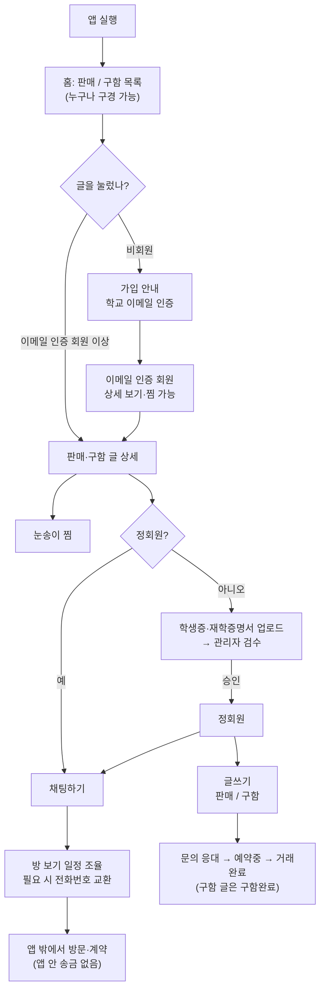
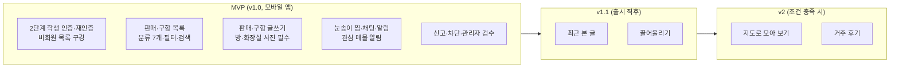
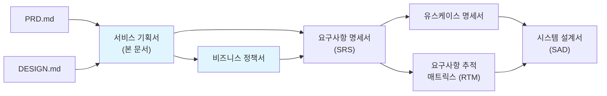

# 서비스 기획서 (Service Planning Document)

> 숙박숙박 Phase 0 기획 산출물이다. 근거는 PRD.md v0.1(저장소 PR #2), DESIGN.md(PR #1, 2026-11-25 색·찜 아이콘 변경 포함), 그리고 2026-11-24·11-26 사용자 결정이다. 확인되지 않은 수치와 결정은 "가정" 또는 "미결"로 표시하고 7.3에 모았다.

> 이 문서는 SRS(요구사항 명세서) 작성 이전에 "왜 이 서비스를 만드는가", "핵심 가치는 무엇인가", "MVP에 무엇을 포함/제외하는가"를 정의하는 선행 기획 문서이다.
> SRS가 "무엇을 만들 것인가(What)"에 집중한다면, 이 문서는 "왜 만드는가(Why)"와 "어디까지 만드는가(Scope)"에 집중한다.

| 항목 | 내용 |
|------|------|
| **프로젝트명** | 숙박숙박 (SookbakSookbak) |
| **문서 ID** | SPD-SOOKBAK-v0.2 |
| **문서 버전** | v0.2 |
| **작성일** | 2026-11-24 (최종 수정 2026-11-26) |
| **작성자** | 이유나 (기획) / Claude (초안 작성 지원) |
| **승인자** | 이유나 (기획 책임자) |
| **문서 상태** | 검토중 |

---

## 변경 이력

| 버전 | 날짜 | 작성자 | 변경 내용 |
|------|------|--------|-----------|
| v0.1 | 2026-11-24 | 이유나 / Claude | 초안 작성. PRD v0.1, DESIGN.md 기준. 인증 단계별 권한 확정 반영 |
| v0.1a | 2026-11-25 | 이유나 / Claude | 시각적 아이덴티티를 파랑·하늘 팔레트와 눈송이 찜 아이콘으로 변경 (DESIGN.md 변경과 맞춤) |
| v0.2 | 2026-11-26 | 이유나 / Claude | 사용자 최종 수정 요청 반영: 모바일 우선 앱, 판매/구함 글 유형, 판매 분류 7개(아파트 제외, 단기숙박 추가), 도보 시간 대신 숙대 기준 위치(도서관 후문·1캠 등)와 동네 이름 표시, 비회원 목록 구경 허용(클릭 불가), 채팅 전화번호 공유 허용·송금 금지, 필수 입력 항목과 방·화장실 사진 필수, 눈송이(교표 모티브) 찜 아이콘 |
| v0.2a | 2026-11-26 | 이유나 / Claude | 정회원 범위 확정(휴학생, 졸업 1년 이내 포함), 판매 글 사진 2~10장 |
| v0.2b | 2026-11-26 | 이유나 / Claude | 관심 매물 알림(키워드 알림)을 v1.1에서 MVP로 앞당김 |
| v1.0 | [미정] | 이유나 | G0 검토 후 최종 승인 |

---

## 목차

1. [서비스 개요](#1-서비스-개요)
2. [핵심 메커니즘](#2-핵심-메커니즘)
3. [콘텐츠/기능 전략](#3-콘텐츠기능-전략)
4. [수익화 전략](#4-수익화-전략)
5. [MVP 스코프 정의](#5-mvp-스코프-정의)
6. [KPI 가설 검증 프레임워크](#6-kpi-가설-검증-프레임워크)
7. [다음 단계](#7-다음-단계)
8. [관련 문서](#8-관련-문서)

---

## 1. 서비스 개요

### 1.1 서비스명 및 컨셉

| 항목 | 내용 |
|------|------|
| 서비스명 | 숙박숙박 (SookbakSookbak) |
| 한 줄 설명 | 숙명여대 학생(눈송이)이 방을 내놓는 "판매" 글과 방을 찾는 "구함" 글을 올리고, 찜하고, 채팅으로 집주인·세입자와 연결되는 학생 인증 기반 방 구하기 앱 |
| 서비스 유형 | 커뮤니티형 매물 정보 플랫폼. 계약·송금·중개는 하지 않음 |
| 대상 플랫폼 | 모바일 우선 앱 (iOS·Android). 구현 방식(크로스플랫폼 앱 / 웹앱)은 Phase 2에서 결정 (DEC-010) |

**서비스 컨셉 설명:**

숙대생은 학교 근처(청파동·효창동·남영동·용산동 일대) 방을 구하거나 내놓을 때 에브리타임 같은 학교 커뮤니티 게시판에 의존한다. 게시판에는 방을 내놓는 글과 방을 구하는 글이 섞여 올라오고, 글이 금방 묻히며, 가격·관리비·층·면적을 사람마다 다르게 적어 비교가 어렵다. 숙박숙박은 글을 **판매**(방 내놓기)와 **구함**(방 구하기) 두 메뉴로 나누고, 판매 글은 원룸·투룸·오피스텔·쉐어하우스·하숙·단기임대·단기숙박 7개 분류로 정리한다. 가격·주소·관리비 포함 항목·층·면적과 방·화장실 사진은 꼭 입력해야 하고, 나머지 이야기는 글쓰기란에 자유롭게 쓴다. 위치는 에타에서 쓰듯 "도서관 후문", "1캠 정문" 같은 숙대 기준 위치와 동네 이름으로 보여 준다. 숙대생이 아닌 사람도 목록은 구경할 수 있지만 글을 열어 볼 수는 없고, 상세 보기와 찜은 학교 이메일 인증, 글쓰기와 채팅은 학생증 인증까지 마친 숙대생만 할 수 있다. 앱은 방을 보고 상대와 연결되는 데까지만 돕는다. 채팅에서 전화번호를 주고받는 것까지는 괜찮지만, 계약과 돈은 앱 밖에서 당사자끼리 처리하며 앱 안 송금은 절대 없다.

**배경 및 동기:**

- 학교 근처 매물 정보와 방 구하는 글이 커뮤니티 게시판에 비정형 글로 흩어져 있다 (PRD 2장, 2026-11-26 사용자 의견).
- 에타 등에서는 위치를 "도서관 후문 쪽", "1캠 근처"처럼 학교 기준으로 말한다. 도보 몇 분보다 이런 표현이 학생에게 더 익숙하다 (2026-11-26 사용자 의견).
- 숙대 근처가 아닌 곳의 방도 가끔 올라오므로 동네 이름을 목록에서 바로 확인할 수 있어야 한다 (2026-11-26 사용자 의견).
- 직방·다방은 중개사 매물 위주라 학생끼리 주고받는 단기임대·단기숙박·하숙·쉐어하우스 매물을 담기 어렵다 (PRD 2장).
- 여성 학생끼리 집 문제로 처음 연락하는 상황이라, "인증된 같은 학교 학생"이라는 조건이 안전감의 핵심이다 (PRD 5장 원칙 2, 인터뷰 검증 전).

#### 사용자 문제와 근거

| 문제 ID | 사용자·상황·겪는 문제 | 현재 대안과 한계 | 관찰 근거 | 확인 상태·다음 검증 |
| --- | --- | --- | --- | --- |
| OBJ-001 | 방 찾는 눈송이가 학교 근처 매물을 가격·형태별로 비교하기 어렵다 | 게시판 검색. 형식 제각각, 분류·검색 불가, 글이 묻힘 | PRD 2장 문제 표 | 가정. 재학생 5명 이상 인터뷰, 게시판 글 30건 표본의 필수 정보(관리비·층·면적) 누락률 확인 |
| OBJ-002 | 방 내놓는 눈송이(졸업·휴학·교환학생)가 같은 학교 학생에게 빨리 알리고 싶지만 글이 묻힌다 | 게시판 재작성, 댓글·쪽지 | PRD 2장, 4장 | 가정. 양도 경험자 인터뷰 |
| OBJ-003 | 처음 보는 상대가 실제 숙대생인지 알 수 없어 불안하다 | 커뮤니티 가입 인증만 있음, 글 단위 신원 확인 없음 | PRD 3.1 목표 2 | 가정. 인터뷰에서 "학생증 인증 정회원만 채팅" 선호도 확인 |
| OBJ-004 | 단기(몇 주~몇 달) 거주 또는 하숙·쉐어하우스를 찾는 학생이 해당 매물만 모아볼 곳이 없다 | 게시판, 지인 소개 | PRD 4장 페르소나 | 가정. 단기·하숙 경험자 인터뷰 |
| OBJ-005 | 이미 나간 방인지 알 수 없어 댓글로 일일이 물어봐야 한다 | 댓글 문의 | PRD 2장 | 가정. 게시판 글의 "마감" 표기 비율 확인 |
| OBJ-006 | 원하는 조건의 방이 목록에 없을 때, 방을 구한다는 사실을 알릴 곳이 정리돼 있지 않다 | 게시판에 "방 구해요" 글, 판매 글과 섞여 묻힘 | 2026-11-26 사용자 의견 ("방 구하는 글도 올라옴") | 가정. 게시판의 구함 글 비율 확인 |
| OBJ-007 | 좋은 매물은 금방 나가서, 놓치지 않으려고 게시판을 수시로 들락날락해야 한다 | 에타 게시판 반복 확인 | 2026-11-26 사용자 의견 ("좋은 매물 있으면 빨리 보려고 에타를 들락날락함") | 가정. 인터뷰에서 하루 확인 횟수 확인 |

### 1.2 핵심 가치 제안 (Value Proposition)

| 항목 | 내용 |
|------|------|
| 핵심 가치 | 인증된 숙대생끼리, 학교 근처 방을 같은 형식으로 비교하고 채팅으로 바로 연결된다. 원하는 방이 없으면 구함 글로 먼저 알린다 |
| 차별점 | (1) 학교 이메일 + 학생증 2단계 인증과 학기별 재인증 (2) 판매·구함 메뉴 분리 (3) 단기임대·단기숙박·하숙·쉐어하우스를 원룸·투룸·오피스텔과 나란히 분류 (4) "도서관 후문", "1캠" 같은 숙대 기준 위치와 동네 이름 표시 (5) 중개사 광고 없음 |
| 대안 대비 우위 | 게시판 대비: 판매·구함 분리, 정형 필수 필드, 방·화장실 사진 필수, 거래 상태, 찜, 채팅. 직방·다방 대비: 학생 매물 중심, 목록이 먼저, 단기·하숙·쉐어 분류, 학교 기준 위치 |

**가치 제안 캔버스:**

| 구분 | 내용 |
|------|------|
| 사용자의 할 일 (Jobs) | 예산 안에서 학교와 가깝고 안전한 방 찾기 / 남은 계약 기간의 방을 믿을 만한 학생에게 넘기기 / 원하는 조건의 방을 구한다고 알리기 |
| 사용자의 고통 (Pains) | 글이 묻힘, 판매·구함 글이 섞임, 비교 불가, 사진 없는 글, 거래 상태 모름, 상대 신원 불확실 |
| 사용자의 이득 (Gains) | 한눈에 비교되는 목록, 익숙한 학교 기준 위치, 방·화장실 사진으로 미리 확인, 찜 목록, 같은 학교 학생이라는 안심 |
| 고통 해결제 (Pain Relievers) | 2단계 학생 인증, 가격·주소·관리비 포함 항목·층·면적 필수, 방·화장실 사진 필수, 거래 상태(거래가능·예약중·거래완료), 채팅, 신고·차단 |
| 이득 생성제 (Gain Creators) | 관심 조건에 맞는 새 매물 즉시 알림, 판매·구함 메뉴, 분류 탭·필터·정렬, 숙대 기준 위치·동네 표시, 눈송이 찜과 찜 매물 변경 알림, 구함 글에 맞는 방을 가진 학생의 채팅 제안 |

### 1.3 타겟 사용자 정의

#### 1.3.1 주요 사용자 페르소나

모든 회원 사용자는 숙명여대 재학생이며, 같은 사람이 상황에 따라 찾는 역할과 내놓는 역할을 오간다 (PRD 4장).

**페르소나 1: 방 찾는 눈송이**

| 항목 | 내용 |
|------|------|
| 이름 | 김눈송 (가상) |
| 연령/직업 | 20세 / 1학년, 지방 출신 |
| 기술 수준 | 중급 (에브리타임·당근마켓 앱 일상 사용) |
| 핵심 목표 | 개강 전 보증금 500·월세 50 안쪽, 도서관 후문 근처 원룸 구하기 |
| 핵심 불편 | 시세를 모르고, 관리비 포함 항목이 글마다 달라 실제 월 비용 비교가 안 됨. 사진 없는 글이 많음 |
| 사용 시나리오 | 판매 메뉴 `원룸` 탭 → "도서관 후문" 위치 필터 → 방·화장실 사진 확인 → 눈송이 찜 → 후보 3곳에 채팅 → 주말 방문 |
| 성공 기준 | 일주일 안에 인증된 학생 매물만으로 후보를 정했을 때 |

**페르소나 2: 방 내놓는 눈송이**

| 항목 | 내용 |
|------|------|
| 이름 | 이청파 (가상) |
| 연령/직업 | 23세 / 4학년, 교환학생 출국 예정 |
| 기술 수준 | 중급 |
| 핵심 목표 | 출국 기간 원룸을 단기임대로 넘겨 월세 부담 줄이기 (집주인 동의 받음) |
| 핵심 불편 | 게시판 글이 묻혀 여러 번 다시 올려야 함 |
| 사용 시나리오 | 판매 글쓰기 → 단기임대, 방·화장실 사진과 필수 항목 입력, 추가 정보는 글쓰기란에 → 채팅 문의 응대, 전화번호 교환 → `예약중` → `거래완료` |
| 성공 기준 | 등록 2주 안에 인증 학생에게서 문의가 오고 세입자를 구했을 때 |

**페르소나 3: 방 구하는 글을 올리는 눈송이**

| 항목 | 내용 |
|------|------|
| 이름 | 박효창 (가상) |
| 연령/직업 | 21세 / 2학년, 여름방학 인턴 |
| 기술 수준 | 초급~중급 |
| 핵심 목표 | 7~8월 두 달만 살 방 구하기 |
| 핵심 불편 | 원하는 기간에 맞는 매물이 목록에 없음 |
| 사용 시나리오 | 구함 메뉴에 "7~8월 단기, 1캠 근처, 월 60 이하" 글 작성 → 조건에 맞는 방을 가진 학생이 채팅으로 제안 |
| 성공 기준 | 구함 글을 올린 뒤 일주일 안에 제안 채팅을 받을 때 |

**페르소나 4: 하숙·쉐어하우스 거주 눈송이**

| 항목 | 내용 |
|------|------|
| 이름 | 최남영 (가상) |
| 연령/직업 | 22세 / 3학년, 쉐어하우스 거주 |
| 기술 수준 | 중급 |
| 핵심 목표 | 우리 쉐어하우스 빈방 1자리에 같은 학교 학생 들이기 |
| 핵심 불편 | 공용 공간·하우스 규칙을 정리해 알릴 곳이 없음 |
| 사용 시나리오 | 판매 글쓰기 → 쉐어하우스, 필수 항목 입력, 하우스 규칙은 글쓰기란에 |
| 성공 기준 | 규칙을 미리 읽고 온 학생에게서 문의를 받을 때 |

#### 1.3.2 사용자 세그먼트

| 세그먼트 | 설명 | 규모 추정 | 우선순위 | MVP 포함 |
|----------|------|-----------|----------|----------|
| 방 찾는 재학생 | 신입생·편입생·지방 출신, 기숙사 미배정 | 미측정 (재학생 수·기숙사 수용 인원으로 추정 예정) | P1 | Y |
| 방 내놓는 재학생 | 졸업·휴학·교환학생, 계약 승계·양도 | 미측정 | P1 | Y |
| 단기 거주 재학생 | 방학·계절학기·인턴 (단기임대·단기숙박) | 미측정 | P1 | Y |
| 하숙·쉐어 거주 재학생 | 자기 집 빈방 소개 | 미측정 | P2 | Y |
| 휴학생·졸업 1년 이내 졸업생 | 정회원 범위에 포함 (2026-11-26 확정). 졸업생은 졸업일 + 1년까지 | 미측정 | P2 | Y |
| 숙대생이 아닌 일반인 | 목록 구경만 가능, 글 열람·참여 불가 | 미측정 | - | 목록 구경만 |

#### 1.3.3 비사용자 (Anti-Persona)

| 비사용자 | 이유 | 대안 |
|----------|------|------|
| 숙명여대 학생이 아닌 일반인 | 판매·구함 목록은 구경할 수 있지만 글을 눌러 열 수 없다. 상세·찜·글쓰기·채팅은 숙대생 인증이 필요하다 (2026-11-26 사용자 결정) | 직방, 다방, 당근마켓 부동산 |
| 공인중개사·부동산 업체·임대사업자 | 영업 목적 게시 금지, 확인 시 영구 정지 (PRD 3.2, 12장) | 직방, 다방 중개사 서비스 |
| 학생이 아닌 집주인·하숙집 운영자 | 글은 인증된 학생 개인만 올린다 (PRD 3.2) | 하숙에 사는 학생이 빈방을 대신 소개 |
| 앱 안에서 계약·송금까지 끝내려는 사용자 | 앱은 방을 보고 상대와 연결되는 데까지만 돕는다. 채팅에서 전화번호를 주고받는 것까지는 허용하지만, 계약은 앱 밖에서 하고 앱 안 송금 기능은 절대 두지 않는다 (2026-11-26 사용자 결정) | 공인중개사 계약, 당사자 직거래 |

---

## 2. 핵심 메커니즘

### 2.1 서비스 작동 원리

**핵심 루프 (Core Loop):**

1. 사용자가 홈에서 판매 또는 구함 목록을 훑고 분류 탭·숙대 기준 위치·가격 필터로 좁힌다. 숙대생이 아닌 사람도 여기까지는 구경할 수 있다.
2. 시스템은 판매 글마다 가격, 분류, 층·면적·관리비, 숙대 기준 위치("도서관 후문 근처")와 동네 이름, 거래 상태를 같은 형식으로 보여준다.
3. 이메일 인증 회원은 글을 열어 방·화장실 사진과 정보를 확인하고 눈송이 아이콘으로 찜한다. 문의하려면 학생증 인증(정회원)을 마치고 `채팅하기`로 작성자와 1:1 채팅을 연다.
4. 두 사람은 채팅에서 방 보기 일정을 잡고 필요하면 전화번호를 교환한다. 작성자는 `예약중` → `거래완료`로 상태를 바꾼다. 찜한 사람은 가격 인하·상태 변경 알림을 받고 다시 목록으로 돌아온다.

**구함 루프:** 정회원이 구함 글(원하는 분류·위치·예산·기간)을 올림 → 조건에 맞는 방을 가진 정회원이 구함 글에서 `채팅하기`로 제안 → 연결되면 작성자가 구함 글을 `구함완료`로 바꿈.

**공급 루프:** 정회원이 판매 글을 올림 → 목록 최상단 노출 → 찜·채팅 알림 → 거래완료 → 다음 학기에 다시 올림.

### 2.2 전체 서비스 플로우

### 2.3 핵심 사용자 여정 (Key User Journey)

#### 여정 1: 구경하다가 가입하고 방 찾기

| 단계 | 사용자 행동 | 시스템 반응 | 감정 목표 | 핵심 지표 |
|------|------------|------------|-----------|-----------|
| 1. 진입 | 앱 설치·실행 | 로그인 없이 판매·구함 목록 표시 | 호기심 | 설치 → 목록 스크롤 비율 |
| 2. 가입 | 글을 누름 → 학교 메일 입력, 6자리 번호 입력 | "숙대생만 글을 볼 수 있어요" 안내 후 인증, 완료 시 누른 글로 이동 | 간편함 | 이메일 인증 완료율 |
| 3. 탐색 | 분류 탭·위치 필터로 좁히고 상세 확인 | 같은 형식의 카드, 방·화장실 사진, 월 예상 비용 | 이해 | 첫 세션 상세 조회 수 |
| 4. 찜 | 후보에 눈송이 찜 | 찜 목록 저장 | 기대 | 첫 찜까지 시간 |
| 5. 학생증 인증 | `채팅하기` → 인증 안내 → 학생증 업로드 | 검수 대기, 영업일 24시간 내 결과 알림 | 안심 | 학생증 인증 완료율, 검수 소요 시간 |
| 6. 문의 | 채팅 시작, 필요하면 전화번호 교환 | 작성자에게 푸시 알림 | 신뢰 | 첫 문의율 |

#### 여정 2: 방 내놓기 (판매 글)

| 단계 | 사용자 행동 | 시스템 반응 | 감정 목표 | 핵심 지표 |
|------|------------|------------|-----------|-----------|
| 1 | 글쓰기 → `판매` 선택, 분류 선택 | 필수 항목 폼, 방·화장실 사진 칸, 임시 저장 | 간편함 | 작성 시작 → 완료율 |
| 2 | 사진(방·화장실 필수)·가격·주소·관리비 포함 항목·층·면적 입력, 글쓰기란에 추가 정보 | 필수 항목 검증, 주소로 동네 이름 자동 입력, 숙대 기준 위치 선택 | 성취감 | 작성 소요 시간 |
| 3 | 게시 | 목록 최상단 노출 | 기대 | 첫 문의까지 시간 |
| 4 | 채팅 응대, `예약중` 변경 | 찜한 사람에게 상태 변경 알림 | 신뢰 | 응답률 |
| 5 | `거래완료` 처리 | 30일 후 목록에서 자동 숨김 | 마무리 | 거래완료 비율 |

#### 여정 3: 방 구하는 글 올리기 (구함 글)

| 단계 | 사용자 행동 | 시스템 반응 | 감정 목표 | 핵심 지표 |
|------|------------|------------|-----------|-----------|
| 1 | 글쓰기 → `구함` 선택 | 구함 폼: 원하는 분류(복수), 희망 위치, 예산, 입주 희망일·기간, 글쓰기란 | 간편함 | 구함 글 작성 완료율 |
| 2 | 게시 | 구함 목록 최상단 노출 | 기대 | - |
| 3 | 제안 채팅 받음 | 푸시 알림, 채팅방 상단에 구함 글 요약 고정 | 기대 | 제안 채팅을 받은 구함 글 비율 |
| 4 | 방을 구함 → `구함완료` | 구함 목록에서 아래로 내려감 | 마무리 | 구함완료 비율 |

---

## 3. 콘텐츠/기능 전략

### 3.1 핵심 기능 방향

| 기능 영역 | 전략 방향 | 우선순위 | MVP 포함 | 비고 |
|-----------|-----------|----------|----------|------|
| 학생 인증·권한 | 2단계(학교 이메일 → 학생증·재학증명서), 학기별 재인증. 비회원은 목록 구경만 | P1 | Y | 확정 (BP-AUTH) |
| 판매 / 구함 메뉴 | 홈 상단에서 판매·구함 목록 전환, 글쓰기에서 둘 중 선택 | P1 | Y | 2026-11-26 확정 |
| 판매 분류 | 원룸 · 투룸 · 오피스텔 · 쉐어하우스 · 하숙 · 단기임대 · 단기숙박 (7개, 아파트 제외) | P1 | Y | 2026-11-26 확정 |
| 판매 글쓰기 | 필수: 사진 2~10장(방·화장실 각 1장 이상), 분류, 가격, 주소, 관리비·관리비 포함 항목, 층, 면적, 제목. 나머지는 글쓰기란에 자유 서술 | P1 | Y | 2026-11-26 확정 |
| 위치 표기 | 도보 시간 대신 숙대 기준 위치(예: 도서관 후문, 1캠 정문)와 동네 이름. 숙대 근처가 아닌 매물도 동네 이름으로 구분 | P1 | Y | 2026-11-26 확정, 기준 위치 목록 DEC-012 |
| 구함 글쓰기 | 원하는 분류, 희망 위치, 예산, 입주 희망일·기간, 글쓰기란. 사진 선택 | P1 | Y | 2026-11-26 확정 |
| 거래 상태 | 판매: 거래가능 → 예약중 → 거래완료 / 구함: 구하는 중 → 구함완료 | P1 | Y | 구함 상태는 초안 |
| 찜 | 눈송이(교표 모티브) 아이콘, 찜 목록, 가격 인하·상태 변경 알림 | P1 | Y | 교표 사용 승인 DEC-011 |
| 채팅 | 글별 1:1, 텍스트·사진, 읽음 표시, 푸시. 전화번호 교환 허용, 송금 유도 경고 | P1 | Y | BP-CHAT 갱신 필요 |
| 검색·필터 | 키워드, 분류, 가격 범위, 숙대 기준 위치·동네, 입주일, 기간, 조건 | P1 | Y | |
| 신고·차단·검수 | 신고 3건 자동 숨김, 경고 → 7일 → 영구 정지 | P1 | Y | BP-MOD |
| 관심 매물 알림 | 관심 조건(판매/구함, 분류, 숙대 기준 위치·동네, 가격 상한, 입주 가능일, 키워드)을 최대 5개 저장하면, 조건에 맞는 새 글이 올라오는 즉시 앱 푸시로 알림. 에타를 자주 들락날락하는 이유(좋은 매물을 빨리 보려고)를 앱이 대신 해결 | P1 | Y | 2026-11-26 사용자 결정, BP-NOTI-003 |
| 끌어올리기, 최근 본 글 | MVP 직후 | P2 | N | EX-002 |
| 지도로 모아 보기 | 목록 결과를 지도에 표시. 메인은 계속 목록 | P3 | N | EX-003 |

> 우선순위 대응: PRD P0 = 본 문서 P1(MVP 필수), PRD P1 = P2(MVP 직후), PRD P2 = P3(이후 검토).

**판매 분류 정의:**

| 분류 | 설명 | 분류별 추가 입력 (필수 여부는 SRS에서 확정) |
|---|---|---|
| 원룸 | 방 하나 구조 (오픈형·분리형·복층) | 구조 |
| 투룸 | 방 두 개 이상 | 방 수 |
| 오피스텔 | 오피스텔 건물의 호실 | - |
| 쉐어하우스 | 여러 명이 집을 나눠 쓰고 공용 공간 공유 | 모집 인원, 현재 거주 인원, 1인실·다인실 |
| 하숙 | 집주인 가정에 살거나 식사 제공 | 식사 제공 여부, 1인실·2인실 |
| 단기임대 | 1개월 이상 6개월 이하 기간을 정한 임대. 방학·교환학생 기간 양도 포함 | 임대 가능 기간 (필수) |
| 단기숙박 | 1개월 미만(며칠~몇 주) 머무는 방 | 숙박 가능 기간 (필수), 1박·1주 단위 가격 | 

> 단기임대·단기숙박의 기간 경계(1개월)는 초안이다 (DEC-013). 아파트는 판매 분류에서 제외한다 (2026-11-26 사용자 결정). 투룸에는 쓰리룸 이상도 포함한다 (초안).

**기능 방향 의사결정 기록:**

| 항목 | A안 | B안 | 선택 | 근거 |
|------|-----|-----|------|------|
| 첫 화면 구조 | 지도 + 리스트 분할 (DESIGN.md 초기안) | 전체 폭 목록 피드 + 하단 탭 (당근마켓식) | B | 사용자 요청, PRD 5장 원칙 1 |
| 글 유형 | 매물(판매)만 | 판매 + 구함 | B | 2026-11-26 사용자 결정. 게시판에도 구함 글이 많이 올라옴 (OBJ-006) |
| 위치 표기 | 숙대 정문까지 도보 N분 | 숙대 기준 위치(도서관 후문·1캠 등) + 동네 이름 | B | 2026-11-26 사용자 결정. 에타에서 쓰는 표현이 익숙하고, 학교에서 먼 매물도 동네로 구분 가능 |
| 비회원 범위 | 앱 소개 화면만 | 목록 구경 가능, 글 클릭 불가 | B | 2026-11-26 사용자 결정. 둘러보고 가입하도록 유도 |
| 거래 범위 | 앱 내 계약·결제 | 연결까지만. 채팅 전화번호 교환 허용, 송금 기능 없음 | B | PRD 3.2, 12장, 2026-11-26 사용자 결정 ("송금은 절대 안 됨") |
| 인증 강도 | 학교 이메일만 | 이메일 + 학생증·재학증명서 관리자 검수 | B | PRD 7.1 |
| 열람 권한 | 정회원만 상세 열람 | 이메일 인증 회원도 상세·찜 가능 | B | 2026-11-24 사용자 결정 |
| 플랫폼 | 모바일 우선 반응형 웹 | 모바일 우선 앱 | B | 2026-11-26 사용자 결정. 구현 방식은 DEC-010 |

**인증 단계별 권한 (확정):**

| 상태 | 판매·구함 목록 보기 | 글 상세 보기 | 찜 | 글쓰기 (판매·구함) | 채팅 |
|---|---|---|---|---|---|
| 비회원 (숙대생 아닌 일반인 포함) | ○ (구경만, 카드 클릭 불가) | ✕ | ✕ | ✕ | ✕ |
| 이메일 인증 회원 | ○ | ○ | ○ | ✕ | ✕ |
| 정회원 (학생증 인증 완료) | ○ | ○ | ○ | ○ | ○ |

### 3.3 콘텐츠 전략

| 항목 | 내용 |
|------|------|
| 콘텐츠 유형 | 판매 글(정형 필드 + 방·화장실 포함 사진 + 글쓰기란), 구함 글(희망 조건 + 글쓰기란, 사진 선택), 채팅 메시지(텍스트·사진) |
| 콘텐츠 생산 방식 | 사용자 생성(UGC). 정회원만 작성 |
| 콘텐츠 큐레이션 | 정렬(최신순 기본, 낮은 가격순, 찜 많은순) + 판매/구함 전환 + 분류 탭 + 필터. 추천 알고리즘 없음 |
| 콘텐츠 갱신 주기 | 실시간 (작성 즉시 최상단) |
| 품질 관리 | 필수 필드·필수 사진 검증, 신고 3건 자동 숨김 + 관리자 검토, 거래완료 30일 후 자동 숨김, 재인증 실패 시 비공개 |

### 3.4 브랜드/톤앤매너

| 항목 | 내용 |
|------|------|
| 브랜드 톤 | 친근하지만 정보는 정확하게. 같은 학교 선배가 알려주는 느낌 |
| 커뮤니케이션 스타일 | 해요체, 이모지 최소. 위치는 에타식 표현("도서관 후문 쪽", "1캠 근처") |
| 시각적 아이덴티티 | DESIGN.md 기준. 파랑·하늘 계열만 사용(메인 Sookmyung Royal Light Blue `#0072CE`, 배경 강조는 하늘색 틴트 `#E8F4FD`, 주황·노랑 없음). Pretendard 400·700, 가격만 18px/700 |
| 찜 아이콘 | 하트 대신 숙명여대 교표의 눈송이를 모티브로 한 눈송이 아이콘. 학교 공식 교표를 그대로 쓰려면 학교 승인이 필요하므로, 승인 전에는 교표를 따라 그리지 않은 앱 전용 눈송이 아이콘을 쓰고 승인되면 교표로 바꾼다 (DEC-011) |
| 캐릭터/마스코트 | 없음. 숙명여대 로고·심볼은 학교 승인 전까지 사용하지 않음 |

---

## 4. 수익화 전략

### 4.1 수익 모델 선택

| 항목 | 내용 |
|------|------|
| 주요 수익 모델 | 없음 (완전 무료) |
| 보조 수익 모델 | 없음 |
| 무료/유료 경계 | 모든 기능 무료. 권한 차이는 결제가 아니라 인증 단계로만 나뉨 |
| 가격 전략 | 해당 없음 |

**선택 근거:** PRD 12장에 따라 중개업으로 보이지 않도록 수수료, 계약 대행, 매물 광고비를 받지 않는다. MVP 목표는 인증 학생 사이의 판매·구함·문의 루프 검증이다. MVP 이후 수익화 여부(예: 지역 상점 배너)는 DEC-007로 남긴다.

### 4.2 단계별 수익화 계획

| 단계 | 시점 / 조건 | 수익화 방식 | 목표 |
|------|------------|------------|------|
| Phase 0: PMF 검증 | 출시 ~ 3개월 | 없음 | 인증 가입자 1,000명, 누적 판매 글 300건 (PRD 3.3) |
| Phase 1 이후 | 미결 (DEC-007) | 미결. 거래 수수료·매물 광고비는 받지 않음 | 미결 |

### 4.3 과금 정책 요약

| 항목 | 정책 방향 |
|------|-----------|
| 무료 체험 | 해당 없음 |
| 환불 정책 | 해당 없음 |
| 구독 갱신 | 해당 없음 |
| 결제 수단 | 없음. 앱 안에서 보증금·월세·숙박비 등 어떤 돈도 주고받지 않는다. 송금 기능은 어떤 버전에서도 두지 않는다 |

---

## 5. MVP 스코프 정의

### 5.1 MVP 정의 기준

| 항목 | 내용 |
|------|------|
| MVP 목표 | "엄격한 학생 인증을 거친 숙대생끼리라면, 판매·구함 목록과 찜·채팅만으로 학교 근처 방이 오가고 연결이 성사된다"를 검증한다 |
| MVP 기간 | 미결 (DEC-006) |
| MVP 성공 기준 | 출시 후 3개월: 인증 가입자 1,000명, 누적 판매 글 300건, 문의 발생 판매 글 60% 이상, 거래완료 판매 글 30% 이상, 신고 숨김 3% 이하 (PRD 3.3, 가설값) |
| MVP 실패 시 대응 | 공급 부족이면 글쓰기 폼 점검·게시판 이용자 대상 홍보, 문의 부족이면 카드 정보·사진 품질 점검, 인증 이탈이 크면 검수 시간·안내 개선 |

### 5.2 포함 항목 (In-Scope)

| ID | 기능/항목 | 설명 | 우선순위 | 예상 공수 | 비고 |
|----|-----------|------|----------|-----------|------|
| MVP-001 | 학교 이메일 인증 가입 | `@sookmyung.ac.kr` 6자리 번호(10분 유효), 이메일 1개당 계정 1개 | P1 | 미정 | OBJ-003, BP-AUTH-001 |
| MVP-002 | 학생증·재학증명서 인증 | 이미지 업로드 → 관리자 검수(영업일 24시간), 승인 시 원본 즉시 삭제 | P1 | 미정 | OBJ-003, BP-AUTH-002 |
| MVP-003 | 인증 단계별 권한·학기별 재인증 | 비회원: 목록 구경만(클릭 불가) / 이메일 회원: 상세·찜 / 정회원: 글쓰기·채팅. 3월·9월 재인증 | P1 | 미정 | BP-AUTH-003, BP-AUTH-004 |
| MVP-004 | 홈 목록 (판매·구함) | 판매/구함 전환, 판매 분류 탭(전체 + 7개), 필터 칩, 정렬, 무한 스크롤, 하단 탭 바. 카드에 동네 이름과 숙대 기준 위치 표시 | P1 | 미정 | OBJ-001, OBJ-004, OBJ-006 |
| MVP-005 | 판매 글쓰기·수정·삭제 | 필수: 사진 2~10장, 그중 방 사진 1장 이상 + 화장실 사진 1장 이상, 분류, 가격(거래 방식·보증금·월세/전세금), 주소, 관리비와 관리비 포함 항목, 층, 면적, 제목. 선택: 입주 가능일, 옵션, 분류별 추가 입력. 글쓰기란에 추가 정보 자유 서술. 임시 저장 | P1 | 미정 | OBJ-002, BP-LISTING, BP-PRICE |
| MVP-006 | 구함 글쓰기·수정·삭제 | 원하는 분류(복수), 희망 위치(숙대 기준 위치·동네), 예산, 입주 희망일·기간, 제목, 글쓰기란. 사진 선택 | P1 | 미정 | OBJ-006 |
| MVP-007 | 숙대 기준 위치·동네 이름 | 주소에서 동네 이름 자동 입력, 작성자가 가까운 숙대 기준 위치(도서관 후문·1캠 정문 등) 선택 또는 "숙대 근처 아님" | P1 | 미정 | 기준 위치 목록 DEC-012 |
| MVP-008 | 거래 상태 관리 | 판매: 거래가능 / 예약중 / 거래완료 (거래완료 30일 후 자동 숨김). 구함: 구하는 중 / 구함완료 | P1 | 미정 | OBJ-005, BP-LISTING-003 |
| MVP-009 | 글 상세 | 사진(방·화장실 포함), 작성자 배지, 가격 블록·월 예상 비용, 정보 표, 동네·숙대 기준 위치, 대략 위치 지도, 글쓰기란 본문, 안내 문구 | P1 | 미정 | OBJ-001 |
| MVP-010 | 눈송이 찜 | 눈송이 아이콘으로 찜·해제, 찜 탭, 가격 인하·상태 변경 알림 | P1 | 미정 | BP-NOTI, DEC-011 |
| MVP-011 | 글별 1:1 채팅 | 판매·구함 글 모두에서 시작. 텍스트·사진, 읽음 표시, 글 요약 고정. 전화번호 교환 허용, 계좌번호·송금 요청 감지 시 경고 | P1 | 미정 | OBJ-002, BP-CHAT |
| MVP-012 | 검색·필터 | 키워드(제목·본문·동네·역), 분류, 가격 범위, 숙대 기준 위치·동네, 입주일, 기간, 조건 | P1 | 미정 | OBJ-001, OBJ-004 |
| MVP-013 | 신고·차단·관리자 검수 | 신고 사유(송금 요구 포함), 3건 자동 숨김, 인증·신고 대기열, 경고·정지 | P1 | 미정 | BP-MOD |
| MVP-014 | 마이 | 프로필·인증 상태·다음 재인증일, 내 판매·구함 글, 알림 설정, 차단 목록, 약관, 탈퇴 | P1 | 미정 | |
| MVP-015 | 알림 | 채팅, 찜한 글 변경, 인증 결과, 재인증 안내 (앱 푸시 + 인앱) | P1 | 미정 | BP-NOTI |
| MVP-016 | 관심 매물 알림 | 관심 조건(판매/구함, 분류, 숙대 기준 위치·동네, 가격 상한, 입주 가능일, 키워드)을 최대 5개 저장하면, 조건에 맞는 새 글이 올라오는 즉시 앱 푸시로 알림. 알림을 누르면 해당 글로 바로 이동. 이메일 인증 회원부터 사용 | P1 | 미정 | OBJ-007, BP-NOTI-003 |

P1/P2/P3는 중요도를 뜻한다. G0 검토에서 이번 릴리스에 포함하기로 합의한 행을 5.2에 남기고, 보류한 항목은 사유와 재검토 조건을 5.3에 기록한다. SRS에서 MVP-ID를 참조한다.

### 5.3 제외 항목 (Out-of-Scope) + 제외 근거

| ID | 제외 항목 | 제외 근거 | 대안 (MVP에서는 대신 무엇을 하는가) | v2 진입 조건 |
|----|-----------|-----------|--------------------------------------|-------------|
| EX-001 | 계약서 작성·보증금/월세 결제·송금·에스크로·전자계약 | PRD 3.2 Non-goal, 2026-11-26 사용자 결정("송금은 절대 안 됨"). 거래 당사자·중개자가 되지 않음 | 채팅으로 연결, 필요하면 전화번호 교환. 상세·채팅에 "계약·송금 전 직접 방문, 등기부등본 확인" 안내 | 도입하지 않음 |
| EX-002 | 끌어올리기, 최근 본 글 | PRD P1. 핵심 루프 검증에 필수는 아님 | 정렬·필터, 찜, 구함 글 | MVP 출시 직후 (v1.1) |
| EX-003 | 지도로 모아 보기 | PRD P2. 목록이 먼저라는 원칙, 초기 매물 수 적음 | 상세의 대략 위치 지도 + 숙대 기준 위치·동네 필터 | 활성 판매 글 100건 이상 (가정) |
| EX-004 | 아파트 분류 | 2026-11-26 사용자 결정. 학생 매물로 드묾 | 해당 없음 (등록 분류에 없음) | 사용자 요청이 반복될 때 재검토 |
| EX-005 | 숙대까지 도보 N분 자동 계산·표시 | 2026-11-26 사용자 결정. 학생에게는 학교 기준 위치 표현이 더 익숙 | 숙대 기준 위치 + 동네 이름 | 사용자 요청이 반복될 때 재검토 |
| EX-006 | 거주 후기 | PRD P2. 허위·명예훼손 분쟁 관리 부담 | 채팅으로 직접 질문 | 거래완료 누적 100건 이상 (가정) |
| EX-007 | 커뮤니티(자유게시판) 탭 | PRD 3.2 Non-goal | 판매·구함 글, 학교 커뮤니티 이용 | 계획 없음 |
| EX-008 | 공인중개사·업체·비학생 임대인 계정 | PRD 3.2, 12장 | 학생 개인만 작성 | 계획 없음 |
| EX-009 | 학교 학적 API·외부 인증 서비스 자동 연동 | 연동 가능 여부 미확인 (PRD 14장 Q1) | 운영자 수동 검수 | 연동 가능 확인 시 |
| EX-010 | 등기부등본·실거래가 등 외부 부동산 데이터 연동 | 외부 API·비용, 가설 검증과 무관 | 상세 안내 문구 | 사용자 요청 반복 시 |
| EX-011 | 데스크톱 전용 화면 최적화 | 모바일 우선 앱 (2026-11-26 결정) | 모바일 화면 기준으로 설계 | 데스크톱 이용 요청이 반복될 때 |

### 5.4 MVP 기능 범위 다이어그램

### 5.5 기술적 MVP 결정사항

| 결정 항목 | MVP 선택 | 근거 | v2에서 전환 가능 |
|-----------|----------|------|------------------|
| 플랫폼 | 모바일 우선 앱 (iOS·Android) | 2026-11-26 사용자 결정 | - |
| 앱 구현 방식 | 미결: 크로스플랫폼 앱(React Native·Expo 등) / Next.js 웹앱(PWA) / 웹 + 앱 래핑 | 저장소 AGENTS.md는 Next.js 기준. 앱 스토어 배포·푸시 방식에 따라 Phase 2(SAD)에서 결정 (DEC-010) | Y |
| 디자인 | DESIGN.md 토큰 (목록형 레이아웃, 파랑·하늘 팔레트, 눈송이 찜) | PR #1 | Y |
| 채팅 | 실시간 연결(WebSocket 등), 재접속 시 동기화, 앱 푸시 | PRD 11장. 구체 기술은 Phase 2 | Y |
| 백엔드·DB·스토리지 | 미결 | Phase 2(SAD)에서 확정 | Y |
| 주소 검색·동네 이름·지도 | 미결 (국내 주소·지도 API) | 주소 → 동네 이름 자동 입력에 필요. Phase 2에서 확정 | Y |

---

## 6. KPI 가설 검증 프레임워크

### 6.1 검증할 가설 목록

| ID | 가설 | 검증 방법 | 성공 기준 | 실패 시 대응 | 우선순위 |
|----|------|-----------|-----------|-------------|----------|
| H-001 | 비회원에게 목록을 보여주고 상세는 이메일 인증으로 열면, 학생증 인증이라는 높은 장벽이 있어도 숙대생이 충분히 가입한다 | 인증 퍼널 (목록 구경 → 이메일 → 학생증) | 3개월 이메일 인증 1,000명, 이메일 → 학생증 전환 40% 이상 (전환율은 가정) | 학생증 인증 안내·검수 시간 개선 | P1 |
| H-002 | 방·화장실 사진과 필수 항목이 있어도 방 내놓는 학생은 게시판 대신 숙박숙박에 올린다 | 판매 글 작성 시작 → 완료율, 누적 판매 글 수 | 3개월 누적 300건, 작성 완료율 70% 이상 (완료율은 가정) | 필수 항목 재검토, 임시 저장 안내 강화 | P1 |
| H-003 | 인증된 학생 판매 글에는 문의가 생긴다 | 채팅 1건 이상 판매 글 비율, 글당 찜 | 문의 발생 판매 글 60% 이상, 글당 찜 5회 이상 | 카드 정보·사진 품질, 정렬 기본값 점검 | P1 |
| H-004 | 앱 안 연결(채팅·전화번호 교환)만으로 실제 거래가 성사된다 | 거래완료 판매 글 비율 | 30% 이상 | 거래완료 처리 유도 알림, 미처리 글 원인 인터뷰 | P1 |
| H-005 | 구함 글을 올리면 조건에 맞는 방을 가진 학생이 먼저 연락한다 | 제안 채팅을 1건 이상 받은 구함 글 비율 | 40% 이상 (가정) | 구함 글 노출 위치·형식 점검 | P2 |
| H-007 | 관심 조건 알림이 있으면 사용자가 목록을 계속 확인하지 않아도 새 매물에 빨리 반응한다 | 관심 조건 저장 비율, 알림 → 상세 열람 비율, 새 글 게시 후 첫 찜·채팅까지 시간 | 이메일 인증 회원의 30% 이상이 조건 저장, 알림 열람률 40% 이상 (가정) | 조건 입력 단순화, 알림 문구·빈도 조정 | P1 |
| H-006 | 엄격한 인증으로 허위·광고·송금 유도 글이 적다 | 신고 숨김 글 비율 | 3% 이하 | 작성 확인 절차·제재 강화 | P2 |

### 6.2 핵심 지표 (Key Metrics)

| 구분 | 지표명 | 정의 | 목표값 | 측정 방법 | 측정 주기 |
|------|--------|------|--------|-----------|-----------|
| **North Star** | 문의 발생 판매 글 비율 | 공개된 판매 글 중 채팅방이 1개 이상 생긴 글 비율 | 60% 이상 | 채팅방 생성 / 공개 판매 글 | 주간 |
| 획득 (Acquisition) | 이메일 인증 가입자 | 이메일 인증을 마친 누적 사용자 | 3개월 1,000명 | 인증 이벤트 | 주간 |
| 활성화 (Activation) | 정회원 전환율 | 이메일 인증 회원 중 학생증 인증 완료 비율 | 40% (가정) | 인증 이벤트 | 주간 |
| 유지 (Retention) | D7 Retention | 이메일 인증 7일차 재방문 비율 | 미결 (출시 후 기준값 측정) | 앱 실행 로그 | 주간 |
| 공급 | 누적 판매 글 | 작성 완료된 판매 글 수 | 3개월 300건 | 글 DB | 주간 |
| 수요 | 구함 글 제안 비율 | 제안 채팅을 받은 구함 글 비율 | 40% (가정) | 채팅·글 DB | 주간 |
| 성과 | 거래완료 비율 | 판매 글 중 거래완료 표시 비율 | 30% 이상 | 글 상태 | 월간 |
| 안전 | 신고 숨김 비율 | 전체 글 중 신고로 숨김 처리된 비율 | 3% 이하 | 신고 처리 기록 | 월간 |
| 수익 (Revenue) | 해당 없음 | 무료 서비스 | - | - | - |

| KPI ID·가설 ID | 산식·분모 | 기준값·목표값 | 측정 대상·기간·최소 표본 | 데이터 출처·담당자·판정일 |
| --- | --- | --- | --- | --- |
| KPI-001 / H-001 | 학생증 인증 완료 수 / 이메일 인증 완료 수 | 미측정 / 40% | 출시 후 3개월, 이메일 인증 100명 이상 | 인증 테이블 / 이유나 / 출시 +3개월 |
| KPI-002 / H-002 | 판매 글 작성 완료 수 / 작성 시작 수 | 미측정 / 70% | 출시 후 3개월, 작성 시작 50건 이상 | 글·임시 저장 테이블 / 이유나 / 출시 +3개월 |
| KPI-003 / H-003 | 채팅방 1개 이상 판매 글 / 공개 판매 글 | 미측정 / 60% | 출시 후 3개월, 공개 판매 글 50건 이상 | 채팅·글 테이블 / 이유나 / 출시 +3개월 |
| KPI-004 / H-004 | 거래완료 판매 글 / 판매 글 | 미측정 / 30% | 출시 후 3개월, 판매 글 50건 이상 | 글 상태 이력 / 이유나 / 출시 +3개월 |
| KPI-005 / H-005 | 제안 채팅 1건 이상 구함 글 / 구함 글 | 미측정 / 40% | 출시 후 3개월, 구함 글 30건 이상 | 채팅·글 테이블 / 이유나 / 출시 +3개월 |
| KPI-007 / H-007 | 알림을 눌러 상세를 연 수 / 보낸 관심 매물 알림 수 | 미측정 / 40% | 출시 후 3개월, 알림 200건 이상 | 알림 로그 / 이유나 / 출시 +3개월 |
| KPI-006 / H-006 | 신고 숨김 글 / 전체 글 | 미측정 / 3% 이하 | 출시 후 3개월 | 신고 처리 기록 / 이유나 / 출시 +3개월 |

### 6.3 가설 검증 매트릭스

| 가설 ID | 결과 시나리오 | 판단 | 다음 액션 |
|---------|--------------|------|-----------|
| H-001 | 정회원 전환 40% 이상 | 가설 검증 완료 | 인증 방식 유지 |
| H-001 | 20~40% | 추가 관찰 필요 | 학생증 단계 이탈 원인(검수 지연·반려 사유) 확인, 1개월 재관찰 |
| H-001 | 20% 미만 | 가설 기각 | 인증 방식 재검토 (예: 재학증명서만, 외부 인증 연동) |
| H-001 | 이메일 인증 100명 미만 | 판단 보류 | 홍보 후 재판정 |
| H-002 | 누적 300건 이상 | 가설 검증 완료 | 문의·거래 지표에 집중 |
| H-002 | 300건 미만 | 가설 기각 | 필수 항목·사진 조건 재검토, 학기 초 작성 캠페인 |
| H-003 | 60% 이상 | 가설 검증 완료 | v1.1 기능 진행 |
| H-003 | 60% 미만 | 가설 기각 | 글 정보 품질·노출 방식 점검 |
| H-004 | 30% 이상 | 가설 검증 완료 | v2 검토 |
| H-004 | 30% 미만 | 원인 확인 | 거래완료 미처리인지 실제 미성사인지 작성자 설문 |
| H-005 | 40% 이상 | 가설 검증 완료 | 구함 글 유지 |
| H-005 | 40% 미만 | 원인 확인 | 판매 글 작성자에게 구함 글 노출 방식 점검 |

### 6.4 데이터 수집 계획

| 데이터 항목 | 수집 이벤트 | 수집 도구 | 용도 | MVP 필수 |
|------------|------------|-----------|------|----------|
| 비회원 구경 | 앱 실행, 목록 스크롤, 카드 탭(가입 안내 노출) | 미결 (앱 분석 도구) | H-001 | Y |
| 가입·인증 | 이메일 인증 요청·완료, 학생증 제출·승인·반려 | 자체 DB | H-001 | Y |
| 글 작성 | 판매·구함 작성 시작(임시 저장), 작성 완료, 상태 변경 | 자체 DB | H-002, H-004, H-005 | Y |
| 조회·찜 | 상세 조회, 찜 추가·해제 | 자체 DB | H-003 | Y |
| 채팅 | 채팅방 생성(판매·구함 구분), 첫 메시지 | 자체 DB | H-003, H-005, North Star | Y |
| 신고 | 신고 접수, 숨김, 처리 결과 | 자체 DB | H-006 | Y |
| 관심 매물 알림 | 조건 저장·수정·삭제, 알림 발송, 알림 열람 | 자체 DB | H-007 | Y |
| 필터·검색 사용 | 필터 적용(숙대 기준 위치 포함), 검색어 | 미결 | UX 개선, DEC-012 기준 위치 목록 검증 | N (v1.1) |

---

## 7. 다음 단계

### 7.1 기획 완료 체크리스트

- [x] 서비스 컨셉이 한 문장으로 명확히 정의되었는가
- [x] 타겟 사용자가 구체적으로 정의되었는가 (비사용자 포함)
- [x] 핵심 가치 제안이 경쟁 대비 차별화되었는가
- [x] 핵심 메커니즘(Core Loop)이 명확한가
- [x] 수익 모델이 선택되고 근거가 있는가 (MVP 무료, 이후는 DEC-007)
- [x] MVP 포함/제외 항목이 모두 정의되었는가
- [x] **제외 항목에 "왜 제외하는가"와 "대안"이 모두 기록되었는가**
- [ ] 검증할 가설이 정량적 성공 기준과 함께 정의되었는가 (일부 전환율은 가정값)
- [x] 가설 실패 시 대응 방안이 사전에 정의되었는가
- [x] 비즈니스 동작 규칙이 비즈니스정책서에 독립적으로 정의되었는가 (BPD v0.2)
- [ ] 사용자 문제(OBJ-001~006)가 인터뷰로 확인되었는가
- [ ] 이해관계자 리뷰가 완료되었는가

### 7.2 v2+ 로드맵

| 버전 | 진입 조건 | 주요 기능 | 목표 |
|------|-----------|-----------|------|
| v1.0 (MVP) | - | 5.2절 참조 | 핵심 가설 검증 |
| v1.1 | MVP 출시 직후 | 끌어올리기, 최근 본 글 (EX-002) | 재방문·공급 유지 |
| v2.0 | H-001~H-004 검증 | 지도로 모아 보기(EX-003), 거주 후기(EX-006) | 성장 |

> 일정은 자리표시용이다. 실제 일정은 DEC-006에서 확정한다.

### 7.3 가정·의존성·미결 결정

| ID | 확인할 내용·근거 | 범위·일정 영향 | 담당자·결정 기한 | 상태·결정 기록 |
| --- | --- | --- | --- | --- |
| DEC-000 | 인증 단계별 권한 | MVP-003, BP-AUTH-003 | 이유나 | **확정**: 비회원은 목록 구경만(클릭 불가, 2026-11-26), 이메일 인증 회원은 상세·찜, 정회원(학생증 인증)은 글쓰기·채팅 (2026-11-24) |
| DEC-001 | 양도·룸메이트 별도 탭 여부 | MVP-004 | 이유나 | **확정 (2026-11-26)**: 별도 탭 없음. 판매 분류 7개(원룸·투룸·오피스텔·쉐어하우스·하숙·단기임대·단기숙박)와 구함 글로 처리. 양도는 해당 분류 또는 단기임대로, 룸메이트 구인은 쉐어하우스로 |
| DEC-002 | 정회원 범위 | BP-AUTH-002-7, 세그먼트 | 이유나 | **확정 (2026-11-26)**: 재학생(졸업 예정자·대학원생 포함), 휴학생, 졸업일로부터 1년 이내 졸업생. 졸업생은 졸업증명서로 인증 |
| DEC-015 | 졸업생은 학교 메일이 해지될 수 있어 이메일 인증 가입이 어려울 수 있음 | MVP-001, BP-AUTH-001 | 이유나 / G0 전 | 미결. 학교 메일 유지 정책 확인 필요 |
| DEC-003 | 학생증 검수 주체와 학교·외부 인증 연동 가능성 (PRD 14장 Q1) | MVP-002, EX-009 | 이유나 / Phase 2 전 | 미결. 초안: 운영자 수동 검수 |
| DEC-004 | 공개 판매 글 1인 3건 제한이 적절한지, 구함 글도 제한할지 (PRD 14장 Q3) | BP-LISTING-002 | 이유나 / G0 전 | 초안: 판매 3건, 구함 1건 |
| DEC-005 | 거래가능 상태로 오래 방치된 글 처리 | BP-LISTING | 이유나 / G0 전 | 미결. 초안: 마지막 수정 후 60일이 지나면 확인 알림, 7일 무응답 시 숨김 |
| DEC-006 | MVP 개발 기간 (수업 일정) | 7.2 | 이유나 / G0 전 | 미결 |
| DEC-007 | MVP 이후 수익화 여부 | 4장 | 이유나 / v1.1 이후 | 미결. 수수료·매물 광고비는 받지 않음, 송금 기능은 두지 않음(확정) |
| DEC-008 | 관리자(운영자)는 누구이며 검수 24시간을 지킬 수 있는지 | BP-AUTH-002, BP-MOD | 이유나 / G0 전 | 미결 |
| DEC-009 | 로그인 방식 (비밀번호 / 매번 이메일 인증번호) | BP-AUTH-005 | 이유나 / G0 전 | 미결. 초안: 학교 이메일 + 비밀번호 |
| DEC-010 | 앱 구현 방식: 크로스플랫폼 앱(React Native·Expo 등) / Next.js 웹앱(PWA) / 웹 + 앱 래핑. 저장소 AGENTS.md는 Next.js 기준 | 5.5, 전체 설계, 배포 | 이유나 / Phase 2 전 | 미결 |
| DEC-011 | 찜 아이콘에 숙명여대 공식 교표(눈송이)를 쓸 수 있는지. DESIGN.md는 학교 가이드상 무단 사용 금지로 앱 전용 눈송이를 새로 그림 | MVP-010, 3.4 | 이유나 / 출시 전 | 미결. 초안: 승인 전에는 교표를 모티브로 한 앱 전용 눈송이, 학교 승인 시 교표로 교체 |
| DEC-012 | 숙대 기준 위치 목록. 초안: 1캠 정문, 1캠 후문, 도서관 후문, 2캠, 숙대입구역, 효창공원앞역, 남영역, 숙대 근처 아님 | MVP-007, 필터 | 이유나 / G0 전 | 미결. 학생들이 실제로 쓰는 이름으로 확정 필요 |
| DEC-013 | 단기임대와 단기숙박의 경계(초안 1개월), 단기숙박 최소 기간 | 판매 분류 정의 | 이유나 / G0 전 | 미결. 며칠 단위로 돈을 받고 방을 빌려주는 것은 숙박업 신고 대상이 될 수 있어, 단기숙박의 최소 기간과 안내 문구를 함께 정해야 함 |
| DEC-014 | 채팅에서 계좌번호·송금 요청이 보일 때 경고만 할지, 전송을 막을지 | MVP-011, BP-CHAT | 이유나 / G0 전 | 미결. 초안: 경고 표시 + 신고 사유 "송금 요구" 제공 (전화번호는 자유롭게 허용) |
| DEP-001 | 학교 메일 계정으로 외부 발송 인증 메일 수신 가능 (학교 메일 정책) | MVP-001 | - | 가정 |
| DEP-002 | PRD.md·DESIGN.md를 v0.2 결정(판매/구함, 분류 7개, 아파트 제외, 위치 표기, 비회원 권한, 앱)에 맞춰 갱신 | 전체 | 이유나 / Claude | PRD 완료 (2026-11-26). DESIGN.md는 필요 |
| DEP-003 | 비즈니스정책서를 v0.2 결정에 맞춰 갱신 | 비즈니스정책서 | 이유나 / Claude | **완료 (2026-11-26, BPD v0.2)** |

G0 검토 결과와 승인된 기획 버전은 [단계별 검토 체크리스트](../08-검토/단계별검토-체크리스트.md#phase-0-기획-검토)에 연결한다.

---

## 8. 관련 문서

### 8.1 문서 간 관계

### 8.2 SRS와의 역할 분담

| 항목 | 서비스 기획서 (본 문서) | SRS |
|------|----------------------|-----|
| 관점 | 비즈니스/사용자 관점 | 시스템/구현 관점 |
| 범위 정의 | "왜 이것을 만드는가" + "왜 이것을 안 만드는가" | "무엇을 만드는가" (기능/비기능 요구사항) |
| 비즈니스 목표 | 상세 기술 (배경, 동기, 가설) | SRS 1.2절에서 요약 참조 |
| 사용자 정의 | 페르소나 + 비사용자 + 감정 목표 | 사용자 특성 테이블 (기술 수준, 사용 빈도) |
| 우선순위 | P1/P2/P3 + 제외 근거 + v2 진입 조건 | P2~P4 (SRS 1.5절) |
| 수익화 | 전략 방향 + 단계별 계획 | 해당 없음 (SRS 범위 아님) |
| KPI/가설 | 검증 프레임워크 전체 | 해당 없음 (SRS 범위 아님) |
| 비즈니스 규칙 | "비즈니스정책서 참조" 안내 | FR별 비즈니스 규칙 요약 (BR-xxx) |

> **작성 순서:** 서비스 기획서 -> 비즈니스정책서 -> SRS
> SRS 작성 시 본 문서의 1.1절(서비스 컨셉), 3.1절(판매 분류·권한), 5.2절(MVP 포함 항목)을 기준으로 하고, PRD 7장 중 본 문서와 다른 부분은 본 문서를 따른다.

### 8.3 참조 문서 목록

| 문서명 | 위치 | 관계 |
|--------|------|------|
| PRD | sookbak-sookbak 저장소 `PRD.md` (PR #2) | 제품 요구 원천 (2026-11-26 결정 반영) |
| DESIGN.md | sookbak-sookbak 저장소 (PR #1) | 화면·디자인 토큰 기준 |
| 비즈니스 정책서 | `00-기획/비즈니스정책서.md` | 본 문서의 비즈니스 규칙을 상세 정의 (v0.2) |
| 요구사항 명세서 (SRS) | `01-요구사항분석/요구사항명세서-SRS.md` | MVP 스코프를 시스템 요구사항으로 구체화 |
| 유스케이스 명세서 | `01-요구사항분석/유스케이스명세서.md` | 핵심 사용자 여정을 유스케이스로 상세화 |
| 요구사항 추적 매트릭스 | `01-요구사항분석/요구사항추적매트릭스-RTM.md` | 요구사항 추적 |

---

## 부록

### A. 경쟁 분석

> 경쟁 서비스 특징은 PRD 2장과 일반적으로 알려진 내용 기준이며, 실제 조사로 보완한다.

| 항목 | 학교 커뮤니티 게시판 (에브리타임 등) | 직방·다방 | 숙박숙박 |
|------|----------|----------|------------|
| 주요 기능 | 자유 형식 게시글, 댓글, 쪽지 | 지도 기반 매물 검색, 중개사 연결 | 판매·구함 목록, 눈송이 찜, 글별 채팅 |
| 가격 | 무료 | 사용자 무료 | 무료 |
| 강점 | 학교 커뮤니티, 높은 사용률, 익숙한 학교 기준 위치 표현 | 매물 수, 검색·필터 | 2단계 학생 인증 + 정형 정보·필수 사진 + 단기·하숙·쉐어 분류 + 학교 기준 위치 |
| 약점 | 형식 없음, 판매·구함 글이 섞여 묻힘, 거래 상태 모름 | 학생 매물·단기·하숙 부족, 중개 매물 위주 | 초기 매물 수 부족 (콜드 스타트) |
| 타겟 사용자 | 재학생 전체 | 일반 임차인 | 숙명여대 재학생 |
| **차별화 포인트** | | | 인증된 숙대생끼리, 판매·구함을 나눠, 비교 가능한 형식으로 |

### B. 용어 정의

| 용어 | 정의 |
|------|------|
| 눈송이 | 숙명여대 학생. 찜 아이콘의 모양이기도 함 |
| 비회원 | 가입하지 않았거나 숙대생이 아닌 사용자. 판매·구함 목록 구경만 가능 |
| 이메일 인증 회원 | 학교 이메일 인증만 마친 사용자. 글 상세 열람과 찜 가능 |
| 정회원 | 학교 이메일과 학생증(또는 재학·휴학·졸업증명서) 인증을 모두 마친 재학생·휴학생·졸업 1년 이내 졸업생. 글쓰기·채팅 가능 |
| 판매 글 | 방을 내놓는 글. 원룸·투룸·오피스텔·쉐어하우스·하숙·단기임대·단기숙박 중 하나로 분류 |
| 구함 글 | 방을 구하는 글. 원하는 분류·위치·예산·기간을 적음 |
| 단기임대 | 1개월 이상 6개월 이하 기간을 정한 임대 (경계는 초안) |
| 단기숙박 | 1개월 미만(며칠~몇 주) 머무는 방 (경계는 초안) |
| 하숙 | 집주인 가정에 살거나 식사를 제공받는 거주 형태 |
| 쉐어하우스 | 여러 사람이 한 집의 공용 공간을 나눠 쓰는 거주 형태 |
| 숙대 기준 위치 | "도서관 후문", "1캠 정문"처럼 학생들이 쓰는 학교 기준 위치 표현. 작성자가 선택 |
| 동네 이름 | 주소에서 자동으로 가져오는 동 이름 (예: 청파동, 효창동). 목록 카드에 표시 |
| 월 예상 비용 | 월세 + 관리비 (전세는 관리비) |
| 거래 상태 | 판매: 거래가능 / 예약중 / 거래완료. 구함: 구하는 중 / 구함완료 |
| MVP / PMF / North Star / Core Loop / Retention | 템플릿 정의와 같음 |

### C. 승인

| 역할 | 이름 | 서명 | 날짜 |
|------|------|------|------|
| 기획 책임자 | 이유나 | | [미정] |
| 프로젝트 스폰서 | [해당 시 담당 교수·멘토] | | [미정] |
| 기술 책임자 | 이유나 | | [미정] |
