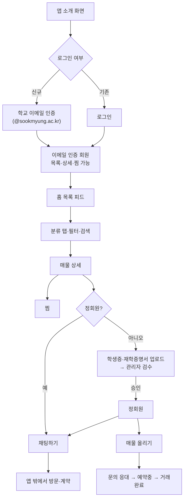
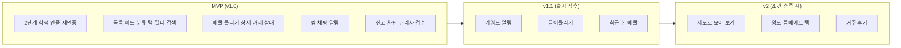
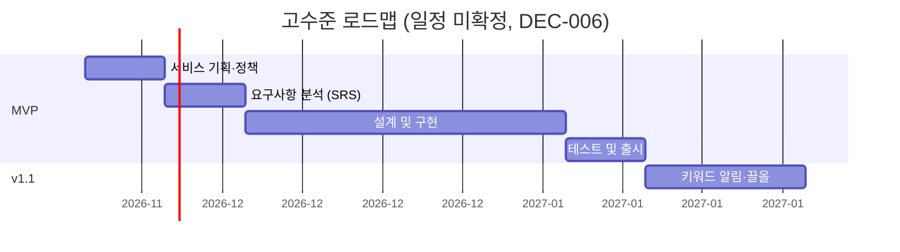
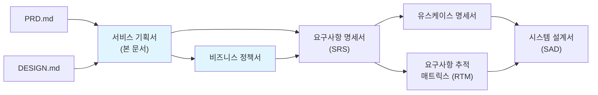

# 서비스 기획서 (Service Planning Document)

> 숙박숙박 Phase 0 기획 산출물이다. 근거는 PRD.md v0.1(저장소 PR #2)과 DESIGN.md(PR #1)이며, 확인되지 않은 수치와 결정은 "가정" 또는 "미결"로 표시하고 7.3에 모았다.

> 이 문서는 SRS(요구사항 명세서) 작성 이전에 "왜 이 서비스를 만드는가", "핵심 가치는 무엇인가", "MVP에 무엇을 포함/제외하는가"를 정의하는 선행 기획 문서이다.
> SRS가 "무엇을 만들 것인가(What)"에 집중한다면, 이 문서는 "왜 만드는가(Why)"와 "어디까지 만드는가(Scope)"에 집중한다.

| 항목 | 내용 |
|------|------|
| **프로젝트명** | 숙박숙박 (SookbakSookbak) |
| **문서 ID** | SPD-SOOKBAK-v0.1 |
| **문서 버전** | v0.1 |
| **작성일** | 2026-11-24 |
| **작성자** | 이유나 (기획) / Claude (초안 작성 지원) |
| **승인자** | 이유나 (기획 책임자) |
| **문서 상태** | 초안 |

---

## 변경 이력

| 버전 | 날짜 | 작성자 | 변경 내용 |
|------|------|--------|-----------|
| v0.1 | 2026-11-24 | 이유나 / Claude | 초안 작성. PRD v0.1, DESIGN.md 기준. 인증 단계별 권한 확정 반영 |
| v1.0 | [미정] | 이유나 | G0 검토 후 최종 승인 |

---

## 목차

1. [서비스 개요](#1-서비스-개요)
2. [핵심 메커니즘](#2-핵심-메커니즘)
3. [콘텐츠/기능 전략](#3-콘텐츠기능-전략)
4. [수익화 전략](#4-수익화-전략)
5. [MVP 스코프 정의](#5-mvp-스코프-정의)
6. [KPI 가설 검증 프레임워크](#6-kpi-가설-검증-프레임워크)
7. [다음 단계](#7-다음-단계)
8. [관련 문서](#8-관련-문서)

---

## 1. 서비스 개요

### 1.1 서비스명 및 컨셉

| 항목 | 내용 |
|------|------|
| 서비스명 | 숙박숙박 (SookbakSookbak) |
| 한 줄 설명 | 숙명여대 학생(눈송이)이 학교 근처 자취방·하숙·쉐어하우스 매물을 직접 올리고, 찜하고, 채팅으로 물어보는 학생 인증 기반 매물 구경 서비스 |
| 서비스 유형 | 커뮤니티형 매물 정보 플랫폼. 거래·결제·중개는 하지 않음 |
| 대상 플랫폼 | 모바일 우선 반응형 웹 (Next.js). 데스크톱에서도 같은 목록형 구조 |

**서비스 컨셉 설명:**

숙대생은 학교 근처(청파동·효창동·남영동·용산동 일대) 방을 구하거나 내놓을 때 에브리타임 같은 학교 커뮤니티 게시판에 의존한다. 게시판 글은 금방 묻히고, 보증금·월세·관리비·입주일을 사람마다 다르게 적어 비교가 어렵고, 이미 나간 방인지도 알 수 없다. 숙박숙박은 학교 이메일과 학생증으로 인증한 숙대생만 매물을 올리고 채팅할 수 있게 하고, 가격·관리비·입주일을 정해진 필드로 받아 같은 형식의 목록으로 보여준다. 앱을 열면 당근마켓처럼 매물 목록이 바로 나오고, 사용자는 찜으로 후보를 모으고 매물별 1:1 채팅으로 문의한다. 계약과 송금은 당사자끼리 앱 밖에서 한다.

**배경 및 동기:**

- 학교 근처 매물 정보가 커뮤니티 게시판에 비정형 글로 흩어져 있다 (PRD 2장).
- 직방·다방은 지도 중심, 중개사 매물 위주라 학생끼리 주고받는 단기임대·하숙·쉐어하우스·양도 매물을 담기 어렵다 (PRD 2장).
- 여성 학생끼리 집 문제로 처음 연락하는 상황이라, "인증된 같은 학교 학생"이라는 조건이 안전감의 핵심이다 (PRD 5장 원칙 2, 인터뷰 검증 전).

#### 사용자 문제와 근거

| 문제 ID | 사용자·상황·겪는 문제 | 현재 대안과 한계 | 관찰 근거 | 확인 상태·다음 검증 |
| --- | --- | --- | --- | --- |
| OBJ-001 | 방 찾는 눈송이가 학교 근처 매물을 가격·형태별로 비교하기 어렵다 | 게시판 검색. 형식 제각각, 분류·검색 불가, 글이 묻힘 | PRD 2장 문제 표 | 가정. 재학생 5명 이상 인터뷰, 게시판 글 30건 표본의 필수 정보(관리비·입주일) 누락률 확인 |
| OBJ-002 | 방 내놓는 눈송이(졸업·휴학·교환학생)가 같은 학교 학생에게 빨리 알리고 싶지만 글이 묻히고 개인 번호를 일찍 공개하게 된다 | 게시판 재작성, 댓글·쪽지 | PRD 2장, 4장 | 가정. 양도 경험자 인터뷰 |
| OBJ-003 | 처음 보는 상대가 실제 숙대생인지 알 수 없어 불안하다 | 게시판 인증(학교 커뮤니티 가입)만 있음, 매물 단위 신원 확인 없음 | PRD 3.1 목표 2 | 가정. 인터뷰에서 "학생증 인증 정회원만 채팅" 선호도 확인 |
| OBJ-004 | 단기 거주(방학·계절학기·인턴) 또는 하숙·쉐어하우스를 찾는 학생이 해당 매물만 모아볼 곳이 없다 | 게시판, 지인 소개 | PRD 4장 페르소나 | 가정. 단기·하숙 경험자 인터뷰 |
| OBJ-005 | 이미 나간 방인지 알 수 없어 댓글로 일일이 물어봐야 한다 | 댓글 문의 | PRD 2장 | 가정. 게시판 글의 "마감" 표기 비율 확인 |

### 1.2 핵심 가치 제안 (Value Proposition)

| 항목 | 내용 |
|------|------|
| 핵심 가치 | 인증된 숙대생끼리, 학교 근처 방을 같은 형식으로 비교하고 개인 번호 없이 바로 채팅으로 문의한다 |
| 차별점 | (1) 학교 이메일 + 학생증 2단계 인증과 학기별 재인증 (2) 단기임대·하숙·쉐어하우스를 일반 임대와 별도 분류 (3) 모든 매물에 "숙대 정문 도보 N분" (4) 중개사 광고 없음 |
| 대안 대비 우위 | 게시판 대비: 정형 가격 필드, 거래 상태, 찜, 채팅, 필터·정렬. 직방·다방 대비: 학생 매물 중심, 목록이 먼저, 하숙·쉐어·단기 전용 분류 |

**가치 제안 캔버스:**

| 구분 | 내용 |
|------|------|
| 사용자의 할 일 (Jobs) | 예산 안에서 학교와 가깝고 안전한 방 찾기 / 남은 계약 기간의 방을 믿을 만한 학생에게 넘기기 |
| 사용자의 고통 (Pains) | 글이 묻힘, 비교 불가, 거래 상태 모름, 관심 매물 관리 불가, 연락처 조기 노출, 상대 신원 불확실 |
| 사용자의 이득 (Gains) | 한눈에 비교되는 목록, 월 예상 비용, 찜 목록, 연락처 없는 문의, 같은 학교 학생이라는 안심 |
| 고통 해결제 (Pain Relievers) | 2단계 학생 인증, 가격·관리비·입주일 필수 필드, 거래 상태(거래가능·예약중·거래완료), 매물별 채팅, 신고·차단 |
| 이득 생성제 (Gain Creators) | 목록형 피드와 분류 탭, 필터·정렬, 학교까지 도보 시간 자동 계산, 찜 매물 가격 인하·상태 변경 알림 |

### 1.3 타겟 사용자 정의

#### 1.3.1 주요 사용자 페르소나

모든 사용자는 숙명여대 재학생이며, 같은 사람이 상황에 따라 찾는 역할과 내놓는 역할을 오간다 (PRD 4장).

**페르소나 1: 방 찾는 눈송이**

| 항목 | 내용 |
|------|------|
| 이름 | 김눈송 (가상) |
| 연령/직업 | 20세 / 1학년, 지방 출신 |
| 기술 수준 | 중급 (에브리타임·당근마켓 일상 사용) |
| 핵심 목표 | 개강 전 보증금 500·월세 50 안쪽, 숙대 정문 도보 10분 이내 원룸 구하기 |
| 핵심 불편 | 시세를 모르고, 관리비 표기가 글마다 달라 실제 월 비용 비교가 안 됨. 모르는 사람에게 연락하기 불안 |
| 사용 시나리오 | 홈에서 `원룸` 탭, 필터 "도보 10분·월세 50 이하" → 찜 → 후보 3곳에 채팅 → 주말 방문 |
| 성공 기준 | 일주일 안에 인증된 학생 매물만으로 후보를 정했을 때 |

**페르소나 2: 방 내놓는 눈송이**

| 항목 | 내용 |
|------|------|
| 이름 | 이청파 (가상) |
| 연령/직업 | 23세 / 4학년, 교환학생 출국 예정 |
| 기술 수준 | 중급 |
| 핵심 목표 | 출국 기간 원룸을 단기임대로 넘겨 월세 부담 줄이기 (집주인 동의 받음) |
| 핵심 불편 | 게시판 글이 묻혀 여러 번 다시 올려야 하고, 개인 번호를 공개해야 함 |
| 사용 시나리오 | `+ 매물 올리기` → 단기임대, 기간·가격·사진 입력 → 채팅 문의 응대 → `예약중` → `거래완료` |
| 성공 기준 | 등록 2주 안에 인증 학생에게서 문의가 오고 세입자를 구했을 때 |

**페르소나 3: 단기 거주 눈송이**

| 항목 | 내용 |
|------|------|
| 이름 | 박효창 (가상) |
| 연령/직업 | 21세 / 2학년, 여름방학 인턴 |
| 기술 수준 | 초급~중급 |
| 핵심 목표 | 7~8월 두 달만 살 방 |
| 핵심 불편 | 단기 매물을 따로 모아볼 곳이 없음 |
| 사용 시나리오 | `단기임대` 탭 + 입주일 필터 → 주 단위 가격 비교 → 채팅 |
| 성공 기준 | 원하는 기간에 맞는 매물만 걸러 볼 수 있을 때 |

**페르소나 4: 하숙·쉐어하우스 거주 눈송이**

| 항목 | 내용 |
|------|------|
| 이름 | 최남영 (가상) |
| 연령/직업 | 22세 / 3학년, 쉐어하우스 거주 |
| 기술 수준 | 중급 |
| 핵심 목표 | 우리 쉐어하우스 빈방 1자리에 같은 학교 학생 들이기 |
| 핵심 불편 | 공용 공간·하우스 규칙을 정리해 알릴 곳이 없음 |
| 사용 시나리오 | 쉐어하우스 분류로 등록, 모집 인원·현재 인원·규칙 입력 |
| 성공 기준 | 규칙을 미리 읽고 온 학생에게서 문의를 받을 때 |

#### 1.3.2 사용자 세그먼트

| 세그먼트 | 설명 | 규모 추정 | 우선순위 | MVP 포함 |
|----------|------|-----------|----------|----------|
| 방 찾는 재학생 | 신입생·편입생·지방 출신, 기숙사 미배정 | 미측정 (재학생 수·기숙사 수용 인원으로 추정 예정) | P1 | Y |
| 방 내놓는 재학생 | 졸업·휴학·교환학생, 계약 승계·양도 | 미측정 | P1 | Y |
| 단기 거주 재학생 | 방학·계절학기·인턴 | 미측정 | P1 | Y |
| 하숙·쉐어 거주 재학생 | 자기 집 빈방 소개 | 미측정 | P2 | Y |
| 휴학생·졸업 예정자·대학원생 | 정회원 범위 미확정 | 미측정 | P2 | 미결 (DEC-002) |

#### 1.3.3 비사용자 (Anti-Persona)

| 비사용자 | 이유 | 대안 |
|----------|------|------|
| 숙명여대 학생이 아닌 일반인 | 학교 이메일 인증 없이는 앱 소개 화면만 볼 수 있음 | 직방, 다방, 당근마켓 부동산 |
| 공인중개사·부동산 업체·임대사업자 | 영업 목적 게시 금지, 확인 시 영구 정지 (PRD 3.2, 12장) | 직방, 다방 중개사 서비스 |
| 학생이 아닌 집주인·하숙집 운영자 | 매물은 인증된 학생 개인만 올림 (PRD 3.2) | 하숙에 사는 학생이 빈방을 대신 소개 |
| 앱 안에서 계약·송금까지 끝내려는 사용자 | 정보 게시와 대화 연결까지만 제공 | 공인중개사 계약, 당사자 직거래 |

---

## 2. 핵심 메커니즘

### 2.1 서비스 작동 원리

**핵심 루프 (Core Loop):**

1. 이메일 인증 회원이 홈의 매물 목록을 훑고 분류 탭·필터·정렬로 좁힌다.
2. 시스템은 매물마다 가격(8.3 표기 규칙), 분류·방 종류, 층·면적·관리비, 숙대 도보 시간, 입주일, 거래 상태를 같은 형식으로 보여준다.
3. 사용자는 마음에 드는 매물을 찜한다. 문의하려면 학생증 인증(정회원)을 마치고 `채팅하기`로 작성자와 1:1 채팅을 연다.
4. 작성자가 답하고 `예약중` → `거래완료`로 상태를 바꾼다. 찜한 사람은 가격 인하·상태 변경 알림을 받고 다시 목록으로 돌아온다.

공급 루프: 정회원이 매물을 올림 → 목록 최상단 노출 → 찜·채팅 알림 → 거래완료 → 다음 학기에 다시 올림.

### 2.2 전체 서비스 플로우

### 2.3 핵심 사용자 여정 (Key User Journey)

#### 여정 1: 가입하고 방 찾기

| 단계 | 사용자 행동 | 시스템 반응 | 감정 목표 | 핵심 지표 |
|------|------------|------------|-----------|-----------|
| 1. 진입 | 홍보 링크로 접속 | 앱 소개, "학교 메일로 시작하기" | 호기심 | 방문 → 가입 시작률 |
| 2. 이메일 인증 | 학교 메일 입력, 6자리 번호 입력 | 인증 완료 후 홈으로 이동 | 간편함 | 이메일 인증 완료율 |
| 3. 탐색 | 탭·필터로 좁히고 상세 확인 | 같은 형식의 카드, 월 예상 비용 | 이해 | 첫 세션 상세 조회 수 |
| 4. 찜 | 후보 찜 | 찜 목록 저장 | 기대 | 첫 찜까지 시간 |
| 5. 학생증 인증 | `채팅하기` → 인증 안내 → 학생증 업로드 | 검수 대기, 영업일 24시간 내 결과 알림 | 안심 | 학생증 인증 완료율, 검수 소요 시간 |
| 6. 문의 | 채팅 시작 | 작성자에게 알림 | 신뢰 | 첫 문의율 |

#### 여정 2: 방 내놓기

| 단계 | 사용자 행동 | 시스템 반응 | 감정 목표 | 핵심 지표 |
|------|------------|------------|-----------|-----------|
| 1 | `+ 매물 올리기`, 분류 선택 | 분류별 필수 항목 폼, 임시 저장 | 간편함 | 등록 시작 → 완료율 |
| 2 | 사진·가격·위치·일정 입력, 확인 동의 | 필수 항목 검증, 도보 시간 자동 계산 | 성취감 | 등록 소요 시간 |
| 3 | 게시 | 목록 최상단 노출 | 기대 | 첫 문의까지 시간 |
| 4 | 채팅 응대, `예약중` 변경 | 찜한 사람에게 상태 변경 알림 | 신뢰 | 응답률 |
| 5 | `거래완료` 처리 | 30일 후 목록에서 자동 숨김 | 마무리 | 거래완료 비율 |

---

## 3. 콘텐츠/기능 전략

### 3.1 핵심 기능 방향

| 기능 영역 | 전략 방향 | 우선순위 | MVP 포함 | 비고 |
|-----------|-----------|----------|----------|------|
| 학생 인증 | 2단계(학교 이메일 → 학생증·재학증명서), 학기별 재인증. 단계별 권한 차등 | P1 | Y | 확정 (BP-AUTH) |
| 홈 목록 피드 | 목록이 먼저. 분류 탭 8개, 필터 칩, 정렬, 무한 스크롤 | P1 | Y | DESIGN.md 레이아웃 수정 중 |
| 매물 분류 | 축 1 분류(일반 임대/단기임대/하숙/쉐어하우스) × 축 2 방 종류(원룸/투룸+/오피스텔/아파트/기타) | P1 | Y | 모든 분류·방 종류 등록 가능 |
| 매물 올리기 | 정해진 필드, 분류별 추가 필드, 임시 저장, 공개 매물 1인 3건 | P1 | Y | BP-LISTING |
| 거래 상태 | 거래가능 → 예약중 → 거래완료 | P1 | Y | |
| 찜 | 찜 목록, 가격 인하·상태 변경 알림 | P1 | Y | |
| 채팅 | 매물별 1:1, 텍스트·사진, 읽음 표시, 푸시 | P1 | Y | BP-CHAT |
| 검색·필터 | 키워드, 가격 범위, 방 종류, 숙대 거리, 입주일, 기간, 조건 | P1 | Y | |
| 신고·차단·검수 | 신고 3건 자동 숨김, 경고 → 7일 → 영구 정지 | P1 | Y | BP-MOD |
| 키워드 알림, 끌어올리기, 최근 본 매물 | MVP 직후 | P2 | N | EX-002 |
| 지도로 모아 보기 | 목록 결과를 지도에 표시. 메인은 계속 목록 | P3 | N | EX-003 |

> 우선순위 대응: PRD P0 = 본 문서 P1(MVP 필수), PRD P1 = P2(MVP 직후), PRD P2 = P3(이후 검토).

**기능 방향 의사결정 기록:**

| 항목 | A안 | B안 | 선택 | 근거 |
|------|-----|-----|------|------|
| 첫 화면 구조 | 지도 + 리스트 분할 (DESIGN.md 초기안, 다방식) | 전체 폭 목록 피드 + 하단 탭 (당근마켓식) | B | 사용자 요청, PRD 5장 원칙 1. 학교 근처 좁은 지역이라 지도 탐색 가치가 낮고 초기 매물이 적을 때 지도가 비어 보임. DESIGN.md는 PRD 13장 기준으로 수정 중 |
| 거래 범위 | 앱 내 계약·결제 | 정보 게시·대화 연결만 | B | PRD 3.2, 12장. 공인중개사법상 중개로 보이지 않도록 함 |
| 인증 강도 | 학교 이메일만 | 이메일 + 학생증·재학증명서 관리자 검수 | B | PRD 7.1 "빡센" 인증. 이메일만으로는 졸업생·타인 계정 사용을 막기 어려움 |
| 열람 권한 | 정회원만 열람 | 이메일 인증 회원도 열람·찜 가능 | B | 사용자 결정(2026-11-24). 구경 장벽을 낮춰 가입 전환을 높이고, 연락·게시만 정회원으로 제한 |

### 3.3 콘텐츠 전략

| 항목 | 내용 |
|------|------|
| 콘텐츠 유형 | 매물 글(정형 필드 + 사진 3~10장 + 설명), 채팅 메시지(텍스트·사진) |
| 콘텐츠 생산 방식 | 사용자 생성(UGC). 정회원만 등록 |
| 콘텐츠 큐레이션 | 정렬(최신순 기본, 낮은 가격순, 가까운순, 찜 많은순) + 분류 탭 + 필터. 추천 알고리즘 없음 |
| 콘텐츠 갱신 주기 | 실시간 (등록 즉시 최상단) |
| 품질 관리 | 필수 필드 검증, 신고 3건 자동 숨김 + 관리자 검토, 거래완료 30일 후 자동 숨김, 재인증 실패 시 비공개 |

### 3.4 브랜드/톤앤매너

| 항목 | 내용 |
|------|------|
| 브랜드 톤 | 친근하지만 정보는 정확하게. 같은 학교 선배가 알려주는 느낌 |
| 커뮤니케이션 스타일 | 해요체, 이모지 최소 |
| 시각적 아이덴티티 | DESIGN.md 기준. Sookmyung Royal Blue `#003087` 단일 강조색, Pretendard 400·700, 가격만 18px/700 |
| 캐릭터/마스코트 | 없음. 숙명여대 로고·심볼은 학교 승인 전까지 사용하지 않음 |

---

## 4. 수익화 전략

### 4.1 수익 모델 선택

| 항목 | 내용 |
|------|------|
| 주요 수익 모델 | 없음 (완전 무료) |
| 보조 수익 모델 | 없음 |
| 무료/유료 경계 | 모든 기능 무료. 권한 차이는 결제가 아니라 인증 단계로만 나뉨 |
| 가격 전략 | 해당 없음 |

**선택 근거:** PRD 12장에 따라 중개업으로 보이지 않도록 수수료, 계약 대행, 매물 광고비를 받지 않는다. MVP 목표는 인증 학생 사이의 매물·문의 루프 검증이다. MVP 이후 수익화 여부(예: 지역 상점 배너)는 DEC-007로 남긴다.

### 4.2 단계별 수익화 계획

| 단계 | 시점 / 조건 | 수익화 방식 | 목표 |
|------|------------|------------|------|
| Phase 0: PMF 검증 | 출시 ~ 3개월 | 없음 | 인증 가입자 1,000명, 누적 매물 300건 (PRD 3.3) |
| Phase 1 이후 | 미결 (DEC-007) | 미결. 거래 수수료·매물 광고비는 받지 않음 | 미결 |

### 4.3 과금 정책 요약

| 항목 | 정책 방향 |
|------|-----------|
| 무료 체험 | 해당 없음 |
| 환불 정책 | 해당 없음 |
| 구독 갱신 | 해당 없음 |
| 결제 수단 | 없음. 앱 안에서 보증금·월세 등 어떤 돈도 주고받지 않음 |

---

## 5. MVP 스코프 정의

### 5.1 MVP 정의 기준

| 항목 | 내용 |
|------|------|
| MVP 목표 | "엄격한 학생 인증을 거친 숙대생끼리라면, 정형화된 매물 목록·찜·채팅만으로 학교 근처 방이 오가고 거래가 성사된다"를 검증한다 |
| MVP 기간 | 미결 (DEC-006) |
| MVP 성공 기준 | 출시 후 3개월: 인증 가입자 1,000명, 누적 매물 300건, 문의 발생 매물 60% 이상, 거래완료 매물 30% 이상, 신고 숨김 3% 이하 (PRD 3.3, 가설값) |
| MVP 실패 시 대응 | 공급 부족이면 등록 폼 간소화·게시판 이용자 대상 등록 홍보, 문의 부족이면 카드 정보·사진 품질 점검, 인증 이탈이 크면 검수 시간·안내 개선 |

### 5.2 포함 항목 (In-Scope)

| ID | 기능/항목 | 설명 | 우선순위 | 예상 공수 | 비고 |
|----|-----------|------|----------|-----------|------|
| MVP-001 | 학교 이메일 인증 가입 | `@sookmyung.ac.kr` 6자리 번호(10분 유효), 이메일 1개당 계정 1개 | P1 | 미정 | OBJ-003, BP-AUTH-001 |
| MVP-002 | 학생증·재학증명서 인증 | 이미지 업로드 → 관리자 검수(영업일 24시간), 승인 시 원본 즉시 삭제 | P1 | 미정 | OBJ-003, BP-AUTH-002 |
| MVP-003 | 인증 단계별 권한·학기별 재인증 | 이메일 회원: 열람·찜 / 정회원: 올리기·채팅. 3월·9월 재인증 | P1 | 미정 | BP-AUTH-003, BP-AUTH-004 |
| MVP-004 | 홈 목록 피드 | 기준 위치, 분류 탭 8개, 필터 칩, 정렬 4종, 무한 스크롤, 하단 탭 바 | P1 | 미정 | OBJ-001, OBJ-004 |
| MVP-005 | 매물 올리기·수정·삭제 | 사진 3~10장, 분류·방 종류, 가격 필드, 위치, 기본 정보, 일정, 옵션, 분류별 필드, 임시 저장 | P1 | 미정 | OBJ-002, BP-LISTING, BP-PRICE |
| MVP-006 | 거래 상태 관리 | 거래가능 / 예약중 / 거래완료, 거래완료 30일 후 자동 숨김 | P1 | 미정 | OBJ-005, BP-LISTING-003 |
| MVP-007 | 매물 상세 | 사진, 작성자 배지, 가격 블록·월 예상 비용, 정보 표, 대략 위치 지도, 도보 시간, 안내 문구 | P1 | 미정 | OBJ-001 |
| MVP-008 | 찜 | 찜·해제, 찜 탭, 가격 인하·상태 변경 알림 | P1 | 미정 | BP-NOTI |
| MVP-009 | 매물별 1:1 채팅 | 텍스트·사진(10장), 읽음 표시, 매물 요약 고정, 연락처·계좌 패턴 안내 | P1 | 미정 | OBJ-002, BP-CHAT |
| MVP-010 | 검색·필터 | 키워드(제목·설명·동네·역), 필터 11종, 칩 값 표시·초기화 | P1 | 미정 | OBJ-001, OBJ-004 |
| MVP-011 | 신고·차단·관리자 검수 | 신고 사유 7종, 3건 자동 숨김, 인증·신고 대기열, 경고·정지 | P1 | 미정 | BP-MOD |
| MVP-012 | 마이 | 프로필·인증 상태·다음 재인증일, 내 매물, 알림 설정, 차단 목록, 약관, 탈퇴 | P1 | 미정 | |
| MVP-013 | 알림 | 채팅, 찜 매물 변경, 인증 결과, 재인증 안내 (푸시 + 인앱) | P1 | 미정 | BP-NOTI |

P1/P2/P3는 중요도를 뜻한다. G0 검토에서 이번 릴리스에 포함하기로 합의한 행을 5.2에 남기고, 보류한 항목은 사유와 재검토 조건을 5.3에 기록한다. SRS에서 MVP-ID를 참조한다.

### 5.3 제외 항목 (Out-of-Scope) + 제외 근거

| ID | 제외 항목 | 제외 근거 | 대안 (MVP에서는 대신 무엇을 하는가) | v2 진입 조건 |
|----|-----------|-----------|--------------------------------------|-------------|
| EX-001 | 계약서 작성·보증금/월세 결제·에스크로·전자계약 | PRD 3.2 Non-goal. 거래 당사자·중개자가 되지 않음 | 채팅으로 연결, 상세·채팅에 "계약·송금 전 직접 방문, 등기부등본 확인" 안내 | 도입 계획 없음 |
| EX-002 | 키워드 알림, 끌어올리기, 최근 본 매물 | PRD P1. 핵심 루프 검증에 필수는 아님 | 정렬·필터, 찜 | MVP 출시 직후 (v1.1) |
| EX-003 | 지도로 모아 보기 | PRD P2. 목록이 먼저라는 원칙, 초기 매물 수 적음 | 상세의 대략 위치 지도 + 숙대까지 거리 필터 | 활성 매물이 지도에 의미 있게 퍼질 때 (가정: 100건 이상) |
| EX-004 | 양도·룸메이트 별도 탭 | PRD P2. 단기임대·쉐어하우스·일반 임대(계약 승계)와 겹침 | 양도는 일반 임대(계약 승계) 또는 단기임대로, 룸메이트는 쉐어하우스로 등록 | DEC-001 결정 후 |
| EX-005 | 거주 후기 | PRD P2. 허위·명예훼손 분쟁 관리 부담, 초기 거래 수 적음 | 채팅으로 직접 질문 | 거래완료 누적 100건 이상 (가정) |
| EX-006 | 커뮤니티(자유게시판) 탭 | PRD 3.2 Non-goal | 학교 커뮤니티 이용 | 계획 없음 |
| EX-007 | 공인중개사·업체·비학생 임대인 계정 | PRD 3.2, 12장 | 학생 개인만 등록 | 계획 없음 |
| EX-008 | 학교 학적 API·외부 인증 서비스 자동 연동 | 연동 가능 여부 미확인 (PRD 14장 Q1) | 운영자 수동 검수 | 연동 가능 확인 시 |
| EX-009 | 등기부등본·실거래가 등 외부 부동산 데이터 연동 | 외부 API·비용, 가설 검증과 무관 | 상세 안내 문구 | 사용자 요청 반복 시 |
| EX-010 | 네이티브 앱 (iOS/Android) | 웹으로 가설 검증 가능 | 모바일 우선 반응형 웹 | MVP 성공 기준 달성 후 |

### 5.4 MVP 기능 범위 다이어그램

### 5.5 기술적 MVP 결정사항

| 결정 항목 | MVP 선택 | 근거 | v2에서 전환 가능 |
|-----------|----------|------|------------------|
| 프론트엔드 | Next.js (TypeScript), 모바일 우선 반응형 | 저장소 AGENTS.md, PRD 11장 | N |
| 디자인 | DESIGN.md 토큰 (레이아웃은 목록형으로 수정) | PR #1, PRD 13장 | Y |
| 채팅 | 실시간 연결(WebSocket 등), 재접속 시 동기화 | PRD 11장. 구체 기술은 Phase 2 | Y |
| 백엔드·DB·스토리지 | 미결 | Phase 2(SAD)에서 확정 | Y |
| 지도·주소 검색·도보 시간 | 미결 (국내 지도 API) | Phase 2에서 확정 | Y |

---

## 6. KPI 가설 검증 프레임워크

### 6.1 검증할 가설 목록

| ID | 가설 | 검증 방법 | 성공 기준 | 실패 시 대응 | 우선순위 |
|----|------|-----------|-----------|-------------|----------|
| H-001 | 열람을 이메일 인증만으로 열어 두면, 학생증 인증이라는 높은 장벽이 있어도 숙대생이 충분히 가입한다 | 인증 퍼널 (가입 시작 → 이메일 → 학생증) | 3개월 이메일 인증 1,000명, 이메일 → 학생증 전환 40% 이상 (전환율은 가정) | 학생증 인증 안내·검수 시간 개선 | P1 |
| H-002 | 정형 필드가 많아도 방 내놓는 학생은 게시판 대신 숙박숙박에 올린다 | 등록 시작 → 완료율, 누적 매물 수 | 3개월 누적 300건, 등록 완료율 70% 이상 (완료율은 가정) | 필수 항목 재검토, 임시 저장 안내 강화 | P1 |
| H-003 | 인증된 학생 매물에는 문의가 생긴다 | 채팅 1건 이상 매물 비율, 매물당 찜 | 문의 발생 매물 60% 이상, 매물당 찜 5회 이상 | 카드 정보·사진 품질, 정렬 기본값 점검 | P1 |
| H-004 | 앱 안 연결만으로 실제 거래가 성사된다 | 거래완료 매물 비율 | 30% 이상 | 거래완료 처리 유도 알림, 미처리 매물 원인 인터뷰 | P1 |
| H-005 | 엄격한 인증으로 허위·광고 매물이 적다 | 신고 숨김 매물 비율 | 3% 이하 | 등록 확인 절차·제재 강화 | P2 |

### 6.2 핵심 지표 (Key Metrics)

| 구분 | 지표명 | 정의 | 목표값 | 측정 방법 | 측정 주기 |
|------|--------|------|--------|-----------|-----------|
| **North Star** | 문의 발생 매물 비율 | 공개된 매물 중 채팅방이 1개 이상 생긴 매물 비율 | 60% 이상 | 채팅방 생성 / 공개 매물 | 주간 |
| 획득 (Acquisition) | 이메일 인증 가입자 | 이메일 인증을 마친 누적 사용자 | 3개월 1,000명 | 인증 이벤트 | 주간 |
| 활성화 (Activation) | 정회원 전환율 | 이메일 인증 회원 중 학생증 인증 완료 비율 | 40% (가정) | 인증 이벤트 | 주간 |
| 유지 (Retention) | D7 Retention | 이메일 인증 7일차 재방문 비율 | 미결 (출시 후 기준값 측정) | 방문 로그 | 주간 |
| 공급 | 누적 등록 매물 | 등록 완료된 매물 수 | 3개월 300건 | 매물 DB | 주간 |
| 성과 | 거래완료 비율 | 등록 매물 중 거래완료 표시 비율 | 30% 이상 | 매물 상태 | 월간 |
| 안전 | 신고 숨김 비율 | 등록 매물 중 신고로 숨김 처리된 비율 | 3% 이하 | 신고 처리 기록 | 월간 |
| 수익 (Revenue) | 해당 없음 | 무료 서비스 | - | - | - |

| KPI ID·가설 ID | 산식·분모 | 기준값·목표값 | 측정 대상·기간·최소 표본 | 데이터 출처·담당자·판정일 |
| --- | --- | --- | --- | --- |
| KPI-001 / H-001 | 학생증 인증 완료 수 / 이메일 인증 완료 수 | 미측정 / 40% | 출시 후 3개월, 이메일 인증 100명 이상 | 인증 테이블 / 이유나 / 출시 +3개월 |
| KPI-002 / H-002 | 등록 완료 수 / 등록 시작 수 | 미측정 / 70% | 출시 후 3개월, 등록 시작 50건 이상 | 매물·임시 저장 테이블 / 이유나 / 출시 +3개월 |
| KPI-003 / H-003 | 채팅방 1개 이상 매물 / 공개 매물 | 미측정 / 60% | 출시 후 3개월, 공개 매물 50건 이상 | 채팅·매물 테이블 / 이유나 / 출시 +3개월 |
| KPI-004 / H-004 | 거래완료 매물 / 등록 매물 | 미측정 / 30% | 출시 후 3개월, 등록 매물 50건 이상 | 매물 상태 이력 / 이유나 / 출시 +3개월 |
| KPI-005 / H-005 | 신고 숨김 매물 / 등록 매물 | 미측정 / 3% 이하 | 출시 후 3개월 | 신고 처리 기록 / 이유나 / 출시 +3개월 |

### 6.3 가설 검증 매트릭스

| 가설 ID | 결과 시나리오 | 판단 | 다음 액션 |
|---------|--------------|------|-----------|
| H-001 | 정회원 전환 40% 이상 | 가설 검증 완료 | 인증 방식 유지 |
| H-001 | 20~40% | 추가 관찰 필요 | 학생증 단계 이탈 원인(검수 지연·반려 사유) 확인, 1개월 재관찰 |
| H-001 | 20% 미만 | 가설 기각 | 인증 방식 재검토 (예: 재학증명서만, 외부 인증 연동) |
| H-001 | 이메일 인증 100명 미만 | 판단 보류 | 홍보 후 재판정 |
| H-002 | 누적 300건 이상 | 가설 검증 완료 | 문의·거래 지표에 집중 |
| H-002 | 300건 미만 | 가설 기각 | 등록 폼 간소화, 학기 초 등록 캠페인 |
| H-003 | 60% 이상 | 가설 검증 완료 | v1.1 기능 진행 |
| H-003 | 60% 미만 | 가설 기각 | 매물 정보 품질·노출 방식 점검 |
| H-004 | 30% 이상 | 가설 검증 완료 | v2 검토 |
| H-004 | 30% 미만 | 원인 확인 | 거래완료 미처리인지 실제 미성사인지 작성자 설문 |

### 6.4 데이터 수집 계획

| 데이터 항목 | 수집 이벤트 | 수집 도구 | 용도 | MVP 필수 |
|------------|------------|-----------|------|----------|
| 가입·인증 | 이메일 인증 요청·완료, 학생증 제출·승인·반려 | 자체 DB | H-001 | Y |
| 매물 등록 | 등록 시작(임시 저장), 등록 완료, 상태 변경 | 자체 DB | H-002, H-004 | Y |
| 조회·찜 | 상세 조회, 찜 추가·해제 | 자체 DB | H-003 | Y |
| 채팅 | 채팅방 생성, 첫 메시지 | 자체 DB | H-003, North Star | Y |
| 신고 | 신고 접수, 숨김, 처리 결과 | 자체 DB | H-005 | Y |
| 방문 | 세션 시작 | 미결 (GA4 등) | Retention | Y |
| 필터·검색 사용 | 필터 적용, 검색어 | 미결 | UX 개선 | N (v1.1) |

---

## 7. 다음 단계

### 7.1 기획 완료 체크리스트

- [x] 서비스 컨셉이 한 문장으로 명확히 정의되었는가
- [x] 타겟 사용자가 구체적으로 정의되었는가 (비사용자 포함)
- [x] 핵심 가치 제안이 경쟁 대비 차별화되었는가
- [x] 핵심 메커니즘(Core Loop)이 명확한가
- [x] 수익 모델이 선택되고 근거가 있는가 (MVP 무료, 이후는 DEC-007)
- [x] MVP 포함/제외 항목이 모두 정의되었는가
- [x] **제외 항목에 "왜 제외하는가"와 "대안"이 모두 기록되었는가**
- [ ] 검증할 가설이 정량적 성공 기준과 함께 정의되었는가 (일부 전환율은 가정값)
- [x] 가설 실패 시 대응 방안이 사전에 정의되었는가
- [x] 비즈니스 동작 규칙이 비즈니스정책서에 독립적으로 정의되었는가
- [ ] 사용자 문제(OBJ-001~005)가 인터뷰로 확인되었는가
- [ ] 이해관계자 리뷰가 완료되었는가

### 7.2 v2+ 로드맵

| 버전 | 진입 조건 | 주요 기능 | 목표 |
|------|-----------|-----------|------|
| v1.0 (MVP) | - | 5.2절 참조 | 핵심 가설 검증 |
| v1.1 | MVP 출시 직후 | 키워드 알림, 끌어올리기, 최근 본 매물 (EX-002) | 재방문·공급 유지 |
| v2.0 | H-001~H-004 검증 | 지도로 모아 보기(EX-003), 양도·룸메이트(EX-004), 거주 후기(EX-005) | 성장 |

> 일정은 자리표시용이다. 실제 일정은 DEC-006에서 확정한다.

### 7.3 가정·의존성·미결 결정

| ID | 확인할 내용·근거 | 범위·일정 영향 | 담당자·결정 기한 | 상태·결정 기록 |
| --- | --- | --- | --- | --- |
| DEC-000 | 인증 단계별 권한 | MVP-003, BP-AUTH-003 | 이유나 | **확정 (2026-11-24)**: 매물 구경(목록·상세)과 찜은 이메일 인증으로 가능, 매물 올리기와 채팅은 학생증 인증까지 마쳐야 가능 |
| DEC-001 | 양도·룸메이트를 단기임대·쉐어하우스·일반 임대에 흡수할지, 별도 탭으로 둘지 (PRD 14장 Q4) | MVP-004 분류 탭, EX-004 | 이유나 / G0 전 | 미결. 초안은 흡수 (양도 → 일반 임대 계약 승계·단기임대, 룸메이트 → 쉐어하우스) |
| DEC-002 | 휴학생·졸업 예정자·대학원생을 정회원 범위에 넣을지 (PRD 14장 Q2) | BP-AUTH-002, 세그먼트 | 이유나 / G0 전 | 미결. 초안: 학부·대학원 재학생과 졸업 예정자 포함, 휴학생은 열람·찜만 |
| DEC-003 | 학생증 검수 주체와 학교·외부 인증 연동 가능성 (PRD 14장 Q1) | MVP-002, EX-008 | 이유나 / Phase 2 전 | 미결. 초안: 운영자 수동 검수 |
| DEC-004 | 공개 매물 1인 3건 제한이 적절한지 (PRD 14장 Q3) | BP-LISTING-002 | 이유나 / G0 전 | 초안 3건 유지 |
| DEC-005 | 거래가능 상태로 오래 방치된 매물 처리 (PRD에 기준 없음) | BP-LISTING-004 | 이유나 / G0 전 | 미결. 초안: 마지막 수정 후 60일이 지나면 작성자에게 확인 알림, 7일 내 응답 없으면 숨김 |
| DEC-006 | MVP 개발 기간 (수업 일정) | 7.2 | 이유나 / G0 전 | 미결 |
| DEC-007 | MVP 이후 수익화 여부 | 4장 | 이유나 / v1.1 이후 | 미결. 수수료·매물 광고비는 받지 않음(확정) |
| DEC-008 | 관리자(운영자)는 누구이며 검수 24시간을 지킬 수 있는지 | BP-AUTH-002, BP-MOD | 이유나 / G0 전 | 미결 |
| DEP-001 | 학교 메일 계정으로 외부 발송 인증 메일 수신 가능 (학교 메일 정책) | MVP-001 | - | 가정 |
| DEP-002 | DESIGN.md 레이아웃·카테고리를 PRD 13장 기준으로 수정 | 화면설계, MVP-004 | 별도 작업 진행 중 | 진행 중 |

G0 검토 결과와 승인된 기획 버전은 [단계별 검토 체크리스트](../08-검토/단계별검토-체크리스트.md#phase-0-기획-검토)에 연결한다.

---

## 8. 관련 문서

### 8.1 문서 간 관계

### 8.2 SRS와의 역할 분담

| 항목 | 서비스 기획서 (본 문서) | SRS |
|------|----------------------|-----|
| 관점 | 비즈니스/사용자 관점 | 시스템/구현 관점 |
| 범위 정의 | "왜 이것을 만드는가" + "왜 이것을 안 만드는가" | "무엇을 만드는가" (기능/비기능 요구사항) |
| 비즈니스 목표 | 상세 기술 (배경, 동기, 가설) | SRS 1.2절에서 요약 참조 |
| 사용자 정의 | 페르소나 + 비사용자 + 감정 목표 | 사용자 특성 테이블 (기술 수준, 사용 빈도) |
| 우선순위 | P1/P2/P3 + 제외 근거 + v2 진입 조건 | P2~P4 (SRS 1.5절) |
| 수익화 | 전략 방향 + 단계별 계획 | 해당 없음 (SRS 범위 아님) |
| KPI/가설 | 검증 프레임워크 전체 | 해당 없음 (SRS 범위 아님) |
| 비즈니스 규칙 | "비즈니스정책서 참조" 안내 | FR별 비즈니스 규칙 요약 (BR-xxx) |

> **작성 순서:** 서비스 기획서 -> 비즈니스정책서 -> SRS
> SRS 작성 시 본 문서의 1.1절(서비스 컨셉)과 5.2절(MVP 포함 항목), PRD 7장(기능 요구사항)을 기반으로 기능 요구사항을 도출한다.

### 8.3 참조 문서 목록

| 문서명 | 위치 | 관계 |
|--------|------|------|
| PRD | sookbak-sookbak 저장소 `PRD.md` (PR #2) | 제품 요구 원천 |
| DESIGN.md | sookbak-sookbak 저장소 (PR #1) | 화면·디자인 토큰 기준 |
| 비즈니스 정책서 | `00-기획/비즈니스정책서.md` | 본 문서의 비즈니스 규칙을 상세 정의 |
| 요구사항 명세서 (SRS) | `01-요구사항분석/요구사항명세서-SRS.md` | MVP 스코프를 시스템 요구사항으로 구체화 |
| 유스케이스 명세서 | `01-요구사항분석/유스케이스명세서.md` | 핵심 사용자 여정을 유스케이스로 상세화 |
| 요구사항 추적 매트릭스 | `01-요구사항분석/요구사항추적매트릭스-RTM.md` | 요구사항 추적 |

---

## 부록

### A. 경쟁 분석

> 경쟁 서비스 특징은 PRD 2장과 일반적으로 알려진 내용 기준이며, 실제 조사로 보완한다.

| 항목 | 학교 커뮤니티 게시판 (에브리타임 등) | 직방·다방 | 숙박숙박 |
|------|----------|----------|------------|
| 주요 기능 | 자유 형식 게시글, 댓글, 쪽지 | 지도 기반 매물 검색, 중개사 연결 | 목록형 매물 피드, 찜, 매물별 채팅 |
| 가격 | 무료 | 사용자 무료 | 무료 |
| 강점 | 학교 커뮤니티, 높은 사용률 | 매물 수, 검색·필터 | 2단계 학생 인증 + 정형 정보 + 단기·하숙·쉐어 분류 |
| 약점 | 형식 없음, 글이 묻힘, 거래 상태 모름 | 학생 매물·단기·하숙 부족, 중개 매물 위주 | 초기 매물 수 부족 (콜드 스타트) |
| 타겟 사용자 | 재학생 전체 | 일반 임차인 | 숙명여대 재학생 |
| **차별화 포인트** | | | 인증된 숙대생끼리, 학생 매물만, 비교 가능한 형식으로 |

### B. 용어 정의

| 용어 | 정의 |
|------|------|
| 눈송이 | 숙명여대 학생 |
| 이메일 인증 회원 | 학교 이메일 인증만 마친 사용자. 목록·상세 열람과 찜 가능 |
| 정회원 | 학교 이메일과 학생증(또는 재학증명서) 인증을 모두 마친 사용자. 매물 올리기·채팅 가능 |
| 일반 임대 | 6개월 이상 월세·전세 매물. 계약 승계·양도 포함 |
| 단기임대 | 1주~6개월 단기 거주 매물. 방학·계절학기·교환학생 기간 양도 포함 |
| 하숙 | 집주인 가정에 살거나 식사를 제공받는 거주 형태 |
| 쉐어하우스 | 여러 사람이 한 집의 공용 공간을 나눠 쓰는 거주 형태 |
| 월 예상 비용 | 월세 + 관리비 (전세는 관리비) |
| 거래 상태 | 거래가능 / 예약중 / 거래완료 |
| MVP / PMF / North Star / Core Loop / Retention | 템플릿 정의와 같음 |

### C. 승인

| 역할 | 이름 | 서명 | 날짜 |
|------|------|------|------|
| 기획 책임자 | 이유나 | | [미정] |
| 프로젝트 스폰서 | [해당 시 담당 교수·멘토] | | [미정] |
| 기술 책임자 | 이유나 | | [미정] |
