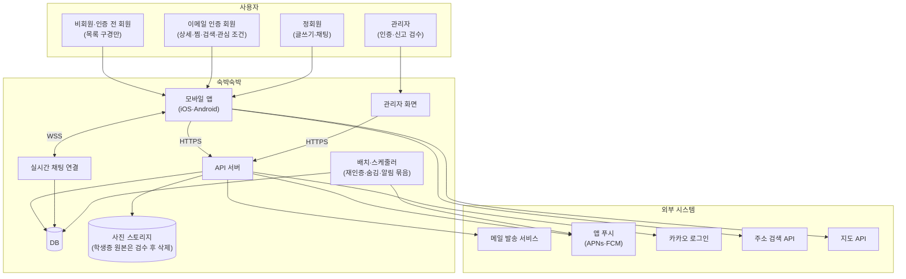
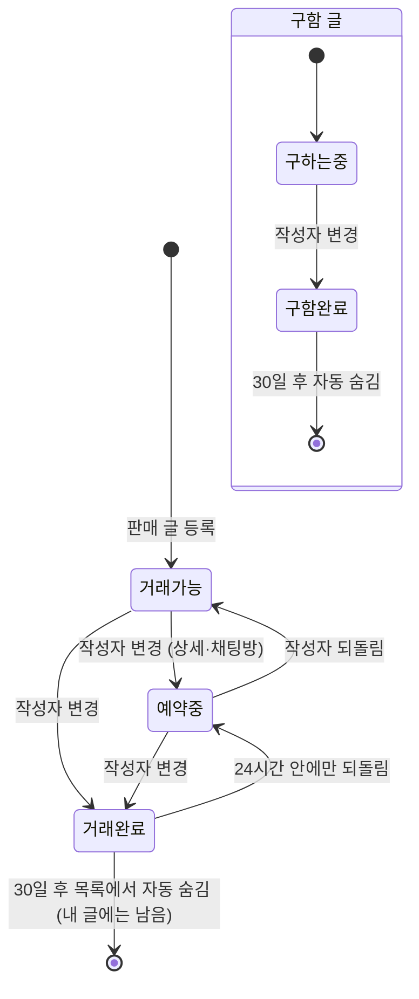
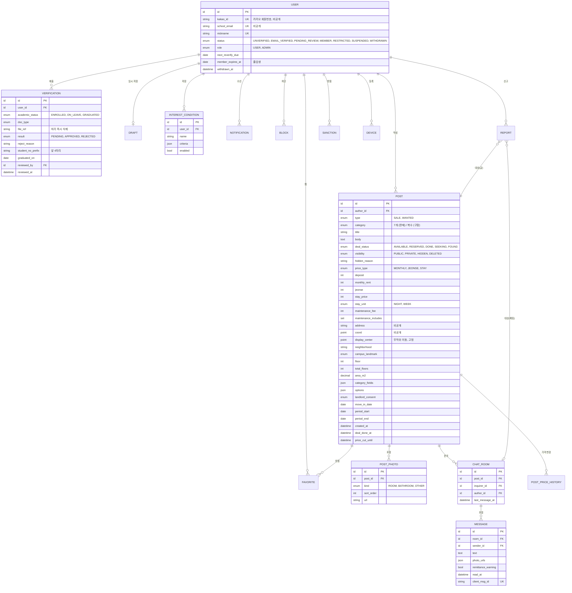

# 소프트웨어 요구사항 명세서 (SRS)

> 숙박숙박 Phase 1 요구사항 분석 산출물이다. 근거는 PRD.md v0.2(저장소 PR #2), [서비스 기획서](../00-기획/서비스기획서.md) v0.2b, [비즈니스 정책서](../00-기획/비즈니스정책서.md) v0.2a(PR #3), DESIGN.md(PR #1), 그리고 2026-11-24·11-26 사용자 결정이다. 요구사항마다 출처(MVP-ID·BP-ID)와 관찰 가능한 수용 기준을 함께 적었다. 확인되지 않은 수치는 "초안", 결정되지 않은 사항은 "미결"로 표시하고 부록 C에 모았다.

> Software Requirements Specification

---

## 문서 정보

| 항목 | 내용 |
|------|------|
| 프로젝트명 | 숙박숙박 (SookbakSookbak) |
| 문서 번호 | SRS-SOOKBAK-v0.1 |
| 버전 | v0.1 (초안) |
| 작성일 | 2026-11-26 |
| 작성자 | 이유나 (기획) / Claude (초안 작성 지원) |
| 보안 등급 | 공개 (수업 프로젝트) |

---

## 변경 이력

| 버전 | 날짜 | 변경 내용 | 작성자 | 승인자 |
|------|------|-----------|--------|--------|
| v0.1 | 2026-11-26 | 초안 작성. PRD v0.2, 서비스 기획서 v0.2b, 비즈니스 정책서 v0.2a, DESIGN.md 기준. 사용자 결정 반영: 카카오 로그인과 인증 2단계 유지(DEC-009), 졸업생 가입 경로(DEC-015), 단기숙박 최소 기간(DEC-013), 채팅 계좌번호 전송 차단(사진 속 계좌번호 포함, DEC-014), 숙대 근처 아닌 곳은 동네 이름만 표시(PRD 기준), 하숙 이름 필수(DEC-012) | 이유나 / Claude | - |
| v1.0 | [미정] | G1 검토 후 최종 승인 | 이유나 | 이유나 |

---

## 목차

1. [문서 개요](#1-문서-개요)
2. [전체 시스템 설명](#2-전체-시스템-설명)
3. [기능 요구사항](#3-기능-요구사항)
4. [비기능 요구사항](#4-비기능-요구사항)
5. [외부 인터페이스 요구사항](#5-외부-인터페이스-요구사항)
6. [데이터 요구사항](#6-데이터-요구사항)
7. [제약 조건](#7-제약-조건)
8. [승인 내역](#8-승인-내역)

---

## 1. 문서 개요

### 1.1 목적

본 문서는 **숙박숙박** 모바일 앱의 소프트웨어 요구사항을 정의한다. 숙박숙박은 숙명여대 학생(눈송이)이 방을 내놓는 **판매 글**과 방을 찾는 **구함 글**을 올리고, 찜하고, 채팅으로 연결되는 학생 인증 기반 앱이다.

본 문서는 다음 용도로 활용된다:

- MVP(v1.0) 개발 범위와 기능의 명확한 정의
- 시스템 설계(SAD·API·DB·화면 설계), 구현, 테스트의 기준 문서
- 요구사항 추적(RTM)의 기반 문서
- 기획(이유나)과 구현(Claude Code 등 AI 보조 개발) 사이의 합의 근거

### 1.2 범위

- **포함 범위**: 카카오 로그인, 2단계 학생 인증(학교 메일 + 학생증·증명서)과 학기별 재인증, 인증 단계별 권한(비회원 목록 구경), 판매·구함 목록, 판매 분류 7개, 판매·구함 글쓰기·수정·삭제, 거래 상태 관리, 글 상세, 눈송이 찜, 글별 1:1 채팅(전화번호 교환 허용), 검색·필터·정렬, 신고·차단·관리자 검수, 알림, 관심 매물 알림, 마이 화면 (서비스 기획서 5.2 MVP-001~016)
- **제외 범위**: 계약·결제·송금·에스크로(어떤 버전에도 없음), 아파트 분류, 숙대까지 도보 N분 계산, 지도 중심 탐색, 커뮤니티 탭, 중개업자·업체 계정, 거주 후기, 학교 학적 API 연동, 외부 부동산 데이터 연동, 데스크톱 전용 화면 (서비스 기획서 5.3 EX-001~011)

시스템의 주요 목표 (서비스 기획서 OBJ, PRD 3.1 요약):

1. 커뮤니티 게시판에 흩어진 학교 근처 매물과 방 구하는 글을 판매·구함으로 나눈 정해진 형식의 목록으로 모아, 앱을 열자마자 구경할 수 있게 한다.
2. 엄격한 학생 인증으로 숙대생만 글을 올리고 연락할 수 있는 안전한 공간을 만든다. 숙대생이 아닌 사람은 목록 구경만 할 수 있다.
3. 판매 글을 7개 분류로 나누고, 위치를 "도서관 후문", "1캠 정문" 같은 숙대 기준 위치와 동네 이름으로 보여 줘 원하는 방을 빨리 찾게 한다.
4. 찜·채팅·관심 매물 알림으로 관심 매물 관리와 문의를 앱 안에서 끝낼 수 있게 한다. 계약과 송금은 앱 밖에서 당사자끼리 한다.

### 1.3 용어 정의

| 용어 | 정의 |
|------|------|
| SRS | Software Requirements Specification. 소프트웨어 요구사항 명세서 |
| RTM | Requirements Traceability Matrix. 요구사항 추적 매트릭스 |
| FR / NFR | 기능 요구사항 / 비기능 요구사항 |
| AC | Acceptance Criteria. 수용 기준. `AC-{FR번호}-{순번}` 형식 |
| UC | Use Case. 유스케이스 |
| MVP-ID / EX-ID | 서비스 기획서 5.2 포함 항목 / 5.3 제외 항목 ID |
| BP-ID | 비즈니스 정책서의 정책·규칙 ID (예: BP-AUTH-001-3) |
| DEC-ID | 서비스 기획서 7.3의 미결·확정 결정 ID |
| KST | 한국 표준시 (UTC+9). 시스템의 모든 날짜·시각 기준 (BP-COMMON-1) |
| 눈송이 | 숙명여대 학생 |
| 비회원 | 로그인하지 않은 사용자. 숙대생이 아닌 일반인 포함. 목록 구경만 가능 |
| 인증 전 회원 | 카카오로 가입만 하고 학교 메일 인증을 마치지 않은 사용자. 비회원처럼 목록 구경만 가능 |
| 이메일 인증 회원 | 카카오 가입 후 학교 메일 인증까지 마친 사용자. 글 상세·찜·검색·필터·관심 조건 가능 |
| 정회원 | 학교 메일과 학생증(재학·휴학·졸업증명서) 인증을 모두 마친 재학생·휴학생·졸업 1년 이내 졸업생. 글쓰기·채팅 가능 |
| 판매 글 / 구함 글 | 방을 내놓는 글 / 방을 구하는 글 |
| 판매 분류 | 원룸, 투룸, 오피스텔, 쉐어하우스, 하숙, 단기임대, 단기숙박 (7개) |
| 숙대 기준 위치 | 1캠 정문, 1캠 후문, 도서관 후문 등 학생들이 쓰는 학교 기준 위치 |
| 하숙 이름 | 하숙 글에 적는 하숙집 이름 (예: 청파하숙) |
| 동네 이름 | 주소에서 자동으로 뽑은 법정동·행정동 이름 (예: 청파동) |
| 거래 상태 | 판매 글: 거래가능 / 예약중 / 거래완료. 구함 글: 구하는 중 / 구함완료 |
| 월 예상 비용 | 월세 + 관리비 (전세는 관리비만) |
| 관심 조건 | 사용자가 저장한 분류·위치·가격 등의 조건. 맞는 새 글이 올라오면 푸시 알림 |
| 공개 | 목록·검색에 노출되는 상태. 비공개(작성자 권한 정지)와 숨김(신고·방치·거래완료 30일)은 노출되지 않는다 |

### 1.4 참고 문서

| 문서명 | 버전 | 비고 |
|--------|------|------|
| PRD.md (저장소 루트, PR #2) | v0.2 | 제품 요구 원천 |
| [서비스 기획서](../00-기획/서비스기획서.md) | v0.2b (검토중) | 문제·목표·MVP 범위(MVP-ID·EX-ID), 미결 결정(DEC-ID) |
| [비즈니스 정책서](../00-기획/비즈니스정책서.md) | v0.2a (검토중) | 적용할 규칙과 예외(BP-ID) |
| DESIGN.md (저장소 루트, PR #1) | 2026-11-26 | 디자인 토큰·컴포넌트. 본 문서와 다른 부분은 부록 C-2 참고 |
| [유스케이스 명세서](유스케이스명세서.md) | v0.1 (초안) | UC-001~020. 각 FR의 관련 UC |
| [요구사항 추적 매트릭스 (RTM)](요구사항추적매트릭스-RTM.md) | v0.1 (초안) | FR·NFR ↔ MVP·BP·UC·AC 추적 |
| [화면 설계서](../02-시스템설계/화면설계서.md) | 미작성 | 5.1.2의 화면 ID(S1~S14)를 이어 쓴다 |

> 문서 간 내용이 다르면 서비스 기획서 8.2에 따라 **사용자 결정 > 서비스 기획서·비즈니스 정책서 > PRD > DESIGN.md** 순으로 따른다.

### 1.5 우선순위 정의

포함 범위의 우선순위는 서비스 기획서와 같은 P1–P3를 사용합니다. 제외한 항목을 SRS에 남길 때는 P4로 기록하고 해당 EX-ID를 참조합니다.

| 등급 | 라벨 | 정의 | 숙박숙박 적용 |
|------|------|------|---------------|
| P1 | 필수 (Must) | 반드시 구현해야 하는 핵심 기능. 미구현 시 시스템 출시 불가 | MVP(v1.0) 전체 (PRD의 P0) |
| P2 | 권장 (Should) | 구현이 강력히 권장되는 기능. 일정에 따라 조정 가능 | 출시 직후 v1.1 (PRD의 P1, EX-002) |
| P3 | 선택 (Could) | 구현하면 좋으나 필수는 아닌 기능. 후속 릴리스로 이관 가능 | 조건 충족 시 v2 (PRD의 P2, EX-003·EX-006) |
| P4 | 제외 (Won't) | 현재 범위에서 명시적으로 제외하는 기능 | EX-001, EX-004, EX-005, EX-007~011 |

---

## 2. 전체 시스템 설명

### 2.1 시스템 관점도

구체 기술(앱 구현 방식, 백엔드, DB, 외부 API 업체)은 Phase 2(SAD)에서 정한다 (DEC-010). 아래는 역할 단위 구성이다.



### 2.2 사용자 유형 및 특성

| Actor ID | 사용자 유형 | 설명 | 권한 수준 | 사용 빈도 | 기술 숙련도 |
|----------|-------------|------|-----------|-----------|-------------|
| ACT-01 | 비회원·인증 전 회원 | 로그인하지 않았거나, 카카오로 가입만 하고 학교 메일 인증을 하지 않은 사용자. 숙대생이 아닌 일반인 포함 | 목록 구경 (카드 클릭 불가) | 가끔 | 초~중급 |
| ACT-02 | 이메일 인증 회원 | 카카오 가입 후 `@sookmyung.ac.kr` 인증을 마쳤고 학생증 인증 전이거나 검수 대기 중인 숙대생 | 상세·찜·검색·필터·관심 조건·매물 신고 | 매일 (개강 전 집중) | 초~중급 |
| ACT-03 | 정회원 | 학생증·증명서 인증까지 마친 재학생(졸업 예정자·대학원생 포함)·휴학생·졸업 1년 이내 졸업생. 방 찾는 눈송이, 방 내놓는 눈송이, 단기 거주 눈송이, 하숙·쉐어하우스 거주 눈송이 | 위 + 글쓰기·채팅·채팅 상대 신고·차단 | 매일 | 초~중급 |
| ACT-04 | 권한 제한 회원 | 재인증 미완료 또는 졸업 1년이 지난 사용자 | 이메일 인증 회원과 같음 + 기존 채팅방 읽기 | 가끔 | 초~중급 |
| ACT-05 | 이용 정지 회원 | 7일 정지 또는 영구 정지된 사용자 | 없음 | - | - |
| ACT-06 | 관리자 | 학생증 검수, 신고 처리, 글 숨김·복구, 사용자 제재를 하는 운영자 (담당자 미결 DEC-008) | 관리 | 매일 (영업일) | 중급 |
| ACT-07 | 외부 시스템 | 카카오 로그인, 메일 발송, 앱 푸시, 주소 검색, 지도 서비스 | API 전용 | 상시 | - |

### 2.3 운영 환경

#### 2.3.1 하드웨어 환경

| 구분 | 사양 | 비고 |
|------|------|------|
| Application Server | 미결 (관리형 서버리스 또는 소형 인스턴스 1대 초안) | Phase 2에서 결정. 초기 가입자 1,000명 목표 기준 |
| Database Server | 미결 (관리형 DB 초안) | 자동 백업 지원 필수 (NFR-008) |
| 사진 스토리지 | 미결 (객체 스토리지 + CDN 초안) | 매물 사진 리사이즈본 제공 |
| CDN | 미결 | 썸네일·상세 사진 제공 |

#### 2.3.2 소프트웨어 환경

| 구분 | 기술 스택 | 버전 | 비고 |
|------|-----------|------|------|
| 앱 구현 방식 | 미결: 크로스플랫폼 앱(React Native·Expo 등) / Next.js 웹앱(PWA) / 웹 + 앱 래핑 | - | DEC-010. 저장소 AGENTS.md는 Next.js 기준 |
| Runtime | 미결 (Node.js 초안) | - | AGENTS.md와 맞춤 |
| Framework | 미결 | - | Phase 2 |
| Database | 미결 (관계형 DB 초안) | - | 6장 데이터 모델 기준 |
| 실시간 연결 | 미결 (WebSocket 계열) | - | NFR-003 |
| CI/CD | 미결 (GitHub Actions 초안) | - | 저장소가 GitHub에 있음 |
| 언어 | TypeScript 우선 | - | AGENTS.md 3장 |

#### 2.3.3 클라이언트 환경

| 구분 | 지원 범위 | 비고 |
|------|-----------|------|
| 모바일 앱 | iOS·Android (최소 버전은 NFR-010) | **모바일 우선** (2026-11-26 결정). 기준 화면 폭 360~430px |
| 태블릿 | 같은 구조, 콘텐츠 폭 720px 가운데 정렬 | DESIGN.md Responsive |
| 데스크톱 브라우저 | 웹으로 구현할 경우 같은 화면을 가운데 정렬로 보여 주는 수준 | 전용 최적화는 EX-011 (P4) |
| 관리자 화면 | 데스크톱 브라우저 (Chrome 최신) | 운영자 전용 |

### 2.4 제약사항

1. **송금·결제 기능 금지**: 앱 안 송금·결제·에스크로·계약 기능은 어떤 버전에도 두지 않는다 (BP-DEAL-001, 2026-11-26 사용자 결정).
2. **중개 아님**: 공인중개사법상 중개업으로 보이지 않도록 수수료·계약 대행비·매물 광고비를 받지 않고, 중개업자·업체 계정을 받지 않는다 (PRD 12장, EX-008).
3. **개인정보**: 개인정보 보호법을 따른다. 학생증 원본은 검수 즉시 삭제하고, 실명·학번·이메일은 다른 사용자에게 공개하지 않는다 (BP-PRIVACY).
4. **학교 상징물**: 숙명여대 공식 로고·교표는 학교 승인 전까지 쓰지 않는다. 찜 아이콘은 앱 전용 눈송이 (DEC-011).
5. **일정**: 수업(2026 AI 바이브코딩 심화과정) 일정 안에서 MVP를 만든다. 개발 기간 미결 (DEC-006).
6. **개발 방식**: 저장소 AGENTS.md를 따른다. 에이전트 세션에서는 `npm run dev`로 확인하고 `npm run build`를 실행하지 않는다.

### 2.5 가정 및 전제 조건

1. 학교 메일(`@sookmyung.ac.kr`)은 외부에서 보낸 인증 메일을 받을 수 있다 (DEP-001, 가정).
2. 졸업생은 졸업 후에도 학교 메일이 살아 있는 동안만 가입할 수 있다. 메일이 해지된 졸업생은 대상이 아니다 (DEC-015 확정, 2026-11-26).
3. 학생증 검수는 운영자가 직접 한다. 학교 학적 API 연동은 없다 (DEC-003, EX-009).
4. 출시 후 3개월 가입자 1,000명, 누적 판매 글 300건 수준이다 (PRD 3.3 가설). 성능·용량 요구사항은 이 규모 기준이다.
5. 사용자는 대부분 모바일 데이터(4G 이상) 또는 학교·집 와이파이로 접속한다.

---

## 3. 기능 요구사항

### 3.1 기능 요구사항 요약 목록

관련 UC는 [유스케이스 명세서](유스케이스명세서.md) v0.1을, 추적은 [RTM](요구사항추적매트릭스-RTM.md) v0.1을 따른다.

| FR-ID | 기능명 | 설명 | 우선순위 | 출처 | 상태 |
|-------|--------|------|----------|------|------|
| FR-001 | 카카오 가입·학교 메일 인증 | 카카오 계정으로 가입, 닉네임 설정, `@sookmyung.ac.kr` 6자리 인증번호 (1단계) | P1 | MVP-001, BP-AUTH-001, DEC-009 | 초안 |
| FR-002 | 로그인·로그인 유지·로그아웃·탈퇴 | 카카오 로그인, 로그인 상태 유지 | P1 | MVP-001, BP-AUTH-005 | 초안 |
| FR-003 | 학생증·증명서 인증 | 학적 상태별 자료 업로드 → 관리자 검수 → 정회원 | P1 | MVP-002, BP-AUTH-002 | 초안 |
| FR-004 | 인증 단계별 권한 | 비회원·인증 전 회원 목록 구경만, 이메일 회원 상세·찜, 정회원 글쓰기·채팅 | P1 | MVP-003, BP-AUTH-003 | 초안 |
| FR-005 | 학기별 재인증·졸업 만료 | 3월·9월 재인증, 졸업 1년 만료 시 권한 정지·글 비공개 | P1 | MVP-003, BP-AUTH-004, BP-AUTH-002-8 | 초안 |
| FR-006 | 홈 목록 | 판매/구함 전환, 분류 탭, 필터 칩, 정렬, 무한 스크롤 | P1 | MVP-004, BP-LISTING-001-10, BP-LISTING-003 | 초안 |
| FR-007 | 판매 글쓰기·수정·삭제 | 필수 항목·사진 규칙 검증, 임시 저장, 등록 수량 제한 | P1 | MVP-005, BP-LISTING-001·002·004 | 초안 |
| FR-008 | 판매 분류별 항목 | 7개 분류와 분류별 추가 입력, 단기숙박 안전장치 | P1 | MVP-005, BP-LISTING-001-2·4·5 | 초안 |
| FR-009 | 가격 입력·계산·표기 | 거래 방식별 가격 필드, 월 예상 비용, 고정 표기 형식 | P1 | MVP-005, BP-PRICE | 초안 |
| FR-010 | 위치 입력·공개 | 주소 검색 → 동네 이름 자동 입력, 숙대 기준 위치 선택(숙대 근처 아니면 동네 이름만), 대략 위치 | P1 | MVP-007, BP-LISTING-001-8, BP-PRIVACY | 초안 |
| FR-011 | 구함 글쓰기·수정·삭제 | 원하는 분류·희망 위치·예산·입주 희망일 | P1 | MVP-006, BP-LISTING-005 | 초안 |
| FR-012 | 거래 상태 관리 | 거래가능→예약중→거래완료, 구하는 중→구함완료, 자동 숨김 | P1 | MVP-008, BP-LISTING-003, BP-LISTING-005-2 | 초안 |
| FR-013 | 글 상세 | 사진 캐러셀, 가격 블록, 정보 표, 위치 지도, 안내 문구 | P1 | MVP-009, BP-DEAL-003 | 초안 |
| FR-014 | 눈송이 찜 | 찜·해제, 찜 탭, 찜 매물 변경 알림 | P1 | MVP-010, BP-CHAT-001 | 초안 |
| FR-015 | 글별 1:1 채팅 | 실시간 채팅(텍스트·사진), 매물 요약 고정, 전화번호 교환 허용, 계좌번호 전송 차단 | P1 | MVP-011, BP-CHAT-002 | 초안 |
| FR-016 | 차단 | 상대 차단·해제, 차단 사용자 글 숨김 | P1 | MVP-011, BP-CHAT-003 | 초안 |
| FR-017 | 검색·필터·정렬 | 키워드 검색, 필터 바텀시트, 최근 검색어 | P1 | MVP-012, BP-AUTH-003-0 | 초안 |
| FR-018 | 신고 | 매물·채팅 상대 신고, 3건 자동 숨김 | P1 | MVP-013, BP-MOD-001 | 초안 |
| FR-019 | 관리자 검수·제재 | 인증 대기열, 신고 대기열, 숨김·복구, 경고·정지 | P1 | MVP-013, BP-MOD-002, BP-AUTH-002-2 | 초안 |
| FR-020 | 알림 | 앱 푸시 + 인앱 알림 목록, 유형별 설정, 묶음·야간 규칙 | P1 | MVP-015, BP-NOTI-001·002 | 초안 |
| FR-021 | 관심 매물 알림 | 관심 조건 최대 5개, 맞는 새 글 즉시 푸시 | P1 | MVP-016, BP-NOTI-003 | 초안 |
| FR-022 | 마이 | 프로필·인증 상태, 내 글, 설정, 차단 목록, 약관 | P1 | MVP-014 | 초안 |
| FR-023 | 거래 비개입 고지 | 글쓰기 동의, 상세·채팅 안내, 약관 명시 | P1 | BP-DEAL-002~005 | 초안 |
| FR-024 | 조회·찜·채팅 수 집계 | 카운팅 기준과 표시 규칙 | P1 | BP-STAT | 초안 |
| FR-025 | 오프라인·오류 처리 | 재시도, 오프라인 배너, 임시 저장, 상태별 오류 문구 | P1 | BP-ERROR | 초안 |
| FR-026 | 끌어올리기 | 올린 지 3일 지난 매물을 하루 1회 최상단으로 | P2 | EX-002 | 초안 |
| FR-027 | 최근 본 매물 | 최근 본 매물 30개 기록 | P2 | EX-002 | 초안 |
| FR-028 | 지도로 모아 보기 | 현재 필터 결과를 지도에 표시 (메인은 목록 유지) | P3 | EX-003 | 초안 |
| FR-029 | 거주 후기 | 매물·건물 거주 후기 | P3 | EX-006 | 초안 |

---

### 3.2 FR-001: 카카오 로그인 가입과 학교 메일 인증 (1단계)

| 항목 | 내용 |
|------|------|
| **FR-ID** | FR-001 |
| **기능명** | 카카오 로그인 가입과 학교 메일 인증 (1단계) |
| **설명** | 사용자가 카카오 계정으로 가입하고 닉네임을 정한 뒤, 숙명여대 학교 메일로 받은 인증번호를 입력해 이메일 인증 회원이 된다. 카카오 가입만 한 상태(인증 전 회원)에서는 비회원처럼 목록 구경만 할 수 있다. |
| **우선순위** | P1 필수 |
| **출처** | MVP-001, BP-AUTH-001-0~6, DEC-009 (확정 2026-11-26: 카카오 로그인, 인증 2단계 유지), DEC-015 (확정) |
| **연관 기능** | FR-002, FR-003, FR-004 |
| **관련 UC** | UC-001 |
| **화면** | S1, S2 |

#### 입력

| 필드명 | 타입 | 필수 여부 | 유효성 검증 규칙 |
|--------|------|-----------|------------------|
| 카카오 로그인 | OAuth 인가 결과 | 필수 | 카카오 회원번호로 계정 식별. 카카오 계정 1개당 숙박숙박 계정 1개 |
| 닉네임 | String | 필수 | 2~10자, 한글·영문·숫자, 중복 불가. 카카오 프로필 이름을 그대로 쓰지 않는다 |
| 서비스 이용약관 동의 | Boolean | 필수 | true. 약관에 "회사는 거래 당사자가 아니며 중개하지 않는다" 포함 (BP-DEAL-004) |
| 개인정보 처리방침 동의 | Boolean | 필수 | true |
| 학교 이메일 | String (email) | 필수 (1단계 인증) | `@sookmyung.ac.kr` 도메인만, 다른 계정에 이미 연결된 이메일 불가 |
| 인증번호 | String | 필수 (1단계 인증) | 숫자 6자리, 발송 후 10분 이내 |

#### 처리 로직

**카카오 가입**

1. 사용자가 `카카오로 시작하기`를 누르면 카카오 로그인(카카오톡 앱 또는 카카오 계정 화면)으로 보낸다.
2. 카카오가 인가 결과를 돌려주면 서버가 카카오에 확인해 카카오 회원번호를 받는다. 카카오에서 받는 정보는 회원번호로 제한한다 (프로필·이메일·전화번호 동의 항목 요청 안 함, 초안).
3. 이미 가입된 회원번호면 로그인으로 처리한다 (FR-002).
4. 처음이면 닉네임·약관 동의를 받아 계정을 만들고 상태를 `UNVERIFIED`(인증 전 회원)로 저장한다. 탈퇴 후 30일이 안 된 카카오 계정, 영구 정지된 카카오 계정은 가입을 막는다.
5. 가입 직후 바로 학교 메일 인증 화면으로 이어진다. `다음에 할게요`를 누르면 인증 전 회원으로 홈에 간다.

**학교 메일 인증 (1단계)**

1. 이메일 도메인을 검사한다. 다른 도메인이면 "숙명여대 학교 이메일(@sookmyung.ac.kr)만 사용할 수 있어요"를 표시하고 진행을 막는다.
2. 다른 계정에 이미 연결된 학교 이메일이면 "이미 다른 계정에서 인증한 학교 이메일이에요"를 표시한다. 탈퇴 후 30일 이내이거나 영구 정지된 계정의 학교 이메일도 막는다.
3. 6자리 숫자 인증번호를 메일로 보낸다. 유효 시간은 10분이며, 재발송하면 이전 번호는 즉시 무효가 된다. 재발송은 직전 발송 60초 후부터 가능하다.
4. 인증번호를 5회 틀리면 해당 이메일은 30분 동안 인증번호를 다시 요청할 수 없다.
5. 번호가 맞으면 학교 이메일을 계정에 연결하고(1이메일 1계정) 상태를 `EMAIL_VERIFIED`(이메일 인증 회원)로 바꾼다.
6. "학생증 인증을 마치면 글쓰기와 채팅을 할 수 있어요" 안내와 `학생증 인증하기`·`다음에 할게요`를 보여 준다.

#### 출력

| 상황 | 응답 | HTTP Status |
|------|------|-------------|
| 카카오 가입 완료 | 로그인 토큰, 사용자 기본 정보(닉네임, 인증 단계) | 201 Created |
| 이미 가입된 카카오 계정 | 로그인 처리 | 200 OK |
| 카카오 로그인 취소·실패 | "카카오 로그인을 완료하지 못했어요. 다시 시도해 주세요" | 400 / 502 |
| 재가입 제한 | 가입할 수 없는 사유와 가능 시점 | 403 Forbidden |
| 인증번호 발송 성공 | 남은 시간(10:00) 표시 | 200 OK |
| 학교 이메일 아님 | 도메인 안내 문구 | 400 Bad Request |
| 이미 연결된 학교 이메일 | 안내 문구 | 409 Conflict |
| 인증번호 불일치 | "인증번호가 맞지 않아요 (남은 횟수 N회)" | 400 Bad Request |
| 인증번호 만료 | "인증번호가 만료됐어요. 다시 받아 주세요" | 410 Gone |
| 5회 실패 잠금 / 60초 내 재발송 | 다시 요청 가능 시각 안내 | 429 Too Many Requests |
| 학교 메일 인증 완료 | 인증 단계 `EMAIL_VERIFIED` | 200 OK |

#### 수용 기준

- AC-001-1: 카카오 로그인만으로 가입할 수 있고, 별도 비밀번호를 만들지 않는다.
- AC-001-2: 같은 카카오 계정으로 두 번째 계정을 만들 수 없고, 하나의 학교 이메일은 한 계정에만 연결된다.
- AC-001-3: 학교 이메일이 아닌 주소로는 인증번호를 받을 수 없다. 발송 후 10분이 지났거나 재발송 전의 인증번호는 받아들이지 않는다.
- AC-001-4: 인증번호를 5회 틀리면 30분 동안 인증번호 요청 버튼이 비활성화되고 다시 요청 가능 시각이 보인다.
- AC-001-5: 카카오 가입만 한 회원은 목록 구경만 할 수 있고, 학교 메일 인증을 마치면 글 상세를 열고 찜할 수 있지만 글쓰기·채팅은 할 수 없다.
- AC-001-6: 다른 사용자에게 카카오 프로필 이름·사진이 보이지 않고 앱에서 정한 닉네임만 보인다.

#### 비고

- 졸업생은 학교 메일이 살아 있는 경우에만 1단계 인증을 마칠 수 있다 (DEC-015 확정, 2026-11-26).

---

### 3.3 FR-002: 로그인·로그인 유지·로그아웃·탈퇴

| 항목 | 내용 |
|------|------|
| **FR-ID** | FR-002 |
| **기능명** | 로그인·로그인 유지·로그아웃·탈퇴 |
| **설명** | 가입한 사용자가 카카오로 로그인하고, 로그아웃하기 전까지 앱을 다시 열어도 로그인 상태가 유지된다. 로그아웃과 회원 탈퇴를 할 수 있다. |
| **우선순위** | P1 필수 |
| **출처** | BP-AUTH-005, DEC-009 (확정 2026-11-26: 카카오 로그인, 로그인 유지) |
| **연관 기능** | FR-001, FR-004 |
| **관련 UC** | UC-002, UC-017 |
| **화면** | S1, S12 |

#### 처리 로직

**로그인**

1. `카카오로 시작하기` → 카카오 인가 → 서버가 카카오 회원번호로 계정을 찾는다. 없으면 가입(FR-001)으로 이어진다.
2. 계정 상태(정상·이용 정지·탈퇴)를 확인하고, 정상이면 숙박숙박 Access Token과 Refresh Token을 발급해 기기 보안 저장소에 저장한다 (NFR-004).
3. 로그인 이력(시각, 기기 정보)을 기록한다 (NFR-006).

**로그인 유지**

1. 사용자가 로그아웃하지 않으면 앱을 다시 열어도 로그인 상태가 유지된다.
2. 앱을 쓸 때마다 Refresh Token 만료 시각을 마지막 이용 시각 + 30일로 늘린다 (초안). 30일 동안 한 번도 쓰지 않으면 다시 카카오로 로그인한다.
3. 로그인 유지는 숙박숙박 토큰으로 하며, 카카오 토큰은 가입·로그인 확인에만 쓰고 저장하지 않는다 (초안).

**로그아웃**

1. 현재 기기의 Refresh Token을 무효화하고 기기에 저장된 토큰을 지운다.

**탈퇴**

1. 확인 단계를 거친 뒤 즉시 로그인할 수 없게 하고, 카카오 연결 끊기(unlink)를 요청한다.
2. 공개 중인 판매·구함 글을 즉시 숨긴다. 채팅 상대에게는 "탈퇴한 사용자"로 표시한다.
3. 개인정보는 탈퇴 30일 후 파기한다 (6.3). 30일 동안 같은 카카오 계정·학교 이메일로 다시 가입·인증할 수 없다.

#### 출력

| 상황 | 응답 | HTTP Status |
|------|------|-------------|
| 로그인 성공 | 토큰, 사용자 기본 정보(닉네임, 인증 단계, 다음 재인증일) | 200 OK |
| 가입 안 된 카카오 계정 | 가입 단계(FR-001)로 이동 | 200 OK |
| 이용 정지 | 정지 사유와 해제일(7일 정지) 안내 | 403 Forbidden |
| 로그아웃·탈퇴 성공 | 홈(비회원 목록)으로 이동 | 200 OK |

#### 수용 기준

- AC-002-1: 로그인한 사용자가 앱을 완전히 닫았다가 다시 열면 로그인 화면 없이 바로 홈이 보인다.
- AC-002-2: 앱 어디에도 비밀번호 입력·재설정 화면이 없다.
- AC-002-3: 탈퇴한 사용자의 글은 즉시 목록·검색에서 사라진다.

---

### 3.4 FR-003: 학생증·증명서 인증

| 항목 | 내용 |
|------|------|
| **FR-ID** | FR-003 |
| **기능명** | 학생증·재학/휴학/졸업증명서 인증 (2단계, 정회원) |
| **설명** | 이메일 인증 회원이 학적 상태에 맞는 자료를 올리면 관리자가 확인해 승인 또는 반려한다. 승인되면 정회원이 된다. |
| **우선순위** | P1 필수 |
| **출처** | MVP-002, BP-AUTH-002-1~8, BP-PRIVACY-005, DEC-002 (확정) |
| **연관 기능** | FR-004, FR-005, FR-019, FR-020 |
| **관련 UC** | UC-003, UC-018 |
| **화면** | S3, S14 |

#### 입력

| 필드명 | 타입 | 필수 여부 | 유효성 검증 규칙 |
|--------|------|-----------|------------------|
| 학적 상태 | Enum | 필수 | 재학생(졸업 예정자·대학원생 포함) / 휴학생 / 졸업생 |
| 자료 종류 | Enum | 필수 | 재학생: 모바일 학생증 캡처·실물 학생증 사진·재학증명서(발급 30일 이내) / 휴학생: 휴학증명서(발급 30일 이내) / 졸업생: 졸업일이 적힌 졸업증명서 |
| 자료 이미지 | File (image) | 필수 | JPG·PNG·HEIC, 10MB 이하, 1~2장 (초안) |

#### 처리 로직

1. 이메일 인증 회원인지, 검수 대기 중인 제출이 없는지 확인한다. 대기 중이면 추가 제출을 막는다.
2. 이미지를 접근 제한 저장소에 저장하고 상태를 `PENDING_REVIEW`(검수 대기)로 바꾼다. 관리자 인증 대기열에 올린다.
3. 관리자가 이름·학번·학적 상태·발급일을 확인한다 (FR-019).
   - 승인 조건: 재학생, 휴학생, 졸업일로부터 1년이 지나지 않은 졸업생.
   - 반려 조건: 졸업 후 1년 경과, 제적·자퇴, 식별 불가, 발급일 초과, 타인 자료 의심, 같은 학번으로 이미 승인된 다른 계정 있음.
4. 승인하면 상태를 `MEMBER`(정회원)로 바꾸고 학번 앞 4자리(초안), 학적 상태, 승인일, 졸업생은 졸업일을 저장한다.
5. 반려하면 사유를 선택해 저장하고 사용자에게 알린다. 반려 후에는 횟수 제한 없이 다시 제출할 수 있다.
6. 승인·반려 처리 즉시 원본 이미지를 삭제한다.
7. 결과를 푸시 + 인앱 알림으로 보낸다 (FR-020).

#### 출력

| 상황 | 응답 | HTTP Status |
|------|------|-------------|
| 제출 성공 | "학생증을 확인하고 있어요. 영업일 24시간 안에 알려드릴게요" + 접수 시각 | 201 Created |
| 검수 대기 중 재제출 | "이미 확인 중인 자료가 있어요" | 409 Conflict |
| 파일 형식·크기 오류 | "10MB 이하 사진만 올릴 수 있어요" | 400 / 413 |
| 승인 | 정회원 배지, 다음 재인증일 표시 | - (알림) |
| 반려 | 반려 사유, `다시 올리기` 버튼 | - (알림) |

#### 수용 기준

- AC-003-1: 승인 또는 반려 처리 후 원본 이미지는 저장소와 관리자 화면 어디에서도 열 수 없다.
- AC-003-2: 졸업일로부터 1년이 지난 졸업증명서는 승인할 수 없다 (관리자 화면에서 졸업일 입력 시 경고).
- AC-003-3: 검수 목표 시간은 제출 후 영업일 기준 24시간이며, 관리자 대기열에 대기 시간이 표시된다.
- AC-003-4: 정회원 프로필에는 "숙대생 인증" 배지가 보이고, 실명·학번은 다른 사용자에게 보이지 않는다.

---

### 3.5 FR-004: 인증 단계별 권한

| 항목 | 내용 |
|------|------|
| **FR-ID** | FR-004 |
| **기능명** | 인증 단계별 권한 |
| **설명** | 사용자의 인증 단계에 따라 쓸 수 있는 기능을 나눈다. 숙대생이 아닌 사람은 목록 구경만 할 수 있다. |
| **우선순위** | P1 필수 |
| **출처** | MVP-003, BP-AUTH-003, BP-AUTH-003-0~3, DEC-000 (확정) |
| **연관 기능** | 모든 FR |
| **관련 UC** | UC-005 (모든 UC의 사전 조건) |

#### 권한 표

| 상태 | 목록 보기 (판매/구함 전환·분류 탭) | 글 상세 | 검색·필터 | 찜 | 관심 조건 | 매물 신고 | 글쓰기 | 채팅 |
|------|---|---|---|---|---|---|---|---|
| 비회원 (숙대생 아닌 일반인 포함) | ○ (카드 클릭 불가) | ✕ | ✕ | ✕ | ✕ | ✕ | ✕ | ✕ |
| 인증 전 회원 (카카오 가입만) | ○ (카드 클릭 불가) | ✕ | ✕ | ✕ | ✕ | ✕ | ✕ | ✕ |
| 이메일 인증 회원 / 학생증 검수 대기 | ○ | ○ | ○ | ○ | ○ | ○ | ✕ | ✕ |
| 정회원 | ○ | ○ | ○ | ○ | ○ | ○ | ○ | ○ |
| 재인증 미완료 / 졸업 1년 경과 | ○ | ○ | ○ | ○ | ○ | ○ | ✕ | ✕ (기존 채팅방 읽기만) |
| 이용 정지 | ✕ | ✕ | ✕ | ✕ | ✕ | ✕ | ✕ | ✕ |
| 관리자 | ○ | ○ (숨김 글 포함) | ○ | - | - | - | - | - |

#### 처리 로직

1. 비회원이 목록 카드, 찜 아이콘, 검색, 필터 칩, `+ 글쓰기`를 누르면 글을 열지 않고 "숙대생만 글을 볼 수 있어요. 카카오로 시작하고 학교 메일로 인증해 주세요" 안내와 `카카오로 시작하기` 버튼이 있는 바텀시트를 띄운다. 인증 전 회원에게는 같은 자리에 학교 메일 인증 버튼을 보여 준다.
2. 정회원이 아닌 회원이 `+ 글쓰기`나 `채팅하기`를 누르면 학생증 인증 안내(`verify-gate-sheet`)를 띄운다. 검수 대기 중이면 "학생증 확인 중이에요. 영업일 24시간 안에 알려드릴게요"를 표시한다.
3. 잠긴 버튼은 숨기지 않고 같은 자리에 자물쇠 아이콘과 함께 보여 준다 (DESIGN.md Verification Gate).
4. 모든 권한 검사는 앱 화면뿐 아니라 서버 API에서도 같은 기준으로 한다. 권한이 없으면 403과 필요한 인증 단계를 응답한다.

#### 수용 기준

- AC-004-1: 비회원은 판매·구함 목록을 스크롤하고 판매/구함 전환과 분류 탭을 쓸 수 있다.
- AC-004-2: 비회원·인증 전 회원이 목록의 카드를 누르면 글이 열리지 않고 카카오 시작 또는 학교 메일 인증 안내가 뜬다.
- AC-004-3: 학생증 인증 전 사용자가 글쓰기나 채팅을 누르면 인증 안내로 이동한다.
- AC-004-4: 비회원·이메일 인증 회원 토큰으로 글 상세·글쓰기·채팅 API를 직접 호출하면 각각 401·403을 받는다.

---

### 3.6 FR-005: 학기별 재인증·졸업 만료

| 항목 | 내용 |
|------|------|
| **FR-ID** | FR-005 |
| **기능명** | 학기별 재인증·졸업 만료 |
| **설명** | 재학생·휴학생 정회원은 매 학기 학적을 다시 인증한다. 졸업생은 졸업일 + 1년에 정회원 권한이 끝난다. |
| **우선순위** | P1 필수 |
| **출처** | MVP-003, BP-AUTH-004-1~5, BP-AUTH-002-8 |
| **연관 기능** | FR-003, FR-004, FR-020 |
| **관련 UC** | UC-004, UC-020 |

#### 처리 로직

1. 재인증 기간은 3월 1일~31일, 9월 1일~30일이다 (KST). 기간 시작 30일 이내에 정회원이 된 사용자는 그 기간을 면제한다.
2. 재인증 방법은 FR-003과 같다. 학적 상태가 바뀌었으면 바뀐 상태의 자료를 낸다.
3. 재인증 안내를 기간 시작일, 마감 7일 전, 마감 1일 전에 푸시 + 인앱 + 이메일로 보낸다.
4. 마감일 23:59까지 승인되지 않으면 다음 날 00:00에 상태를 `RESTRICTED`(권한 제한)로 바꾸고 공개 글을 비공개로 바꾼다. 기한 안에 제출해 검수 대기 중이면 결과가 나올 때까지 권한을 유지한다.
5. 졸업생은 졸업일 + 1년이 되는 날 23:59에 `RESTRICTED`로 바꾸고 공개 글을 비공개로 바꾼다. 30일 전과 7일 전에 안내한다.
6. 재인증이 승인되면 비공개였던 거래가능·예약중 판매 글과 구하는 중 구함 글을 다시 공개한다.

#### 수용 기준

- AC-005-1: 재인증 기한이 지났거나 졸업 1년이 지난 사용자의 글은 목록에서 사라진다.
- AC-005-2: 권한 제한 사용자는 기존 채팅방 메시지를 읽을 수 있지만 보낼 수 없다.
- AC-005-3: 재인증이 승인되면 비공개였던 공개 가능 글이 다시 목록에 나온다.
- AC-005-4: 마이 화면 인증 상태 카드에 다음 재인증일(졸업생은 권한 만료일)이 보인다.

---

### 3.7 FR-006: 홈 목록

| 항목 | 내용 |
|------|------|
| **FR-ID** | FR-006 |
| **기능명** | 홈: 판매·구함 목록 |
| **설명** | 앱을 열면 지도가 아니라 판매·구함 글 목록이 바로 나온다 (당근마켓 방식). 로그인하지 않아도 목록은 구경할 수 있다. |
| **우선순위** | P1 필수 |
| **출처** | MVP-004, PRD 7.2, BP-LISTING-001-10, BP-LISTING-003-2~5, BP-CHAT-003-2 |
| **연관 기능** | FR-004, FR-014, FR-017, FR-021 |
| **관련 UC** | UC-005 |
| **화면** | S4 |

#### 화면 구성 (위에서 아래로)

1. 상단 바: `판매` / `구함` 전환, 검색 아이콘, 알림 아이콘
2. 분류 탭 (가로 스크롤, 판매·구함 공통): `전체` · `원룸` · `투룸` · `오피스텔` · `쉐어하우스` · `하숙` · `단기임대` · `단기숙박`
3. "내 관심 조건" 칩 (관심 조건을 하나 이상 저장한 경우, FR-021)
4. 필터 칩 줄: 가격, 숙대 기준 위치, 동네, 입주 가능일, 여성전용, 거래가능만 보기
5. 글 카드 목록 (무한 스크롤, 한 번에 20개 초안)
6. 오른쪽 아래 떠 있는 `+ 글쓰기` 버튼 (판매 / 구함 선택)
7. 하단 탭 바: `홈` · `찜` · `채팅` · `마이`

#### 카드 표시 항목

| 판매 글 카드 | 구함 글 카드 |
|------|------|
| 정사각형 썸네일(대표 사진), 썸네일 위 눈송이 찜 아이콘 | 제목 |
| 가격 (FR-009 표기, 가장 크게) | 원하는 분류 |
| 분류 (예: "원룸 · 분리형", "하숙 · 청파하숙 · 식사 포함", "단기숙박 · 1박"). 하숙은 하숙 이름을 함께 표시 | 희망 위치 |
| 층 · 면적 · 관리비 (예: "3층 · 20㎡ · 관리비 5만") | 예산 (예: "보증금 500 이하 · 월 60 이하") |
| 위치: 동네 이름 + 숙대 기준 위치 (예: "청파동 · 도서관 후문 근처"). 숙대 근처가 아니면 동네 이름만 (예: "신수동") | 입주 희망일·기간 |
| 입주 가능일 또는 기간 (예: "12월 20일부터", "1~2월 단기") | 상태 (`구하는 중` / `구함완료`) |
| 거래 상태 배지 (`예약중`, `거래완료`. 거래가능은 배지 없음), "가격 인하" 태그 | 올린 시각 |
| 올린 시각 · 채팅 수 · 찜 수 (0이면 숨김, FR-024) | |

#### 처리 로직

1. 기본 정렬은 최신순(최초 등록 시각 기준, 수정해도 순서 유지)이다. 낮은 가격순(월 예상 비용 기준, 초안), 찜 많은순을 고를 수 있다.
2. `거래완료` 글은 거래가능·예약중 글 아래에 둔다. "거래가능만 보기"를 켜면 숨긴다. 거래완료 후 30일이 지난 글은 목록에 나오지 않는다.
3. 비공개·숨김·삭제 글, 로그인 사용자가 차단한 사용자의 글은 나오지 않는다.
4. 분류 탭을 바꿔도 적용한 필터는 유지한다.
5. 비회원은 목록 스크롤, 판매/구함 전환, 분류 탭까지만 쓸 수 있다 (FR-004).

#### 수용 기준

- AC-006-1: 첫 화면 진입 후 2초 안에 첫 카드 10개가 보인다 (4G 기준, NFR-001).
- AC-006-2: `거래완료` 글은 목록 아래로 내려가고, "거래가능만 보기"를 켜면 숨겨진다.
- AC-006-3: 분류 탭을 바꿔도 적용한 필터는 유지된다.
- AC-006-4: 카드 어디에도 "도보 N분" 같은 거리·시간 표시가 없다.
- AC-006-5: 목록 카드에 건물 주소가 표시되지 않는다.

---

### 3.8 FR-007: 판매 글쓰기·수정·삭제

| 항목 | 내용 |
|------|------|
| **FR-ID** | FR-007 |
| **기능명** | 판매 글쓰기·수정·삭제 |
| **설명** | 정회원이 방을 내놓는 판매 글을 정해진 필드로 작성·수정·삭제한다. 한 화면에서 위에서 아래로 채우고, 필수 항목을 다 채워야 `완료`가 켜진다. |
| **우선순위** | P1 필수 |
| **출처** | MVP-005, PRD 7.4, BP-LISTING-001-0~10, BP-LISTING-002, BP-LISTING-004, BP-DEAL-002 |
| **연관 기능** | FR-008, FR-009, FR-010, FR-012, FR-021, FR-023 |
| **관련 UC** | UC-008, UC-010 |
| **화면** | S8 |

#### 입력 (작성/수정)

| 섹션 | 필드명 | 타입 | 필수 여부 | 유효성 검증 규칙 |
|------|--------|------|-----------|------------------|
| 사진 | 사진 목록 | File[] (image) | 필수 | 2~10장. 사진마다 방 / 화장실 / 기타 표시. **방 1장 이상, 화장실 1장 이상**. 장당 10MB 이하. 첫 장이 대표 사진, 순서 변경 가능 |
| 분류 | 판매 분류 | Enum | 필수 | 7개 중 하나 (FR-008) |
| 가격 | 거래 방식·보증금·월세/전세금/숙박비 | 정수(만 원) | 필수 | FR-009 표 |
| 관리비 | 관리비 금액 | 정수(만 원) 또는 "없음" | 필수 | 0~99 |
| 관리비 | 관리비 포함 항목 | Enum[] | 필수 | 수도·전기·가스·인터넷·TV·청소 복수 선택, 또는 "없음" |
| 주소 | 주소 | 주소 검색 결과 | 필수 | 건물 단위까지. 동·호수 입력 불가 (FR-010) |
| 위치 | 숙대 기준 위치 | Enum | 필수 | FR-010 목록 중 하나 |
| 층 | 해당 층 / 전체 층 | 정수 | 필수 | 반지하 -1, 옥탑 표기 허용(초안). 해당 층 ≤ 전체 층 |
| 면적 | 전용면적 | 소수(㎡) | 필수 | 1~200㎡ (초안). 평 자동 환산 |
| 분류별 항목 | FR-008 표 | - | 분류별 | 단기임대·단기숙박 기간은 필수 |
| 제목 | 제목 | String | 필수 | 1~40자 |
| 일정 | 입주 가능일(또는 "즉시"), 계약 만료일 | Date | 선택 | 입주 가능일 ≥ 오늘 |
| 방 구성 | 방 수·욕실 수 | 정수 | 선택 | 투룸은 방 수 필수 (FR-008) |
| 옵션 | 에어컨, 세탁기, 냉장고, 침대, 책상, 옷장, 와이파이, 전자레인지, 인덕션 등 | Enum[] | 선택 | |
| 건물 | 엘리베이터, 주차, 여성전용 건물, 현관 보안, 반려동물 가능 | Enum[] | 선택 | |
| 계약 형태 | 계약 승계·전대 여부, 집주인 동의 여부 | Enum | 조건부 필수 | 계약 승계·전대 글, 단기임대·단기숙박은 집주인 동의 여부(받음 / 받지 않음 / 확인 중) 필수 |
| 글쓰기란 | 본문 | String | 선택 | 2,000자 이내. 필드에 없는 정보(통금, 하우스 규칙 등) |
| 확인 | 비개입 고지 동의 | Boolean | 필수 | true (FR-023) |

#### 처리 로직

**작성**

1. 정회원인지 확인한다. 아니면 403과 인증 안내 (FR-004).
2. 공개 중인 판매 글(거래가능·예약중)이 3건이면 "공개 중인 매물은 최대 3건까지 올릴 수 있어요. 기존 매물을 거래완료로 바꾸거나 삭제해 주세요"를 표시하고 막는다.
3. 필수 항목이 하나라도 비면 `완료`를 비활성화한다. 비활성 `완료`를 누르면 첫 번째 빈 항목으로 스크롤하고 그 항목에 오류 문구를 표시한다.
4. 사진을 업로드하면 EXIF 위치 정보를 지우고 목록용·상세용 크기로 줄여 저장한다 (NFR-005).
5. 저장 시 서버가 같은 검증(필수 항목, 사진 수·종류, 가격 필드)을 다시 한다.
6. 같은 사용자의 같은 등록 요청이 5초 안에 두 번 오면 하나만 처리한다.
7. 상태 `거래가능`, 공개로 저장하고 판매 목록 최상단(최신순)에 노출한다.
8. 공개 즉시 관심 조건 매칭을 실행한다 (FR-021).

**임시 저장**

1. 작성 중 화면을 벗어나면 입력 내용을 임시 저장한다. 임시 저장본은 1인 1개, 마지막 수정 후 7일 보관한다.
2. 다시 글쓰기에 들어오면 "작성 중인 글이 있어요. 이어서 쓸까요?"를 묻는다.

**수정**

1. 작성자만 수정할 수 있고, 수정 시에도 작성과 같은 검증을 한다.
2. 가격(월세·전세금·하숙비·숙박비 또는 보증금)을 내리면 "가격 인하" 표시를 3일간 붙이고, 찜한 사용자와 새로 조건에 맞게 된 관심 조건 사용자에게 알린다 (FR-014, FR-021).
3. 신고로 숨겨진 글은 수정해도 관리자 검토 전까지 다시 공개되지 않는다.

**삭제**

1. 작성자는 언제든 삭제할 수 있다. 삭제한 글은 목록·검색·찜 목록에서 사라진다.
2. 진행 중인 채팅방은 유지하고 상단 매물 요약에 "삭제된 매물"을 표시한다.

#### 출력

| 상황 | 응답 | HTTP Status |
|------|------|-------------|
| 등록 성공 | 작성한 글 상세로 이동 | 201 Created |
| 필수 항목·사진 규칙 위반 | 실패 필드와 사유, 해당 필드로 스크롤 | 400 Bad Request |
| 정회원 아님 | 인증 안내 | 403 Forbidden |
| 등록 수량 초과 | 3건 안내 문구 | 409 Conflict |
| 사진 크기 초과 | "10MB 이하 사진만 올릴 수 있어요", 해당 사진만 제외 | 413 Payload Too Large |
| 수정·삭제 성공 | 상세 갱신 / 내 글로 이동 | 200 OK |

#### 수용 기준

- AC-007-1: 필수 항목이 비거나 방·화장실 사진이 각 1장 이상 없으면 `완료`를 누를 수 없고, 빈 항목으로 화면이 스크롤된다.
- AC-007-2: 사진이 2장 미만이거나 10장을 넘으면 저장되지 않는다.
- AC-007-3: 올린 글은 바로 판매 목록 최상단(최신순 기준)에 보인다.
- AC-007-4: 공개 중인 판매 글이 3건인 사용자는 네 번째 글을 올릴 수 없다.
- AC-007-5: 작성 중 앱을 닫았다가 다시 글쓰기에 들어오면 입력하던 내용을 이어서 쓸 수 있다.
- AC-007-6: 업로드된 사진 파일에 EXIF 위치 정보가 남아 있지 않다.

---

### 3.9 FR-008: 판매 분류별 항목

| 항목 | 내용 |
|------|------|
| **FR-ID** | FR-008 |
| **기능명** | 판매 분류 체계와 분류별 추가 입력 |
| **설명** | 판매 글은 7개 분류 중 하나로 나누고, 분류에 따라 추가 입력 항목이 바뀐다. 아파트는 다루지 않는다. |
| **우선순위** | P1 필수 |
| **출처** | MVP-005, PRD 7.3, BP-LISTING-001-2·4·5, DEC-001 (확정), DEC-013 (확정 2026-11-26), EX-004 |
| **연관 기능** | FR-006, FR-007, FR-009, FR-017 |
| **관련 UC** | UC-008 |

#### 분류와 추가 입력

| 분류 | 정의 | 분류별 추가 입력 | 필수 |
|------|------|-----------------|------|
| 원룸 | 방 하나 구조 | 구조: 오픈형 / 분리형 / 복층 | ● |
| 투룸 | 방 두 개 이상 (쓰리룸 이상 포함) | 방 수 | ● |
| 오피스텔 | 오피스텔 건물의 호실 | - | - |
| 쉐어하우스 | 여러 명이 집을 나눠 쓰는 형태. 룸메이트 구인 포함 | 모집 인원, 현재 거주 인원, 1인실·다인실 | ● |
| 하숙 | 집주인 가정에 살거나 식사가 제공되는 형태 | **하숙 이름**(예: 청파하숙, 2~20자), 식사 제공(조식 / 석식 / 없음, 복수), 1인실·2인실 | ● |
| 단기임대 | 1개월 이상 6개월 이하. 방학·계절학기·교환학생 기간 양도 포함 | 임대 가능 기간(시작일~종료일), 집주인 동의 여부 | ● |
| 단기숙박 | 1개월 미만 (하루~몇 주). 돈을 내고 잠깐 묵을 곳 | 숙박 가능 기간(시작일~종료일), 가격 단위(1박 / 1주), 집주인 동의 여부, 단기숙박 주의 안내 동의 | ● |

#### 처리 로직

1. 분류를 바꾸면 해당 분류의 추가 입력과 가격 필드(FR-009)가 바뀐다. 이전 분류에서 입력한 분류별 값은 버린다.
2. 단기임대 기간은 30일 이상 183일 이하, 단기숙박 기간은 1일 이상 30일 미만이어야 한다 (경계 1개월, 초안 일수 환산). 범위를 벗어나면 "이 기간이면 ○○ 분류로 올려 주세요"를 안내한다.
3. 양도·룸메이트는 따로 분류를 두지 않는다. 양도는 해당 분류 또는 단기임대로, 룸메이트 구인은 쉐어하우스로 올린다.
4. **단기숙박 안전장치** (DEC-013 확정 2026-11-26: 최소 기간 없음, 법에서 안전한 수준으로 운영). 단기숙박은 돈을 내고 잠깐 묵을 곳을 찾는 사람이 많아 만든 분류다. 며칠 단위로 돈을 받고 방을 빌려주는 일이 계속·반복되면 숙박업 신고 대상이 될 수 있으므로 다음을 적용한다 (초안, 출시 전 법률 확인 필요):
   - (a) 본인이 실제로 살고 있는 방의 빈 기간만 올릴 수 있다는 확인에 동의해야 게시된다.
   - (b) 집주인 동의 여부를 반드시 선택하고 상세에 표시한다.
   - (c) 한 사용자가 공개 중인 단기숙박 글은 동시에 1건까지다 (판매 글 3건 한도 안에서).
   - (d) 영리 목적으로 반복해서 방을 빌려주는 숙박 영업 게시를 금지하고, 신고 사유 "숙박 영업 의심"을 추가한다. 확인되면 BP-MOD-002의 중개업자·영업 목적 게시와 같이 즉시 영구 정지한다.
   - (e) 글쓰기에 "며칠 단위로 돈을 받고 반복해서 방을 빌려주는 것은 숙박업 신고 대상이 될 수 있어요. 숙박숙박은 숙박 영업 글을 받지 않아요" 안내를 보여 준다.

#### 수용 기준

- AC-008-1: 판매 분류 선택지에 아파트가 없다.
- AC-008-2: 단기숙박 글은 1박부터 등록할 수 있다 (최소 기간 없음).
- AC-008-3: 단기숙박·단기임대 글은 집주인 동의 여부를 고르지 않으면 저장되지 않고, 상세에 동의 여부가 보인다.
- AC-008-4: 공개 중인 단기숙박 글이 있는 사용자는 두 번째 단기숙박 글을 올릴 수 없다.
- AC-008-5: 원룸 글의 카드에 구조(예: "원룸 · 분리형")가, 하숙 글에 하숙 이름과 식사 제공 여부(예: "하숙 · 청파하숙 · 식사 포함")가 표시된다.
- AC-008-6: 하숙 이름을 비우면 하숙 글이 저장되지 않는다.

---

### 3.10 FR-009: 가격 입력·계산·표기

| 항목 | 내용 |
|------|------|
| **FR-ID** | FR-009 |
| **기능명** | 가격 입력·계산·표기 |
| **설명** | 가격은 정해진 필드로만 받고, 목록과 상세에서 같은 형식으로 보여 준다. 단위는 만 원이다. |
| **우선순위** | P1 필수 |
| **출처** | MVP-005, PRD 8장, BP-PRICE-001~003 |
| **연관 기능** | FR-006, FR-007, FR-013, FR-017 |
| **관련 UC** | UC-008, UC-007 |

#### 입력 (분류·거래 방식별 필드)

| 필드 | 값 범위 | 원룸·투룸·오피스텔 (월세) | 원룸·투룸·오피스텔 (전세) | 하숙 | 쉐어하우스·단기임대 | 단기숙박 |
|---|---|---|---|---|---|---|
| 거래 방식 | 월세 / 전세 / 숙박비 | 필수 | 필수 | 월세 고정 | 월세 고정 (단기임대는 주 단위 선택 가능) | 숙박비 고정 (1박 / 1주) |
| 보증금 | 0~99,999 | 필수 | — | 선택 | 필수 (0 가능) | 선택 |
| 월세 (하숙비, 주 단위 금액) | 1~999 | 필수 | — | 필수 | 필수 | — |
| 전세금 | 1~99,999 | — | 필수 | — | — | — |
| 숙박비 (1박·1주) | 1~999 | — | — | — | — | 필수 |
| 관리비 | 0~99 또는 "없음" | 필수 | 필수 | 필수 | 필수 | 필수 |
| 관리비 포함 항목 | 복수 또는 "없음" | 필수 | 필수 | 필수 | 필수 | 필수 |
| 가격 협의 가능 | 체크 | 선택 | 선택 | 선택 | 선택 | 선택 |

#### 처리 로직

1. 금액은 만 원 단위 정수만 입력받는다. 소수·음수는 입력할 수 없고, 상한을 넘으면 "입력할 수 있는 최대 금액을 넘었어요"를 표시한다.
2. 월세인데 월세가 비었거나 전세인데 전세금이 비면 저장하지 않는다.
3. 계산 값
   - 월 예상 비용 = 월세 + 관리비 (전세는 관리비만, 관리비 "없음"은 0). 결과가 0이면 "관리비 없음".
   - 평 = ㎡ ÷ 3.3058, 소수 첫째 자리 반올림.
   - 단기임대 주 단위 금액은 필터·정렬 비교 시 × 4.3을 월 금액으로 환산한다.
4. 표기 규칙 (목록·상세·채팅 요약·알림 공통)

| 대상 | 형식 | 예 |
|---|---|---|
| 월세 | `월세 {보증금}/{월세}` | `월세 500/45`, `월세 0/45`, `월세 1억2000/39` |
| 전세 | `전세 {전세금}` | `전세 1억5000`, `전세 2억` |
| 하숙 | `하숙 월 {금액}` + 식사 제공 시 "식사 포함" 태그 | `하숙 월 65` |
| 단기임대 주 단위 | `주 {금액}` | `주 15` |
| 단기숙박 | `1박 {금액}` / `1주 {금액}` | `1박 3`, `1주 18` |
| 관리비 | `관리비 {금액}만`, 0 또는 없음은 `관리비 없음` | `관리비 5만` |

#### 수용 기준

- AC-009-1: 같은 글의 가격이 목록 카드, 상세, 채팅방 요약, 알림 문구에서 똑같은 형식으로 보인다.
- AC-009-2: 보증금 12,000만 원은 `1억2000`, 20,000만 원은 `2억`으로 표기된다.
- AC-009-3: 월세 45, 관리비 5인 글의 상세에 월 예상 비용 50만 원이 보인다.
- AC-009-4: 20㎡ 글에 "6.0평"이 함께 보인다.

---

### 3.11 FR-010: 위치 입력·공개

| 항목 | 내용 |
|------|------|
| **FR-ID** | FR-010 |
| **기능명** | 위치 입력·공개 (숙대 기준 위치 + 동네 이름) |
| **설명** | 위치는 에타에서 쓰듯 숙대 기준 위치와 동네 이름으로만 보여 준다. 도보 시간은 계산하지 않고, 정확한 주소는 공개하지 않는다. |
| **우선순위** | P1 필수 |
| **출처** | MVP-007, PRD 8.4, BP-LISTING-001-8, BP-PRIVACY-001~003·007, EX-005, DEC-012 (숙대 근처 아님 표시 확정 2026-11-26, 기준 위치 목록은 초안) |
| **연관 기능** | FR-006, FR-007, FR-013, FR-017 |
| **관련 UC** | UC-008, UC-007 |

#### 입력

| 필드명 | 타입 | 필수 여부 | 유효성 검증 규칙 |
|--------|------|-----------|------------------|
| 주소 | 주소 검색 결과 (도로명/지번, 좌표) | 필수 | 건물 단위까지. 동·호수 입력칸 없음 |
| 동네 이름 | String | 자동 | 주소에서 동 이름을 자동 입력. 작성자가 고칠 수 없음 |
| 숙대 기준 위치 | Enum | 필수 | 1캠 정문 / 1캠 후문 / 도서관 후문 / 2캠 / 숙대입구역 / 효창공원앞역 / 남영역 / 숙대 근처 아님 (목록 초안, DEC-012) |

#### 처리 로직

1. 주소 검색 API로 주소를 고르면 건물 좌표와 동네 이름을 저장한다.
2. 목록에는 "동네 이름 · 숙대 기준 위치 근처"(예: "청파동 · 도서관 후문 근처")만 보여 준다. 숙대 근처가 아니면 동네 이름만 보여 준다(예: "신수동") (PRD 기준, 2026-11-26 사용자 결정).
3. 상세 지도에는 건물 좌표에서 무작위로 옮긴 중심의 반경 150m 원(초안)과 숙대 위치만 표시한다. 건물 핀은 표시하지 않는다. 무작위 이동값은 글마다 한 번 정해 고정한다(다시 열 때마다 바뀌면 원래 위치를 추정할 수 있음).
4. 건물 주소와 좌표는 API 응답에 포함하지 않는다. 상세 주소는 작성자가 채팅으로 직접 알려 준다.
5. 숙대 기준 위치 목록은 코드에 고정하지 않고 설정값으로 관리해, DEC-012 확정 후 바꿀 수 있게 한다.

#### 수용 기준

- AC-010-1: 목록·상세·API 응답 어디에도 건물 주소, 정확한 좌표, 도보 시간이 나오지 않는다.
- AC-010-2: 주소를 고르면 동네 이름이 자동으로 채워지고 수정할 수 없다.
- AC-010-3: 같은 글의 상세 지도 원은 다시 열어도 같은 자리에 있다.

---

### 3.12 FR-011: 구함 글쓰기·수정·삭제

| 항목 | 내용 |
|------|------|
| **FR-ID** | FR-011 |
| **기능명** | 구함 글쓰기·수정·삭제 |
| **설명** | 원하는 방이 목록에 없을 때 정회원이 방을 구한다는 글을 올린다. 방을 가진 정회원은 구함 글에서 채팅으로 방을 제안한다. |
| **우선순위** | P1 필수 |
| **출처** | MVP-006, PRD 7.4a, BP-LISTING-005-1~4, BP-LISTING-002-1, DEC-004 (미결) |
| **연관 기능** | FR-006, FR-012, FR-015, FR-021 |
| **관련 UC** | UC-009, UC-010 |
| **화면** | S8a |

#### 입력

| 필드명 | 타입 | 필수 여부 | 유효성 검증 규칙 |
|--------|------|-----------|------------------|
| 원하는 분류 | Enum[] | 필수 | 판매 분류 7개 중 1개 이상 |
| 희망 위치 | Enum[] | 필수 | 숙대 기준 위치 또는 동네, 1개 이상 |
| 예산 | 보증금 상한, 월 비용 상한 | 정수(만 원) | 필수 | 0 이상. 하나 이상 입력 |
| 입주 희망일 | Date 또는 "즉시" | 필수 | 오늘 이후 |
| 희망 기간 | String/정수 | 선택 | 예) 2개월, 1년 |
| 제목 | String | 필수 | 1~40자 |
| 사진 | File[] | 선택 | 최대 10장, 장당 10MB |
| 글쓰기란 | String | 선택 | 2,000자 이내 |

#### 처리 로직

1. 정회원만 쓸 수 있다. 한 사용자는 `구하는 중` 구함 글을 1건까지 가질 수 있다 (초안, DEC-004).
2. 상태 `구하는 중`, 공개로 저장하고 구함 목록 최상단에 노출한다. 공개 즉시 구함 글 유형의 관심 조건과 매칭한다.
3. 수정·삭제 규칙은 FR-007과 같다.
4. 입주 희망일이 지난 지 14일이 넘은 `구하는 중` 글은 작성자에게 확인 알림을 보내고, 7일 안에 응답이 없으면 숨긴다.

#### 수용 기준

- AC-011-1: 원하는 분류·희망 위치·예산·입주 희망일·제목 중 하나라도 비면 저장되지 않는다.
- AC-011-2: 다른 정회원이 구함 글 상세에서 `채팅하기`를 누르면 작성자와 채팅방이 열린다.
- AC-011-3: `구하는 중` 글이 이미 있으면 두 번째 구함 글을 올릴 수 없다.

---

### 3.13 FR-012: 거래 상태 관리

| 항목 | 내용 |
|------|------|
| **FR-ID** | FR-012 |
| **기능명** | 거래 상태 관리와 자동 숨김 |
| **설명** | 작성자가 글의 거래 상태를 바꾸고, 시스템이 오래된 글을 자동으로 숨긴다. |
| **우선순위** | P1 필수 |
| **출처** | MVP-008, BP-LISTING-003-1~7, BP-LISTING-005-2, DEC-005 (미결) |
| **연관 기능** | FR-006, FR-014, FR-015, FR-020 |
| **관련 UC** | UC-011, UC-020 |

#### 상태 전이



#### 처리 로직

1. 작성자만 상태를 바꿀 수 있다. 채팅방 상단 매물 요약에서도 `예약중`으로 바꿀 수 있다.
2. `거래완료`에서 되돌리기는 거래완료 후 24시간 안에만 허용한다.
3. 상태가 `예약중`·`거래완료`로 바뀌면 찜한 사용자에게 알린다 (FR-014).
4. `거래완료` 글에는 새 채팅을 시작할 수 없다. 기존 채팅방은 계속 쓸 수 있다.
5. 매일 00:00(KST) 배치로 거래완료·구함완료 후 30일이 지난 글을 목록·검색에서 숨긴다.
6. 마지막 수정·상태 변경 후 60일이 지난 `거래가능` 글은 "아직 거래 가능한가요?" 알림을 보내고, 7일 안에 응답(유지 선택 또는 수정)이 없으면 숨긴다 (초안, DEC-005).

#### 수용 기준

- AC-012-1: 상태를 `예약중`으로 바꾸면 목록 카드에 `예약중` 배지가 바로 보인다.
- AC-012-2: 거래완료 후 30일이 지난 글은 목록·검색에 나오지 않지만 작성자의 내 글에는 남아 있다.
- AC-012-3: 거래완료 후 24시간이 지나면 상태를 되돌릴 수 없다.

---

### 3.14 FR-013: 글 상세

| 항목 | 내용 |
|------|------|
| **FR-ID** | FR-013 |
| **기능명** | 판매·구함 글 상세 |
| **설명** | 이메일 인증 회원부터 글의 사진·가격·정보·위치를 보고 찜·채팅·신고할 수 있다. |
| **우선순위** | P1 필수 |
| **출처** | MVP-009, PRD 7.5, BP-DEAL-003, BP-PRIVACY-002·004, BP-STAT |
| **연관 기능** | FR-009, FR-010, FR-014, FR-015, FR-018, FR-023 |
| **관련 UC** | UC-007 |
| **화면** | S7 |

#### 표시 항목 (판매 글)

1. 사진 캐러셀: 좌우 스와이프, 탭하면 전체 화면, 사진마다 방·화장실 표시
2. 작성자 영역: 닉네임, "숙대생 인증" 배지, 가입 기간, 올린 매물 수 (실명·학번·이메일 없음)
3. 가격 블록: 보증금 · 월세(또는 전세금·하숙비·숙박비) · 관리비 · 관리비 포함 항목 · 월 예상 비용, "가격 협의 가능" 표시
4. 기본 정보 표: 분류, 구조·방 종류, 전용면적(㎡·평), 층(해당/전체), 방·욕실 수, 입주 가능일, 계약 만료일·기간, 집주인 동의 여부(해당 시)
5. 분류별 정보: 하숙 식사 / 쉐어하우스 인원 / 단기임대·단기숙박 기간
6. 옵션·건물 아이콘 목록
7. 글쓰기란 본문
8. 위치: 동네 이름과 숙대 기준 위치, 작은 지도(대략 위치 반경 원 + 숙대 위치)
9. 조회 수 · 찜 수 · 채팅 수, 올린 시각
10. 안내 문구 (FR-023): "숙박숙박은 방을 보고 연결되는 데까지만 도와요. 앱 안에서는 송금할 수 없고, 계약 전에는 절대 송금하지 마세요. 반드시 직접 방문하고 등기부등본을 확인하세요."
11. 하단 고정 바: 왼쪽 눈송이 찜 아이콘 + 가격 요약, 오른쪽 `채팅하기` (자기 글이면 `채팅 N개 보기`, 정회원 아니면 잠김)
12. 오른쪽 위 메뉴: 공유, 신고, (작성자 본인) 수정·상태 변경·삭제

구함 글 상세는 원하는 분류, 희망 위치, 예산, 입주 희망일·기간, 사진(있으면), 본문, 상태, 작성자 영역, `채팅하기`(방 제안)를 보여 준다.

#### 처리 로직

1. 비회원 요청은 401, 숨김·삭제·비공개 글은 404("삭제되었거나 숨겨진 글이에요")를 응답한다. 작성자 본인은 자기 비공개·숨김 글을 볼 수 있다.
2. 상세 진입 시 조회 수를 FR-024 기준으로 센다.
3. 공유는 앱 링크를 만들고, 링크를 연 사람에게도 FR-004 권한을 똑같이 적용한다.

#### 수용 기준

- AC-013-1: 이메일 인증 회원은 상세를 볼 수 있고, 비회원은 볼 수 없다.
- AC-013-2: 모든 판매 글 상세에 안내 문구(10번)가 항상 보인다.
- AC-013-3: 자기 글에는 `채팅하기` 대신 `채팅 N개 보기`가 보인다.
- AC-013-4: 단기임대·단기숙박·전대 글에 집주인 동의 여부가 보인다.

---

### 3.15 FR-014: 눈송이 찜

| 항목 | 내용 |
|------|------|
| **FR-ID** | FR-014 |
| **기능명** | 눈송이 찜 |
| **설명** | 하트 대신 눈송이 결정 아이콘으로 관심 글을 모아 두고, 찜한 글의 가격·상태 변화를 알림으로 받는다. |
| **우선순위** | P1 필수 |
| **출처** | MVP-010, PRD 7.6, BP-CHAT-001-0~5, BP-NOTI-002-2, DEC-011 (미결) |
| **연관 기능** | FR-006, FR-013, FR-020 |
| **관련 UC** | UC-012 |
| **화면** | S4, S7, S9 |

#### 처리 로직

1. 이메일 인증 회원 이상이 판매·구함 글을 찜할 수 있다. 같은 글은 한 번만 찜되고 다시 누르면 해제된다. 자기 글은 찜할 수 없다.
2. 찜 아이콘은 앱 전용 눈송이 결정 아이콘이다. 찜하면 `{colors.snowflake}`(#2B8FE6)로 채운다. 학교 승인 전에는 공식 교표를 쓰지 않는다.
3. 하단 `찜` 탭에서 찜한 글을 최신 찜순으로 보여 주고 분류별 필터를 제공한다. 숨김·삭제 글은 보이지 않고, 거래완료 글은 "거래완료"로 표시해 남긴다. 찜 개수 상한은 없다.
4. 찜한 글의 가격이 내리거나 상태가 `예약중`·`거래완료`로 바뀌면 알린다. 같은 글은 하루 1회까지만 알린다.
5. 작성자에게는 찜 수만 보이고 누가 찜했는지는 보이지 않는다.

#### 수용 기준

- AC-014-1: 목록 카드와 상세의 눈송이 아이콘을 누르면 찜·해제가 바로 반영되고 찜 수가 바뀐다.
- AC-014-2: 찜한 글이 예약중으로 바뀌면 찜한 사용자에게 알림이 온다.
- AC-014-3: 작성자 화면과 API 어디에도 찜한 사용자의 정보가 나오지 않는다.

---

### 3.16 FR-015: 글별 1:1 채팅

| 항목 | 내용 |
|------|------|
| **FR-ID** | FR-015 |
| **기능명** | 글별 1:1 채팅 |
| **설명** | 정회원이 판매·구함 글의 작성자와 1:1로 대화한다. 구매자가 추가 사진을 볼 수 있도록 사진도 주고받을 수 있다. 전화번호는 자유롭게 주고받을 수 있다. 앱 안 송금은 없으며, 계좌번호가 들어간 메시지와 사진은 보낼 수 없다. |
| **우선순위** | P1 필수 |
| **출처** | MVP-011, PRD 7.7, BP-CHAT-002-1~8, BP-ERROR-002-2, DEC-014 (확정 2026-11-26: 계좌번호가 든 메시지·사진 전송 차단, 일반 사진은 허용) |
| **연관 기능** | FR-012, FR-016, FR-018, FR-020, FR-023 |
| **관련 UC** | UC-013 |
| **화면** | S10, S11 |

#### 입력

| 필드명 | 타입 | 필수 여부 | 유효성 검증 규칙 |
|--------|------|-----------|------------------|
| 텍스트 메시지 | String | 택1 | 1~1,000자 (초안). 계좌번호가 들어 있으면 전송 불가 |
| 사진 메시지 | File[] | 택1 | 한 번에 최대 10장, 장당 10MB. 사진 속에 계좌번호가 보이면 전송 불가 |

#### 처리 로직

1. 정회원만 채팅을 시작하고 메시지를 보낼 수 있다. 채팅방은 (글, 문의자) 조합당 1개이며, 이미 있으면 기존 방을 연다. `거래완료` 글에는 새 채팅을 시작할 수 없다.
2. 채팅방 상단에 글 요약(썸네일, 가격, 거래 상태)을 고정한다. 작성자에게는 `예약중으로 변경` 버튼을 보여 준다.
3. 메시지는 실시간 연결로 전달하고 읽음 표시를 한다. 상대가 그 채팅방을 보고 있지 않으면 푸시를 보낸다 (FR-020).
4. 하단 `채팅` 탭에 모든 채팅방을 최근 메시지순으로 보여 주고 안 읽은 메시지 수를 표시한다.
5. **전화번호**는 자유롭게 주고받을 수 있으며 막거나 경고하지 않는다 (2026-11-26 결정).
6. **계좌번호 전송 차단** (DEC-014 확정): 보내려는 메시지에 계좌번호로 보이는 내용(하이픈·공백을 뺀 숫자 10~14자리, 또는 은행 이름과 함께 쓴 숫자열, 초안)이 있으면 전송하지 않는다. 입력창 위에 "계좌번호는 보낼 수 없어요. 숙박숙박은 송금을 중개하지 않고, 계약 전에는 절대 송금하면 안 돼요"를 표시하고 입력 내용은 지우지 않는다. 앱에서 먼저 검사하고 서버에서도 다시 검사한다. 전화번호(010으로 시작하는 11자리 등)는 계좌번호로 보지 않는다.
7. **송금 요청 표현 경고**: 계좌번호 없이 송금 요청 표현("입금", "송금", "계약금 먼저" 등)만 있으면 전송은 하되, 그 메시지 아래에 두 사람 모두에게 "계약 전에는 절대 송금하지 마세요. 숙박숙박은 송금을 중개하지 않아요" 경고를 띄우고 받는 사람에게 "송금 요구" 신고 버튼을 보여 준다 (초안). 감지 패턴과 단어 목록은 설정값으로 관리한다.
8. **사진 속 계좌번호 차단**: 구매자가 추가 사진(창문 밖 풍경, 수납공간 등)을 요청할 수 있으므로 채팅 사진은 허용한다 (2026-11-26 사용자 결정). 다만 계좌번호가 적힌 사진(통장·송금 화면 캡처 등)이 오가지 않도록, 보낸 사진은 서버에서 글자 인식(OCR)으로 6번과 같은 계좌번호 패턴을 검사하고, 걸리면 그 사진만 전송하지 않고 "계좌번호가 보이는 사진은 보낼 수 없어요"를 표시한다 (초안). 사진은 업로드 시 EXIF 위치 정보를 지운다. 자동 검사가 놓친 사진은 "송금 요구" 신고로 처리한다.
9. 메시지는 보낸 사람이 삭제할 수 없다 (신고 증거 보존).
10. 연결이 끊긴 동안 보낸 메시지는 "전송 실패"로 표시하고 다시 보내기 버튼을 준다. 재접속하면 놓친 메시지를 동기화한다.
11. 글이 삭제되면 채팅방은 유지하고 요약에 "삭제된 매물"을 표시한다. 상대가 탈퇴하면 "탈퇴한 사용자"로 표시하고 메시지를 보낼 수 없다.

#### 수용 기준

- AC-015-1: 메시지는 보낸 뒤 1초 안에 상대 화면에 나타난다 (앱을 연 상태 기준, NFR-001).
- AC-015-2: 같은 글에서 같은 상대와 `채팅하기`를 두 번 눌러도 채팅방은 하나다.
- AC-015-3: 전화번호가 들어간 메시지는 경고 없이 그대로 전송된다.
- AC-015-4: "국민 123456-78-901234로 보내 주세요"처럼 계좌번호가 든 메시지는 전송되지 않고 안내 문구가 보인다. API로 직접 보내도 서버가 거부한다.
- AC-015-5: 채팅에서 방 사진을 최대 10장까지 보낼 수 있다. 계좌번호가 크게 보이는 통장 사진은 전송되지 않고 안내 문구가 보인다.
- AC-015-6: "계약금 먼저 입금해 주세요"(계좌번호 없음)는 전송되고, 두 사람 화면 모두 그 메시지 아래에 송금 경고가, 받는 사람에게 "송금 요구" 신고 버튼이 보인다.
- AC-015-7: 앱 어디에도 송금·결제 버튼이나 계좌 연결 기능이 없다.

---

### 3.17 FR-016: 차단

| 항목 | 내용 |
|------|------|
| **FR-ID** | FR-016 |
| **기능명** | 차단 |
| **설명** | 사용자가 원치 않는 상대를 차단하고 해제한다. |
| **우선순위** | P1 필수 |
| **출처** | MVP-011, BP-CHAT-003-1~3 |
| **연관 기능** | FR-006, FR-015, FR-021, FR-022 |
| **관련 UC** | UC-014 |

#### 처리 로직

1. 채팅방 메뉴에서 상대를 차단하면 상대는 나에게 메시지를 보낼 수 없고 새 채팅도 시작할 수 없다. 상대에게는 "메시지를 보낼 수 없는 상대예요"만 표시하고 차단 사실은 알리지 않는다.
2. 차단한 사용자의 글은 내 목록·검색·관심 매물 알림에서 빠진다.
3. 마이 > 차단 목록에서 해제할 수 있다.

#### 수용 기준

- AC-016-1: 차단당한 사용자가 메시지를 보내면 전송되지 않고 안내 문구만 보인다.
- AC-016-2: 차단한 사용자의 글은 내 홈 목록에 나오지 않는다.

---

### 3.18 FR-017: 검색·필터·정렬

| 항목 | 내용 |
|------|------|
| **FR-ID** | FR-017 |
| **기능명** | 검색·필터·정렬 |
| **설명** | 키워드와 필터로 원하는 글만 빠르게 찾는다. 이메일 인증 회원부터 쓸 수 있다. |
| **우선순위** | P1 필수 |
| **출처** | MVP-012, PRD 7.8, BP-AUTH-003-0, BP-PRICE-002-3, BP-PRICE-001-4 |
| **연관 기능** | FR-006, FR-021 |
| **관련 UC** | UC-006 |
| **화면** | S5, S6 |

#### 입력

| 필터 | 값 |
|------|------|
| 키워드 | 제목·글쓰기란·동네 이름(청파동, 효창동, 남영동, 용산동 등)·역 이름에서 찾음 |
| 거래 방식 | 월세 / 전세 (복수) |
| 보증금 | 범위 슬라이더 0 ~ 1억 이상 |
| 월세 | 범위 슬라이더 0 ~ 150만 이상 |
| 전세금 | 범위 슬라이더 0 ~ 3억 이상 |
| 관리비 포함 | 켜면 월세 범위를 월 예상 비용으로 비교 |
| 분류 | 원룸(오픈형/분리형/복층) / 투룸 / 오피스텔 / 쉐어하우스 / 하숙 / 단기임대 / 단기숙박 |
| 숙대 기준 위치 | 1캠 정문 / 1캠 후문 / 도서관 후문 / 2캠 / 숙대입구역 / 효창공원앞역 / 남영역 (복수) |
| 동네 | 청파동 / 효창동 / 남영동 / 용산동 / 기타 동네 (복수) |
| 입주 가능일 | 날짜 선택, "즉시 입주" |
| 기간 | 단기숙박(1개월 미만) / 단기임대(1~6개월) / 장기 |
| 조건 | 여성전용 건물, 반려동물 가능, 엘리베이터, 주차, 풀옵션 |
| 상태 | 거래가능만 보기 |
| 정렬 | 최신순(기본) / 낮은 가격순 / 찜 많은순 |

#### 처리 로직

1. 필터는 바텀시트에서 고르고, 결과 수를 버튼에 미리 보여 준다(예: "매물 128개 보기").
2. 적용한 필터는 칩에 값으로 표시하고(예: "도서관 후문"), 한 번에 초기화할 수 있다.
3. 여러 필터는 AND로, 한 필터 안의 복수 값은 OR로 조합한다.
4. 단기임대 주 단위 금액은 × 4.3으로 환산해 월세 범위와 비교한다.
5. 최근 검색어를 기기에 최대 10개(초안) 저장하고 개별·전체 삭제할 수 있다.
6. 비회원이 검색·필터를 누르면 가입 안내를 띄운다 (FR-004).

#### 수용 기준

- AC-017-1: "도서관 후문" + "월세 50 이하"를 적용하면 두 조건을 모두 만족하는 글만 나온다.
- AC-017-2: "청파동"으로 검색하면 동네 이름이 청파동인 글이 나온다.
- AC-017-3: 필터 초기화를 누르면 모든 칩이 해제되고 전체 목록이 나온다.

---

### 3.19 FR-018: 신고

| 항목 | 내용 |
|------|------|
| **FR-ID** | FR-018 |
| **기능명** | 신고 |
| **설명** | 허위 매물, 송금 요구 등 문제 글과 채팅 상대를 신고하고, 신고가 쌓이면 글을 자동으로 숨긴다. |
| **우선순위** | P1 필수 |
| **출처** | MVP-013, PRD 7.9, BP-MOD-001-1~5 |
| **연관 기능** | FR-013, FR-015, FR-019, FR-020 |
| **관련 UC** | UC-015 |
| **화면** | S13 |

#### 입력

| 필드명 | 타입 | 필수 여부 | 유효성 검증 규칙 |
|--------|------|-----------|------------------|
| 신고 대상 | 글 ID 또는 채팅 상대(채팅방 ID) | 필수 | |
| 신고 사유 | Enum | 필수 | 허위 매물 / 이미 거래된 매물 / 중개업자·광고 / 숙박 영업 의심 / 부적절한 사진·내용 / 사기 의심 / 송금 요구 / 욕설·괴롭힘 / 기타 |
| 상세 내용 | String | 기타일 때 필수 | 500자 이내 (초안) |

#### 처리 로직

1. 이메일 인증 회원 이상은 글을, 정회원은 채팅 상대를 신고할 수 있다. 같은 사용자는 같은 글을 한 번만 신고할 수 있다.
2. 채팅 상대 신고에는 해당 채팅방 메시지를 증거로 함께 묶어 관리자에게 보낸다.
3. 서로 다른 사용자의 신고가 3건 쌓이면 글을 자동으로 숨기고 관리자 신고 대기열에 올린다. 작성자에게 "신고가 접수되어 매물이 잠시 숨겨졌어요"를 알린다.
4. 신고자는 처리 결과(조치함 / 조치 없음)를 알림으로 받는다. 신고자 정보는 작성자에게 공개하지 않는다.

#### 수용 기준

- AC-018-1: 서로 다른 3명이 같은 글을 신고하면 그 글이 즉시 목록·검색에서 사라진다.
- AC-018-2: 같은 사용자가 같은 글을 두 번 신고할 수 없다.

---

### 3.20 FR-019: 관리자 검수·제재

| 항목 | 내용 |
|------|------|
| **FR-ID** | FR-019 |
| **기능명** | 관리자 검수·제재 |
| **설명** | 관리자가 학생증 인증, 신고, 글 숨김·복구, 사용자 제재를 처리한다. |
| **우선순위** | P1 필수 |
| **출처** | MVP-013, BP-AUTH-002-2·3, BP-MOD-001-4, BP-MOD-002-1~3, DEC-008 (미결) |
| **연관 기능** | FR-003, FR-018, FR-020 |
| **관련 UC** | UC-018, UC-019 |
| **화면** | S14 |

#### 처리 로직

1. **인증 대기열**: 제출 순으로 보여 주고 대기 시간을 표시한다. 관리자는 자료를 보고 학적 상태·학번 앞 4자리·졸업일(졸업생)을 입력해 승인하거나 반려 사유를 골라 반려한다. 처리 즉시 원본을 지운다 (FR-003).
2. **신고 대기열**: 자동 숨김 글을 위에 두고, 신고 사유·건수·증거 메시지를 보여 준다. 영업일 2일 안에 복구 또는 숨김 유지(+제재)한다.
3. **글 관리**: 글 숨김·복구. 숨김 시 사유를 남긴다.
4. **제재**: 경고 → 7일 정지 → 영구 정지. 사기·중개업자·임대사업자·숙박 영업 목적 게시가 확인되면 이력과 관계없이 즉시 영구 정지한다. 경고 이력은 마지막 제재 후 1년이 지나면 소멸한다.
   - 7일 정지: 7일 동안 모든 기능 이용 불가, 공개 글 비공개.
   - 영구 정지: 계정 이용 불가, 글 전체 숨김, 같은 카카오 계정·학교 이메일·학번으로 재가입·인증 불가.
5. 모든 관리자 작업은 감사 로그에 남긴다 (NFR-006).
6. 관리자 계정은 일반 가입으로 만들 수 없고, 별도로 발급한다.

#### 수용 기준

- AC-019-1: 영구 정지된 사용자의 카카오 계정으로 다시 가입할 수 없고, 그 학교 이메일로 다른 계정을 인증할 수 없다.
- AC-019-2: 7일 정지가 끝나면 자동으로 이용이 다시 가능해진다.
- AC-019-3: 관리자 작업마다 누가, 언제, 무엇을 했는지 기록이 남는다.

---

### 3.21 FR-020: 알림

| 항목 | 내용 |
|------|------|
| **FR-ID** | FR-020 |
| **기능명** | 알림 (앱 푸시 + 인앱 알림) |
| **설명** | 서비스 이용에 필요한 알림만 보내고, 마케팅 알림은 보내지 않는다. |
| **우선순위** | P1 필수 |
| **출처** | MVP-015, BP-NOTI-001, BP-NOTI-002-1~4 |
| **연관 기능** | FR-003, FR-005, FR-012, FR-014, FR-015, FR-018, FR-019, FR-021 |
| **관련 UC** | UC-016, UC-012, UC-013, UC-020 |

#### 알림 유형

| 알림 유형 | 채널 | 발송 조건 | 사용자 설정 |
|-----------|------|-----------|------------|
| 학교 메일 인증번호 | 이메일 | 1단계 인증 | 끌 수 없음 |
| 학생증 인증 결과 | 푸시 + 인앱 | 승인·반려 | 끌 수 없음 |
| 재인증 안내 | 푸시 + 인앱 + 이메일 | 기간 시작일, 마감 7일 전, 1일 전 | 끌 수 없음 |
| 졸업 1년 만료 안내 | 푸시 + 인앱 + 이메일 | 만료 30일 전, 7일 전 | 끌 수 없음 |
| 새 채팅 메시지 | 푸시 + 인앱 | 해당 채팅방을 보고 있지 않을 때 | 가능 |
| 찜 글 가격 인하 / 상태 변경 | 푸시 + 인앱 | FR-014 | 가능 |
| 관심 매물 알림 | 푸시 + 인앱 | FR-021 | 조건별 가능 |
| 신고 숨김·처리 결과 | 인앱 | FR-018 | 끌 수 없음 |
| 방치 글·구함 글 확인 | 푸시 + 인앱 | FR-011, FR-012 | 끌 수 없음 |
| 제재 | 인앱 + 이메일 | 경고·정지 | 끌 수 없음 |

#### 처리 로직

1. 알림을 누르면 관련 화면(채팅방, 글 상세, 인증 화면)으로 바로 이동한다.
2. 같은 채팅방에서 1분 안에 온 여러 메시지 알림은 하나로 묶는다.
3. 22:00~08:00(KST)에는 찜 글 변경·방치 글 확인 알림을 푸시로 보내지 않고 08:00에 보낸다. 채팅·인증 결과는 즉시 보낸다. 관심 매물 알림은 FR-021 규칙을 따른다.
4. 사용자가 끈 유형은 푸시를 보내지 않고 인앱 알림 목록에만 남긴다.
5. 상단 바 알림 아이콘에서 인앱 알림 목록을 최신순으로 보여 준다. 90일(초안)이 지난 알림은 지운다.
6. 앱 첫 실행 후 로그인 시 푸시 권한을 요청한다. 거부하면 마이 > 알림 설정에서 기기 설정으로 가는 안내를 보여 준다.

#### 수용 기준

- AC-020-1: 채팅방을 보고 있지 않은 상대에게 메시지를 보내면 푸시가 온다.
- AC-020-2: 23:00에 찜한 글이 예약중으로 바뀌면 푸시는 다음 날 08:00에 온다.
- AC-020-3: 마케팅·광고 알림은 어떤 경우에도 오지 않는다.

---

### 3.22 FR-021: 관심 매물 알림

| 항목 | 내용 |
|------|------|
| **FR-ID** | FR-021 |
| **기능명** | 관심 매물 알림 |
| **설명** | 관심 조건을 저장해 두면 조건에 맞는 새 글이 올라오는 즉시 앱 푸시로 알려 준다. 게시판을 계속 들락날락하지 않아도 좋은 매물을 빨리 볼 수 있게 한다. |
| **우선순위** | P1 필수 |
| **출처** | MVP-016, PRD 7.9a, BP-NOTI-003-1~9 (2026-11-26 MVP 편입) |
| **연관 기능** | FR-006, FR-007, FR-011, FR-016, FR-017, FR-020 |
| **관련 UC** | UC-016 |
| **화면** | S6(조건 저장), S12(조건 관리) |

#### 입력 (관심 조건)

| 항목 | 타입 | 필수 여부 | 규칙 |
|------|------|-----------|------|
| 글 유형 | Enum | 필수 | 판매 / 구함 (기본 판매) |
| 분류 | Enum[] | 선택 | 7개 중 복수 |
| 숙대 기준 위치·동네 | Enum[] | 선택 | 복수 |
| 가격 상한 | 정수(만 원) | 선택 | 보증금 / 월 예상 비용 / 전세금 / 숙박비 |
| 입주 가능일 | Date | 선택 | 이 날짜 이전 입주 가능 |
| 키워드 | String[] | 선택 | 최대 3개, 제목·글쓰기란에서 찾음 |
| 조건 이름 | String | 자동 | 자동 생성(예: "원룸 · 도서관 후문 · 월 60 이하"), 수정 가능 |
| 알림 켜기 | Boolean | 필수 | 조건마다 켜고 끌 수 있음 |

#### 처리 로직

1. 이메일 인증 회원 이상이 1인 최대 5개까지 저장한다. 글 유형 외에 최소 1개 항목을 채워야 저장된다. 검색·필터 화면에서 "이 조건으로 알림 받기"로 바로 저장할 수 있다.
2. 새 글이 공개되는 순간(작성 완료, 재인증·신고 검토 후 재공개 포함) 저장된 조건과 비교한다. 채운 항목은 모두 만족해야(AND) 일치로 본다. 글 수정은 새 글로 보지 않지만, 가격을 내려 새로 조건에 맞게 된 글은 1회 알린다.
3. 자기 글, 차단한 사용자의 글, 거래완료·숨김 글은 알리지 않는다. 같은 글은 한 사용자에게 1번만 알린다(여러 조건에 걸려도 1회).
4. 10분 안에 일치하는 글이 3건 이상이면 "관심 조건에 맞는 새 매물 N건"으로 묶어 1건만 보낸다. 누르면 그 조건이 적용된 목록으로 이동한다.
5. 22:00~08:00에도 기본으로 즉시 보낸다. 사용자가 "밤에는 알림 받지 않기"를 켜면 08:00에 모아서 보낸다.
6. 알림 문구: "[조건 이름] 새 매물: 원룸 · 월세 500/45 · 청파동 · 도서관 후문 근처". 누르면 글 상세로 바로 이동한다.
7. 조건을 하나라도 저장하면 홈 상단에 "내 관심 조건" 칩이 생겨 한 번에 그 조건으로 목록을 볼 수 있다.
8. 권한 제한·이용 정지 사용자의 조건은 알림을 멈춘다. 이용 정지가 풀리면 다시 보낸다.

#### 수용 기준

- AC-021-1: 조건에 맞는 글이 공개된 뒤 1분 안에 푸시가 도착한다 (NFR-001).
- AC-021-2: 자기 글, 차단한 사용자의 글, 거래완료 글은 알리지 않는다.
- AC-021-3: 두 조건에 동시에 맞는 글도 알림은 1번만 온다.
- AC-021-4: 여섯 번째 조건은 저장할 수 없다.
- AC-021-5: 알림을 누르면 해당 글 상세가 바로 열린다.

---

### 3.23 FR-022: 마이

| 항목 | 내용 |
|------|------|
| **FR-ID** | FR-022 |
| **기능명** | 마이 |
| **설명** | 프로필과 인증 상태, 내 글, 설정을 한곳에서 관리한다. |
| **우선순위** | P1 필수 |
| **출처** | MVP-014, PRD 7.10 |
| **연관 기능** | FR-002, FR-003, FR-005, FR-012, FR-016, FR-020, FR-021 |
| **관련 UC** | UC-017 |
| **화면** | S12 |

#### 구성

1. 인증 상태 카드: 상태(정회원 / 검수 중 / 반려됨 / 재인증 필요 / 권한 제한), 다음 재인증일(졸업생은 권한 만료일). 반려됐으면 사유와 `다시 올리기`
2. 프로필: 닉네임, 프로필 사진(JPG·PNG, 10MB 이하, 선택). 닉네임 변경은 30일에 1회(초안)
3. 내 글: 판매(거래가능 / 예약중 / 거래완료), 구함(구하는 중 / 구함완료), 비공개·숨김 글은 사유와 함께 표시
4. 찜 목록 바로가기, 최근 본 매물(P2, FR-027)
5. 알림 설정(유형별 켜기·끄기, "밤에는 알림 받지 않기"), 관심 조건 관리, 차단 목록
6. 이용약관, 개인정보처리방침, 로그아웃, 회원 탈퇴
7. 비회원이 마이 탭을 누르면 `카카오로 시작하기`(S1)를 보여 준다. 인증 전 회원에게는 맨 위에 학교 메일 인증 안내를 보여 준다.

#### 수용 기준

- AC-022-1: 정회원은 마이 화면 맨 위에서 다음 재인증일을 확인할 수 있다.
- AC-022-2: 내 글 목록에 숨김 처리된 글이 숨김 사유와 함께 보인다.

---

### 3.24 FR-023: 거래 비개입 고지

| 항목 | 내용 |
|------|------|
| **FR-ID** | FR-023 |
| **기능명** | 거래 비개입 고지 |
| **설명** | 앱은 방을 보고 연결되는 데까지만 돕는다는 사실을 글쓰기·상세·채팅·약관에 표시한다. |
| **우선순위** | P1 필수 |
| **출처** | BP-DEAL-001~005, PRD 3.2·12장, EX-001 |
| **연관 기능** | FR-001, FR-007, FR-013, FR-015 |
| **관련 UC** | UC-008, UC-007, UC-013 |

#### 처리 로직

1. 판매 글쓰기 마지막 단계에서 "실제 거래는 앱 밖에서 당사자 간에 이루어지며, 앱 안 송금은 없습니다. 허위 매물은 제재됩니다"에 동의해야 게시된다.
2. 글 상세에 FR-013의 안내 문구를 항상 표시한다.
3. 채팅방 첫 진입 시 상단에 "숙박숙박은 송금을 중개하지 않아요. 계약 전에는 절대 송금하지 마세요"를 한 번 보여 준다 (초안).
4. 이용약관에 "회사는 거래 당사자가 아니며 중개하지 않는다"를 명시한다.
5. 앱은 거래완료 표시만 기록하고 계약 사실·금액을 확인하거나 보증하지 않는다.

#### 수용 기준

- AC-023-1: 비개입 고지에 동의하지 않으면 판매 글이 게시되지 않는다.
- AC-023-2: 앱에 결제·송금·계좌 연결·수수료 화면이 없다.

---

### 3.25 FR-024: 조회·찜·채팅 수 집계

| 항목 | 내용 |
|------|------|
| **FR-ID** | FR-024 |
| **기능명** | 조회·찜·채팅 수 집계와 표시 |
| **우선순위** | P1 필수 |
| **출처** | BP-STAT-001, BP-STAT-002 |

| 대상 | 기준 | 중복 처리 |
|------|------|-----------|
| 조회 수 | 글 상세 진입 | 같은 사용자·같은 글은 24시간 안에 1회. 작성자 본인 제외 |
| 찜 수 | 현재 찜한 사용자 수 | 해제하면 차감 |
| 채팅 수 | 글에 생긴 채팅방 수 | (글, 문의자)당 1 |

- 카드에는 "올린 시각 · 채팅 N · 찜 N"을 표시하고 0인 항목은 숨긴다.
- 올린 시각: 1분 미만 "방금 전", 1시간 미만 "N분 전", 24시간 미만 "N시간 전", 7일 미만 "N일 전", 그 이후 "M월 D일".
- 1,000 이상은 "1.2천"처럼 표시한다.
- KPI 집계(문의 발생 비율, 거래완료 비율, 신고 숨김 비율)는 주간·월간 배치로 만든다 (서비스 기획서 6장).

**수용 기준**
- AC-024-1: 같은 사용자가 24시간 안에 같은 글을 여러 번 열어도 조회 수는 1만 오른다.

---

### 3.26 FR-025: 오프라인·오류 처리

| 항목 | 내용 |
|------|------|
| **FR-ID** | FR-025 |
| **기능명** | 오프라인·오류 처리 |
| **우선순위** | P1 필수 |
| **출처** | BP-ERROR-001~003 |

1. 조회 요청 실패 시 1초·2초·4초 간격으로 최대 3회 자동 재시도한다. 등록·수정·신고 같은 쓰기 요청은 자동 재시도하지 않는다.
2. 재시도가 모두 실패하면 "네트워크 연결을 확인해 주세요"와 `다시 시도` 버튼을 보여 준다.
3. 오프라인이면 상단에 오프라인 배너를 띄우고, 이미 불러온 목록·채팅은 읽기 전용으로 보여 준다.
4. 글 작성 중 연결이 끊기면 입력 내용을 기기에 저장하고, 복구되면 서버 임시 저장본과 동기화한다.
5. 상태별 사용자 메시지는 비즈니스 정책서 BP-ERROR-003 표를 따른다 (400 입력 확인, 401 로그인 필요, 403 권한별 안내, 404 삭제·숨김 글, 413 사진 크기, 429 요청 과다, 500 일시 오류, 503 점검). 기술적 상세는 사용자에게 보여 주지 않는다.

**수용 기준**
- AC-025-1: 비행기 모드에서 앱을 열면 오프라인 배너와 이전에 불러온 목록이 보인다.

---

### 3.27 FR-026~FR-029: 출시 후 기능 (P2·P3)

| FR-ID | 기능명 | 요구사항 요약 | 우선순위 | 출처 | 진입 조건 |
|-------|--------|---------------|----------|------|-----------|
| FR-026 | 끌어올리기 | 올린 지 3일이 지난 판매 글을 하루 1회 목록 최상단으로 올린다. 최신순 기준 시각을 끌어올린 시각으로 바꾼다 | P2 | EX-002 | MVP 출시 직후 (v1.1) |
| FR-027 | 최근 본 매물 | 최근 본 글 30개를 마이에 기록한다 | P2 | EX-002 | v1.1 |
| FR-028 | 지도로 모아 보기 | 목록에서 `지도로 보기`를 누르면 현재 필터 결과를 대략 위치 원으로 지도에 표시한다. 메인은 계속 목록 | P3 | EX-003 | 활성 판매 글 100건 이상 (가정) |
| FR-029 | 거주 후기 | 매물·건물 거주 후기 | P3 | EX-006 | 거래완료 누적 100건 이상 (가정) |

상세 요구사항은 해당 릴리스 계획 시 이 문서를 개정해 추가한다.

### 3.28 제외 기능 (P4)

| 항목 | 우선순위 | 근거 |
|------|----------|------|
| 계약서·결제·송금·에스크로·전자계약 | P4 (도입하지 않음) | EX-001 |
| 아파트 분류 | P4 | EX-004 |
| 숙대까지 도보 N분 계산·표시 | P4 | EX-005 |
| 커뮤니티(자유게시판) 탭 | P4 | EX-007 |
| 공인중개사·업체·비학생 임대인 계정 | P4 | EX-008 |
| 학교 학적 API·외부 인증 자동 연동 | P4 | EX-009 |
| 등기부등본·실거래가 등 외부 부동산 데이터 | P4 | EX-010 |
| 데스크톱 전용 화면 최적화 | P4 | EX-011 |

---

## 4. 비기능 요구사항

### 4.1 비기능 요구사항 요약 목록

| NFR-ID | 분류 | 요구사항 | 우선순위 | 출처 |
|--------|------|----------|----------|------|
| NFR-001 | 성능 | 응답 시간·체감 속도 | P1 | PRD 7.2·7.7·7.9a·11장 |
| NFR-002 | 성능 | 동시 사용자·처리량 | P1 | PRD 3.3 (가설 규모) |
| NFR-003 | 성능 | 실시간 채팅·푸시 전달 | P1 | PRD 11장 |
| NFR-004 | 보안 | 인증·인가 | P1 | BP-AUTH, BP-AUTH-003-2 |
| NFR-005 | 보안·개인정보 | 데이터 보호·개인정보 | P1 | BP-PRIVACY, PRD 11장 |
| NFR-006 | 보안 | 감사 로깅 | P1 | BP-MOD |
| NFR-007 | 가용성 | 업타임 목표 | P2 | 초안 |
| NFR-008 | 가용성 | 백업·장애 복구 | P1 | 초안 |
| NFR-009 | 확장성 | 확장 전략 | P3 | 초안 |
| NFR-010 | 호환성 | 기기·OS 호환성 | P1 | 2026-11-26 모바일 우선 결정 |
| NFR-011 | 유지보수성 | 코드 품질·문서화 | P2 | AGENTS.md |
| NFR-012 | 사용성·접근성 | 접근성·디자인 일관성 | P1 | PRD 11장, DESIGN.md |

### 4.2 성능 요구사항

#### NFR-001: 응답 시간·체감 속도

| 항목 | 내용 |
|------|------|
| **NFR-ID** | NFR-001 |
| **분류** | 성능 |
| **요구사항** | 주요 화면과 기능의 응답 시간 기준 |
| **우선순위** | P1 필수 |

| 요청 유형 | 목표 | 측정 기준 | 출처 |
|-----------|------|-----------|------|
| 홈 첫 화면 | 첫 카드 10개 2초 이내, LCP 2.5초 이하 | 4G 네트워크, 중급 안드로이드 기기 | PRD 7.2, 11장 |
| 목록·검색 API | 95번째 백분위 500ms 이하 (초안) | 서버 처리 시간 | 초안 |
| 상세 조회 API | 95번째 백분위 300ms 이하 (초안) | 서버 처리 시간 | 초안 |
| 글 등록 (사진 제외) | 95번째 백분위 1초 이하 (초안) | 서버 처리 시간 | 초안 |
| 사진 업로드 | 장당 10MB 기준 5초 이하 (초안) | 4G 네트워크 | 초안 |
| 채팅 메시지 전달 | 1초 이내 | 두 사람 모두 앱을 연 상태 | PRD 7.7 |
| 관심 매물 푸시 | 글 공개 후 1분 이내 도착 | 푸시 서비스 전달 시간 포함 | PRD 7.9a |

- 썸네일은 lazy-load하고, 첫 화면 카드 10장의 썸네일만 먼저 불러온다. 업로드 사진은 서버에서 목록용·상세용으로 줄여 저장한다.

#### NFR-002: 동시 사용자·처리량

| 항목 | 내용 |
|------|------|
| **NFR-ID** | NFR-002 |
| **분류** | 성능 |
| **요구사항** | 출시 후 3개월 목표 규모(가입자 1,000명, 판매 글 300건)를 여유 있게 처리 |
| **우선순위** | P1 필수 |

| 지표 | 목표 수치 (초안) | 비고 |
|------|-----------|------|
| 정상 동시 사용자 | 200명 | 개강 전(2월·8월) 집중 이용 가정 |
| 최대 동시 사용자 | 500명 | NFR-001 기준을 20% 이내로 벗어나도 허용 |
| 동시 채팅 연결 | 300개 | |
| 관심 조건 매칭 | 글 1건 공개 시 저장된 조건 5,000개(1,000명 × 5개)를 1분 안에 비교 | NFR-001 |

#### NFR-003: 실시간 채팅·푸시 전달

| 항목 | 내용 |
|------|------|
| **NFR-ID** | NFR-003 |
| **분류** | 성능·신뢰성 |
| **요구사항** | 채팅은 실시간 연결로 전달하고 메시지를 잃어버리지 않는다 |
| **우선순위** | P1 필수 |

- 채팅은 실시간 연결(WebSocket 계열, 구체 기술은 SAD)로 전달한다.
- 연결이 끊기면 자동으로 다시 연결하고, 재접속 시 마지막으로 받은 메시지 이후를 동기화한다.
- 서버에 저장된 메시지는 사라지지 않는다. 같은 메시지가 두 번 저장되지 않도록 클라이언트 메시지 ID로 중복을 막는다.
- 앱이 백그라운드거나 꺼져 있으면 앱 푸시(APNs·FCM)로 알린다.

### 4.3 보안 요구사항

#### NFR-004: 인증 및 인가

| 항목 | 내용 |
|------|------|
| **NFR-ID** | NFR-004 |
| **분류** | 보안 |
| **요구사항** | 인증·인가 체계 |
| **우선순위** | P1 필수 |

| 항목 | 요구 수준 | 구현 방법 |
|------|-----------|-----------|
| 로그인 방식 | 카카오 로그인 (DEC-009 확정) | 카카오 OAuth로 본인 계정 확인 → 숙박숙박 자체 토큰(Access + Refresh) 발급. 카카오 토큰은 저장하지 않음 (초안) |
| 인가 방식 | 인증 단계별 권한 (FR-004) | 서버 API에서 사용자 상태(비회원·인증 전·이메일 인증·검수 대기·정회원·권한 제한·정지·관리자)로 검사 |
| 비밀번호 | 없음 | 카카오 로그인만 사용. 앱이 비밀번호를 받거나 저장하지 않음 |
| OAuth 보안 | 인가 결과 위변조 방지 | state 값 검증, 서버에서 카카오에 토큰·회원번호 확인 |
| 세션 관리 | 로그인 유지 | Access 1시간(초안), Refresh 마지막 이용 후 30일(초안), Refresh Token rotation |
| 토큰 저장 | 기기 보안 저장소 | iOS Keychain·Android Keystore 또는 이에 준하는 저장소 |
| 계정 잠금 | 연속 실패 시 잠금 | 학교 메일 인증번호 5회 실패 시 30분 |
| 요청 제한 | 남용 방지 | 인증번호 발송 60초 간격, 로그인·인증·신고·글 등록 API에 사용자·IP별 요청 제한 (수치는 SAD) |
| 관리자 | 별도 계정 | 일반 가입 경로로 만들 수 없음, 관리자 화면 접근은 관리자 역할만 |

#### NFR-005: 데이터 보호·개인정보

| 항목 | 내용 |
|------|------|
| **NFR-ID** | NFR-005 |
| **분류** | 보안·개인정보 |
| **요구사항** | 전송·저장 데이터 보호와 개인정보 최소 수집 |
| **우선순위** | P1 필수 |

| 구분 | 요구 수준 |
|------|-----------|
| 전송 중 암호화 | 모든 통신 HTTPS·WSS (TLS 1.2 이상) |
| 저장 시 암호화 | DB·스토리지 저장 시 암호화 (관리형 서비스 기본 기능 사용 가능) |
| 학생증 원본 | 접근 제한 저장소에 저장, 관리자 화면에서만 열람, 승인·반려 즉시 삭제 |
| 공개 범위 | 다른 사용자에게는 닉네임, 프로필 사진, 인증 배지, 가입 기간, 올린 매물 수만 공개. 실명·학번·학교 이메일·건물 주소·좌표는 API 응답에도 포함하지 않음 |
| 사진 | 업로드 시 EXIF(위치 등) 메타데이터 제거 |
| 수집 항목 | 카카오 회원번호, 닉네임, 학교 이메일, 인증 결과(학번 앞 4자리·학적 상태·승인일, 졸업생은 졸업일), 글·채팅 내용, 기기 푸시 토큰 |
| 파기 | 탈퇴 30일 후 개인정보 파기 (6.3) |
| 비밀 정보 | API 키·DB 접속 정보는 저장소에 커밋하지 않고 환경 변수·비밀 관리 기능으로 관리 |

#### NFR-006: 감사 로깅

| 항목 | 내용 |
|------|------|
| **NFR-ID** | NFR-006 |
| **분류** | 보안 |
| **요구사항** | 분쟁·제재 판단을 위한 기록 |
| **우선순위** | P1 필수 |

| 이벤트 유형 | 기록 항목 | 보관 기간 (초안) |
|------------|-----------|-----------|
| 인증 이벤트 | 로그인, 학교 메일 인증 성공·실패, 잠금, 시각, 기기 정보 | 1년 |
| 학생증 검수 | 처리 관리자, 결과, 반려 사유, 시각 (원본 이미지는 남기지 않음) | 1년 |
| 관리자 활동 | 글 숨김·복구, 제재, 수행자, 시각, 사유 | 2년 |
| 신고 | 신고자, 대상, 사유, 처리 결과 | 2년 |
| 글 변경 | 가격·상태 변경 이력 | 글 삭제 후 1년 |

- 로그 접근은 관리자만 할 수 있다. 로그에 토큰·인증번호·학생증 이미지를 남기지 않는다.

### 4.4 가용성 요구사항

#### NFR-007: 업타임 목표

| 항목 | 내용 |
|------|------|
| **NFR-ID** | NFR-007 |
| **분류** | 가용성 |
| **요구사항** | 서비스 가용성 목표 |
| **우선순위** | P2 권장 |

| 지표 | 목표 (초안) | 비고 |
|------|------|-------------|
| 월간 가용성 | 99.5% (약 3.6시간/월) | 수업 프로젝트 규모. 관리형 서비스 SLA에 따름 |
| 계획된 점검 | 새벽 2~5시(KST), 사전 공지 | 점검 중 503과 종료 예정 시각 표시 |

#### NFR-008: 백업·장애 복구

| 항목 | 내용 |
|------|------|
| **NFR-ID** | NFR-008 |
| **분류** | 가용성 |
| **요구사항** | 데이터 손실 최소화 |
| **우선순위** | P1 필수 |

| 지표 | 목표 (초안) | 비고 |
|------|------|------|
| RPO | 24시간 | 매일 자동 백업 |
| RTO | 4시간 | |
| 백업 보관 | 7일 | 학생증 원본은 백업 대상에서 제외 |
| 장애 감지 | 오류율 급증 시 운영자 알림 | 모니터링 도구는 SAD |

### 4.5 확장성 요구사항

#### NFR-009: 확장 전략

| 항목 | 내용 |
|------|------|
| **NFR-ID** | NFR-009 |
| **분류** | 확장성 |
| **요구사항** | 다른 학교·대규모 확장은 MVP 범위가 아니며, 현재 규모의 10배(가입자 1만 명)까지 구조 변경 없이 늘릴 수 있게 한다 |
| **우선순위** | P3 선택 |

- API 서버는 상태를 저장하지 않게(stateless) 만들어 인스턴스를 늘릴 수 있게 한다.
- 판매 분류, 숙대 기준 위치, 동네 목록, 송금 감지 단어는 설정값으로 관리한다.

### 4.6 호환성 요구사항

#### NFR-010: 기기·OS 호환성

| 항목 | 내용 |
|------|------|
| **NFR-ID** | NFR-010 |
| **분류** | 호환성 |
| **요구사항** | 모바일 우선 앱 호환성 |
| **우선순위** | P1 필수 |

| 플랫폼 | 최소 버전 (초안) | 지원 수준 |
|--------|-----------|-----------|
| iOS | 16 이상 | 완전 지원 |
| Android | 10 이상 | 완전 지원 |
| 웹으로 구현하는 경우 | iOS Safari·Android Chrome 최신 2버전 | 완전 지원 (웹 푸시 제약은 SAD에서 검토) |

| 구분 | 범위 | 비고 |
|------|------|------|
| Mobile (기준) | 360px ~ 767px | 한 열 피드, 하단 탭 바, 바텀시트 |
| Tablet | 768px ~ 1023px | 같은 구조, 콘텐츠 폭 720px 가운데 |
| Desktop | 1024px ~ | 웹 구현 시 같은 화면 가운데 정렬 수준 (EX-011) |

- 시스템 글꼴 크기 확대(최대 200%, 초안)에서도 가격·버튼 글자가 잘리지 않아야 한다.
- API 버전은 URL 경로(`/v1`)로 관리한다 (초안). 앱 스토어 업데이트가 늦은 사용자를 위해 이전 버전을 최소 1개 유지한다.

### 4.7 유지보수성 요구사항

#### NFR-011: 코드 품질 및 문서화

| 항목 | 내용 |
|------|------|
| **NFR-ID** | NFR-011 |
| **분류** | 유지보수성 |
| **요구사항** | AI 보조 개발에서도 일관된 품질 유지 |
| **우선순위** | P2 권장 |

| 지표 | 목표 (초안) | 도구 |
|------|-----------|------|
| 정적 분석 | `npm run lint` 오류 0건 | ESLint |
| 테스트 | 비즈니스 규칙(권한, 가격 표기, 필수 항목 검증, 관심 조건 매칭, 자동 숨김) 단위 테스트 | `npm run test` |
| 언어 | TypeScript | AGENTS.md 3장 |

- 브랜치 전략은 GitHub Flow(기능 브랜치 → PR → main), 커밋 메시지는 Conventional Commits(초안).
- 디자인 값은 DESIGN.md 토큰으로만 참조하고 HEX를 코드에 직접 쓰지 않는다.
- 비즈니스 규칙 값(한도, 기간, 목록)은 한곳에 모아 BP-ID 주석과 함께 관리한다.

### 4.8 사용성·접근성 요구사항

#### NFR-012: 접근성·디자인 일관성

| 항목 | 내용 |
|------|------|
| **NFR-ID** | NFR-012 |
| **분류** | 사용성·접근성 |
| **요구사항** | 누구나 읽고 누를 수 있는 화면, DESIGN.md와 일치하는 화면 |
| **우선순위** | P1 필수 |

| 항목 | 요구사항 |
|------|----------|
| 텍스트 대비 | WCAG 2.1 AA (본문 4.5:1 이상) |
| 터치 영역 | 44 × 44px 이상 (눈송이 찜 아이콘 24px도 터치 영역 44px) |
| 스크린 리더 | 찜 아이콘·잠긴 버튼·사진에 의미 있는 레이블 (예: "찜하기, 현재 찜 안 함") |
| 색 | 파랑·하늘 팔레트만 (메인 `#0072CE`, 틴트 `#E8F4FD`). 주황·노랑 없음 |
| 찜 아이콘 | 하트가 아닌 눈송이 결정. 찜하면 `#2B8FE6`으로 채움 |
| 서체 | Pretendard, 굵기 400·700. 가격만 18px/700 |
| 잠긴 기능 | 숨기지 않고 자물쇠와 함께 보여 주고, 누르면 이유와 다음 단계를 안내 |
| 언어·시간 | 한국어 단일, 모든 날짜·시각은 KST |

**수용 기준**
- AC-NFR-012-1: 주요 화면(S4, S7, S8, S11)의 글자 대비가 AA를 만족한다.
- AC-NFR-012-2: 앱 어디에도 하트 모양 찜 아이콘이 없다.

---

## 5. 외부 인터페이스 요구사항

### 5.1 사용자 인터페이스 (UI)

#### 5.1.1 UI 일반 원칙

| 항목 | 요구사항 |
|------|----------|
| 디자인 시스템 | DESIGN.md (토큰 기반, 다방 카드 정보 구성 + 당근마켓식 피드 구조) |
| 첫 화면 | 판매·구함 글 목록 (지도 아님) |
| 내비게이션 | 하단 탭 바 `홈` · `찜` · `채팅` · `마이`, 떠 있는 `+ 글쓰기` |
| 접근성 | WCAG 2.1 AA (NFR-012) |
| 국제화 | 한국어 단일 |
| 다크 모드 | 미지원 (MVP, 초안) |
| 로딩 상태 | 목록은 카드 모양 스켈레톤, 그 밖의 비동기 작업은 로딩 표시 |
| 오류 표시 | BP-ERROR-003 문구, 기술적 상세 미노출 |
| 빈 화면 | 찜·채팅·내 글이 비었을 때 안내와 다음 행동 버튼 (예: "구함 글을 올려 보세요") |

#### 5.1.2 주요 화면 목록

화면 ID는 PRD 9장을 따른다.

| 화면 ID | 화면명 | 설명 | 관련 FR |
|---------|--------|------|---------|
| S1 | 카카오로 시작하기 / 가입 안내 | 비회원이 카드·찜·검색·글쓰기를 누를 때, 마이 탭. 카카오 로그인 후 닉네임·약관 | FR-001, FR-002, FR-004 |
| S2 | 학교 메일 인증 | 이메일 입력, 6칸 인증번호, 남은 시간 | FR-001 |
| S3 | 학생증·증명서 업로드 / 검수 대기 | 학적 상태 선택, 자료 업로드, 검수 상태 | FR-003, FR-005 |
| S4 | 홈 | 판매/구함 전환, 분류 탭, 관심 조건 칩, 필터 칩, 목록 | FR-006, FR-014, FR-021 |
| S5 | 필터 바텀시트 | 필터 값 선택, 결과 수 미리보기, 초기화 | FR-017 |
| S6 | 검색 | 키워드, 최근 검색어, 결과, "이 조건으로 알림 받기" | FR-017, FR-021 |
| S7 | 판매·구함 글 상세 | 사진, 가격, 정보, 위치 지도, 안내 문구, 하단 고정 바 | FR-013, FR-014, FR-015 |
| S8 | 판매 글쓰기 / 수정 | 한 화면 세로 스크롤 입력, 임시 저장 | FR-007~FR-010, FR-023 |
| S8a | 구함 글쓰기 / 수정 | 원하는 분류·위치·예산·입주 희망일 | FR-011 |
| S9 | 찜 목록 | 최신 찜순, 분류 필터 | FR-014 |
| S10 | 채팅 목록 | 최근 메시지순, 안 읽은 수 | FR-015 |
| S11 | 채팅방 | 글 요약 고정, 텍스트·사진 메시지, 계좌번호 전송 차단·송금 경고, 신고·차단 | FR-015, FR-016, FR-018 |
| S12 | 마이 / 내 글 / 설정 | 인증 상태, 내 글, 알림·관심 조건·차단 설정 | FR-022, FR-020, FR-021 |
| S13 | 신고 | 사유 선택, 상세 내용 | FR-018 |
| S14 | 관리자: 인증·신고 검수 | 인증 대기열, 신고 대기열, 글 숨김·복구, 제재 | FR-019 |
| S15 | 알림 목록 | 인앱 알림 최신순 | FR-020 |

### 5.2 API 인터페이스

#### 5.2.1 API 일반 규격

엔드포인트의 상세 명세(요청·응답 스키마, 오류 코드)는 [API 설계서](../02-시스템설계/API설계서.md)에서 정한다.

| 항목 | 내용 |
|------|------|
| 프로토콜 | HTTPS (TLS 1.2+), 채팅은 WSS |
| 아키텍처 스타일 | REST (초안) |
| 데이터 형식 | JSON (UTF-8). 날짜·시각은 ISO 8601, KST 표시는 클라이언트에서 |
| 인증 방식 | Bearer Token |
| 금액 | 만 원 단위 정수 |
| Base URL | 미결 (예: `https://api.{도메인}/v1`) |
| Rate Limiting | 사용자·IP별 제한, 초과 시 429와 재시도 가능 시각 |

#### 5.2.2 API 엔드포인트 목록 (초안)

| Method | Endpoint | 설명 | 최소 권한 | 관련 FR |
|--------|----------|------|------|---------|
| POST | /auth/kakao | 카카오 인가 결과로 로그인 (가입 안 됐으면 가입 대기 토큰) | 없음 | FR-001, FR-002 |
| POST | /auth/signup | 가입 (닉네임·약관 동의) | 카카오 확인 | FR-001 |
| POST | /verifications/email-codes | 학교 메일 인증번호 발송 | 로그인 | FR-001 |
| POST | /verifications/email-codes/verify | 학교 메일 인증번호 확인 → 이메일 인증 회원 | 로그인 | FR-001 |
| POST | /auth/refresh | 토큰 갱신 (로그인 유지) | Refresh Token | FR-002 |
| POST | /auth/logout | 로그아웃 | 로그인 | FR-002 |
| GET / PATCH / DELETE | /users/me | 내 정보 조회·수정·탈퇴(카카오 연결 끊기 포함) | 로그인 | FR-002, FR-022 |
| POST | /verifications | 학생증·증명서 제출 (재인증 포함) | 이메일 인증 | FR-003, FR-005 |
| GET | /verifications/me | 내 인증 상태 | 이메일 인증 | FR-003, FR-022 |
| GET | /posts | 판매·구함 목록·검색·필터 (`type`, `category`, `q`, 필터, `sort`, 커서) | 없음 (검색·필터 파라미터는 이메일 인증) | FR-006, FR-017 |
| GET | /posts/:id | 글 상세 | 이메일 인증 | FR-013 |
| POST | /posts | 판매·구함 글 등록 | 정회원 | FR-007, FR-011 |
| PATCH | /posts/:id | 글 수정 | 작성자 | FR-007, FR-011 |
| PATCH | /posts/:id/status | 거래 상태 변경 | 작성자 | FR-012 |
| DELETE | /posts/:id | 글 삭제 | 작성자 | FR-007, FR-011 |
| GET / PUT / DELETE | /drafts/me | 임시 저장본 | 정회원 | FR-007 |
| POST | /uploads/photos | 글·채팅 사진 업로드 (EXIF 제거·리사이즈, 채팅 사진은 계좌번호 검사) | 정회원 | FR-007, FR-011, FR-015 |
| PUT / DELETE | /posts/:id/favorite | 찜·해제 | 이메일 인증 | FR-014 |
| GET | /favorites | 찜 목록 | 이메일 인증 | FR-014 |
| POST | /chat-rooms | 채팅방 열기 (글 ID) | 정회원 | FR-015 |
| GET | /chat-rooms | 채팅 목록 | 이메일 인증 | FR-015 |
| GET / POST | /chat-rooms/:id/messages | 메시지(텍스트·사진) 조회·전송 (실시간은 WSS). 계좌번호가 든 메시지·사진은 거부 | 정회원 (권한 제한은 조회만) | FR-015 |
| POST / DELETE | /blocks/:userId | 차단·해제 | 이메일 인증 | FR-016 |
| POST | /reports | 신고 | 이메일 인증 (채팅 상대는 정회원) | FR-018 |
| GET / POST / PATCH / DELETE | /interest-conditions | 관심 조건 관리 | 이메일 인증 | FR-021 |
| GET / PATCH | /notifications | 알림 목록·읽음 처리 | 이메일 인증 | FR-020 |
| PUT | /notification-settings | 알림 설정 | 이메일 인증 | FR-020 |
| PUT | /devices/push-token | 푸시 토큰 등록 | 이메일 인증 | FR-020 |
| GET / POST | /admin/verifications... | 인증 대기열·승인·반려 | 관리자 | FR-019 |
| GET / POST | /admin/reports... | 신고 대기열·처리 | 관리자 | FR-019 |
| POST | /admin/posts/:id/hide, /restore | 글 숨김·복구 | 관리자 | FR-019 |
| POST | /admin/users/:id/sanctions | 경고·정지 | 관리자 | FR-019 |

#### 5.2.3 공통 응답 형식

**성공 응답:**

```json
{
  "success": true,
  "data": { },
  "meta": {
    "nextCursor": "eyJpZCI6MTIzfQ",
    "limit": 20
  }
}
```

**오류 응답:**

```json
{
  "success": false,
  "error": {
    "code": "VERIFICATION_REQUIRED",
    "message": "학생 인증을 마치면 채팅할 수 있어요",
    "requiredLevel": "MEMBER",
    "details": [
      { "field": "photos", "message": "화장실 사진을 1장 이상 올려 주세요" }
    ]
  }
}
```

- 목록은 무한 스크롤에 맞게 커서 기반 페이지네이션을 쓴다 (초안).
- 권한 부족 응답(403)에는 필요한 인증 단계(`requiredLevel`)를 넣어 앱이 알맞은 안내를 띄우게 한다.

### 5.3 외부 시스템 연동

업체는 Phase 2(SAD)에서 정한다.

| 외부 시스템 | 용도 | 연동 방식 | 요구사항 | 장애 시 동작 |
|-------------|------|-----------|----------|--------------|
| 카카오 로그인 | 가입·로그인 (카카오 회원번호 확인) | OAuth 2.0 (카카오 SDK·REST API) | 카카오톡 앱·카카오 계정 로그인 모두 지원, 탈퇴 시 연결 끊기 | "카카오 로그인이 잠시 안 돼요. 잠시 후 다시 시도해 주세요". 이미 로그인된 사용자는 숙박숙박 토큰으로 계속 이용 |
| 메일 발송 서비스 | 학교 메일 인증번호, 재인증·만료·제재 안내 | API | 학교 메일로 1분 안에 도착 (DEP-001 확인 필요) | 발송 실패 시 "메일을 보내지 못했어요. 잠시 후 다시 시도해 주세요" |
| 앱 푸시 (APNs·FCM) | 채팅, 찜, 관심 매물, 인증 결과 알림 | API | NFR-001 1분 이내 | 인앱 알림 목록에는 항상 남김 |
| 주소 검색 API (국내) | 주소 입력, 좌표·동네 이름 | API | 도로명·지번 검색, 법정동 이름 제공 | 검색 실패 시 글쓰기 `완료` 비활성, 재시도 안내 |
| 지도 API (국내) | 상세 대략 위치 지도 | SDK | 원·마커 그리기 | 지도 대신 동네 이름·숙대 기준 위치 텍스트만 표시 |
| 사진 스토리지·CDN | 매물·채팅 사진, 학생증 원본(임시) | API | 학생증 원본은 비공개 버킷, 처리 즉시 삭제 | 업로드 실패 사진만 다시 시도 |
| 이미지 글자 인식(OCR) | 채팅 사진 속 계좌번호 검사 | API 또는 서버 라이브러리 | 사진 1장당 2초 이내 (초안) | 검사 실패 시 사진을 보내고 "송금 요구" 신고로 보완 (초안) |

---

## 6. 데이터 요구사항

### 6.1 데이터 모델 개요

논리 모델이다. 물리 설계(타입, 인덱스)는 [데이터베이스 설계서](../02-시스템설계/데이터베이스설계서.md)에서 정한다.



### 6.2 주요 엔티티 설명

| 엔티티 | 설명 | 주요 규칙 | 예상 데이터량 (3개월, 초안) |
|--------|------|-----------|---------------------------|
| USER | 회원. 카카오 계정 1개당 1개, 학교 이메일 1개는 한 계정에만 연결 | 카카오 회원번호·이메일·실명·학번은 비공개 | 1,000건 |
| VERIFICATION | 학생증·증명서 제출 이력 | 원본 파일은 처리 즉시 삭제, 결과만 보관 | 1,500건 (재인증 포함) |
| POST | 판매·구함 글 하나의 테이블 (type으로 구분) | 공개 판매 3건·구함 1건·단기숙박 1건 한도 | 판매 300건, 구함 200건 |
| POST_PHOTO | 글 사진 | 판매 글은 2~10장, 방·화장실 각 1장 이상 | 2,500건 |
| POST_PRICE_HISTORY | 가격 변경 이력 | 가격 인하 표시·알림·관심 조건 재매칭 근거 | 300건 |
| DRAFT | 판매·구함 글 임시 저장본 | 1인 1개, 7일 보관 | 300건 |
| FAVORITE | 찜 | (사용자, 글) 유일, 자기 글 불가 | 1,500건 |
| CHAT_ROOM | 글별 1:1 채팅방 | (글, 문의자) 유일 | 500건 |
| MESSAGE | 채팅 메시지 | 보낸 사람이 삭제 불가 | 10,000건 |
| INTEREST_CONDITION | 관심 조건 | 1인 최대 5개 | 1,500건 |
| NOTIFICATION | 인앱 알림 | 90일 후 삭제 | 30,000건 |
| BLOCK | 차단 | (차단자, 대상) 유일 | 100건 |
| REPORT | 신고 | (신고자, 글) 유일 | 50건 |
| SANCTION | 제재 | 경고 이력 1년 후 소멸 | 20건 |
| DEVICE | 푸시 토큰 | 로그아웃 시 삭제 | 1,200건 |
| SETTINGS | 숙대 기준 위치, 동네, 송금 감지 단어 등 설정값 | 관리자가 수정 | 수십 건 |

### 6.3 데이터 보존 정책

| 데이터 | 보존 기간 | 처리 방식 | 근거 |
|--------|-----------|-----------|------|
| 학생증·증명서 원본 이미지 | 검수 처리 즉시 | 스토리지에서 영구 삭제, 백업 제외 | BP-AUTH-002-6, BP-PRIVACY-005 |
| 인증 결과 (학번 앞 4자리, 학적 상태, 승인일, 졸업일) | 회원 탈퇴 후 30일 | 파기. 영구 정지자는 재가입 방지용 카카오 회원번호·이메일·학번 앞 4자리 해시만 보관 | BP-MOD-002 |
| 회원 정보 | 탈퇴 후 30일 | 파기 | PRD 11장, BP-AUTH-005-4 |
| 글·사진 | 삭제·탈퇴 후 30일 (초안) | 파기 | 초안 |
| 채팅 메시지 | 채팅방 양쪽 모두 탈퇴 후 30일, 또는 신고 처리 완료 후 1년 (초안) | 파기 | 신고 증거 보존 |
| 임시 저장본 | 마지막 수정 후 7일 | 자동 삭제 | BP-LISTING-001-7 |
| 인앱 알림 | 90일 (초안) | 자동 삭제 | 초안 |
| 감사 로그 | NFR-006 표 | 기간 경과 후 삭제 | 초안 |

### 6.4 백업 정책

| 항목 | 정책 (초안) |
|------|------|
| 백업 주기 | DB 매일 1회 자동 백업 |
| 보관 기간 | 7일 |
| 백업 대상 | DB 전체, 매물·채팅 사진 |
| 제외 대상 | 학생증·증명서 원본 (임시 데이터) |
| 복구 테스트 | 출시 전 1회, 이후 학기마다 1회 |

---

## 7. 제약 조건

### 7.1 기술적 제약

1. 앱 구현 방식은 미결이다 (DEC-010). 크로스플랫폼 앱(React Native·Expo 등), Next.js 웹앱(PWA), 웹 + 앱 래핑 중 SAD에서 결정한다. 결정 기준: 앱 푸시 안정성(NFR-003, FR-021), 앱 스토어 배포, 저장소 AGENTS.md(Next.js) 정합성.
2. 에이전트 세션에서는 `npm run dev`로 확인하고 `npm run build`를 실행하지 않는다 (AGENTS.md 1장).
3. 의존성을 바꾸면 lockfile을 함께 갱신한다 (AGENTS.md 2장).
4. 주소 검색·지도는 국내 서비스 API를 쓴다 (업체 미결).

### 7.2 일정 제약

| 마일스톤 | 목표일 | 비고 |
|----------|--------|------|
| G1 SRS 승인 | 미정 | 본 문서 v1.0 |
| 설계 완료 (SAD·API·DB·화면) | 미정 | |
| MVP 출시 | 미정 (DEC-006) | 개강 전(2월) 출시가 이용 집중 시기와 맞음 (가정) |

### 7.3 비용 제약

- 수업 프로젝트로, 무료 또는 저비용 관리형 서비스를 우선한다 (초안).
- 수익 모델은 MVP에 없다. 수수료·매물 광고비는 받지 않는다 (DEC-007, BP-DEAL-001).
- 앱 스토어 개발자 계정 비용(Apple 연간, Google 1회)이 필요할 수 있다 (앱 구현 방식에 따라).

### 7.4 법규 및 규정 제약

| 법규 | 적용 범위 | 대응 방안 |
|------|-----------|-----------|
| 개인정보 보호법 | 카카오 회원번호, 학교 이메일, 인증 결과, 채팅 내용 | 최소 수집, 학생증 원본 즉시 삭제, 탈퇴 30일 후 파기, 개인정보처리방침 고지 (NFR-005) |
| 공인중개사법 | 매물 게시·연결 서비스 | 거래 당사자·중개자가 아님을 약관·상세·채팅에 표시, 수수료·계약 대행·광고비 없음, 중개업자 게시 금지 (FR-023) |
| 전자금융·결제 관련 법령 | - | 송금·결제 기능 자체를 두지 않음 (EX-001) |
| 숙박업 관련 법령 (공중위생관리법 등) | 단기숙박 분류 | 최소 기간은 두지 않되(DEC-013 확정), 본인 거주 방만·집주인 동의 필수·공개 1건 한도·숙박 영업 게시 금지와 신고·안내 문구 적용 (FR-008). **출시 전 법률 검토로 안전 수준 확인 필요** |
| 정보통신망법 | 신고·게시물 관리, 광고성 정보 | 신고·숨김 절차 운영 (FR-018·019), 마케팅 알림 없음 |
| 위치정보법 | 지도·위치 표시 | 사용자 기기 위치를 수집하지 않음. 글 위치는 작성자가 입력한 주소만 사용 (초안) |
| 앱 스토어 정책 | 사용자 생성 콘텐츠 | 신고·차단·운영자 연락처 제공 (FR-016·018), 계정 삭제 기능 (FR-002) |
| 숙명여대 UI 가이드 | 학교 로고·교표 | 학교 승인 전 사용 금지, 앱 전용 눈송이 사용 (DEC-011) |

---

## 8. 승인 내역

### 8.1 문서 검토

| 검토자 | 역할 | 검토일 | 검토 결과 | 의견 |
|--------|------|--------|-----------|------|
| 이유나 | 기획 책임자 | [미정] | [미정] | |
| Claude | 초안 작성 지원 | 2026-11-26 | 초안 완료 | 부록 C 미결 사항 결정 필요 |

### 8.2 최종 승인

| 역할 | 이름 | 서명 | 날짜 |
|------|------|------|------|
| 기획 책임자 (PM) | 이유나 | | [미정] |

G1 검토 결과는 [단계별 검토 체크리스트](../08-검토/단계별검토-체크리스트.md)에 연결한다.

---

## 부록

### 부록 A: 용어 사전 (확장)

1.3 용어 정의와 [서비스 기획서](../00-기획/서비스기획서.md) 부록 B, [비즈니스 정책서](../00-기획/비즈니스정책서.md) 부록 B를 따른다.

### 부록 B: 참고 자료

- PRD.md v0.2 (저장소 PR #2)
- DESIGN.md (저장소 PR #1)
- [서비스 기획서](../00-기획/서비스기획서.md) v0.2b, [비즈니스 정책서](../00-기획/비즈니스정책서.md) v0.2a (저장소 PR #3)
- [숙명여자대학교 UI 가이드 Color Scheme](https://www.sookmyung.ac.kr/kr/intro/ui.do)

### 부록 C: 이슈 및 미결정 사항

#### C-1. 결정 기록과 미결 사항

| ID | 내용 | 영향 FR/NFR | 상태 | 결정·초안 값 |
|----|------|-------------|------|--------------|
| DEC-009 | 로그인 방식 | FR-001, FR-002, NFR-004 | **확정 (2026-11-26, 변경)** | 카카오 로그인, 로그인 상태 유지. 인증은 2단계 유지(학교 메일 → 상세·찜, 학생증 → 글쓰기·채팅). 처음 결정한 "학교 이메일 + 비밀번호"를 대체. 유지 기간(마지막 이용 후 30일)은 초안 |
| DEC-015 | 졸업생 가입 경로 | FR-001, FR-003 | **확정 (2026-11-26)** | 학교 메일이 살아 있는 졸업생만 가입 가능 |
| DEC-013 | 단기숙박 최소 기간 | FR-008, 7.4 | **확정 (2026-11-26)** | 최소 기간 없음. 법에서 안전한 수준으로 운영(FR-008 안전장치). 안전장치의 법적 충분성은 출시 전 확인 필요 |
| DEC-014 | 채팅 송금 요청: 경고만 / 전송 차단 | FR-015 | **확정 (2026-11-26)** | 계좌번호가 든 메시지와 사진은 전송 차단, 일반 사진은 허용 (사진은 추가 사진 요청용으로 필요, 2026-11-26). 계좌번호 없는 송금 요청 표현은 경고 + 신고 버튼(초안). 계좌번호 판별 패턴과 사진 글자 인식(OCR) 방식은 초안 |
| DEC-012 | 숙대 기준 위치 목록 | FR-010, FR-017 | 일부 확정 (2026-11-26) | 확정: 숙대 근처가 아니면 동네 이름만 보여 주고(예: 신수동, PRD 기준), 하숙은 하숙 이름을 쓴다. 미결: 기준 위치 목록(1캠 정문, 1캠 후문, 도서관 후문, 2캠, 숙대입구역, 효창공원앞역, 남영역)이 학생들이 쓰는 이름인지 |
| SRS-Q3 | 하숙 이름으로 정확한 위치가 드러날 수 있음 | FR-008 | 초안 (SRS에서 추가) | 하숙 이름은 공개(사용자 결정). 건물 이름·호수를 쓰지 말라는 안내를 표시하고, 신고 사유 "부적절한 사진·내용"으로 처리 |
| DEC-004 | 공개 글 1인 한도 | FR-007, FR-011 | 미결 | 판매 3건, 구함 1건 (+ 단기숙박 1건은 FR-008 초안) |
| DEC-005 | 오래 방치된 거래가능 글 | FR-012 | 미결 | 60일 후 확인 알림, 7일 무응답 시 숨김 |
| DEC-010 | 앱 구현 방식 | 2.3, 7.1, NFR-010 | 미결 (SAD) | - |
| DEC-008 | 관리자(운영자) 지정과 검수 24시간 준수 | FR-019 | 미결 | 이유나 |
| DEC-011 | 공식 교표 사용 승인 | FR-014 | 미결 | 승인 전 앱 전용 눈송이 |
| DEC-006 | MVP 개발 기간 | 7.2 | 미결 | - |
| DEP-001 | 학교 메일이 외부 발송 인증 메일을 받는지 | FR-001 | 가정 | 개발 초기에 실제 학교 메일로 확인 |
| SRS-Q1 | 단기숙박 공개 1건 한도, "숙박 영업 의심" 신고 사유 추가 | FR-008, FR-018 | 초안 (SRS에서 추가) | DEC-013 결정의 "법에서 안전한 수준"을 구체화한 값. 비즈니스 정책서 BP-LISTING·BP-MOD에 반영 필요 |
| SRS-Q2 | 닉네임 변경 주기, 프로필 사진, 카카오에서 받는 정보 범위 | FR-001, FR-022 | 초안 (SRS에서 추가) | 닉네임 30일 1회, 카카오 회원번호만 받음 |

#### C-2. 다른 문서와의 차이 (후속 수정 필요)

| 문서 | 현재 내용 | 본 문서 기준 | 조치 |
|------|-----------|-------------|------|
| DESIGN.md Overview·Accent | "숙대 정문 도보 N분" 표시 | 도보 시간 표시 없음, 동네 이름 + 숙대 기준 위치 (EX-005) | DESIGN.md 수정 |
| DESIGN.md Verification Gate | 비회원/이메일 미인증은 "앱 소개 화면만" | 비회원도 목록 구경 가능, 카드 클릭 불가 (FR-004) | DESIGN.md 수정 |
| DESIGN.md Responsive | "PRD 11: 모바일 우선 반응형 웹" | 모바일 우선 앱, 구현 방식 미결 (DEC-010) | DESIGN.md 수정 |
| DESIGN.md Verification Gate | 버튼 이름 `+ 매물 올리기` | `+ 글쓰기` (판매 / 구함 선택) | DESIGN.md 수정 |
| PRD 7.1·10장 | 학교 이메일로 가입, 이메일 + 비밀번호 로그인 | 카카오로 가입·로그인 후 학교 메일 인증 (DEC-009 변경) | 수정 완료 (PRD v0.2a, PR #2) |
| 서비스 기획서 MVP-001·DEC-009, 비즈니스 정책서 BP-AUTH-001·005, BP-PRIVACY-006 | 이메일 + 비밀번호 로그인, 로그인 5회 실패 잠금 | 카카오 로그인, 인증 전 회원 추가, 비밀번호·로그인 잠금 삭제 | 수정 완료 (기획서 v0.2c, 정책서 v0.2b) |
| 비즈니스 정책서 BP-LISTING-001-5·BP-MOD-001-1 | 단기숙박 안전장치 없음 | FR-008 안전장치, "숙박 영업 의심" 신고 사유 | 정책서 보완 |
| PRD 7.7, 비즈니스 정책서 BP-CHAT-002-6·7a | 송금 요청은 경고만 하고 전송은 막지 않음 | 계좌번호가 든 메시지·사진은 전송 차단, 일반 사진은 최대 10장 유지 (DEC-014 확정) | PRD·정책서 수정 |
| PRD 7.2·7.4, 비즈니스 정책서 BP-LISTING-001-8·10 | 하숙 이름 없음 | 하숙 이름 필수 (DEC-012 일부 확정). 숙대 근처 아님이면 동네 이름만 표시하는 것은 PRD와 같음 | PRD·정책서 수정 |
