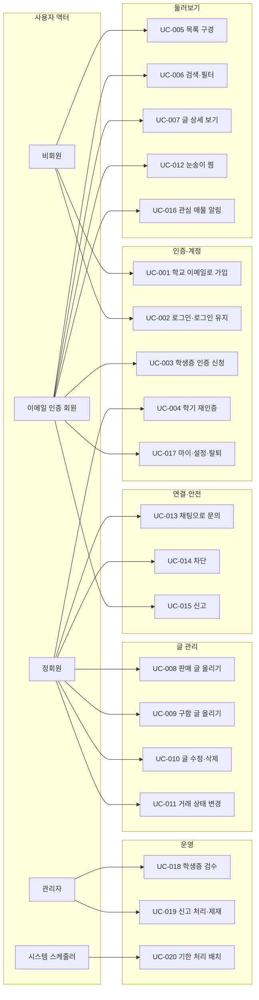
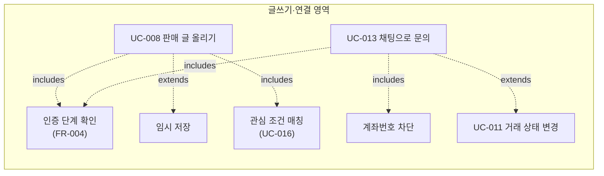
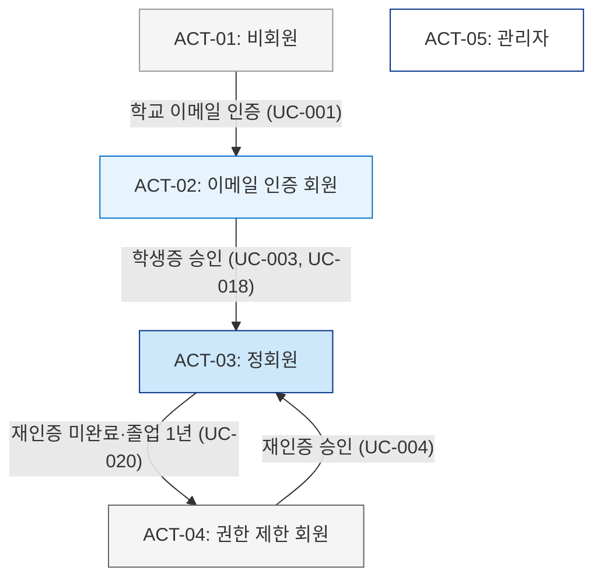

# 유스케이스 명세서

> 숙박숙박 Phase 1 요구사항 분석 산출물이다. [SRS](요구사항명세서-SRS.md) v0.1의 기능 요구사항을 사용자와 시스템이 주고받는 흐름으로 풀었다. 규칙 값은 [비즈니스 정책서](../00-기획/비즈니스정책서.md)와 SRS를 따르고, 규칙 ID로 연결했다. 추적은 [RTM](요구사항추적매트릭스-RTM.md) v0.1에서 한다.

> Use Case Specification

---

## 문서 정보

| 항목 | 내용 |
|------|------|
| 프로젝트명 | 숙박숙박 (SookbakSookbak) |
| 문서 번호 | UCS-SOOKBAK-v0.1 |
| 버전 | v0.1 (초안) |
| 작성일 | 2026-11-26 |
| 작성자 | 이유나 (기획) / Claude (초안 작성 지원) |

---

## 변경 이력

| 버전 | 날짜 | 변경 내용 | 작성자 | 승인자 |
|------|------|-----------|--------|--------|
| v0.1 | 2026-11-26 | 초안 작성. SRS v0.1 기준 UC 20개 (MVP v1.0 범위) | 이유나 / Claude | - |
| v1.0 | [미정] | G1 검토 후 최종 승인 | 이유나 | 이유나 |

---

## 목차

1. [유스케이스 다이어그램](#1-유스케이스-다이어그램)
2. [액터 정의](#2-액터-정의)
3. [유스케이스 목록](#3-유스케이스-목록)
4. [유스케이스 상세 명세](#4-유스케이스-상세-명세)

---

## 1. 유스케이스 다이어그램

### 1.1 전체 시스템 유스케이스 다이어그램

> 상위 액터는 하위 액터의 유스케이스를 모두 쓸 수 있다 (2.3). 그림에는 처음 쓸 수 있게 되는 액터에만 선을 그었다.

### 1.2 기능 영역별 유스케이스 다이어그램

---

## 2. 액터 정의

### 2.1 주요 액터 (Primary Actors)

| Actor ID | 이름 | 설명 | 권한 수준 | 인증 여부 |
|----------|------|------|-----------|-----------|
| ACT-01 | 비회원 | 가입·이메일 인증을 하지 않은 사용자. 숙대생이 아닌 일반인 포함. 목록 구경만 (카드 클릭 불가) | Level 0 | 미인증 |
| ACT-02 | 이메일 인증 회원 | 학교 이메일 인증을 마친 숙대생. 학생증 검수 대기 포함. 상세·검색·찜·관심 조건·매물 신고 | Level 1 | 학교 이메일 |
| ACT-03 | 정회원 | 학생증·증명서 인증까지 마친 재학생·휴학생·졸업 1년 이내 졸업생. 글쓰기·채팅 | Level 2 | 학교 이메일 + 학생증 |
| ACT-04 | 권한 제한 회원 | 재인증 미완료·졸업 1년 경과. Level 1과 같고 기존 채팅방은 읽기만 | Level 1 | 학교 이메일 |
| ACT-05 | 관리자 | 학생증 검수, 신고 처리, 글 숨김·복구, 제재 (담당자 미결 DEC-008) | 관리 | 별도 발급 계정 |

### 2.2 보조 액터 (Secondary Actors)

| Actor ID | 이름 | 설명 | 연동 방식 |
|----------|------|------|-----------|
| ACT-S01 | 메일 발송 서비스 | 인증번호, 재인증·만료·제재 안내 메일 | API |
| ACT-S02 | 앱 푸시 (APNs·FCM) | 채팅, 찜, 관심 매물, 인증 결과 알림 | API |
| ACT-S03 | 주소 검색 API | 주소 → 좌표·동네 이름 | API |
| ACT-S04 | 지도 API | 상세 대략 위치 지도 | SDK |
| ACT-S05 | 사진 스토리지 | 매물·채팅 사진, 학생증 원본(임시) | API |
| ACT-S06 | 이미지 글자 인식(OCR) | 채팅 사진 속 계좌번호 검사 | API 또는 서버 라이브러리 |
| ACT-S07 | 시스템 스케줄러 | 재인증 마감, 졸업 만료, 거래완료 30일 숨김, 방치 글 확인 등 정해진 시각의 처리 | 내부 배치 |

### 2.3 액터 계층 구조

> 상위 액터는 하위 액터의 모든 권한을 포함한다. 관리자는 일반 회원 계층과 별개로 발급한다. 이용 정지 회원은 어떤 유스케이스도 시작할 수 없다.

---

## 3. 유스케이스 목록

| UC-ID | 유스케이스명 | 주요 액터 | 우선순위 | 상태 | 관련 FR |
|-------|-------------|-----------|----------|------|---------|
| UC-001 | 학교 이메일로 가입한다 | 비회원 | P1 | 초안 | FR-001 |
| UC-002 | 로그인하고 로그인 상태를 유지한다 | 비회원·회원 | P1 | 초안 | FR-002 |
| UC-003 | 학생증 인증을 신청한다 | 이메일 인증 회원 | P1 | 초안 | FR-003, FR-004 |
| UC-004 | 학기 재인증을 한다 | 정회원·권한 제한 회원 | P1 | 초안 | FR-005 |
| UC-005 | 목록을 구경한다 | 비회원 이상 | P1 | 초안 | FR-004, FR-006, FR-024 |
| UC-006 | 검색·필터로 글을 찾는다 | 이메일 인증 회원 이상 | P1 | 초안 | FR-017 |
| UC-007 | 글 상세를 본다 | 이메일 인증 회원 이상 | P1 | 초안 | FR-013, FR-009, FR-010, FR-023, FR-024 |
| UC-008 | 판매 글을 올린다 | 정회원 | P1 | 초안 | FR-007, FR-008, FR-009, FR-010, FR-023, FR-025 |
| UC-009 | 구함 글을 올린다 | 정회원 | P1 | 초안 | FR-011 |
| UC-010 | 내 글을 수정·삭제한다 | 정회원 (작성자) | P1 | 초안 | FR-007, FR-011 |
| UC-011 | 거래 상태를 바꾼다 | 정회원 (작성자) | P1 | 초안 | FR-012 |
| UC-012 | 눈송이로 찜한다 | 이메일 인증 회원 이상 | P1 | 초안 | FR-014, FR-020 |
| UC-013 | 채팅으로 문의하거나 방을 제안한다 | 정회원 | P1 | 초안 | FR-015, FR-020, FR-023, FR-025 |
| UC-014 | 상대를 차단한다 | 이메일 인증 회원 이상 | P1 | 초안 | FR-016 |
| UC-015 | 글이나 채팅 상대를 신고한다 | 이메일 인증 회원 이상 | P1 | 초안 | FR-018 |
| UC-016 | 관심 조건을 저장하고 새 글 알림을 받는다 | 이메일 인증 회원 이상 | P1 | 초안 | FR-021, FR-020 |
| UC-017 | 마이에서 정보·설정을 관리하고 탈퇴한다 | 이메일 인증 회원 이상 | P1 | 초안 | FR-022, FR-002, FR-020 |
| UC-018 | 학생증 자료를 검수한다 | 관리자 | P1 | 초안 | FR-019, FR-003 |
| UC-019 | 신고를 처리하고 제재한다 | 관리자 | P1 | 초안 | FR-019, FR-018 |
| UC-020 | 기한이 지난 권한과 글을 처리한다 | 시스템 스케줄러 | P1 | 초안 | FR-005, FR-012, FR-020 |

**상태 정의:**

| 상태 | 설명 |
|------|------|
| 초안 | 최초 작성, 검토 필요 |
| 검토중 | 이해관계자 검토 진행 중 |
| 완료 | 검토 완료 및 승인됨 |
| 변경중 | 승인 후 변경 사항 발생 |

P2·P3 기능(FR-026~029: 끌어올리기, 최근 본 매물, 지도로 모아 보기, 거주 후기)의 유스케이스는 해당 릴리스 계획 때 추가한다.

---

## 4. 유스케이스 상세 명세

---

### 4.1 UC-001: 학교 이메일로 가입한다

| 항목 | 내용 |
|------|------|
| **UC-ID** | UC-001 |
| **유스케이스명** | 학교 이메일로 가입한다 |
| **액터** | 비회원, 메일 발송 서비스 (보조) |
| **설명** | 숙대생이 `@sookmyung.ac.kr` 메일로 받은 인증번호를 입력하고 닉네임·비밀번호를 정해 이메일 인증 회원이 된다. |
| **우선순위** | P1 필수 |
| **트리거** | 비회원이 목록 카드·찜·검색·글쓰기를 눌러 가입 안내가 뜬 뒤 `가입하기`를 누르거나, 마이 탭에서 가입을 고른다 |
| **관련 요구사항** | FR-001 |

#### 사전 조건 (Pre-conditions)

1. 사용자는 로그인하지 않은 상태이다.
2. 사용자는 사용 중인 숙명여대 학교 메일 계정이 있다 (졸업생은 학교 메일이 살아 있어야 한다, DEC-015).
3. 메일 발송 서비스가 동작 중이다.

#### 기본 흐름 (Main Flow)

| 단계 | 액터 | 시스템 |
|------|------|--------|
| 1 | 사용자가 `가입하기`를 누른다. | 학교 이메일 입력 화면(S2)을 보여 준다. |
| 2 | 사용자가 학교 이메일을 입력하고 `인증번호 받기`를 누른다. | 도메인과 가입 여부를 확인한다. |
| 3 | - | 6자리 인증번호를 만들어 메일로 보내고, 6칸 입력창과 남은 시간(10:00)을 보여 준다. |
| 4 | 사용자가 메일에서 번호를 확인해 입력한다. | 번호와 유효 시간을 확인한다. |
| 5 | - | 닉네임·비밀번호·약관 동의 화면을 보여 준다. |
| 6 | 사용자가 닉네임(2~10자), 비밀번호(8자 이상, 영문·숫자)를 입력하고 이용약관·개인정보 처리방침에 동의한다. | 닉네임 중복과 비밀번호 규칙을 실시간으로 확인한다. |
| 7 | 사용자가 `가입 완료`를 누른다. | 비밀번호를 해시로 저장하고 계정(상태 `EMAIL_VERIFIED`)을 만든 뒤 로그인 상태로 만든다. |
| 8 | - | "학생증 인증을 마치면 글쓰기와 채팅을 할 수 있어요" 안내와 `학생증 인증하기`·`다음에 할게요`를 보여 준다. |
| 9 | 사용자가 `다음에 할게요`를 누른다. | 가입 전 보던 화면(누른 카드의 상세 등)으로 돌아간다. |

#### 대안 흐름 (Alternative Flow)

**AF-001-01: 바로 학생증 인증으로 이동**

- 분기 시점: 단계 9
- 사용자가 `학생증 인증하기`를 누른다.
- UC-003으로 이어진다.

**AF-001-02: 인증번호 재발송**

- 분기 시점: 단계 3~4
- 사용자가 `다시 받기`를 누른다.
- 직전 발송 후 60초가 지났으면 새 번호를 보내고 이전 번호는 무효로 한다. 60초가 안 지났으면 남은 초를 보여 준다.
- 단계 4로 돌아간다.

#### 예외 흐름 (Exception Flow)

**EF-001-01: 학교 이메일이 아님**

- 분기 시점: 단계 2
- 조건: 도메인이 `@sookmyung.ac.kr`가 아니다.
- "숙명여대 학교 이메일(@sookmyung.ac.kr)만 사용할 수 있어요"를 보여 주고 진행을 막는다.

**EF-001-02: 이미 가입된 이메일 / 재가입 제한**

- 분기 시점: 단계 2
- 조건: 가입된 이메일이거나, 탈퇴 후 30일이 안 됐거나, 영구 정지된 이메일이다.
- 가입된 이메일이면 "이미 가입된 학교 이메일이에요. 로그인해 주세요"와 로그인 버튼을, 나머지는 가입할 수 없다는 안내를 보여 준다. 유스케이스 종료.

**EF-001-03: 인증번호 불일치·만료**

- 분기 시점: 단계 4
- 틀리면 "인증번호가 맞지 않아요 (남은 횟수 N회)", 10분이 지났으면 "인증번호가 만료됐어요. 다시 받아 주세요"를 보여 준다.
- 5회 틀리면 30분 동안 번호를 다시 요청할 수 없고, 요청 가능 시각을 보여 준다.

**EF-001-04: 메일 발송 실패**

- 분기 시점: 단계 3
- "메일을 보내지 못했어요. 잠시 후 다시 시도해 주세요"를 보여 주고 실패를 기록한다.

#### 사후 조건 (Post-conditions)

**성공 시:**

1. 이메일 인증 회원 계정이 생기고 로그인 상태다.
2. 다른 사용자에게는 닉네임만 공개된다.

**실패 시:**

1. 계정이 만들어지지 않는다. 입력 중이던 이메일은 화면에 남는다.

#### 비즈니스 규칙

| 규칙 ID | 내용 |
|---------|------|
| BP-AUTH-001-1 | `@sookmyung.ac.kr`만 가입 가능 |
| BP-AUTH-001-2 | 학교 이메일 1개당 계정 1개 |
| BP-AUTH-001-3 | 6자리 번호, 10분 유효, 재발송 시 이전 번호 무효 |
| BP-AUTH-001-4 | 5회 실패 시 30분 요청 불가 |
| BP-AUTH-001-5 | 재발송은 60초 후부터 |
| BP-AUTH-001-6 | 닉네임 2~10자, 중복 불가, 닉네임만 공개 |
| BP-AUTH-005-1 | 비밀번호 8자 이상, 영문·숫자 포함 (DEC-009 확정) |
| BP-AUTH-005-5 | 탈퇴 후 30일 재가입 불가 |

#### UI 참조

| 화면 ID | 화면명 | 설명 |
|---------|--------|------|
| S1 | 가입 안내 바텀시트 | "숙대생만 글을 볼 수 있어요. 학교 메일로 인증해 주세요" |
| S2 | 학교 이메일 인증 | 이메일 입력, 6칸 인증번호, 남은 시간, 닉네임·비밀번호 |

#### 관련 요구사항 ID (RTM)

| 요구사항 ID | 설계 문서 | 테스트케이스 |
|------------|----------|-------------|
| FR-001 | 미작성 (Phase 2) | 미작성 |
| NFR-004 | 미작성 | 미작성 |

---

### 4.2 UC-002: 로그인하고 로그인 상태를 유지한다

| 항목 | 내용 |
|------|------|
| **UC-ID** | UC-002 |
| **유스케이스명** | 로그인하고 로그인 상태를 유지한다 |
| **액터** | 비회원(가입한 사용자), 회원 |
| **설명** | 가입한 사용자가 학교 이메일과 비밀번호로 로그인하고, 로그아웃하기 전까지 앱을 다시 열어도 로그인 상태가 유지된다. |
| **우선순위** | P1 필수 |
| **트리거** | 로그아웃 상태에서 가입 안내의 `로그인` 또는 마이 탭의 로그인을 누른다 / 로그인 상태에서 앱을 연다 |
| **관련 요구사항** | FR-002 |

#### 사전 조건 (Pre-conditions)

1. 사용자는 가입한 계정이 있다.

#### 기본 흐름 (Main Flow)

| 단계 | 액터 | 시스템 |
|------|------|--------|
| 1 | 사용자가 `로그인`을 누른다. | 로그인 화면(S1)을 보여 준다. |
| 2 | 사용자가 학교 이메일과 비밀번호를 입력하고 `로그인`을 누른다. | 계정 상태와 비밀번호를 확인한다. |
| 3 | - | 토큰을 발급해 기기 보안 저장소에 저장하고 로그인 이력을 남긴다. |
| 4 | - | 로그인 전 보던 화면으로 돌아간다. 처음이면 푸시 알림 권한을 요청한다. |
| 5 | 사용자가 앱을 닫았다가 다시 연다. | 저장된 토큰으로 로그인 상태를 복원하고 만료 시각을 마지막 이용 + 30일로 늘린 뒤 홈을 보여 준다. |

#### 대안 흐름 (Alternative Flow)

**AF-002-01: 비밀번호 재설정**

- 분기 시점: 단계 2
- 사용자가 `비밀번호를 잊었어요`를 누른다.
- 학교 이메일로 6자리 인증번호를 받아 확인한 뒤 새 비밀번호를 정한다 (UC-001 인증번호 규칙과 같음).
- 다른 기기의 로그인은 모두 끝난다. 단계 2로 돌아간다.

**AF-002-02: 로그아웃**

- 사용자가 마이 > `로그아웃`을 누른다.
- 현재 기기의 토큰을 무효화하고 지운 뒤 홈(비회원 목록)을 보여 준다.

#### 예외 흐름 (Exception Flow)

**EF-002-01: 이메일 또는 비밀번호 불일치**

- 분기 시점: 단계 2
- "이메일 또는 비밀번호가 맞지 않아요"를 보여 준다 (어느 쪽이 틀렸는지 알리지 않음). 연속 5회면 30분 동안 로그인을 막고 해제 시각을 보여 준다.

**EF-002-02: 이용 정지 계정**

- 분기 시점: 단계 2
- 정지 사유와 해제일(7일 정지) 또는 영구 정지 안내를 보여 준다. 유스케이스 종료.

**EF-002-03: 30일 동안 미사용**

- 분기 시점: 단계 5
- 토큰이 만료돼 로그인 화면을 보여 준다.

#### 사후 조건 (Post-conditions)

- 성공 시: 사용자는 로그인 상태이며, 로그아웃·30일 미사용 전까지 유지된다.
- 실패 시: 로그인되지 않고 실패 횟수가 기록된다.

#### 비즈니스 규칙

| 규칙 ID | 내용 |
|---------|------|
| BP-AUTH-005-1 | 학교 이메일 + 비밀번호 로그인 (DEC-009 확정) |
| BP-AUTH-005-2 | 연속 5회 실패 시 30분 잠금 |
| BP-AUTH-005-3 | 마지막 이용 후 30일 로그인 유지 (초안) |

#### UI 참조

| 화면 ID | 화면명 | 설명 |
|---------|--------|------|
| S1 | 로그인 / 가입 안내 | 이메일·비밀번호 입력, 비밀번호 재설정 |

#### 관련 요구사항 ID (RTM)

| 요구사항 ID | 설계 문서 | 테스트케이스 |
|------------|----------|-------------|
| FR-002 | 미작성 | 미작성 |
| NFR-004 | 미작성 | 미작성 |

---

### 4.3 UC-003: 학생증 인증을 신청한다

| 항목 | 내용 |
|------|------|
| **UC-ID** | UC-003 |
| **유스케이스명** | 학생증 인증을 신청한다 |
| **액터** | 이메일 인증 회원, 사진 스토리지 (보조), 관리자 (UC-018) |
| **설명** | 이메일 인증 회원이 학적 상태에 맞는 자료를 올려 정회원 인증을 신청하고 결과를 받는다. |
| **우선순위** | P1 필수 |
| **트리거** | 잠긴 `+ 글쓰기`·`채팅하기`를 눌러 뜬 인증 안내에서 `학생증 인증하기`를 누르거나, 마이의 인증 상태 카드에서 인증을 시작한다 |
| **관련 요구사항** | FR-003, FR-004 |

#### 사전 조건 (Pre-conditions)

1. 사용자는 이메일 인증 회원이다.
2. 검수 대기 중인 제출이 없다.

#### 기본 흐름 (Main Flow)

| 단계 | 액터 | 시스템 |
|------|------|--------|
| 1 | 사용자가 `학생증 인증하기`를 누른다. | 단계 표시(① 학교 이메일 완료 ② 학생증)와 학적 상태 선택을 보여 준다 (S3). |
| 2 | 사용자가 학적 상태(재학생 / 휴학생 / 졸업생)를 고른다. | 상태에 맞는 자료 종류를 보여 준다. 재학생: 모바일 학생증·실물 학생증·재학증명서(30일 이내) / 휴학생: 휴학증명서(30일 이내) / 졸업생: 졸업증명서. |
| 3 | 사용자가 자료 사진을 올리고 `제출`을 누른다. | 형식·크기(10MB 이하)를 확인하고 접근 제한 저장소에 저장한다. |
| 4 | - | 상태를 `PENDING_REVIEW`로 바꾸고 관리자 인증 대기열에 올린다. "학생증을 확인하고 있어요. 영업일 24시간 안에 알려드릴게요"와 접수 시각을 보여 준다. |
| 5 | - | 관리자가 승인하면(UC-018) 상태를 `MEMBER`로 바꾸고 원본을 지운 뒤 승인 알림을 보낸다. |
| 6 | 사용자가 알림을 누른다. | 마이의 인증 상태 카드에 "정회원", "숙대생 인증" 배지, 다음 재인증일(졸업생은 권한 만료일)을 보여 준다. 잠겼던 글쓰기·채팅이 열린다. |

#### 대안 흐름 (Alternative Flow)

**AF-003-01: 검수 대기 중 잠긴 기능을 누름**

- 분기 시점: 단계 4 이후
- 사용자가 `+ 글쓰기`나 `채팅하기`를 누르면 "학생증 확인 중이에요. 영업일 24시간 안에 알려드릴게요"와 접수·예상 완료 시각을 보여 준다.

#### 예외 흐름 (Exception Flow)

**EF-003-01: 반려**

- 분기 시점: 단계 5
- 관리자가 반려하면 원본을 지우고 사유(식별 불가·재학 확인 불가·발급일 초과·타인 자료 의심·졸업 1년 경과·같은 학번 계정 있음·기타)와 함께 알린다.
- 인증 상태 카드에 사유와 `다시 올리기`를 보여 준다. 다시 올리면 단계 2로 돌아간다 (횟수 제한 없음).

**EF-003-02: 검수 대기 중 재제출**

- 분기 시점: 단계 1
- "이미 확인 중인 자료가 있어요"를 보여 준다.

**EF-003-03: 파일 오류**

- 분기 시점: 단계 3
- "10MB 이하 사진만 올릴 수 있어요" 등 오류를 보여 주고 단계 3으로 돌아간다.

#### 사후 조건 (Post-conditions)

- 성공 시: 정회원이 되고, 학번 앞 4자리·학적 상태·승인일(졸업생은 졸업일)만 남는다. 원본 이미지는 없다.
- 실패 시: 이메일 인증 회원으로 남고, 원본 이미지는 없다.

#### 비즈니스 규칙

| 규칙 ID | 내용 |
|---------|------|
| BP-AUTH-002-1 | 학적 상태별 제출 자료 |
| BP-AUTH-002-3 | 검수 목표 영업일 24시간 |
| BP-AUTH-002-4 | 대기 중 추가 제출 불가, 반려 후 무제한 재제출 |
| BP-AUTH-002-6 | 승인·반려 즉시 원본 삭제 |
| BP-AUTH-002-7 | 정회원 범위: 재학생, 휴학생, 졸업 1년 이내 졸업생 (확정) |
| BP-AUTH-003-1 | 검수 대기 중 잠긴 기능 안내 문구 |

#### UI 참조

| 화면 ID | 화면명 | 설명 |
|---------|--------|------|
| S3 | 학생증·증명서 업로드 / 검수 대기 | 학적 상태 선택, 사진 업로드 상자, 검수 상태 |
| S12 | 마이 (인증 상태 카드) | 정회원 / 검수 중 / 반려됨 / 재인증 필요 |

#### 관련 요구사항 ID (RTM)

| 요구사항 ID | 설계 문서 | 테스트케이스 |
|------------|----------|-------------|
| FR-003, FR-004 | 미작성 | 미작성 |
| NFR-005 | 미작성 | 미작성 |

---

### 4.4 UC-004: 학기 재인증을 한다

| 항목 | 내용 |
|------|------|
| **UC-ID** | UC-004 |
| **유스케이스명** | 학기 재인증을 한다 |
| **액터** | 정회원(재학생·휴학생), 권한 제한 회원, 관리자 (UC-018) |
| **설명** | 재학생·휴학생 정회원이 3월·9월 재인증 기간에 학적 자료를 다시 내고 정회원 권한을 유지한다. 졸업생은 재인증 대신 졸업 1년 만료를 따른다 (UC-020). |
| **우선순위** | P1 필수 |
| **트리거** | 재인증 안내 알림(기간 시작일, 마감 7일 전, 1일 전)을 누르거나 마이의 인증 상태 카드에서 `재인증하기`를 누른다 |
| **관련 요구사항** | FR-005 |

#### 사전 조건 (Pre-conditions)

1. 사용자는 재인증 대상 정회원이거나, 재인증을 못 해 권한이 제한된 회원이다.
2. 기간 시작 30일 이내에 정회원이 된 사용자는 대상이 아니다.

#### 기본 흐름 (Main Flow)

| 단계 | 액터 | 시스템 |
|------|------|--------|
| 1 | 사용자가 재인증 안내를 누른다. | 마감일과 "지금 학적 상태가 바뀌었나요?"를 보여 준다. |
| 2 | 사용자가 현재 학적 상태를 고르고 자료를 제출한다. | UC-003 단계 2~4와 같이 처리한다. |
| 3 | - | 관리자가 승인하면 다음 재인증일을 갱신하고 알린다. |

#### 대안 흐름 (Alternative Flow)

**AF-004-01: 권한 제한 후 재인증**

- 분기 시점: 단계 3
- 권한 제한 회원이 승인을 받으면 정회원으로 돌아가고, 비공개였던 거래가능·예약중 판매 글과 구하는 중 구함 글이 다시 공개된다.

**AF-004-02: 기한 안에 냈지만 검수 대기**

- 분기 시점: 단계 2 이후 마감일이 지남
- 검수 결과가 나올 때까지 정회원 권한을 유지한다.

#### 예외 흐름 (Exception Flow)

**EF-004-01: 반려**

- UC-003 EF-003-01과 같다. 마감일이 지나면 UC-020에 따라 권한이 제한된다.

#### 사후 조건 (Post-conditions)

- 성공 시: 정회원 권한이 다음 재인증 기간까지 유지된다.
- 실패 시: 마감 다음 날 00:00에 권한 제한(UC-020).

#### 비즈니스 규칙

| 규칙 ID | 내용 |
|---------|------|
| BP-AUTH-004-1 | 재인증 기간 3월 1~31일, 9월 1~30일 |
| BP-AUTH-004-3 | 마감 후 권한 정지·글 비공개, 기한 내 제출 시 결과까지 유지 |
| BP-AUTH-004-4 | 기간 시작 30일 이내 승인자는 면제 |
| BP-AUTH-004-5 | 재인증 승인 시 비공개 글 재공개 |

#### UI 참조

| 화면 ID | 화면명 | 설명 |
|---------|--------|------|
| S3 | 학생증·증명서 업로드 | 재인증 모드 |
| S12 | 마이 (인증 상태 카드) | "재인증 필요", 마감일 |

#### 관련 요구사항 ID (RTM)

| 요구사항 ID | 설계 문서 | 테스트케이스 |
|------------|----------|-------------|
| FR-005 | 미작성 | 미작성 |

---

### 4.5 UC-005: 목록을 구경한다

| 항목 | 내용 |
|------|------|
| **UC-ID** | UC-005 |
| **유스케이스명** | 목록을 구경한다 |
| **액터** | 비회원 이상 모든 사용자 |
| **설명** | 앱을 열면 판매·구함 글 목록이 바로 나오고, 판매/구함 전환과 분류 탭으로 원하는 글을 훑어본다. 비회원은 구경만 하고 카드를 열 수 없다. |
| **우선순위** | P1 필수 |
| **트리거** | 사용자가 앱을 열거나 하단 탭 `홈`을 누른다 |
| **관련 요구사항** | FR-004, FR-006, FR-024 |

#### 사전 조건 (Pre-conditions)

1. 사용자는 이용 정지 상태가 아니다.

#### 기본 흐름 (Main Flow)

| 단계 | 액터 | 시스템 |
|------|------|--------|
| 1 | 사용자가 앱을 연다. | 판매 목록을 최신순으로 보여 준다. 첫 카드 10개를 2초 안에 표시한다. |
| 2 | 사용자가 위아래로 스크롤한다. | 다음 카드 묶음을 이어서 불러온다 (무한 스크롤). |
| 3 | 사용자가 `구함`으로 전환한다. | 구함 글 목록을 보여 준다. |
| 4 | 사용자가 분류 탭(예: `단기숙박`)을 누른다. | 해당 분류 글만 보여 준다. 적용한 필터는 유지한다. |
| 5 | 회원이 카드를 누른다. | 글 상세를 연다 (UC-007). |

카드에는 가격, 분류(하숙은 하숙 이름), 층·면적·관리비, "동네 이름 · 숙대 기준 위치 근처"(숙대 근처가 아니면 "동네 이름 · 위치 이름 근처", 예: "신림동 · 신림역 근처"), 입주 가능일, 거래 상태 배지, "올린 시각 · 채팅 N · 찜 N"이 나온다. 도보 시간과 주소는 나오지 않는다.

#### 대안 흐름 (Alternative Flow)

**AF-005-01: 정렬 변경**

- 분기 시점: 단계 2
- 이메일 인증 회원 이상이 정렬(최신순 / 낮은 가격순 / 찜 많은순)을 바꾸면 목록을 다시 불러온다.

**AF-005-02: 내 관심 조건 칩**

- 관심 조건이 있는 사용자가 "내 관심 조건" 칩을 누르면 그 조건이 적용된 목록을 보여 준다 (UC-016).

#### 예외 흐름 (Exception Flow)

**EF-005-01: 비회원이 카드·찜·검색·필터·글쓰기를 누름**

- 분기 시점: 단계 5
- 글을 열지 않고 "숙대생만 글을 볼 수 있어요. 학교 메일로 인증해 주세요" 바텀시트와 `가입하기`·`로그인`을 띄운다. `가입하기`를 누르면 UC-001로 이어진다.

**EF-005-02: 네트워크 오류**

- 1·2·4초 간격으로 3회 다시 시도하고, 실패하면 "네트워크 연결을 확인해 주세요"와 `다시 시도`를 보여 준다. 오프라인이면 배너와 이미 불러온 목록을 보여 준다.

#### 사후 조건 (Post-conditions)

- 성공 시: 사용자가 공개 글 목록을 본다. 비공개·숨김·삭제 글, 차단한 사용자의 글, 거래완료 30일 지난 글은 없다.

#### 비즈니스 규칙

| 규칙 ID | 내용 |
|---------|------|
| BP-AUTH-003-0 | 비회원은 목록 스크롤·판매/구함 전환·분류 탭만, 카드 클릭 불가 |
| BP-LISTING-001-10 | 카드 표시 항목 |
| BP-LISTING-003-3 | 거래완료 글은 아래로, "거래가능만 보기" 시 숨김 |
| BP-LISTING-003-5 | 최신순 기준은 최초 등록 시각 |
| BP-CHAT-003-2 | 차단한 사용자의 글은 안 보임 |
| BP-STAT-002-1~3 | 메타 줄 표시 규칙 |

#### UI 참조

| 화면 ID | 화면명 | 설명 |
|---------|--------|------|
| S4 | 홈 | 판매/구함 전환, 분류 탭, 필터 칩, 카드 목록, `+ 글쓰기`, 하단 탭 바 |
| S1 | 가입 안내 바텀시트 | 비회원이 카드를 누를 때 |

#### 관련 요구사항 ID (RTM)

| 요구사항 ID | 설계 문서 | 테스트케이스 |
|------------|----------|-------------|
| FR-004, FR-006, FR-024 | 미작성 | 미작성 |
| NFR-001, NFR-012 | 미작성 | 미작성 |

---

### 4.6 UC-006: 검색·필터로 글을 찾는다

| 항목 | 내용 |
|------|------|
| **UC-ID** | UC-006 |
| **유스케이스명** | 검색·필터로 글을 찾는다 |
| **액터** | 이메일 인증 회원 이상 |
| **설명** | 키워드와 필터(가격, 분류, 숙대 기준 위치, 동네, 입주일, 기간, 조건)로 원하는 글만 본다. |
| **우선순위** | P1 필수 |
| **트리거** | 홈의 필터 칩이나 검색 아이콘을 누른다 |
| **관련 요구사항** | FR-017 |

#### 사전 조건 (Pre-conditions)

1. 사용자는 이메일 인증 회원 이상이다 (비회원은 UC-005 EF-005-01).

#### 기본 흐름 (Main Flow)

| 단계 | 액터 | 시스템 |
|------|------|--------|
| 1 | 사용자가 필터 칩(예: 숙대 기준 위치)을 누른다. | 필터 바텀시트(S5)를 연다. |
| 2 | 사용자가 "도서관 후문", 월세 0~50을 고른다. | 조건에 맞는 글 수를 버튼에 미리 보여 준다 ("매물 12개 보기"). |
| 3 | 사용자가 버튼을 누른다. | 목록을 다시 불러오고 칩에 적용 값("도서관 후문", "월세 50 이하")을 표시한다. |

#### 대안 흐름 (Alternative Flow)

**AF-006-01: 키워드 검색**

- 사용자가 검색 아이콘을 누르고 "청파동"을 입력한다.
- 제목·글쓰기란·동네 이름·역 이름에서 찾은 결과를 보여 주고, 검색어를 최근 검색어(최대 10개)에 저장한다.

**AF-006-02: 관리비 포함 비교**

- "관리비 포함"을 켜면 월세 범위를 월 예상 비용(월세 + 관리비)으로 비교한다. 단기임대 주 단위 금액은 × 4.3으로 환산한다.

**AF-006-03: 초기화**

- `초기화`를 누르면 모든 필터를 해제하고 전체 목록을 보여 준다.

**AF-006-04: 이 조건으로 알림 받기**

- 결과 화면에서 `이 조건으로 알림 받기`를 누르면 UC-016으로 이어진다.

#### 예외 흐름 (Exception Flow)

**EF-006-01: 결과 없음**

- "조건에 맞는 글이 없어요"와 `필터 초기화`, `구함 글 올리기`(정회원), `이 조건으로 알림 받기`를 보여 준다.

#### 사후 조건 (Post-conditions)

- 성공 시: 모든 필터(AND)와 필터 안의 복수 값(OR)을 만족하는 공개 글만 보인다. 분류 탭을 바꿔도 필터는 유지된다.

#### 비즈니스 규칙

| 규칙 ID | 내용 |
|---------|------|
| BP-AUTH-003-0 | 검색·필터는 이메일 인증 회원부터 |
| BP-PRICE-001-4 | 주 단위 금액 × 4.3 월 환산 |
| BP-PRICE-002-3 | "관리비 포함" 시 월 예상 비용으로 비교 |

#### UI 참조

| 화면 ID | 화면명 | 설명 |
|---------|--------|------|
| S5 | 필터 바텀시트 | 값 선택, 결과 수 미리보기, 초기화 |
| S6 | 검색 | 키워드, 최근 검색어, 결과 |

#### 관련 요구사항 ID (RTM)

| 요구사항 ID | 설계 문서 | 테스트케이스 |
|------------|----------|-------------|
| FR-017 | 미작성 | 미작성 |

---

### 4.7 UC-007: 글 상세를 본다

| 항목 | 내용 |
|------|------|
| **UC-ID** | UC-007 |
| **유스케이스명** | 글 상세를 본다 |
| **액터** | 이메일 인증 회원 이상, 지도 API (보조) |
| **설명** | 사진·가격·정보·대략 위치를 확인하고 찜·채팅·신고로 이어간다. |
| **우선순위** | P1 필수 |
| **트리거** | 목록 카드, 찜 목록, 알림, 공유 링크를 누른다 |
| **관련 요구사항** | FR-013, FR-009, FR-010, FR-023, FR-024 |

#### 사전 조건 (Pre-conditions)

1. 사용자는 이메일 인증 회원 이상이다.
2. 글은 공개 상태다 (작성자 본인은 자기 비공개·숨김 글도 볼 수 있다).

#### 기본 흐름 (Main Flow)

| 단계 | 액터 | 시스템 |
|------|------|--------|
| 1 | 사용자가 카드를 누른다. | 상세(S7)를 연다. 같은 사용자의 24시간 내 첫 조회면 조회 수를 1 올린다 (작성자 제외). |
| 2 | 사용자가 사진을 좌우로 넘기고 눌러 크게 본다. | 사진마다 방·화장실 표시를 보여 준다. |
| 3 | 사용자가 아래로 스크롤한다. | 작성자 영역(닉네임, "숙대생 인증" 배지, 가입 기간, 올린 매물 수), 가격 블록(월 예상 비용 포함), 기본 정보 표, 분류별 정보(하숙 이름·식사 등), 옵션, 본문을 보여 준다. |
| 4 | - | 위치 영역에 "청파동 · 도서관 후문 근처"와 작은 지도(대략 위치 반경 원 + 숙대 위치)를 보여 준다. |
| 5 | - | "숙박숙박은 방을 보고 연결되는 데까지만 도와요. 앱 안에서는 송금할 수 없고, 계약 전에는 절대 송금하지 마세요. 반드시 직접 방문하고 등기부등본을 확인하세요." 안내를 항상 보여 준다. |
| 6 | 사용자가 하단 고정 바의 눈송이 아이콘이나 `채팅하기`를 누른다. | UC-012 또는 UC-013으로 이어진다. |

#### 대안 흐름 (Alternative Flow)

**AF-007-01: 작성자 본인의 글**

- `채팅하기` 대신 `채팅 N개 보기`, 오른쪽 위 메뉴에 수정·상태 변경·삭제를 보여 준다 (UC-010, UC-011).

**AF-007-02: 정회원이 아닌 사용자가 `채팅하기`를 누름**

- 자물쇠가 있는 버튼을 누르면 학생증 인증 안내 바텀시트를 띄운다 (UC-003).

**AF-007-03: 공유**

- 메뉴의 `공유`를 누르면 앱 링크를 만든다. 링크를 연 사람에게도 같은 권한 규칙을 적용한다.

**AF-007-04: 구함 글 상세**

- 원하는 분류, 희망 위치, 예산, 입주 희망일·기간, 사진(있으면), 본문, 상태와 `채팅하기`(방 제안)를 보여 준다.

#### 예외 흐름 (Exception Flow)

**EF-007-01: 비회원의 요청**

- 401을 받고 가입 안내를 띄운다.

**EF-007-02: 숨김·삭제된 글**

- "삭제되었거나 숨겨진 글이에요"와 `홈으로` 버튼을 보여 준다.

**EF-007-03: 지도 로딩 실패**

- 지도 대신 동네 이름·숙대 기준 위치 텍스트만 보여 준다.

#### 사후 조건 (Post-conditions)

- 성공 시: 조회 수가 기록되고, 건물 주소·좌표·작성자 실명은 어디에도 노출되지 않는다.

#### 비즈니스 규칙

| 규칙 ID | 내용 |
|---------|------|
| BP-DEAL-003 | 상세 안내 문구 항상 표시 |
| BP-PRIVACY-002·003 | 대략 위치 원만 표시, 상세 주소는 채팅으로 |
| BP-PRIVACY-004 | 공개 정보는 닉네임·사진·배지·가입 기간·매물 수 |
| BP-PRICE-002-1 | 월 예상 비용 = 월세 + 관리비 |
| BP-STAT-001 | 조회 수 24시간 1인 1회, 작성자 제외 |

#### UI 참조

| 화면 ID | 화면명 | 설명 |
|---------|--------|------|
| S7 | 판매·구함 글 상세 | 사진 캐러셀, 가격 블록, 정보 표, 미니 지도, 안내, 하단 고정 바 |

#### 관련 요구사항 ID (RTM)

| 요구사항 ID | 설계 문서 | 테스트케이스 |
|------------|----------|-------------|
| FR-013, FR-009, FR-010, FR-023, FR-024 | 미작성 | 미작성 |
| NFR-005 | 미작성 | 미작성 |

---

### 4.8 UC-008: 판매 글을 올린다

| 항목 | 내용 |
|------|------|
| **UC-ID** | UC-008 |
| **유스케이스명** | 판매 글을 올린다 |
| **액터** | 정회원, 주소 검색 API·사진 스토리지 (보조) |
| **설명** | 정회원이 방을 내놓는 글을 정해진 필드로 채워 올린다. 필수 항목을 다 채워야 게시된다. |
| **우선순위** | P1 필수 |
| **트리거** | `+ 글쓰기`를 누르고 `판매`를 고른다 |
| **관련 요구사항** | FR-007, FR-008, FR-009, FR-010, FR-023, FR-025 |

#### 사전 조건 (Pre-conditions)

1. 사용자는 정회원이다.
2. 공개 중인 판매 글(거래가능·예약중)이 3건 미만이다.

#### 기본 흐름 (Main Flow)

| 단계 | 액터 | 시스템 |
|------|------|--------|
| 1 | 사용자가 `+ 글쓰기` → `판매`를 누른다. | 한 화면 세로 스크롤 글쓰기 화면(S8)을 연다. 상단 `완료`는 비활성이다. |
| 2 | 사용자가 사진을 2~10장 고르고, 사진마다 방 / 화장실 / 기타를 붙인다. | EXIF를 지우고 업로드한다. 방·화장실이 각 1장 이상인지 표시한다. |
| 3 | 사용자가 분류(예: 원룸)와 분류별 항목(구조: 분리형)을 고른다. | 분류에 맞는 가격 입력칸과 추가 항목을 보여 준다. |
| 4 | 사용자가 거래 방식(월세), 보증금 500, 월세 45, 관리비 5와 포함 항목(수도·인터넷)을 입력한다. | 월 예상 비용 50을 미리 보여 준다. |
| 5 | 사용자가 주소를 검색해 고른다. | 동네 이름(청파동)을 자동으로 채운다 (수정 불가). |
| 6 | 사용자가 숙대 기준 위치(도서관 후문)를 고른다. | 카드 미리보기에 "청파동 · 도서관 후문 근처"를 보여 준다. |
| 7 | 사용자가 층(3/5층), 전용면적(20㎡), 제목을 입력하고, 원하면 입주 가능일·옵션·건물 조건·글쓰기란을 채운다. | 면적을 평(6.0평)으로 함께 보여 준다. |
| 8 | 사용자가 "실제 거래는 앱 밖에서 당사자 간에 이루어지며, 앱 안 송금은 없습니다. 허위 매물은 제재됩니다"에 동의한다. | 필수 항목이 모두 차면 `완료`를 켠다. |
| 9 | 사용자가 `완료`를 누른다. | 서버가 같은 검증을 다시 하고, 상태 `거래가능`·공개로 저장한다. 5초 안의 중복 요청은 하나만 처리한다. |
| 10 | - | 작성한 글 상세로 이동하고, 판매 목록 최상단에 노출한다. 관심 조건 매칭을 실행한다 (UC-016). |

#### 대안 흐름 (Alternative Flow)

**AF-008-01: 숙대 근처가 아닌 방**

- 분기 시점: 단계 6
- 사용자가 "숙대 근처 아님"을 고르면 위치 이름 입력칸이 나온다. "신림역"처럼 그 동네에서 쓰는 이름을 적는다 (건물 이름·호수 금지 안내). 카드에는 "신림동 · 신림역 근처"로 보인다.

**AF-008-02: 하숙**

- 분기 시점: 단계 3
- 하숙 이름(예: 청파하숙), 식사 제공(조식·석식·없음), 1인실·2인실을 입력한다. 가격은 하숙비(월)이며 카드에 "하숙 · 청파하숙 · 식사 포함", `하숙 월 65`로 보인다.

**AF-008-03: 단기숙박**

- 분기 시점: 단계 3
- 숙박 가능 기간(1일 이상 30일 미만), 가격 단위(1박 / 1주), 숙박비, 집주인 동의 여부를 입력한다. "며칠 단위로 돈을 받고 반복해서 방을 빌려주는 것은 숙박업 신고 대상이 될 수 있어요" 안내를 보여 주고, 본인이 사는 방의 빈 기간이라는 확인에 동의해야 한다. 공개 중인 단기숙박 글이 이미 있으면 올릴 수 없다.

**AF-008-04: 단기임대·전대·계약 승계**

- 분기 시점: 단계 3
- 임대 가능 기간(30~183일)과 집주인 동의 여부(받음 / 받지 않음 / 확인 중)를 반드시 고른다.

**AF-008-05: 전세**

- 분기 시점: 단계 4
- 거래 방식 전세를 고르면 전세금·관리비 입력칸만 보인다. 월 예상 비용은 관리비만이다.

**AF-008-06: 작성 중 이탈과 이어 쓰기**

- 분기 시점: 단계 2~8
- 사용자가 화면을 벗어나면 입력 내용을 임시 저장한다 (1인 1개, 7일 보관). 다시 들어오면 "작성 중인 글이 있어요. 이어서 쓸까요?"를 묻는다.

#### 예외 흐름 (Exception Flow)

**EF-008-01: 필수 항목 누락**

- 분기 시점: 단계 9
- 비활성 `완료`를 누르면 첫 번째 빈 항목으로 스크롤하고 오류 문구(예: "화장실 사진을 1장 이상 올려 주세요")를 보여 준다.

**EF-008-02: 공개 판매 글 3건 초과**

- 분기 시점: 단계 1
- "공개 중인 매물은 최대 3건까지 올릴 수 있어요. 기존 매물을 거래완료로 바꾸거나 삭제해 주세요"를 보여 준다.

**EF-008-03: 정회원 아님**

- 분기 시점: 단계 1
- 학생증 인증 안내를 띄운다 (UC-003).

**EF-008-04: 사진 크기 초과·업로드 실패**

- 분기 시점: 단계 2
- "10MB 이하 사진만 올릴 수 있어요"를 보여 주고 해당 사진만 빼거나 다시 시도한다.

**EF-008-05: 작성 중 연결 끊김**

- 분기 시점: 단계 2~9
- 입력 내용을 기기에 저장하고, 복구되면 서버 임시 저장본과 동기화한다. 등록 요청은 자동으로 다시 보내지 않는다.

**EF-008-06: 주소 검색 실패**

- 분기 시점: 단계 5
- 재시도 안내를 보여 주고, 주소가 없으면 `완료`가 켜지지 않는다.

#### 사후 조건 (Post-conditions)

- 성공 시: 판매 글이 `거래가능`·공개로 저장되고 목록 최상단에 보인다. 임시 저장본은 지워진다. 조건이 맞는 사용자에게 관심 매물 알림이 간다.
- 실패 시: 글은 게시되지 않고 입력 내용은 임시 저장본에 남는다.

#### 비즈니스 규칙

| 규칙 ID | 내용 |
|---------|------|
| BP-LISTING-001-1 | 정회원만 작성 |
| BP-LISTING-001-2 | 판매 분류 7개, 아파트 없음 |
| BP-LISTING-001-3·3a | 필수·선택 항목 |
| BP-LISTING-001-4·5 | 분류별 필수 항목, 집주인 동의 여부 |
| BP-LISTING-001-6 | 필수 누락 시 `완료` 비활성, 빈 항목으로 스크롤 |
| BP-LISTING-001-7 | 임시 저장 1인 1개, 7일 |
| BP-LISTING-001-8 | 동네 이름 자동, 숙대 기준 위치 선택, 도보 시간 없음 (숙대 근처 아님이면 위치 이름, DEC-012) |
| BP-LISTING-001-9 | 사진 2~10장, 방·화장실 각 1장 이상, 장당 10MB |
| BP-LISTING-002-1 | 공개 판매 글 1인 3건 |
| BP-PRICE-001~003 | 가격 필드·계산·표기 |
| BP-PRIVACY-001·007 | 동·호수 미수집, EXIF 제거 |
| BP-DEAL-002 | 비개입 고지 동의 |
| BP-ERROR-002-1·3 | 연결 끊김 시 기기 저장, 5초 중복 요청 방지 |
| SRS FR-008 | 단기숙박 안전장치 (최소 기간 없음, DEC-013) |

#### UI 참조

| 화면 ID | 화면명 | 설명 |
|---------|--------|------|
| S8 | 판매 글쓰기 / 수정 | 사진 → 분류 → 가격 → 위치 → 기본 정보 → 일정 → 옵션 → 건물 → 분류별 항목 → 제목 → 설명 → 확인 |

#### 관련 요구사항 ID (RTM)

| 요구사항 ID | 설계 문서 | 테스트케이스 |
|------------|----------|-------------|
| FR-007, FR-008, FR-009, FR-010, FR-023, FR-025 | 미작성 | 미작성 |
| NFR-001, NFR-005 | 미작성 | 미작성 |

---

### 4.9 UC-009: 구함 글을 올린다

| 항목 | 내용 |
|------|------|
| **UC-ID** | UC-009 |
| **유스케이스명** | 구함 글을 올린다 |
| **액터** | 정회원 |
| **설명** | 원하는 방이 목록에 없을 때 방을 구한다고 알린다. 방을 가진 정회원이 채팅으로 제안한다. |
| **우선순위** | P1 필수 |
| **트리거** | `+ 글쓰기`를 누르고 `구함`을 고르거나, 검색 결과가 없을 때 `구함 글 올리기`를 누른다 |
| **관련 요구사항** | FR-011 |

#### 사전 조건 (Pre-conditions)

1. 사용자는 정회원이다.
2. `구하는 중`인 구함 글이 없다 (1건 한도, 초안 DEC-004).

#### 기본 흐름 (Main Flow)

| 단계 | 액터 | 시스템 |
|------|------|--------|
| 1 | 사용자가 `+ 글쓰기` → `구함`을 누른다. | 구함 글쓰기 화면(S8a)을 연다. |
| 2 | 사용자가 원하는 분류(복수), 희망 위치(숙대 기준 위치·동네, 복수), 예산(보증금 상한·월 비용 상한), 입주 희망일, 제목을 입력하고, 원하면 희망 기간·사진·글쓰기란을 채운다. | 필수 항목이 다 차면 `완료`를 켠다. |
| 3 | 사용자가 `완료`를 누른다. | `구하는 중`·공개로 저장하고 구함 목록 최상단에 노출한다. 구함 글 유형의 관심 조건과 매칭한다. |
| 4 | 다른 정회원이 구함 글에서 `채팅하기`를 누른다. | 채팅방을 열고 작성자에게 알린다 (UC-013). |

#### 대안 흐름 (Alternative Flow)

**AF-009-01: 임시 저장·이어 쓰기** — UC-008 AF-008-06과 같다.

#### 예외 흐름 (Exception Flow)

**EF-009-01: 구하는 중 글이 이미 있음**

- 분기 시점: 단계 1
- 기존 글을 `구함완료`로 바꾸거나 삭제하라는 안내를 보여 준다.

**EF-009-02: 필수 항목 누락** — UC-008 EF-008-01과 같다.

#### 사후 조건 (Post-conditions)

- 성공 시: 구함 글이 공개되고, 정회원은 채팅으로 방을 제안할 수 있다.

#### 비즈니스 규칙

| 규칙 ID | 내용 |
|---------|------|
| BP-LISTING-005-1 | 구함 글 필수·선택 항목 |
| BP-LISTING-005-3 | 정회원은 구함 글에 채팅으로 제안 |
| BP-LISTING-002-1 | 구하는 중 구함 글 1인 1건 (초안) |

#### UI 참조

| 화면 ID | 화면명 | 설명 |
|---------|--------|------|
| S8a | 구함 글쓰기 / 수정 | 원하는 분류·위치·예산·입주 희망일 |

#### 관련 요구사항 ID (RTM)

| 요구사항 ID | 설계 문서 | 테스트케이스 |
|------------|----------|-------------|
| FR-011 | 미작성 | 미작성 |

---

### 4.10 UC-010: 내 글을 수정·삭제한다

| 항목 | 내용 |
|------|------|
| **UC-ID** | UC-010 |
| **유스케이스명** | 내 글을 수정·삭제한다 |
| **액터** | 정회원 (작성자) |
| **설명** | 작성자가 올린 판매·구함 글을 고치거나 지운다. |
| **우선순위** | P1 필수 |
| **트리거** | 글 상세 메뉴나 마이 > 내 글에서 `수정`·`삭제`를 누른다 |
| **관련 요구사항** | FR-007, FR-011 |

#### 사전 조건 (Pre-conditions)

1. 사용자는 그 글의 작성자다.
2. 수정은 정회원 권한이 있어야 한다. 삭제는 권한 제한 회원도 할 수 있다 (초안).

#### 기본 흐름 (Main Flow) — 수정

| 단계 | 액터 | 시스템 |
|------|------|--------|
| 1 | 사용자가 `수정`을 누른다. | 기존 값이 채워진 글쓰기 화면을 연다. |
| 2 | 사용자가 월세를 45에서 42로 내리고 `완료`를 누른다. | 작성과 같은 검증을 다시 한다. 최신순 위치는 바꾸지 않는다. |
| 3 | - | 가격이 내려갔으므로 "가격 인하" 표시를 3일간 붙이고, 찜한 사용자와 새로 조건에 맞게 된 관심 조건 사용자에게 알린다. |

#### 대안 흐름 (Alternative Flow)

**AF-010-01: 삭제**

- 사용자가 `삭제`를 누르고 확인한다.
- 글을 목록·검색·찜 목록에서 없앤다. 진행 중인 채팅방은 남고 상단 요약에 "삭제된 매물"이 보인다.

#### 예외 흐름 (Exception Flow)

**EF-010-01: 신고로 숨겨진 글을 수정**

- 수정은 저장되지만 관리자 검토 전까지 다시 공개되지 않는다는 안내를 보여 준다.

**EF-010-02: 다른 사람의 글**

- 수정·삭제 메뉴가 없고, API로 요청하면 403을 받는다.

#### 사후 조건 (Post-conditions)

- 성공 시: 수정 내용이 상세·카드·채팅 요약에 같은 형식으로 반영되고 가격 변경 이력이 남는다.

#### 비즈니스 규칙

| 규칙 ID | 내용 |
|---------|------|
| BP-LISTING-004-1~3 | 수정·삭제 규칙 |
| BP-LISTING-003-5·6 | 수정해도 순서 유지, 가격 인하 3일 표시 |
| BP-NOTI-003-3 | 가격을 내려 새로 맞게 된 글은 관심 조건 1회 알림 |

#### UI 참조

| 화면 ID | 화면명 | 설명 |
|---------|--------|------|
| S7, S8, S8a, S12 | 상세 메뉴, 글쓰기(수정), 내 글 | |

#### 관련 요구사항 ID (RTM)

| 요구사항 ID | 설계 문서 | 테스트케이스 |
|------------|----------|-------------|
| FR-007, FR-011 | 미작성 | 미작성 |

---

### 4.11 UC-011: 거래 상태를 바꾼다

| 항목 | 내용 |
|------|------|
| **UC-ID** | UC-011 |
| **유스케이스명** | 거래 상태를 바꾼다 |
| **액터** | 정회원 (작성자) |
| **설명** | 작성자가 판매 글을 `거래가능` → `예약중` → `거래완료`로, 구함 글을 `구하는 중` → `구함완료`로 바꾼다. |
| **우선순위** | P1 필수 |
| **트리거** | 글 상세 메뉴, 내 글, 채팅방 상단 요약의 `예약중으로 변경`을 누른다 |
| **관련 요구사항** | FR-012 |

#### 사전 조건 (Pre-conditions)

1. 사용자는 그 글의 작성자다.

#### 기본 흐름 (Main Flow)

| 단계 | 액터 | 시스템 |
|------|------|--------|
| 1 | 작성자가 채팅방 상단의 `예약중으로 변경`을 누른다. | 상태를 `예약중`으로 바꾸고 카드에 배지를 붙인다. |
| 2 | - | 찜한 사용자에게 상태 변경 알림을 보낸다 (같은 글은 하루 1회, 밤 22~08시는 08시에). |
| 3 | 계약이 끝난 뒤 작성자가 `거래완료`를 누른다. | 상태를 `거래완료`로 바꾸고 목록 아래로 내린다. 새 채팅은 막고 기존 채팅방은 유지한다. |

#### 대안 흐름 (Alternative Flow)

**AF-011-01: 되돌리기**

- `예약중` → `거래가능`은 언제든, `거래완료` → `예약중`은 거래완료 후 24시간 안에만 된다.

**AF-011-02: 구함 글**

- 작성자가 `구함완료`를 누르면 상태를 바꾸고, 30일 뒤 목록에서 숨긴다 (UC-020).

#### 예외 흐름 (Exception Flow)

**EF-011-01: 24시간이 지난 거래완료 되돌리기**

- "거래완료 후 24시간이 지나 되돌릴 수 없어요"를 보여 준다.

#### 사후 조건 (Post-conditions)

- 성공 시: 상태가 목록·상세·채팅 요약에 바로 반영된다. 앱은 거래완료 표시만 기록하고 계약 사실·금액을 확인하지 않는다.

#### 비즈니스 규칙

| 규칙 ID | 내용 |
|---------|------|
| BP-LISTING-003-1 | 상태 전이와 되돌리기 조건 |
| BP-CHAT-002-4·5 | 거래완료 글 새 채팅 불가, 채팅방에서 예약중 변경 |
| BP-NOTI-002-2·3 | 찜 알림 하루 1회, 야간 보류 |
| BP-DEAL-005 | 거래완료 표시만 기록 |

#### UI 참조

| 화면 ID | 화면명 | 설명 |
|---------|--------|------|
| S7, S11, S12 | 상세 메뉴, 채팅방 요약, 내 글 | |

#### 관련 요구사항 ID (RTM)

| 요구사항 ID | 설계 문서 | 테스트케이스 |
|------------|----------|-------------|
| FR-012 | 미작성 | 미작성 |

---

### 4.12 UC-012: 눈송이로 찜한다

| 항목 | 내용 |
|------|------|
| **UC-ID** | UC-012 |
| **유스케이스명** | 눈송이로 찜한다 |
| **액터** | 이메일 인증 회원 이상, 앱 푸시 (보조) |
| **설명** | 눈송이 아이콘으로 관심 글을 모아 두고 가격·상태 변화를 알림으로 받는다. |
| **우선순위** | P1 필수 |
| **트리거** | 목록 카드 썸네일 위나 상세 하단의 눈송이 아이콘을 누른다 |
| **관련 요구사항** | FR-014, FR-020 |

#### 사전 조건 (Pre-conditions)

1. 사용자는 이메일 인증 회원 이상이다.
2. 자기 글이 아니다.

#### 기본 흐름 (Main Flow)

| 단계 | 액터 | 시스템 |
|------|------|--------|
| 1 | 사용자가 빈 눈송이 아이콘을 누른다. | 아이콘을 하늘빛 파랑으로 채우고 찜 수를 1 올린다. |
| 2 | 사용자가 하단 탭 `찜`을 누른다. | 찜한 글을 최신 찜순으로 보여 주고 분류 필터를 제공한다. |
| 3 | - | 찜한 글의 가격이 내리거나 `예약중`·`거래완료`가 되면 알림을 보낸다. |

#### 대안 흐름 (Alternative Flow)

**AF-012-01: 찜 해제** — 채워진 아이콘을 다시 누르면 해제하고 찜 수를 1 내린다.

#### 예외 흐름 (Exception Flow)

**EF-012-01: 비회원** — 가입 안내를 띄운다 (UC-005 EF-005-01).

**EF-012-02: 자기 글** — 작성자에게는 눈송이 아이콘 대신 찜 수만 보인다.

#### 사후 조건 (Post-conditions)

- 성공 시: 찜 목록에 글이 있다. 숨김·삭제된 글은 찜 목록에서 빠지고, 거래완료 글은 "거래완료"로 남는다. 작성자는 누가 찜했는지 알 수 없다.

#### 비즈니스 규칙

| 규칙 ID | 내용 |
|---------|------|
| BP-CHAT-001-0~5 | 눈송이 아이콘, 찜 권한, 자기 글 불가, 찜한 사람 비공개, 목록 규칙, 상한 없음 |
| BP-NOTI-001 | 찜 글 가격 인하·상태 변경 알림 |

#### UI 참조

| 화면 ID | 화면명 | 설명 |
|---------|--------|------|
| S4, S7, S9 | 목록 카드, 상세 하단 바, 찜 목록 | |

#### 관련 요구사항 ID (RTM)

| 요구사항 ID | 설계 문서 | 테스트케이스 |
|------------|----------|-------------|
| FR-014, FR-020 | 미작성 | 미작성 |
| NFR-012 | 미작성 | 미작성 |

---

### 4.13 UC-013: 채팅으로 문의하거나 방을 제안한다

| 항목 | 내용 |
|------|------|
| **UC-ID** | UC-013 |
| **유스케이스명** | 채팅으로 문의하거나 방을 제안한다 |
| **액터** | 정회원, 앱 푸시·사진 스토리지·이미지 글자 인식 (보조) |
| **설명** | 정회원이 판매 글 작성자에게 문의하거나 구함 글 작성자에게 방을 제안한다. 텍스트와 사진을 주고받고, 필요하면 전화번호를 교환한다. 계좌번호가 든 메시지·사진은 보낼 수 없다. |
| **우선순위** | P1 필수 |
| **트리거** | 글 상세의 `채팅하기`를 누르거나, 채팅 목록에서 방을 연다 |
| **관련 요구사항** | FR-015, FR-020, FR-023, FR-025 |

#### 사전 조건 (Pre-conditions)

1. 사용자는 정회원이다.
2. 글은 `거래완료`가 아니고, 상대가 나를 차단하지 않았다.

#### 기본 흐름 (Main Flow)

| 단계 | 액터 | 시스템 |
|------|------|--------|
| 1 | 문의자가 `채팅하기`를 누른다. | (글, 문의자) 채팅방이 있으면 열고, 없으면 만든다. 상단에 글 요약(썸네일·가격·상태)을 고정하고, 첫 진입이면 "숙박숙박은 송금을 중개하지 않아요. 계약 전에는 절대 송금하지 마세요"를 보여 준다. |
| 2 | 문의자가 "주말에 방 볼 수 있을까요?"를 보낸다. | 1초 안에 상대 화면에 보여 준다. 상대가 그 방을 보고 있지 않으면 푸시를 보낸다. |
| 3 | 작성자가 답하고, 문의자가 "창문 쪽 사진 더 볼 수 있을까요?"라고 묻는다. | - |
| 4 | 작성자가 사진 3장을 보낸다. | EXIF를 지우고 사진 속 글자에서 계좌번호를 검사한 뒤, 문제가 없으면 전달한다. |
| 5 | 두 사람이 전화번호를 주고받는다. | 경고 없이 그대로 전달한다. |
| 6 | 상대가 메시지를 읽는다. | 읽음 표시를 한다. |

#### 대안 흐름 (Alternative Flow)

**AF-013-01: 작성자가 채팅방에서 예약중으로 변경** — UC-011로 이어진다.

**AF-013-02: 자기 글** — `채팅하기` 대신 `채팅 N개 보기`가 보이고, 누르면 그 글의 채팅방 목록을 보여 준다.

**AF-013-03: 송금 요청 표현(계좌번호 없음)**

- 분기 시점: 단계 2~5
- "계약금 먼저 입금해 주세요"처럼 계좌번호 없이 송금을 요청하면 전송은 하되, 그 메시지 아래에 두 사람 모두에게 "계약 전에는 절대 송금하지 마세요" 경고를, 받는 사람에게 "송금 요구" 신고 버튼을 보여 준다 (UC-015).

#### 예외 흐름 (Exception Flow)

**EF-013-01: 계좌번호가 든 텍스트**

- 분기 시점: 단계 2~5
- 조건: 숫자 10~14자리 또는 은행 이름과 함께 쓴 숫자열 (전화번호 제외).
- 전송하지 않고 "계좌번호는 보낼 수 없어요. 숙박숙박은 송금을 중개하지 않고, 계약 전에는 절대 송금하면 안 돼요"를 보여 준다. 입력 내용은 지우지 않는다. 앱과 서버가 모두 검사한다.

**EF-013-02: 계좌번호가 보이는 사진**

- 분기 시점: 단계 4
- 그 사진만 전송하지 않고 "계좌번호가 보이는 사진은 보낼 수 없어요"를 보여 준다. 나머지 사진은 전송한다.

**EF-013-03: 정회원 아님 / 권한 제한**

- 이메일 인증 회원은 인증 안내를, 권한 제한 회원은 기존 채팅방을 읽기만 할 수 있다는 안내를 본다.

**EF-013-04: 차단당함 / 상대 탈퇴**

- "메시지를 보낼 수 없는 상대예요" 또는 "탈퇴한 사용자"를 보여 주고 입력창을 막는다.

**EF-013-05: 연결 끊김**

- 보낸 메시지를 "전송 실패"로 표시하고 `다시 보내기`를 준다. 재접속하면 놓친 메시지를 동기화한다.

**EF-013-06: 거래완료 글에 새 채팅** — "거래가 끝난 글이에요"를 보여 준다. 기존 채팅방은 쓸 수 있다.

#### 사후 조건 (Post-conditions)

- 성공 시: 메시지가 저장되고(보낸 사람이 지울 수 없음), 채팅 목록이 최근 메시지순으로 갱신되며 안 읽은 수가 보인다. 글의 채팅 수가 (글, 문의자)당 1 오른다.
- 실패 시: 계좌번호가 든 메시지·사진은 저장·전달되지 않는다.

#### 비즈니스 규칙

| 규칙 ID | 내용 |
|---------|------|
| BP-CHAT-002-1~6 | 정회원만, 글×문의자당 방 1개, 자기 글, 거래완료 글, 요약 고정, 텍스트·사진 |
| BP-CHAT-002-7 | 전화번호 자유 교환 |
| BP-CHAT-002-7a | 송금 요청 표현 경고 + 신고 버튼 |
| DEC-014 (확정) | 계좌번호가 든 메시지·사진 전송 차단, 일반 사진 허용 |
| BP-CHAT-002-8 | 메시지 삭제 불가 |
| BP-NOTI-002-1 | 같은 방 1분 내 알림 묶음 |
| BP-ERROR-002-2 | 전송 실패 표시와 재접속 동기화 |

#### UI 참조

| 화면 ID | 화면명 | 설명 |
|---------|--------|------|
| S10 | 채팅 목록 | 최근 메시지순, 안 읽은 수 |
| S11 | 채팅방 | 글 요약, 말풍선, 사진, 계좌번호 차단 안내, 송금 경고, 신고·차단 메뉴 |

#### 관련 요구사항 ID (RTM)

| 요구사항 ID | 설계 문서 | 테스트케이스 |
|------------|----------|-------------|
| FR-015, FR-020, FR-023, FR-025 | 미작성 | 미작성 |
| NFR-001, NFR-003 | 미작성 | 미작성 |

---

### 4.14 UC-014: 상대를 차단한다

| 항목 | 내용 |
|------|------|
| **UC-ID** | UC-014 |
| **유스케이스명** | 상대를 차단한다 |
| **액터** | 이메일 인증 회원 이상 |
| **설명** | 원치 않는 상대의 메시지와 글을 보지 않도록 차단하고, 필요하면 해제한다. |
| **우선순위** | P1 필수 |
| **트리거** | 채팅방 메뉴에서 `차단`을 누른다 |
| **관련 요구사항** | FR-016 |

#### 사전 조건 (Pre-conditions)

1. 사용자와 상대 사이에 채팅방이 있다.

#### 기본 흐름 (Main Flow)

| 단계 | 액터 | 시스템 |
|------|------|--------|
| 1 | 사용자가 채팅방 메뉴 → `차단`을 누르고 확인한다. | 차단을 저장한다. |
| 2 | - | 상대는 나에게 메시지·새 채팅을 보낼 수 없고 "메시지를 보낼 수 없는 상대예요"만 본다 (차단 사실은 알리지 않음). |
| 3 | - | 상대의 글을 내 목록·검색·관심 매물 알림에서 뺀다. |

#### 대안 흐름 (Alternative Flow)

**AF-014-01: 차단 해제** — 마이 > 차단 목록에서 `해제`를 누르면 원래대로 돌아간다.

**AF-014-02: 차단과 함께 신고** — 차단 확인 창에서 `신고도 할게요`를 고르면 UC-015로 이어진다 (초안).

#### 사후 조건 (Post-conditions)

- 성공 시: 차단 목록에 상대가 있고, 상대의 메시지·글이 보이지 않는다.

#### 비즈니스 규칙

| 규칙 ID | 내용 |
|---------|------|
| BP-CHAT-003-1~3 | 차단 효과, 글 숨김, 해제 |
| BP-NOTI-003-4 | 차단한 사용자의 글은 관심 매물 알림 제외 |

#### UI 참조

| 화면 ID | 화면명 | 설명 |
|---------|--------|------|
| S11, S12 | 채팅방 메뉴, 마이 > 차단 목록 | |

#### 관련 요구사항 ID (RTM)

| 요구사항 ID | 설계 문서 | 테스트케이스 |
|------------|----------|-------------|
| FR-016 | 미작성 | 미작성 |

---

### 4.15 UC-015: 글이나 채팅 상대를 신고한다

| 항목 | 내용 |
|------|------|
| **UC-ID** | UC-015 |
| **유스케이스명** | 글이나 채팅 상대를 신고한다 |
| **액터** | 이메일 인증 회원 이상 (채팅 상대 신고는 정회원) |
| **설명** | 허위 매물, 송금 요구, 숙박 영업 의심 등을 신고하고, 신고가 쌓이면 글이 자동으로 숨겨진다. |
| **우선순위** | P1 필수 |
| **트리거** | 글 상세 메뉴 또는 채팅방 메뉴의 `신고`, 송금 경고 아래의 "송금 요구" 신고 버튼을 누른다 |
| **관련 요구사항** | FR-018 |

#### 사전 조건 (Pre-conditions)

1. 같은 사용자가 같은 글을 신고한 적이 없다.

#### 기본 흐름 (Main Flow)

| 단계 | 액터 | 시스템 |
|------|------|--------|
| 1 | 사용자가 `신고`를 누른다. | 신고 화면(S13)에 사유(허위 매물 / 이미 거래된 매물 / 중개업자·광고 / 숙박 영업 의심 / 부적절한 사진·내용 / 사기 의심 / 송금 요구 / 욕설·괴롭힘 / 기타)를 보여 준다. |
| 2 | 사용자가 사유를 고르고(기타면 내용 입력) `신고하기`를 누른다. | 신고를 저장하고 "신고가 접수됐어요"를 보여 준다. 채팅 신고면 해당 채팅방 메시지를 증거로 묶는다. |
| 3 | - | 서로 다른 사용자의 신고가 3건이 되면 글을 자동으로 숨기고 관리자 신고 대기열에 올린 뒤, 작성자에게 "신고가 접수되어 매물이 잠시 숨겨졌어요"를 알린다. |
| 4 | - | 관리자가 처리하면(UC-019) 신고자에게 결과(조치함 / 조치 없음)를 알린다. |

#### 예외 흐름 (Exception Flow)

**EF-015-01: 이미 신고한 글** — "이미 신고한 글이에요"를 보여 준다.

#### 사후 조건 (Post-conditions)

- 성공 시: 신고가 대기열에 있고, 신고자 정보는 작성자에게 공개되지 않는다.

#### 비즈니스 규칙

| 규칙 ID | 내용 |
|---------|------|
| BP-MOD-001-1~5 | 신고 권한·사유, 1회 제한, 3건 자동 숨김, 결과 알림, 신고자 비공개 |
| SRS FR-008 | "숙박 영업 의심" 사유 추가 (초안) |

#### UI 참조

| 화면 ID | 화면명 | 설명 |
|---------|--------|------|
| S13 | 신고 | 사유 선택, 상세 내용 |

#### 관련 요구사항 ID (RTM)

| 요구사항 ID | 설계 문서 | 테스트케이스 |
|------------|----------|-------------|
| FR-018 | 미작성 | 미작성 |

---

### 4.16 UC-016: 관심 조건을 저장하고 새 글 알림을 받는다

| 항목 | 내용 |
|------|------|
| **UC-ID** | UC-016 |
| **유스케이스명** | 관심 조건을 저장하고 새 글 알림을 받는다 |
| **액터** | 이메일 인증 회원 이상, 앱 푸시 (보조) |
| **설명** | 조건을 저장해 두면 맞는 새 글이 올라오는 즉시 푸시를 받고, 누르면 그 글로 바로 간다. |
| **우선순위** | P1 필수 |
| **트리거** | 검색·필터 결과의 `이 조건으로 알림 받기` 또는 마이 > 관심 조건 관리 > `추가`를 누른다 |
| **관련 요구사항** | FR-021, FR-020 |

#### 사전 조건 (Pre-conditions)

1. 사용자는 이메일 인증 회원 이상이다.
2. 저장한 관심 조건이 5개 미만이다.
3. 기기 푸시 권한이 켜져 있다 (꺼져 있으면 인앱 알림만).

#### 기본 흐름 (Main Flow)

| 단계 | 액터 | 시스템 |
|------|------|--------|
| 1 | 사용자가 `이 조건으로 알림 받기`를 누른다. | 현재 필터로 조건(글 유형, 분류, 숙대 기준 위치·동네, 가격 상한, 입주 가능일, 키워드 최대 3개)을 채우고 이름을 자동으로 만든다 (예: "원룸 · 도서관 후문 · 월 60 이하"). |
| 2 | 사용자가 이름을 확인하고 `저장`을 누른다. | 조건을 저장하고 홈 상단에 "내 관심 조건" 칩을 만든다. |
| 3 | 다른 정회원이 조건에 맞는 판매 글을 올린다 (UC-008). | 글이 공개되는 순간 조건과 비교해(채운 항목 모두 일치) 1분 안에 푸시를 보낸다: "[원룸 · 도서관 후문 · 월 60 이하] 새 매물: 원룸 · 월세 500/45 · 청파동 · 도서관 후문 근처". |
| 4 | 사용자가 푸시를 누른다. | 그 글 상세를 바로 연다 (UC-007). |

#### 대안 흐름 (Alternative Flow)

**AF-016-01: 10분 안에 3건 이상** — "관심 조건에 맞는 새 매물 N건" 1건으로 묶어 보내고, 누르면 조건이 적용된 목록을 연다.

**AF-016-02: 밤에는 알림 받지 않기** — 설정을 켠 사용자에게는 22:00~08:00 알림을 08:00에 모아서 보낸다 (기본은 밤에도 즉시).

**AF-016-03: 가격 인하로 새로 일치** — 수정으로 가격이 내려 새로 조건에 맞게 된 글은 1회 알린다.

**AF-016-04: 조건 수정·끄기·삭제** — 마이 > 관심 조건 관리에서 조건마다 이름 수정, 알림 켜기·끄기, 삭제를 한다.

#### 예외 흐름 (Exception Flow)

**EF-016-01: 여섯 번째 조건** — "관심 조건은 5개까지 저장할 수 있어요"를 보여 준다.

**EF-016-02: 빈 조건** — 글 유형 외에 항목이 하나도 없으면 저장하지 않는다.

**EF-016-03: 알리지 않는 글** — 자기 글, 차단한 사용자의 글, 거래완료·숨김 글, 이미 알린 글은 보내지 않는다.

#### 사후 조건 (Post-conditions)

- 성공 시: 조건이 저장되고, 맞는 새 글마다 사용자당 한 번씩 알림이 간다. 인앱 알림 목록에도 남는다.

#### 비즈니스 규칙

| 규칙 ID | 내용 |
|---------|------|
| BP-NOTI-003-1~9 | 저장 권한·개수, 조건 항목, 매칭 시점, 제외 대상, 1회 알림, 묶음, 야간, 문구, 조건 관리 |
| BP-NOTI-002-4 | 끈 알림은 인앱에만 |

#### UI 참조

| 화면 ID | 화면명 | 설명 |
|---------|--------|------|
| S6 | 검색 결과 | `이 조건으로 알림 받기` |
| S4 | 홈 | "내 관심 조건" 칩 |
| S12 | 마이 > 관심 조건 관리 | |
| S15 | 알림 목록 | |

#### 관련 요구사항 ID (RTM)

| 요구사항 ID | 설계 문서 | 테스트케이스 |
|------------|----------|-------------|
| FR-021, FR-020 | 미작성 | 미작성 |
| NFR-001, NFR-002 | 미작성 | 미작성 |

---

### 4.17 UC-017: 마이에서 정보·설정을 관리하고 탈퇴한다

| 항목 | 내용 |
|------|------|
| **UC-ID** | UC-017 |
| **유스케이스명** | 마이에서 정보·설정을 관리하고 탈퇴한다 |
| **액터** | 이메일 인증 회원 이상 |
| **설명** | 인증 상태와 내 글을 확인하고, 프로필·알림·차단 설정을 바꾸거나 탈퇴한다. |
| **우선순위** | P1 필수 |
| **트리거** | 하단 탭 `마이`를 누른다 |
| **관련 요구사항** | FR-022, FR-002, FR-020 |

#### 사전 조건 (Pre-conditions)

1. 사용자는 로그인 상태다 (비회원은 로그인 / 가입 안내 S1을 본다).

#### 기본 흐름 (Main Flow)

| 단계 | 액터 | 시스템 |
|------|------|--------|
| 1 | 사용자가 `마이`를 누른다. | 인증 상태 카드(상태, 다음 재인증일 또는 권한 만료일), 프로필, 내 글, 설정 메뉴를 보여 준다. |
| 2 | 사용자가 `내 글`을 누른다. | 판매(거래가능 / 예약중 / 거래완료)와 구함(구하는 중 / 구함완료) 글을 보여 주고, 비공개·숨김 글은 사유와 함께 보여 준다. |
| 3 | 사용자가 `알림 설정`에서 찜 알림을 끈다. | 설정을 저장한다. 끈 유형은 푸시 없이 인앱에만 남긴다. |

#### 대안 흐름 (Alternative Flow)

**AF-017-01: 프로필 수정** — 닉네임(30일 1회, 초안)과 프로필 사진을 바꾼다.

**AF-017-02: 탈퇴**

- 사용자가 `회원 탈퇴`를 누르고 확인한다.
- 즉시 로그인을 끝내고 공개 글을 숨긴다. 채팅 상대에게는 "탈퇴한 사용자"로 보인다. 개인정보는 30일 후 파기하고, 30일 동안 같은 학교 이메일로 다시 가입할 수 없다.

**AF-017-03: 로그아웃** — UC-002 AF-002-02.

#### 사후 조건 (Post-conditions)

- 성공 시: 바꾼 설정이 바로 적용된다.

#### 비즈니스 규칙

| 규칙 ID | 내용 |
|---------|------|
| BP-AUTH-005-4·5 | 탈퇴 처리, 30일 재가입 불가 |
| BP-NOTI-001, BP-NOTI-002-4 | 끌 수 있는 알림 유형 |
| BP-CHAT-003-3 | 차단 목록에서 해제 |

#### UI 참조

| 화면 ID | 화면명 | 설명 |
|---------|--------|------|
| S12 | 마이 / 내 글 / 설정 | |

#### 관련 요구사항 ID (RTM)

| 요구사항 ID | 설계 문서 | 테스트케이스 |
|------------|----------|-------------|
| FR-022, FR-002, FR-020 | 미작성 | 미작성 |

---

### 4.18 UC-018: 학생증 자료를 검수한다

| 항목 | 내용 |
|------|------|
| **UC-ID** | UC-018 |
| **유스케이스명** | 학생증 자료를 검수한다 |
| **액터** | 관리자 |
| **설명** | 관리자가 인증 대기열의 자료를 확인해 승인하거나 반려한다. |
| **우선순위** | P1 필수 |
| **트리거** | 관리자가 관리자 화면의 인증 대기열을 연다 |
| **관련 요구사항** | FR-019, FR-003 |

#### 사전 조건 (Pre-conditions)

1. 관리자 계정으로 로그인했다.
2. 대기열에 제출이 있다.

#### 기본 흐름 (Main Flow)

| 단계 | 액터 | 시스템 |
|------|------|--------|
| 1 | 관리자가 인증 대기열을 연다. | 제출 순으로 목록과 대기 시간을 보여 준다 (24시간에 가까운 건 강조). |
| 2 | 관리자가 한 건을 연다. | 자료 이미지, 신청 학적 상태, 제출 시각을 보여 준다. |
| 3 | 관리자가 이름·학번·학적 상태·발급일(졸업생은 졸업일)을 확인하고 학번 앞 4자리와 졸업일을 입력한다. | 같은 학번 앞자리로 승인된 계정이 있는지, 졸업일 + 1년이 지났는지 확인해 경고를 보여 준다. |
| 4 | 관리자가 `승인`을 누른다. | 회원을 정회원으로 바꾸고, 결과만 저장한 뒤 원본을 즉시 삭제한다. 감사 로그를 남기고 사용자에게 알린다. |

#### 대안 흐름 (Alternative Flow)

**AF-018-01: 반려** — 사유를 골라 `반려`하면 원본을 즉시 지우고 사용자에게 사유를 알린다.

#### 예외 흐름 (Exception Flow)

**EF-018-01: 졸업 1년 경과·제적·자퇴** — 승인 버튼을 막고 반려만 할 수 있다.

#### 사후 조건 (Post-conditions)

- 성공·반려 모두: 원본 이미지는 어디에도 남지 않는다. 처리 관리자·결과·시각이 감사 로그에 있다.

#### 비즈니스 규칙

| 규칙 ID | 내용 |
|---------|------|
| BP-AUTH-002-2·3·5·6·7 | 확인 항목, 24시간 목표, 1인 1계정, 원본 삭제, 정회원 범위 |
| BP-PRIVACY-005 | 원본은 관리자 화면에서만 열람 |

#### UI 참조

| 화면 ID | 화면명 | 설명 |
|---------|--------|------|
| S14 | 관리자: 인증 검수 | 대기열, 상세, 승인·반려 |

#### 관련 요구사항 ID (RTM)

| 요구사항 ID | 설계 문서 | 테스트케이스 |
|------------|----------|-------------|
| FR-019, FR-003 | 미작성 | 미작성 |
| NFR-005, NFR-006 | 미작성 | 미작성 |

---

### 4.19 UC-019: 신고를 처리하고 제재한다

| 항목 | 내용 |
|------|------|
| **UC-ID** | UC-019 |
| **유스케이스명** | 신고를 처리하고 제재한다 |
| **액터** | 관리자 |
| **설명** | 관리자가 신고 대기열을 검토해 글을 복구하거나 숨기고, 위반한 사용자를 단계별로 제재한다. |
| **우선순위** | P1 필수 |
| **트리거** | 관리자가 신고 대기열을 연다 |
| **관련 요구사항** | FR-019, FR-018 |

#### 사전 조건 (Pre-conditions)

1. 관리자 계정으로 로그인했다.

#### 기본 흐름 (Main Flow)

| 단계 | 액터 | 시스템 |
|------|------|--------|
| 1 | 관리자가 신고 대기열을 연다. | 자동 숨김 글을 위에, 신고 사유·건수·증거 메시지를 보여 준다. |
| 2 | 관리자가 허위 매물로 판단하고 `숨김 유지 + 제재`를 고른다. | 사용자의 제재 이력을 보여 주고 다음 단계(경고 → 7일 정지 → 영구 정지)를 제안한다. |
| 3 | 관리자가 사유를 적고 확정한다. | 제재를 적용하고(7일 정지면 공개 글 비공개, 영구 정지면 글 전체 숨김·재가입 차단), 사용자에게 알리고, 신고자에게 결과를 알린다. 감사 로그를 남긴다. |

#### 대안 흐름 (Alternative Flow)

**AF-019-01: 문제없음** — `복구`를 누르면 글을 다시 공개하고 신고자에게 "조치 없음"을 알린다.

**AF-019-02: 즉시 영구 정지** — 사기·중개업자·임대사업자·숙박 영업 목적 게시가 확인되면 이력과 관계없이 영구 정지한다.

**AF-019-03: 이의 제기** — 제재받은 사용자가 고객센터 메일로 1회 이의를 내면 영업일 3일 안에 답한다 (앱 밖 처리).

#### 사후 조건 (Post-conditions)

- 성공 시: 신고가 처리 완료 상태다. 경고 이력은 마지막 제재 후 1년이 지나면 소멸한다. 7일 정지는 기간이 끝나면 자동으로 풀린다 (UC-020).

#### 비즈니스 규칙

| 규칙 ID | 내용 |
|---------|------|
| BP-MOD-001-4·5 | 영업일 2일 내 검토, 결과 알림 |
| BP-MOD-002-1~3 | 제재 단계, 즉시 영구 정지, 이력 소멸, 이의 제기 |

#### UI 참조

| 화면 ID | 화면명 | 설명 |
|---------|--------|------|
| S14 | 관리자: 신고 검수 | 신고 대기열, 글 숨김·복구, 제재 |

#### 관련 요구사항 ID (RTM)

| 요구사항 ID | 설계 문서 | 테스트케이스 |
|------------|----------|-------------|
| FR-019, FR-018 | 미작성 | 미작성 |
| NFR-006 | 미작성 | 미작성 |

---

### 4.20 UC-020: 기한이 지난 권한과 글을 처리한다

| 항목 | 내용 |
|------|------|
| **UC-ID** | UC-020 |
| **유스케이스명** | 기한이 지난 권한과 글을 처리한다 |
| **액터** | 시스템 스케줄러, 앱 푸시·메일 발송 서비스 (보조) |
| **설명** | 정해진 시각(KST)에 재인증 마감, 졸업 1년 만료, 거래완료·구함완료 30일, 방치 글, 정지 해제를 처리하고 안내를 보낸다. |
| **우선순위** | P1 필수 |
| **트리거** | 매일 00:00(KST) 배치, 재인증·만료 안내 일정 |
| **관련 요구사항** | FR-005, FR-012, FR-020 |

#### 사전 조건 (Pre-conditions)

1. 스케줄러가 동작 중이다.

#### 기본 흐름 (Main Flow)

| 단계 | 액터 | 시스템 |
|------|------|--------|
| 1 | 스케줄러가 매일 00:00에 실행된다. | 재인증 마감일이 지났고 승인·검수 대기 제출이 없는 정회원을 권한 제한으로 바꾸고 공개 글을 비공개로 바꾼다. |
| 2 | - | 졸업일 + 1년이 된 졸업생을 같은 날 23:59에 권한 제한으로 바꾸고 공개 글을 비공개로 바꾼다. |
| 3 | - | 거래완료·구함완료 후 30일이 지난 글을 목록·검색에서 숨긴다 (작성자의 내 글에는 남김). |
| 4 | - | 마지막 수정·상태 변경 후 60일이 지난 거래가능 글, 입주 희망일 후 14일이 지난 구하는 중 글의 작성자에게 확인 알림을 보낸다. 7일 안에 응답이 없으면 숨긴다. |
| 5 | - | 7일 정지가 끝난 사용자를 정상으로 돌린다. |
| 6 | - | 재인증 안내(기간 시작일, 마감 7일 전, 1일 전)와 졸업 만료 안내(30일 전, 7일 전)를 푸시·인앱·이메일로 보낸다. |
| 7 | - | 만료된 임시 저장본(7일), 오래된 인앱 알림(90일), 탈퇴 30일이 지난 개인정보를 지운다. |

#### 예외 흐름 (Exception Flow)

**EF-020-01: 배치 실패** — 실패를 기록하고 운영자에게 알린다. 다음 실행 때 밀린 대상을 함께 처리한다 (같은 처리를 두 번 해도 결과가 같도록).

#### 사후 조건 (Post-conditions)

- 성공 시: 기한이 지난 권한·글이 정책대로 바뀌고, 영향을 받은 사용자에게 안내가 간다.

#### 비즈니스 규칙

| 규칙 ID | 내용 |
|---------|------|
| BP-AUTH-004-3 | 재인증 마감 후 권한 정지 |
| BP-AUTH-002-8 | 졸업 1년 만료와 30일·7일 전 안내 |
| BP-LISTING-003-4·7 | 거래완료 30일 숨김, 방치 글 확인 (초안 DEC-005) |
| BP-LISTING-005-2·4 | 구함완료 30일 숨김, 입주 희망일 경과 확인 |
| BP-LISTING-001-7 | 임시 저장 7일 |
| BP-AUTH-005-4 | 탈퇴 30일 후 파기 |
| BP-COMMON-1 | 모든 시각은 KST |

#### UI 참조

화면 없음 (배치). 결과는 S12 마이의 인증 상태 카드·내 글과 S15 알림 목록에 보인다.

#### 관련 요구사항 ID (RTM)

| 요구사항 ID | 설계 문서 | 테스트케이스 |
|------------|----------|-------------|
| FR-005, FR-012, FR-020 | 미작성 | 미작성 |
| NFR-008 | 미작성 | 미작성 |

---

## 부록

### 부록 A: 유스케이스 간 관계 요약

| 유스케이스 | 관계 유형 | 대상 유스케이스 | 설명 |
|-----------|-----------|---------------|------|
| UC-005 목록 구경 | extends | UC-001 가입 | 비회원이 카드를 누르면 가입 안내로 |
| UC-001 가입 | extends | UC-003 학생증 인증 | 가입 직후 바로 학생증 인증 가능 |
| UC-008 판매 글 / UC-013 채팅 | includes | 인증 단계 확인 (FR-004) | 정회원이 아니면 UC-003 안내 |
| UC-008 판매 글 / UC-009 구함 글 | extends | 임시 저장 | 작성 중 이탈 시 자동 저장 |
| UC-008 판매 글 / UC-009 구함 글 | includes | UC-016 관심 조건 매칭 | 공개 순간 조건과 비교 |
| UC-010 수정 | includes | UC-016 관심 조건 매칭 | 가격 인하로 새로 일치한 경우만 |
| UC-013 채팅 | includes | 계좌번호 차단 | 텍스트·사진 모두 검사 |
| UC-013 채팅 | extends | UC-011 거래 상태 변경 | 채팅방에서 예약중으로 |
| UC-013 채팅 | extends | UC-014 차단, UC-015 신고 | 채팅방 메뉴 |
| UC-006 검색·필터 | extends | UC-016 관심 조건 저장 | `이 조건으로 알림 받기` |
| UC-003 학생증 인증 / UC-004 재인증 | includes | UC-018 검수 | 관리자 승인·반려 |
| UC-015 신고 | includes | UC-019 신고 처리 | 3건 자동 숨김 후 검토 |
| UC-004 재인증 | precedes | UC-020 기한 처리 | 마감 후 권한 제한 |

### 부록 B: 비즈니스 규칙 종합 목록

| 규칙 ID | 관련 UC | 내용 |
|---------|---------|------|
| BP-AUTH-001 | UC-001 | 학교 이메일 인증, 1이메일 1계정, 인증번호 규칙 |
| BP-AUTH-002 | UC-003, UC-018 | 학생증·증명서 인증, 원본 즉시 삭제, 정회원 범위 |
| BP-AUTH-003 | UC-005, UC-007, UC-008, UC-013 | 인증 단계별 권한, 서버 검사 |
| BP-AUTH-004 | UC-004, UC-020 | 학기별 재인증 |
| BP-AUTH-005 | UC-002, UC-017 | 로그인·로그인 유지·탈퇴 |
| BP-LISTING-001~005 | UC-005, UC-008~011, UC-020 | 글 작성·수량·상태·수정·구함 글 |
| BP-PRICE-001~003 | UC-006~008 | 가격 필드·계산·표기 |
| BP-PRIVACY-001~007 | UC-003, UC-007, UC-008, UC-018 | 위치·개인정보 공개 범위 |
| BP-CHAT-001 | UC-012 | 눈송이 찜 |
| BP-CHAT-002, DEC-014 | UC-013 | 채팅, 전화번호 허용, 계좌번호 차단, 송금 경고 |
| BP-CHAT-003 | UC-014 | 차단 |
| BP-MOD-001~002 | UC-015, UC-019 | 신고·제재 |
| BP-DEAL-001~005 | UC-007, UC-008, UC-011, UC-013 | 거래 비개입 고지 |
| BP-NOTI-001~003 | UC-012, UC-013, UC-016, UC-020 | 알림 유형·빈도·관심 매물 알림 |
| BP-ERROR-001~003 | UC-005, UC-008, UC-013 | 오프라인·오류 처리 |
| BP-STAT-001~002 | UC-005, UC-007 | 조회·찜·채팅 수 |

---

> **본 문서는 요구사항 명세서(SRS)와 함께 관리되며, 요구사항 변경 시 동시에 갱신한다.**
