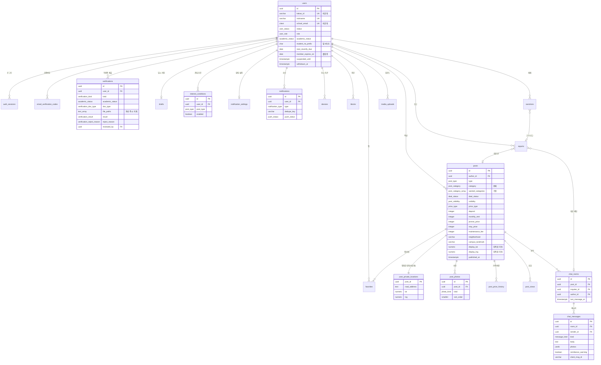
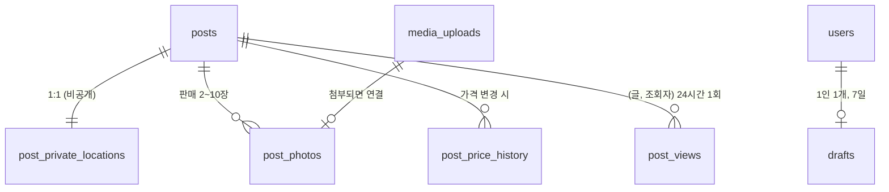
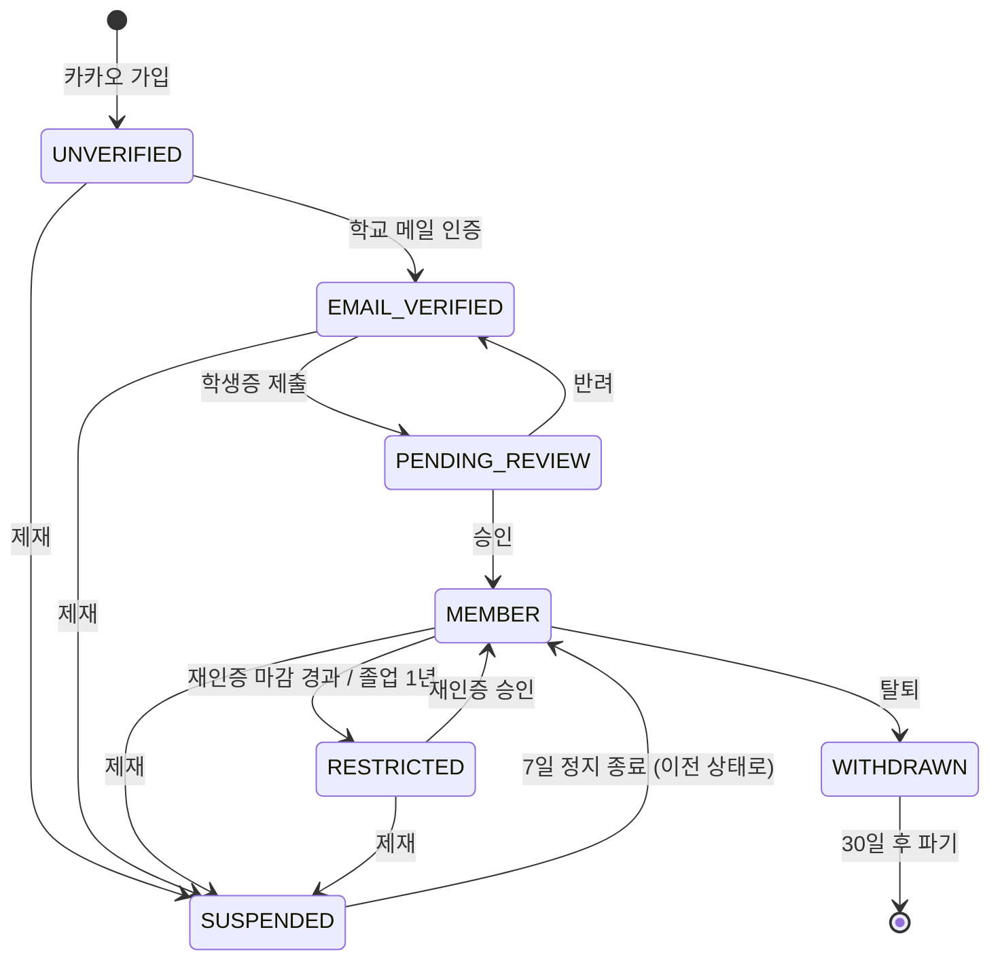

# 데이터베이스 설계서

> 숙박숙박 Phase 2 시스템 설계 산출물이다. [SRS](../01-요구사항분석/요구사항명세서-SRS.md) v0.1 6장의 논리 모델을 물리 설계(테이블, 타입, 제약조건, 인덱스)로 옮겼다. 근거는 SRS·[RTM](../01-요구사항분석/요구사항추적매트릭스-RTM.md)·[유스케이스 명세서](../01-요구사항분석/유스케이스명세서.md) v0.1, [비즈니스 정책서](../00-기획/비즈니스정책서.md), PRD.md v0.2, DESIGN.md, 그리고 2026-11-26 사용자 결정이다. 기술 선택은 [시스템 아키텍처 설계서](시스템아키텍처설계서-SAD.md)의 ADR을 따른다. 확인되지 않은 수치는 "초안", 결정되지 않은 사항은 "미결"로 표시하고 부록 C에 모았다.

| 항목 | 내용 |
|------|------|
| **프로젝트명** | 숙박숙박 (SookbakSookbak) |
| **문서 번호** | DBS-SOOKBAK-v0.1 |
| **문서 버전** | v0.1 (초안) |
| **작성일** | 2026-11-26 |
| **작성자** | 이유나 (기획) / Claude (초안 작성 지원) |
| **승인자** | 이유나 (기획 책임자) |
| **문서 상태** | 초안 (G2 검토 전) |

---

## 1. 개요

### 1.1 목적

본 문서는 숙박숙박 MVP(v1.0)의 데이터베이스 논리·물리 설계를 정의한다. 회원과 2단계 학생 인증, 판매·구함 글, 사진, 찜, 글별 1:1 채팅, 신고·제재, 알림과 관심 조건을 저장하는 테이블과 제약조건, 인덱스, 보존·파기 규칙을 정해 구현(Claude Code 등 AI 보조 개발)이 같은 데이터 모델을 쓰게 한다.

설계에서 특히 지킨 요구사항은 다음과 같다.

| 요구사항 | DB 설계에 반영한 방법 |
|----------|------------------------|
| 정확한 주소·좌표 비공개 (FR-010, AC-010-1) | 건물 주소·좌표를 `post_private_locations` 별도 테이블에 두고, 글 조회 쿼리에서 조인하지 않는다. 상세 지도용으로는 무작위로 옮긴 표시 중심(`display_lat/lng`)만 `posts`에 둔다 |
| 실명·학번·학교 이메일 비공개 (NFR-005) | 학번은 원문을 저장하지 않고 앞 4자리와 HMAC 해시만 저장한다. 학교 이메일은 `users`에 두되 다른 사용자에게 내려가는 응답 모델에 포함하지 않는다 |
| 학생증 원본 즉시 삭제 (FR-003, AC-003-1) | DB에는 비공개 저장소 경로만 두고 승인·반려 트랜잭션에서 경로를 지우고 파일을 삭제한다. 백업 대상이 아닌 별도 버킷에 둔다 |
| 공개 글 한도 (판매 3건, 구함 1건, 단기숙박 1건) | 구함 1건·단기숙박 1건은 부분 유니크 인덱스, 판매 3건은 사용자 행 잠금 후 개수 확인 |
| 같은 알림 1회만 (FR-014, FR-021) | `notifications.dedupe_key` 유니크로 같은 사용자에게 같은 글 알림을 한 번만 저장 |
| 채팅 메시지 중복 저장 방지 (NFR-003) | `(sender_id, client_msg_id)` 유니크 |
| 판매 분류 7개, 아파트 없음 (FR-008) | `post_category` 열거형에 7개 값만 정의 |
| 도보 시간 없음 (EX-005) | 거리·시간 컬럼을 두지 않는다 |

### 1.2 DBMS 선정

| 항목 | 내용 |
|------|------|
| DBMS | PostgreSQL (Supabase 관리형) |
| 버전 | 15 이상 (Supabase 기본 버전) |
| 리전 | 서울 (`ap-northeast-2`) |
| 선정 근거 | 관계형 데이터(회원·글·채팅·신고)가 중심이고 유니크·부분 인덱스·CHECK 제약으로 정책을 DB에서도 지킬 수 있음. 배열·JSONB로 분류별 옵션을 단순하게 저장. Supabase가 저장소(사진)·실시간(채팅)·예약 작업(pg_cron)을 같은 프로젝트에서 무료~저비용으로 제공 (SAD ADR-002) |
| 인코딩 | UTF-8 |
| Collation | `en_US.UTF-8` (Supabase 기본). 한국어 정렬은 쓰지 않음 (정렬은 시각·가격·찜 수 기준) |
| 타임존 | DB 저장은 UTC (`timestamptz`). 날짜 판단(재인증 기간, 00:00 배치, 야간 알림)은 KST(`Asia/Seoul`)로 변환해 계산 (BP-COMMON-1) |
| 확장 | `pgcrypto`(UUID·해시), `pg_trgm`(키워드 검색), `pg_cron`·`pg_net`(예약 작업) |

### 1.3 설계 원칙

| 원칙 | 설명 |
|------|------|
| 정규화 | 3NF 기본. 성능·단순화를 위한 반정규화는 사유를 적는다: 글의 `view_count`·`favorite_count`·`chat_count`(목록 카드 표시), 채팅방의 `last_message_at`·`last_message_preview`(채팅 목록 정렬) |
| 명명 규칙 | snake_case, 복수형 테이블명, 접두사 없음. 열거형 타입은 단수형(`user_status`) |
| 기본키 전략 | UUID v4 (`gen_random_uuid()`). 글·채팅방 ID가 URL·공유 링크에 노출되므로 추측할 수 없는 값을 쓴다. 감사 로그·요청 제한처럼 외부에 노출되지 않고 많이 쌓이는 테이블만 `bigint identity` |
| Soft Delete | 글은 `visibility = 'DELETED'`로 표시 후 30일 뒤 파기(채팅방 "삭제된 매물" 표시에 필요). 회원은 `status = 'WITHDRAWN'` 후 30일 뒤 개인정보 파기. 그 밖의 테이블은 물리 삭제 |
| 타임스탬프 | 모든 테이블에 `created_at`, 수정되는 테이블에 `updated_at` (트리거로 갱신) |
| 외래키 제약 | 사용. 삭제 동작은 테이블별로 명시 (파기 배치가 순서대로 지움) |
| 접근 통제 | 모든 테이블에 RLS(Row Level Security)를 켠다. 앱 데이터 접근은 서버(API)만 서비스 키로 하고, 클라이언트가 직접 읽는 것은 채팅 실시간 구독(`chat_messages` SELECT, 참여자만) 하나뿐이다 (SAD ADR-004) |
| 금액 | 만 원 단위 정수(`integer`). 소수·음수 불가 (FR-009) |
| 감사 로그 | 별도 `audit_logs` 테이블. 인증 이벤트, 학생증 검수, 관리자 작업, 신고, 가격·상태 변경 (NFR-006) |
| 설정값 | 숙대 기준 위치, 동네 목록, 송금 감지 단어, 계좌번호 패턴은 코드에 고정하지 않고 `app_settings`에 둔다 (FR-010-5, NFR-009) |

### 1.4 변경 이력

| 버전 | 날짜 | 작성자 | 변경 내용 |
|------|------|--------|-----------|
| v0.1 | 2026-11-26 | 이유나 / Claude | 초안 작성. SRS v0.1 6장 논리 모델 기준. 카카오 로그인(DEC-009), 판매/구함, 분류 7개(아파트 없음), 숙대 기준 위치·동네 이름만 공개(도보 시간 없음), 사진 2~10장·방/화장실 필수, 채팅 사진 허용·계좌번호 차단, 관심 매물 알림 반영 |
| v1.0 | [미정] | 이유나 | G2 검토 후 최종 승인 |

---

## 2. ER 다이어그램

### 2.1 전체 ER 다이어그램

컬럼은 주요 항목만 표시했다. 전체 컬럼은 3장 테이블 명세를 따른다.



### 2.2 도메인별 ER 다이어그램

| 도메인 | 테이블 | 관련 FR |
|--------|--------|---------|
| 회원·인증 | `users`, `auth_sessions`, `email_verification_codes`, `verifications`, `banned_identifiers` | FR-001~005, FR-019 |
| 글 | `posts`, `post_private_locations`, `post_photos`, `post_price_history`, `post_views`, `drafts`, `media_uploads` | FR-006~013, FR-024 |
| 관심·찜 | `favorites`, `interest_conditions` | FR-014, FR-021 |
| 채팅 | `chat_rooms`, `chat_messages`, `blocks` | FR-015, FR-016 |
| 신고·제재 | `reports`, `sanctions` | FR-018, FR-019 |
| 알림 | `notifications`, `notification_settings`, `devices` | FR-020, FR-021 |
| 운영 | `app_settings`, `audit_logs`, `rate_limit_counters` | NFR-004, NFR-006, NFR-009 |

글 도메인 상세:



---

## 3. 테이블 명세서

공통 컬럼 `created_at timestamptz NOT NULL DEFAULT now()`, `updated_at timestamptz NOT NULL DEFAULT now()`(수정되는 테이블)은 표에서 생략한다.

### 3.1 users - 회원

카카오 계정 1개당 1행. 인증 단계·권한 판단의 기준 테이블이다 (FR-001~005, FR-022).

#### 컬럼 정의

| 컬럼명 | 타입 | Nullable | 기본값 | 설명 |
|--------|------|----------|--------|------|
| `id` | UUID | NOT NULL | `gen_random_uuid()` | 회원 ID |
| `kakao_id` | VARCHAR(20) | NULL | - | 카카오 회원번호. 탈퇴 30일 후 파기 시 NULL. **다른 사용자에게 비공개** |
| `nickname` | VARCHAR(10) | NOT NULL | - | 닉네임 2~10자, 한글·영문·숫자 (FR-001) |
| `nickname_changed_at` | TIMESTAMPTZ | NULL | NULL | 마지막 닉네임 변경 시각. 30일 1회 제한 (초안, SRS-Q2) |
| `profile_photo_path` | TEXT | NULL | NULL | 프로필 사진 저장 경로 (선택) |
| `status` | `user_status` | NOT NULL | `'UNVERIFIED'` | 인증 단계·이용 상태 (4.2) |
| `status_before_suspension` | `user_status` | NULL | NULL | 7일 정지 해제 시 되돌릴 상태 |
| `role` | `user_role` | NOT NULL | `'USER'` | `USER` / `ADMIN`. `ADMIN`은 운영자가 DB에서 직접 지정 (일반 가입 경로 없음, FR-019-6) |
| `school_email` | CITEXT | NULL | NULL | 인증한 학교 이메일 `@sookmyung.ac.kr`. **비공개** |
| `email_verified_at` | TIMESTAMPTZ | NULL | NULL | 학교 메일 인증 완료 시각 |
| `academic_status` | `academic_status` | NULL | NULL | 최근 승인된 학적 상태 |
| `student_no_prefix` | CHAR(4) | NULL | NULL | 학번 앞 4자리 (초안) |
| `student_no_hash` | VARCHAR(64) | NULL | NULL | 학번 전체의 HMAC-SHA256. 원문은 저장하지 않음. "같은 학번으로 승인된 다른 계정" 반려·영구 정지 재인증 차단에 사용 (부록 C DB-Q1) |
| `member_approved_at` | TIMESTAMPTZ | NULL | NULL | 최근 정회원 승인 시각 |
| `graduated_on` | DATE | NULL | NULL | 졸업일 (졸업생) |
| `next_reverify_due` | DATE | NULL | NULL | 다음 재인증 마감일 (재학·휴학생, KST 날짜) |
| `member_expires_on` | DATE | NULL | NULL | 졸업생 정회원 만료일 = 졸업일 + 1년 |
| `suspended_until` | TIMESTAMPTZ | NULL | NULL | 7일 정지 종료 시각. 영구 정지는 `'infinity'` |
| `terms_agreed_at` | TIMESTAMPTZ | NOT NULL | - | 이용약관(비개입 조항 포함) 동의 시각 |
| `privacy_agreed_at` | TIMESTAMPTZ | NOT NULL | - | 개인정보 처리방침 동의 시각 |
| `last_active_at` | TIMESTAMPTZ | NOT NULL | `now()` | 마지막 이용 시각 (로그인 유지 30일 계산) |
| `withdrawn_at` | TIMESTAMPTZ | NULL | NULL | 탈퇴 시각. 30일 후 개인정보 파기 |

#### 제약조건

| 제약조건 유형 | 제약조건명 | 대상 컬럼 | 상세 |
|--------------|-----------|-----------|------|
| PK | `pk_users` | `id` | |
| UK | `uk_users_kakao_id` | `kakao_id` | 카카오 계정 1개당 1계정 (AC-001-2). NULL 허용 |
| UK | `uk_users_nickname` | `lower(nickname)` | 닉네임 중복 불가 (대소문자 무시) |
| UK | `uk_users_school_email` | `school_email` | 1이메일 1계정 (AC-001-2) |
| UK | `uk_users_student_no_hash` | `student_no_hash` | 같은 학번으로 두 계정 승인 불가 |
| CK | `ck_users_nickname` | `nickname` | `nickname ~ '^[가-힣A-Za-z0-9]{2,10}$'` |
| CK | `ck_users_school_email` | `school_email` | `school_email LIKE '%@sookmyung.ac.kr'` |
| CK | `ck_users_member_fields` | `status, member_approved_at` | `status <> 'MEMBER' OR member_approved_at IS NOT NULL` |

#### 인덱스

| 인덱스명 | 컬럼 | 타입 | 용도 |
|----------|------|------|------|
| `uk_users_kakao_id` | `kakao_id` | UNIQUE | 카카오 로그인 시 회원 조회 |
| `idx_users_reverify_due` | `next_reverify_due` | B-tree (Partial: `status = 'MEMBER'`) | 재인증 안내·마감 배치 |
| `idx_users_member_expires` | `member_expires_on` | B-tree (Partial: `status = 'MEMBER'`) | 졸업 1년 만료 배치 |
| `idx_users_suspended_until` | `suspended_until` | B-tree (Partial: `status = 'SUSPENDED'`) | 7일 정지 해제 배치 |
| `idx_users_withdrawn_at` | `withdrawn_at` | B-tree (Partial: `status = 'WITHDRAWN'`) | 30일 후 파기 배치 |

---

### 3.2 auth_sessions - 로그인 세션 (Refresh Token)

로그인 유지를 위한 Refresh Token 저장소. 기기마다 1행 (FR-002, NFR-004).

#### 컬럼 정의

| 컬럼명 | 타입 | Nullable | 기본값 | 설명 |
|--------|------|----------|--------|------|
| `id` | UUID | NOT NULL | `gen_random_uuid()` | 세션 ID |
| `user_id` | UUID | NOT NULL | - | FK → `users.id` (ON DELETE CASCADE) |
| `refresh_token_hash` | VARCHAR(64) | NOT NULL | - | Refresh Token의 SHA-256. 원문은 저장하지 않음 |
| `family_id` | UUID | NOT NULL | - | 로테이션 계열 ID. 이미 쓴 토큰이 다시 오면 계열 전체 폐기(탈취 감지) |
| `device_info` | VARCHAR(200) | NULL | NULL | 기기·앱 버전 요약 (감사용) |
| `expires_at` | TIMESTAMPTZ | NOT NULL | - | 마지막 이용 + 30일 (초안) |
| `last_used_at` | TIMESTAMPTZ | NOT NULL | `now()` | |
| `revoked_at` | TIMESTAMPTZ | NULL | NULL | 로그아웃·로테이션·탈퇴·정지 시 |

#### 제약조건 / 인덱스

| 유형 | 이름 | 대상 | 상세 |
|------|------|------|------|
| PK | `pk_auth_sessions` | `id` | |
| UK | `uk_auth_sessions_token` | `refresh_token_hash` | 토큰 조회 |
| IDX | `idx_auth_sessions_user` | `user_id` (Partial: `revoked_at IS NULL`) | 정지·탈퇴 시 일괄 폐기 |
| IDX | `idx_auth_sessions_expires` | `expires_at` | 만료 세션 정리 |

---

### 3.3 email_verification_codes - 학교 메일 인증번호

6자리 인증번호 발송·확인 기록 (FR-001 1단계).

#### 컬럼 정의

| 컬럼명 | 타입 | Nullable | 기본값 | 설명 |
|--------|------|----------|--------|------|
| `id` | UUID | NOT NULL | `gen_random_uuid()` | |
| `user_id` | UUID | NOT NULL | - | FK → `users.id` (ON DELETE CASCADE) |
| `email` | CITEXT | NOT NULL | - | 인증 요청한 학교 이메일 |
| `code_hash` | VARCHAR(64) | NOT NULL | - | 인증번호 HMAC. 원문 저장·로그 금지 (NFR-006) |
| `sent_at` | TIMESTAMPTZ | NOT NULL | `now()` | 재발송은 60초 후부터 |
| `expires_at` | TIMESTAMPTZ | NOT NULL | - | `sent_at + 10분` |
| `failed_attempts` | SMALLINT | NOT NULL | 0 | 5회 실패 시 잠금 |
| `invalidated_at` | TIMESTAMPTZ | NULL | NULL | 재발송으로 무효 처리된 시각 |
| `consumed_at` | TIMESTAMPTZ | NULL | NULL | 인증 성공 시각 |

#### 제약조건 / 인덱스

| 유형 | 이름 | 대상 | 상세 |
|------|------|------|------|
| CK | `ck_evc_attempts` | `failed_attempts` | `BETWEEN 0 AND 5` |
| IDX | `idx_evc_email_sent` | `email, sent_at DESC` | 60초 재발송 간격·30분 잠금 판단 (같은 이메일 기준, AC-001-4) |
| IDX | `idx_evc_user_active` | `user_id` (Partial: `consumed_at IS NULL AND invalidated_at IS NULL`) | 현재 유효한 번호 1개 조회 |

- 잠금 판단: 같은 `email`의 최근 행이 `failed_attempts = 5`이고 마지막 실패 후 30분이 안 지났으면 발송을 거부(429)한다.
- 7일이 지난 행은 매일 삭제한다.

---

### 3.4 verifications - 학생증·증명서 인증 제출

2단계 인증과 학기별 재인증 제출 이력 (FR-003, FR-005, FR-019).

#### 컬럼 정의

| 컬럼명 | 타입 | Nullable | 기본값 | 설명 |
|--------|------|----------|--------|------|
| `id` | UUID | NOT NULL | `gen_random_uuid()` | |
| `user_id` | UUID | NOT NULL | - | FK → `users.id` (ON DELETE CASCADE) |
| `kind` | `verification_kind` | NOT NULL | - | `INITIAL` / `REVERIFY` |
| `academic_status` | `academic_status` | NOT NULL | - | 제출 시 선택한 학적 상태 |
| `doc_type` | `verification_doc_type` | NOT NULL | - | 자료 종류 (4.2) |
| `file_paths` | TEXT[] | NULL | - | 비공개 버킷 경로 1~2장. **승인·반려 시 NULL로 바꾸고 파일 삭제** |
| `result` | `verification_result` | NOT NULL | `'PENDING'` | `PENDING` / `APPROVED` / `REJECTED` |
| `reject_reason` | `verification_reject_reason` | NULL | NULL | 반려 사유 (4.2) |
| `reviewed_by` | UUID | NULL | NULL | FK → `users.id` (관리자, ON DELETE SET NULL) |
| `reviewed_at` | TIMESTAMPTZ | NULL | NULL | 처리 시각 |
| `submitted_at` | TIMESTAMPTZ | NOT NULL | `now()` | 대기 시간 표시 기준 (AC-003-3) |

승인 시 학번 앞 4자리·학번 해시·학적 상태·졸업일은 `users`에 기록한다. 제출 행에는 결과와 사유만 남긴다.

#### 제약조건 / 인덱스

| 유형 | 이름 | 대상 | 상세 |
|------|------|------|------|
| CK | `ck_verifications_files` | `file_paths, result` | `result = 'PENDING' OR file_paths IS NULL` (처리 후 원본 경로가 남지 않음, AC-003-1) |
| CK | `ck_verifications_reject` | `result, reject_reason` | `result <> 'REJECTED' OR reject_reason IS NOT NULL` |
| UK | `uk_verifications_one_pending` | `user_id` (Partial: `result = 'PENDING'`) | 검수 대기 중 추가 제출 불가 (409) |
| IDX | `idx_verifications_queue` | `submitted_at` (Partial: `result = 'PENDING'`) | 관리자 인증 대기열, 제출 순 |

---

### 3.5 posts - 판매·구함 글

판매 글과 구함 글을 한 테이블에 두고 `type`으로 구분한다 (SRS 6.2). 분류별 항목은 필터·검증이 필요해 JSON이 아닌 컬럼으로 둔다.

#### 컬럼 정의

**공통**

| 컬럼명 | 타입 | Nullable | 기본값 | 설명 |
|--------|------|----------|--------|------|
| `id` | UUID | NOT NULL | `gen_random_uuid()` | 글 ID (공유 링크에 노출) |
| `author_id` | UUID | NOT NULL | - | FK → `users.id` (ON DELETE RESTRICT, 파기 배치가 글 먼저 삭제) |
| `type` | `post_type` | NOT NULL | - | `SALE`(판매) / `WANTED`(구함) |
| `title` | VARCHAR(40) | NOT NULL | - | 1~40자 |
| `body` | VARCHAR(2000) | NULL | NULL | 글쓰기란 2,000자 이내 |
| `deal_status` | `deal_status` | NOT NULL | - | 판매: `AVAILABLE`·`RESERVED`·`DONE` / 구함: `SEEKING`·`FOUND` |
| `deal_status_changed_at` | TIMESTAMPTZ | NOT NULL | `now()` | 방치 글 판단 (60일, DEC-005) |
| `deal_done_at` | TIMESTAMPTZ | NULL | NULL | 거래완료·구함완료 시각. 24시간 되돌림, 30일 후 숨김 |
| `visibility` | `post_visibility` | NOT NULL | `'PUBLIC'` | `PUBLIC` / `PRIVATE` / `HIDDEN` / `DELETED` (4.2) |
| `visibility_reason` | `visibility_reason` | NULL | NULL | 비공개·숨김 사유 (내 글에 표시, AC-022-2) |
| `published_at` | TIMESTAMPTZ | NOT NULL | `now()` | 최초 공개 시각. **최신순 정렬 기준**이며 수정해도 바뀌지 않음 (FR-006-1). FR-026 끌어올리기(P2)는 별도 컬럼으로 추가 예정 |
| `photo_count` | SMALLINT | NOT NULL | 0 | 사진 수 (반정규화, 검증·카드 표시) |
| `cover_photo_path` | TEXT | NULL | NULL | 대표 사진 썸네일 경로 (반정규화, 목록 성능) |
| `view_count` / `favorite_count` / `chat_count` | INTEGER | NOT NULL | 0 | FR-024 집계 (반정규화) |
| `report_count` | SMALLINT | NOT NULL | 0 | 서로 다른 신고자 수. 3이면 자동 숨김 |
| `stale_check_sent_at` | TIMESTAMPTZ | NULL | NULL | "아직 거래 가능한가요?"·구함 글 확인 알림 발송 시각 |
| `non_intervention_agreed_at` | TIMESTAMPTZ | NULL | NULL | 비개입 고지 동의 시각 (판매 필수, FR-023) |
| `search_text` | TEXT | NOT NULL | 생성 컬럼 | `title || ' ' || coalesce(body,'') || ' ' || coalesce(neighborhood,'') || ' ' || coalesce(boarding_name,'')` 키워드 검색용 |

**위치 (판매: 필수 / 구함: 희망 위치)**

| 컬럼명 | 타입 | Nullable | 기본값 | 설명 |
|--------|------|----------|--------|------|
| `neighborhood` | VARCHAR(20) | NULL | NULL | 동네 이름(법정동). 주소에서 자동 입력, 작성자 수정 불가 (판매 필수) |
| `campus_landmark` | VARCHAR(30) | NULL | NULL | 숙대 기준 위치 코드. `app_settings.campus_landmarks`의 값 또는 `NOT_NEAR`(숙대 근처 아님) (판매 필수) |
| `display_lat` / `display_lng` | NUMERIC(9,6) | NULL | NULL | 상세 지도 원의 중심. 건물 좌표에서 무작위로 옮겨 **글 생성 시 한 번만** 정함 (AC-010-3). 주소를 바꾸면 다시 정함 |
| `wanted_landmarks` | VARCHAR(30)[] | NULL | NULL | 구함: 희망 숙대 기준 위치 (복수) |
| `wanted_neighborhoods` | VARCHAR(20)[] | NULL | NULL | 구함: 희망 동네 (복수) |

건물 주소와 정확한 좌표는 이 테이블에 두지 않는다 (3.6).

**분류·가격 (판매)**

| 컬럼명 | 타입 | Nullable | 기본값 | 설명 |
|--------|------|----------|--------|------|
| `category` | `post_category` | NULL | NULL | 판매 분류 7개 중 하나 (판매 필수) |
| `wanted_categories` | `post_category[]` | NULL | NULL | 구함: 원하는 분류 1개 이상 |
| `price_type` | `price_type` | NULL | NULL | `MONTHLY`(월세) / `JEONSE`(전세) / `STAY`(숙박비) |
| `rent_unit` | `rent_unit` | NULL | NULL | 월세 금액 단위 `MONTH` / `WEEK`(단기임대 주 단위만) |
| `stay_unit` | `stay_unit` | NULL | NULL | 숙박비 단위 `NIGHT`(1박) / `WEEK`(1주) |
| `deposit` | INTEGER | NULL | NULL | 보증금(만 원) 0~99,999 |
| `monthly_rent` | INTEGER | NULL | NULL | 월세·하숙비·주 단위 금액(만 원) 1~999 |
| `jeonse_price` | INTEGER | NULL | NULL | 전세금(만 원) 1~99,999 |
| `stay_price` | INTEGER | NULL | NULL | 숙박비(만 원) 1~999 |
| `maintenance_fee` | INTEGER | NULL | NULL | 관리비(만 원) 0~99. "없음"은 0 + 포함 항목 `{NONE}` |
| `maintenance_includes` | VARCHAR(20)[] | NULL | NULL | `WATER`·`ELECTRIC`·`GAS`·`INTERNET`·`TV`·`CLEANING` 복수 또는 `{NONE}` |
| `price_negotiable` | BOOLEAN | NOT NULL | false | 가격 협의 가능 |
| `monthly_cost` | INTEGER | NULL | 생성 컬럼 | 월 예상 비용(비교용). 월세: `monthly_rent + maintenance_fee`, 주 단위: `round(monthly_rent × 4.3) + maintenance_fee`, 전세: `maintenance_fee`, 숙박비: NULL. 낮은 가격순 정렬·필터에 사용 (FR-009, FR-017-4) |
| `price_cut_until` | TIMESTAMPTZ | NULL | NULL | "가격 인하" 표시 종료 시각 (인하 후 3일) |

**구함 예산**

| 컬럼명 | 타입 | Nullable | 기본값 | 설명 |
|--------|------|----------|--------|------|
| `budget_deposit_max` | INTEGER | NULL | NULL | 보증금 상한(만 원) |
| `budget_monthly_max` | INTEGER | NULL | NULL | 월 비용 상한(만 원). 둘 중 하나 이상 필수 |
| `wanted_period_text` | VARCHAR(20) | NULL | NULL | 희망 기간 (예: "2개월", "1년") |

**건물·방 정보 (판매)**

| 컬럼명 | 타입 | Nullable | 기본값 | 설명 |
|--------|------|----------|--------|------|
| `floor` | SMALLINT | NULL | NULL | 해당 층. 반지하 -1 (판매 필수) |
| `is_rooftop` | BOOLEAN | NOT NULL | false | 옥탑 표기 (초안) |
| `total_floors` | SMALLINT | NULL | NULL | 전체 층 (판매 필수) |
| `area_m2` | NUMERIC(5,2) | NULL | NULL | 전용면적 1~200㎡. 평은 표시 시 계산 (판매 필수) |
| `room_count` / `bath_count` | SMALLINT | NULL | NULL | 방·욕실 수 (투룸은 방 수 필수) |
| `room_structure` | `room_structure` | NULL | NULL | 원룸: `OPEN` / `SEPARATED` / `DUPLEX` (원룸 필수) |
| `share_capacity` / `share_residents` | SMALLINT | NULL | NULL | 쉐어하우스 모집 인원·현재 거주 인원 |
| `room_occupancy` | `room_occupancy` | NULL | NULL | `SINGLE`(1인실) / `DOUBLE`(2인실, 하숙) / `MULTI`(다인실, 쉐어) |
| `boarding_name` | VARCHAR(20) | NULL | NULL | 하숙 이름 2~20자 (하숙 필수, DEC-012) |
| `meals` | VARCHAR(10)[] | NULL | NULL | 하숙 식사 `BREAKFAST`·`DINNER` 또는 `{NONE}` |
| `period_start` / `period_end` | DATE | NULL | NULL | 단기임대·단기숙박 가능 기간 (필수) |
| `move_in_date` | DATE | NULL | NULL | 입주 가능일 / 구함: 입주 희망일 |
| `move_in_immediate` | BOOLEAN | NOT NULL | false | "즉시 입주" |
| `contract_end_date` | DATE | NULL | NULL | 계약 만료일 (선택) |
| `contract_form` | `contract_form` | NULL | NULL | `NORMAL` / `SUCCESSION`(계약 승계) / `SUBLEASE`(전대) |
| `landlord_consent` | `landlord_consent` | NULL | NULL | `YES` / `NO` / `CHECKING`. 승계·전대·단기임대·단기숙박 필수 |
| `self_residence_confirmed` | BOOLEAN | NOT NULL | false | 단기숙박: "본인이 실제 사는 방의 빈 기간" 확인 (FR-008-4a) |
| `options` | VARCHAR(20)[] | NOT NULL | `'{}'` | 에어컨·세탁기·냉장고·침대·책상·옷장·와이파이·전자레인지·인덕션 등 코드 |
| `building_features` | VARCHAR(20)[] | NOT NULL | `'{}'` | `ELEVATOR`·`PARKING`·`WOMEN_ONLY`·`SECURITY`·`PET_OK` |

#### 제약조건

| 제약조건 유형 | 제약조건명 | 대상 컬럼 | 상세 |
|--------------|-----------|-----------|------|
| PK | `pk_posts` | `id` | |
| FK | `fk_posts_author` | `author_id` | → `users.id` |
| CK | `ck_posts_deal_status_type` | `type, deal_status` | 판매는 `AVAILABLE/RESERVED/DONE`, 구함은 `SEEKING/FOUND`만 |
| CK | `ck_posts_sale_required` | 판매 필수 컬럼 | `type <> 'SALE' OR (category, price_type, maintenance_fee, maintenance_includes, neighborhood, campus_landmark, floor, total_floors, area_m2, non_intervention_agreed_at) IS NOT NULL` (각 컬럼 NOT NULL 검사) |
| CK | `ck_posts_wanted_required` | 구함 필수 컬럼 | `type <> 'WANTED' OR (cardinality(wanted_categories) >= 1 AND (cardinality(wanted_landmarks) + cardinality(wanted_neighborhoods)) >= 1 AND (budget_deposit_max IS NOT NULL OR budget_monthly_max IS NOT NULL) AND (move_in_date IS NOT NULL OR move_in_immediate))` |
| CK | `ck_posts_price_fields` | 가격 컬럼 | `MONTHLY`면 `monthly_rent` 필수·`jeonse_price` NULL, `JEONSE`면 `jeonse_price` 필수·`monthly_rent` NULL, `STAY`면 `stay_price`·`stay_unit` 필수 (FR-009-2) |
| CK | `ck_posts_price_by_category` | `category, price_type` | 하숙·쉐어하우스·단기임대는 `MONTHLY`, 단기숙박은 `STAY`, 원룸·투룸·오피스텔은 `MONTHLY`/`JEONSE` (FR-009 표). 주 단위(`rent_unit = 'WEEK'`)는 단기임대만 |
| CK | `ck_posts_amount_range` | 금액 컬럼 | 보증금 0~99999, 월세 1~999, 전세금 1~99999, 숙박비 1~999, 관리비 0~99 |
| CK | `ck_posts_floor` | `floor, total_floors` | `floor <= total_floors` |
| CK | `ck_posts_area` | `area_m2` | `area_m2 BETWEEN 1 AND 200` |
| CK | `ck_posts_category_fields` | 분류별 컬럼 | 원룸 → `room_structure`, 투룸 → `room_count >= 2`, 쉐어하우스 → `share_capacity`·`share_residents`·`room_occupancy`, 하숙 → `boarding_name`(2~20자)·`meals`·`room_occupancy`, 단기임대·단기숙박 → `period_start`·`period_end`·`landlord_consent`, 단기숙박 → `self_residence_confirmed = true` (FR-008) |
| CK | `ck_posts_period_length` | `period_start, period_end` | 단기임대 30~183일, 단기숙박 1~29일 (FR-008-2, 초안 일수 환산) |
| CK | `ck_posts_landlord_consent` | `contract_form, landlord_consent` | 승계·전대이면 `landlord_consent` 필수 |
| CK | `ck_posts_visibility_reason` | `visibility, visibility_reason` | `visibility = 'PUBLIC' OR visibility_reason IS NOT NULL` |
| UK | `uk_posts_one_seeking` | `author_id` (Partial: `type = 'WANTED' AND deal_status = 'SEEKING' AND visibility <> 'DELETED'`) | `구하는 중` 구함 글 1인 1건 (AC-011-3, DEC-004 초안) |
| UK | `uk_posts_one_short_stay` | `author_id` (Partial: `category = 'SHORT_STAY' AND deal_status IN ('AVAILABLE','RESERVED') AND visibility = 'PUBLIC'`) | 공개 단기숙박 1인 1건 (AC-008-4) |

- **판매 3건 한도**(AC-007-4)는 부분 유니크로 표현할 수 없어 API 트랜잭션에서 `SELECT ... FROM users WHERE id = $author FOR UPDATE`로 작성자 행을 잠근 뒤 공개 중(`AVAILABLE`·`RESERVED`, `PUBLIC`) 판매 글 수를 세어 3 이상이면 409를 응답한다. 같은 요청이 5초 안에 두 번 오는 경우(FR-007-6)는 API의 멱등 키(`Idempotency-Key`)로 막는다.
- 필수 항목 검증은 API(Zod 스키마)에서 먼저 하고 사용자에게 필드별 오류를 준다. DB 제약은 우회·버그를 막는 마지막 방어선이다.

#### 인덱스

| 인덱스명 | 컬럼 | 타입 | 용도 |
|----------|------|------|------|
| `idx_posts_feed` | `type, (deal_status IN ('DONE','FOUND')), published_at DESC, id DESC` | B-tree (Partial: `visibility = 'PUBLIC'`) | 홈 최신순 목록. 거래완료는 아래로 (FR-006-2), 커서 페이지네이션 |
| `idx_posts_feed_category` | `type, category, (deal_status IN ('DONE','FOUND')), published_at DESC` | B-tree (Partial: `visibility = 'PUBLIC'`) | 분류 탭 |
| `idx_posts_monthly_cost` | `type, monthly_cost, id` | B-tree (Partial: `visibility = 'PUBLIC'`) | 낮은 가격순·월세 범위 필터 |
| `idx_posts_favorite_count` | `type, favorite_count DESC, id` | B-tree (Partial: `visibility = 'PUBLIC'`) | 찜 많은순 |
| `idx_posts_wanted_categories` | `wanted_categories` | GIN | 구함 분류 탭·관심 조건 매칭 |
| `idx_posts_features` | `building_features` | GIN | 여성전용·반려동물 등 조건 필터 |
| `idx_posts_search_trgm` | `search_text` | GIN (`gin_trgm_ops`) | 키워드 검색 `ILIKE '%청파동%'` (AC-017-2) |
| `idx_posts_author` | `author_id, visibility, deal_status` | B-tree | 내 글, 한도 확인, 정지·재인증 시 일괄 비공개 |
| `idx_posts_done_at` | `deal_done_at` | B-tree (Partial: `deal_status IN ('DONE','FOUND') AND visibility = 'PUBLIC'`) | 30일 후 자동 숨김 배치 |
| `idx_posts_stale` | `deal_status_changed_at` | B-tree (Partial: `deal_status IN ('AVAILABLE','SEEKING') AND visibility = 'PUBLIC'`) | 방치 글 확인 배치 |

---

### 3.6 post_private_locations - 판매 글 정확한 위치 (비공개)

건물 주소와 좌표를 글 테이블과 분리해, 목록·상세 조회에서 실수로 응답에 섞이지 않게 한다 (FR-010-4, AC-010-1). 이 테이블은 API의 글 작성·수정 서비스와 파기 배치만 접근한다.

| 컬럼명 | 타입 | Nullable | 기본값 | 설명 |
|--------|------|----------|--------|------|
| `post_id` | UUID | NOT NULL | - | PK, FK → `posts.id` (ON DELETE CASCADE) |
| `road_address` | TEXT | NOT NULL | - | 도로명 주소 (건물 단위, 동·호수 없음) |
| `jibun_address` | TEXT | NULL | NULL | 지번 주소 |
| `b_code` | CHAR(10) | NULL | NULL | 법정동 코드 (동네 이름 근거) |
| `lat` / `lng` | NUMERIC(9,6) | NOT NULL | - | 건물 좌표 |
| `offset_m` | SMALLINT | NOT NULL | - | 표시 중심을 옮긴 거리(m, 초안 30~120) |

- RLS: 정책 없음(클라이언트 접근 전부 차단). 서버 서비스 키로만 읽고 쓴다.
- 표시 중심 계산: 무작위 방향·거리(`offset_m`)로 옮긴 좌표를 `posts.display_lat/lng`에 저장하고, 상세 지도는 그 중심의 반경 150m 원(초안)으로 그린다. 원이 실제 건물을 항상 포함하도록 `offset_m < 150`으로 제한한다.

---

### 3.7 post_photos - 글 사진

| 컬럼명 | 타입 | Nullable | 기본값 | 설명 |
|--------|------|----------|--------|------|
| `id` | UUID | NOT NULL | `gen_random_uuid()` | |
| `post_id` | UUID | NOT NULL | - | FK → `posts.id` (ON DELETE CASCADE) |
| `upload_id` | UUID | NOT NULL | - | FK → `media_uploads.id` |
| `kind` | `photo_kind` | NOT NULL | - | `ROOM`(방) / `BATHROOM`(화장실) / `OTHER`(기타) |
| `sort_order` | SMALLINT | NOT NULL | - | 0이 대표 사진 |
| `thumb_path` | TEXT | NOT NULL | - | 목록용(정사각 336px, WebP) |
| `detail_path` | TEXT | NOT NULL | - | 상세용(긴 변 1280px, WebP) |
| `width` / `height` | SMALLINT | NOT NULL | - | 상세용 크기 |

| 유형 | 이름 | 대상 | 상세 |
|------|------|------|------|
| UK | `uk_post_photos_order` | `post_id, sort_order` | 순서 중복 방지 |
| CK | `ck_post_photos_order` | `sort_order` | `BETWEEN 0 AND 9` (최대 10장) |
| 트리거 | `trg_post_photos_rules` | 커밋 시 확인(DEFERRABLE) | 판매 글은 2~10장, `ROOM` 1장 이상, `BATHROOM` 1장 이상 (AC-007-1·2). 구함 글은 0~10장 |

---

### 3.8 media_uploads - 업로드 파일

사진은 글·메시지를 저장하기 전에 먼저 올린다. 업로드 시 서버가 EXIF를 지우고 크기를 줄여 저장한 뒤 이 행을 만든다 (FR-007-4, NFR-005).

| 컬럼명 | 타입 | Nullable | 기본값 | 설명 |
|--------|------|----------|--------|------|
| `id` | UUID | NOT NULL | `gen_random_uuid()` | |
| `owner_id` | UUID | NOT NULL | - | FK → `users.id` (ON DELETE CASCADE) |
| `purpose` | `upload_purpose` | NOT NULL | - | `POST` / `CHAT` / `PROFILE` |
| `status` | `upload_status` | NOT NULL | `'READY'` | `READY`(첨부 대기) / `ATTACHED` / `REJECTED`(채팅 사진 계좌번호 검출) |
| `thumb_path` / `detail_path` | TEXT | NOT NULL | - | 공개 버킷 경로 |
| `bytes` | INTEGER | NOT NULL | - | 원본 크기 (10MB 이하) |
| `ocr_checked` | BOOLEAN | NOT NULL | false | 채팅 사진 OCR 검사 완료 여부 |
| `ocr_failed` | BOOLEAN | NOT NULL | false | OCR 호출 실패(사진은 보내고 신고로 보완, SRS 5.3) |
| `expires_at` | TIMESTAMPTZ | NOT NULL | `now() + interval '1 day'` | 첨부되지 않은 업로드는 하루 뒤 파일과 함께 삭제 |

- 학생증·증명서는 이 테이블이 아닌 비공개 버킷 + `verifications.file_paths`로만 관리한다.
- 인덱스: `idx_media_uploads_expires (expires_at) WHERE status = 'READY'`.

---

### 3.9 그 밖의 테이블 명세

아래 테이블은 같은 형식(컬럼, 제약조건, 인덱스)으로 정의한다.

#### post_price_history - 가격 변경 이력 (FR-007 수정, FR-014, FR-021, NFR-006)

| 컬럼명 | 타입 | Nullable | 설명 |
|--------|------|----------|------|
| `id` | BIGINT identity | NOT NULL | PK |
| `post_id` | UUID | NOT NULL | FK → `posts.id` (CASCADE) |
| `before` / `after` | JSONB | NOT NULL | 가격 컬럼 묶음 (`deposit`, `monthly_rent`, `jeonse_price`, `stay_price`, `maintenance_fee`) |
| `is_cut` | BOOLEAN | NOT NULL | 월세·전세금·하숙비·숙박비 또는 보증금이 내려갔는지 |
| `changed_at` | TIMESTAMPTZ | NOT NULL | |

인덱스 `idx_price_history_post (post_id, changed_at DESC)`. 글 삭제 후 1년 보관(NFR-006)을 위해 글 파기 시 이력은 `post_id`를 남긴 채 별도 보관하지 않고 함께 삭제하되, 감사가 필요한 변경은 `audit_logs`에도 남긴다.

#### post_views - 조회 중복 방지 (FR-024)

| 컬럼명 | 타입 | 설명 |
|--------|------|------|
| `post_id` | UUID | PK(복합), FK → `posts.id` (CASCADE) |
| `viewer_id` | UUID | PK(복합), FK → `users.id` (CASCADE) |
| `last_counted_at` | TIMESTAMPTZ | 마지막으로 조회 수를 올린 시각 |

`INSERT ... ON CONFLICT (post_id, viewer_id) DO UPDATE SET last_counted_at = now() WHERE post_views.last_counted_at < now() - interval '24 hours'`가 행을 바꿨을 때만 `posts.view_count`를 1 올린다. 작성자 본인은 세지 않는다 (AC-024-1). 30일이 지난 행은 매일 삭제한다.

#### drafts - 임시 저장본 (FR-007)

| 컬럼명 | 타입 | 설명 |
|--------|------|------|
| `user_id` | UUID | PK, FK → `users.id` (CASCADE). 1인 1개 |
| `post_type` | `post_type` | 판매 / 구함 |
| `payload` | JSONB | 입력 중인 값 (업로드 ID 포함, 64KB 이하) |
| `updated_at` | TIMESTAMPTZ | 마지막 수정 후 7일 지나면 배치로 삭제 |

#### favorites - 찜 (FR-014)

| 컬럼명 | 타입 | 설명 |
|--------|------|------|
| `user_id` | UUID | PK(복합), FK → `users.id` (CASCADE) |
| `post_id` | UUID | PK(복합), FK → `posts.id` (CASCADE) |
| `created_at` | TIMESTAMPTZ | 찜 탭 최신 찜순 정렬 |

- 자기 글 찜 금지는 API에서 확인한다(자기 글이면 400).
- `posts.favorite_count`는 같은 트랜잭션에서 ±1 한다. 작성자에게는 수만 보이고 이 테이블은 작성자용 API에 노출하지 않는다 (AC-014-3).
- 인덱스 `idx_favorites_user (user_id, created_at DESC)`, `idx_favorites_post (post_id)`(가격 인하·상태 변경 알림 대상 조회).

#### interest_conditions - 관심 조건 (FR-021)

| 컬럼명 | 타입 | Nullable | 설명 |
|--------|------|----------|------|
| `id` | UUID | NOT NULL | PK |
| `user_id` | UUID | NOT NULL | FK → `users.id` (CASCADE) |
| `name` | VARCHAR(40) | NOT NULL | 자동 생성 후 수정 가능 ("원룸 · 도서관 후문 · 월 60 이하") |
| `post_type` | `post_type` | NOT NULL | 기본 `SALE` |
| `categories` | `post_category[]` | NOT NULL | 빈 배열이면 조건 없음 |
| `landmarks` / `neighborhoods` | VARCHAR[] | NOT NULL | 숙대 기준 위치·동네 (빈 배열 = 조건 없음) |
| `deposit_max` / `monthly_cost_max` / `jeonse_max` / `stay_price_max` | INTEGER | NULL | 가격 상한(만 원) |
| `move_in_by` | DATE | NULL | 이 날짜 이전 입주 가능 |
| `keywords` | VARCHAR(20)[] | NOT NULL | 최대 3개 |
| `enabled` | BOOLEAN | NOT NULL | 조건별 알림 켜기 |

| 유형 | 이름 | 상세 |
|------|------|------|
| CK | `ck_ic_not_empty` | 글 유형 외에 최소 1개 항목이 채워져 있어야 함 (FR-021-1) |
| CK | `ck_ic_keywords` | `cardinality(keywords) <= 3` |
| 트리거 | `trg_ic_limit` | 1인 5개 초과 INSERT 거부 (AC-021-4) |
| IDX | `idx_ic_match` | `(post_type) WHERE enabled` + `categories` GIN: 새 글 공개 시 후보 조건 조회 |

#### chat_rooms - 채팅방 (FR-015)

| 컬럼명 | 타입 | Nullable | 설명 |
|--------|------|----------|------|
| `id` | UUID | NOT NULL | PK |
| `post_id` | UUID | NOT NULL | FK → `posts.id` (ON DELETE RESTRICT, 글은 soft delete) |
| `inquirer_id` | UUID | NOT NULL | 문의자(정회원), FK → `users.id` |
| `author_id` | UUID | NOT NULL | 글 작성자 (조회 편의상 반정규화) |
| `last_message_at` | TIMESTAMPTZ | NULL | 채팅 목록 정렬 |
| `last_message_preview` | VARCHAR(60) | NULL | 채팅 목록 미리보기 ("사진 3장" 포함) |
| `author_last_read_at` / `inquirer_last_read_at` | TIMESTAMPTZ | NULL | 읽음 표시·안 읽은 수 계산 |
| `notice_shown_at` | TIMESTAMPTZ | NULL | 첫 진입 비개입 안내 표시 여부 (FR-023-3) |

| 유형 | 이름 | 상세 |
|------|------|------|
| UK | `uk_chat_rooms_post_inquirer` | `(post_id, inquirer_id)` (AC-015-2) |
| CK | `ck_chat_rooms_not_self` | `inquirer_id <> author_id` |
| IDX | `idx_chat_rooms_author` | `(author_id, last_message_at DESC)` |
| IDX | `idx_chat_rooms_inquirer` | `(inquirer_id, last_message_at DESC)` |

채팅방 생성 시 `posts.chat_count`를 1 올린다(FR-024).

#### chat_messages - 채팅 메시지 (FR-015, NFR-003)

| 컬럼명 | 타입 | Nullable | 설명 |
|--------|------|----------|------|
| `id` | UUID | NOT NULL | PK |
| `room_id` | UUID | NOT NULL | FK → `chat_rooms.id` (CASCADE) |
| `sender_id` | UUID | NULL | FK → `users.id` (SET NULL, 탈퇴 파기 후 "탈퇴한 사용자") |
| `kind` | `message_kind` | NOT NULL | `TEXT` / `PHOTO` / `SYSTEM`(상태 변경·안내) |
| `body` | VARCHAR(1000) | NULL | 텍스트 1~1,000자 |
| `photos` | JSONB | NULL | `[{"thumbPath","detailPath","width","height"}]` 최대 10개 |
| `remittance_warning` | BOOLEAN | NOT NULL | 송금 요청 표현 감지 → 두 사람 화면에 경고 (FR-015-7) |
| `client_msg_id` | VARCHAR(36) | NOT NULL | 앱이 만든 메시지 ID (재전송 중복 방지) |
| `created_at` | TIMESTAMPTZ | NOT NULL | |

| 유형 | 이름 | 상세 |
|------|------|------|
| UK | `uk_chat_messages_client` | `(sender_id, client_msg_id)` |
| CK | `ck_chat_messages_content` | `TEXT`는 `body` 필수, `PHOTO`는 `jsonb_array_length(photos) BETWEEN 1 AND 10` |
| IDX | `idx_chat_messages_room` | `(room_id, created_at, id)` 재접속 동기화·과거 메시지 조회 |

- **계좌번호가 든 메시지·사진은 저장하지 않는다.** API가 저장 전에 거부한다 (AC-015-4·5). 그래서 이 테이블에는 차단된 내용이 남지 않는다.
- 메시지 수정·삭제 API는 없다 (FR-015-9).
- RLS: `SELECT`만 허용, `room_id`의 `author_id` 또는 `inquirer_id`가 `auth.uid()`인 행만. Supabase Realtime 구독도 이 정책을 따른다. INSERT·UPDATE·DELETE 정책은 두지 않아 클라이언트가 직접 쓸 수 없다.

#### blocks - 차단 (FR-016)

| 컬럼명 | 타입 | 설명 |
|--------|------|------|
| `blocker_id` | UUID | PK(복합), FK → `users.id` (CASCADE) |
| `blocked_id` | UUID | PK(복합), FK → `users.id` (CASCADE) |
| `created_at` | TIMESTAMPTZ | |

CK `blocker_id <> blocked_id`. 인덱스 `idx_blocks_blocked (blocked_id)`(메시지 전송 시 상대가 나를 차단했는지 확인).

#### reports - 신고 (FR-018)

| 컬럼명 | 타입 | Nullable | 설명 |
|--------|------|----------|------|
| `id` | UUID | NOT NULL | PK |
| `reporter_id` | UUID | NOT NULL | FK → `users.id` |
| `target_type` | `report_target` | NOT NULL | `POST` / `CHAT_USER` |
| `post_id` | UUID | NULL | 글 신고 대상 |
| `room_id` | UUID | NULL | 채팅 상대 신고: 증거 채팅방 |
| `message_id` | UUID | NULL | "송금 요구" 신고 버튼에서 온 경우 해당 메시지 |
| `reported_user_id` | UUID | NOT NULL | 신고당한 사용자 |
| `reason` | `report_reason` | NOT NULL | 4.2 |
| `detail` | VARCHAR(500) | NULL | `OTHER`이면 필수 |
| `status` | `report_status` | NOT NULL | `RECEIVED` / `ACTIONED` / `NO_ACTION` |
| `handled_by` / `handled_at` | UUID / TIMESTAMPTZ | NULL | 처리 관리자·시각 |

| 유형 | 이름 | 상세 |
|------|------|------|
| UK | `uk_reports_post_once` | `(reporter_id, post_id) WHERE target_type = 'POST'` (AC-018-2) |
| CK | `ck_reports_target` | `POST`면 `post_id` 필수, `CHAT_USER`면 `room_id` 필수 |
| CK | `ck_reports_detail` | `reason <> 'OTHER' OR detail IS NOT NULL` |
| IDX | `idx_reports_queue` | `(status, created_at) WHERE status = 'RECEIVED'` 관리자 신고 대기열 |

글 신고 INSERT 후 같은 트랜잭션에서 `posts.report_count`를 올리고, 3이 되면 `visibility = 'HIDDEN'`, `visibility_reason = 'REPORTED'`로 바꾼다 (AC-018-1). 신고자 정보는 작성자에게 내려가지 않는다.

#### sanctions - 제재 (FR-019)

| 컬럼명 | 타입 | Nullable | 설명 |
|--------|------|----------|------|
| `id` | UUID | NOT NULL | PK |
| `user_id` | UUID | NOT NULL | 대상 |
| `type` | `sanction_type` | NOT NULL | `WARNING` / `SUSPEND_7D` / `PERMANENT` |
| `reason` | VARCHAR(200) | NOT NULL | |
| `report_id` | UUID | NULL | 근거 신고 |
| `starts_at` / `ends_at` | TIMESTAMPTZ | NOT NULL / NULL | 7일 정지는 `ends_at`, 영구는 NULL |
| `lapses_at` | TIMESTAMPTZ | NULL | 경고 소멸 시각 = 마지막 제재 + 1년 |
| `issued_by` | UUID | NOT NULL | 관리자 |

인덱스 `idx_sanctions_user (user_id, created_at DESC)`(다음 제재 단계 판단).

#### banned_identifiers - 재가입·재인증 차단 (FR-001, FR-019, SRS 6.3)

| 컬럼명 | 타입 | Nullable | 설명 |
|--------|------|----------|------|
| `id` | BIGINT identity | NOT NULL | PK |
| `kind` | `identifier_kind` | NOT NULL | `KAKAO_ID` / `SCHOOL_EMAIL` / `STUDENT_NO` |
| `value_hash` | VARCHAR(64) | NOT NULL | HMAC-SHA256 (비밀값은 환경 변수 `IDENTIFIER_HASH_SECRET`) |
| `reason` | `ban_reason` | NOT NULL | `PERMANENT_BAN` / `WITHDRAWN` |
| `until` | TIMESTAMPTZ | NULL | 탈퇴는 탈퇴 + 30일, 영구 정지는 NULL |

UK `(kind, value_hash, reason)`. 가입(카카오 회원번호)·학교 메일 인증(이메일)·학생증 승인(학번) 시 조회한다. 원문을 남기지 않아 탈퇴 30일 후 파기 원칙과 충돌하지 않는다.

#### notifications - 인앱 알림 겸 푸시 발송 대기열 (FR-020, FR-021)

| 컬럼명 | 타입 | Nullable | 설명 |
|--------|------|----------|------|
| `id` | UUID | NOT NULL | PK |
| `user_id` | UUID | NOT NULL | 수신자, FK (CASCADE) |
| `type` | `notification_type` | NOT NULL | 4.2 |
| `title` / `body` | VARCHAR(60) / VARCHAR(200) | NOT NULL | 표시 문구 (가격은 FR-009 표기로 미리 만들어 저장) |
| `link` | VARCHAR(200) | NOT NULL | 누르면 갈 앱 경로 (`/posts/{id}`, `/chats/{id}`, `/me/verification`) |
| `dedupe_key` | VARCHAR(100) | NULL | 같은 알림 1회만: `interest:{postId}`, `fav:{postId}:{KST날짜}` 등 |
| `group_key` | VARCHAR(100) | NULL | 묶음: `chat:{roomId}`(1분), `interest-batch:{userId}`(10분 3건) |
| `push_status` | `push_status` | NOT NULL | `NONE`(인앱만) / `QUEUED` / `DEFERRED`(야간 → 08:00) / `SENT` / `MERGED` / `SUPPRESSED`(설정 끔) / `FAILED` |
| `push_after` | TIMESTAMPTZ | NULL | 이 시각 이후 발송 (야간 규칙) |
| `read_at` | TIMESTAMPTZ | NULL | 읽음 |
| `created_at` | TIMESTAMPTZ | NOT NULL | 90일 후 삭제 (초안) |

| 유형 | 이름 | 상세 |
|------|------|------|
| UK | `uk_notifications_dedupe` | `(user_id, dedupe_key) WHERE dedupe_key IS NOT NULL` (AC-021-3, FR-014-4 하루 1회) |
| IDX | `idx_notifications_inbox` | `(user_id, created_at DESC)` 알림 목록 |
| IDX | `idx_notifications_push_queue` | `(push_after) WHERE push_status IN ('QUEUED','DEFERRED')` 발송 작업 |

푸시는 이 테이블에 행을 쓴 뒤 발송 작업이 읽어 보낸다(아웃박스 방식, SAD 7.2). 발송이 실패해도 인앱 목록에는 남는다.

#### notification_settings - 알림 설정 (FR-020-4, FR-021-5)

| 컬럼명 | 타입 | 기본값 | 설명 |
|--------|------|--------|------|
| `user_id` | UUID | - | PK, FK (CASCADE) |
| `chat_enabled` | BOOLEAN | true | 새 채팅 메시지 |
| `favorite_enabled` | BOOLEAN | true | 찜 글 가격 인하·상태 변경 |
| `interest_enabled` | BOOLEAN | true | 관심 매물 알림 전체 스위치 (조건별은 `interest_conditions.enabled`) |
| `interest_quiet_night` | BOOLEAN | false | "밤에는 알림 받지 않기" |

끌 수 없는 알림(인증 결과, 재인증, 제재 등)은 설정 컬럼을 두지 않는다.

#### devices - 푸시 토큰 (FR-020)

| 컬럼명 | 타입 | 설명 |
|--------|------|------|
| `id` | UUID | PK |
| `user_id` | UUID | FK (CASCADE) |
| `platform` | `device_platform` | `IOS` / `ANDROID` / `WEB`. 지금(웹앱, SAD ADR-001)은 웹 푸시라 `WEB`만 쓰고, 나머지는 나중에 앱으로 포장할 때 쓴다 |
| `push_token` | TEXT | FCM 등록 토큰, UNIQUE (같은 기기에 다른 계정 로그인 시 소유자 교체) |
| `app_version` | VARCHAR(20) | |
| `last_seen_at` | TIMESTAMPTZ | 60일 미사용 토큰 삭제 |

로그아웃 시 해당 기기 행을 지운다. FCM이 "등록되지 않은 토큰"을 응답하면 즉시 지운다.

#### app_settings - 운영 설정값 (FR-010-5, FR-015, NFR-009)

| 컬럼명 | 타입 | 설명 |
|--------|------|------|
| `key` | VARCHAR(50) | PK |
| `value` | JSONB | 값 |
| `updated_by` | UUID | 관리자 |
| `updated_at` | TIMESTAMPTZ | |

초기 값(seed):

| key | 값 (초안) | 근거 |
|-----|-----------|------|
| `campus_landmarks` | `[{"code":"GATE_1","label":"1캠 정문"},{"code":"BACK_1","label":"1캠 후문"},{"code":"LIB_BACK","label":"도서관 후문"},{"code":"CAMPUS_2","label":"2캠"},{"code":"STN_SOOKDAE","label":"숙대입구역"},{"code":"STN_HYOCHANG","label":"효창공원앞역"},{"code":"STN_NAMYEONG","label":"남영역"}]` + `NOT_NEAR`(숙대 근처 아님, 목록에 없는 고정값) | DEC-012 (목록 미결) |
| `neighborhoods` | `["청파동","효창동","남영동","용산동"]` + 그 외는 "기타 동네" | FR-017 |
| `remittance_words` | `["입금","송금","계약금 먼저","선입금","이체"]` | FR-015-7 (초안) |
| `account_number_pattern` | 하이픈·공백 제거 후 숫자 10~14자리, 또는 은행 이름 + 숫자열. 010으로 시작하는 11자리 전화번호 제외 | FR-015-6 (초안) |
| `limits` | `{"salePublicMax":3,"wantedSeekingMax":1,"shortStayPublicMax":1,"interestMax":5,"autoHideReports":3}` | BP 한도 |

#### audit_logs - 감사 로그 (NFR-006)

| 컬럼명 | 타입 | 설명 |
|--------|------|------|
| `id` | BIGINT identity | PK |
| `actor_id` | UUID | 수행자 (시스템 작업은 NULL) |
| `actor_role` | VARCHAR(10) | `USER` / `ADMIN` / `SYSTEM` |
| `action` | VARCHAR(50) | `LOGIN`, `EMAIL_VERIFY_FAIL`, `EMAIL_LOCKED`, `VERIFICATION_APPROVE`, `VERIFICATION_REJECT`, `POST_HIDE`, `POST_RESTORE`, `SANCTION`, `REPORT_CREATE`, `REPORT_RESOLVE`, `POST_PRICE_CHANGE`, `POST_STATUS_CHANGE` 등 |
| `target_type` / `target_id` | VARCHAR(20) / UUID | 대상 |
| `detail` | JSONB | 사유·변경 전후 (토큰·인증번호·학생증 이미지·학번 원문은 넣지 않음) |
| `ip_hash` | VARCHAR(64) | IP 해시 |
| `created_at` | TIMESTAMPTZ | |

인덱스 `(target_type, target_id, created_at DESC)`, `(actor_id, created_at DESC)`, `(created_at)`. 보관 기간은 `action`별로 NFR-006 표(1년·2년)를 따르고 매일 배치로 지운다. UPDATE·DELETE는 배치 계정만 가능.

#### rate_limit_counters - 요청 제한 카운터 (NFR-004)

| 컬럼명 | 타입 | 설명 |
|--------|------|------|
| `key` | VARCHAR(120) | PK(복합). 예: `email-code:user:{id}`, `report:ip:{hash}` |
| `window_start` | TIMESTAMPTZ | PK(복합). 고정 창 시작 시각 |
| `count` | INTEGER | 요청 수 |

`INSERT ... ON CONFLICT DO UPDATE SET count = count + 1 RETURNING count`로 한 번에 판단한다. 1시간 지난 행은 매시간 삭제한다. 제한 수치는 [API 설계서](API설계서.md) 7장.

---

## 4. 데이터 사전 (Data Dictionary)

### 4.1 공통 도메인 정의

| 용어 | 정의 | 도메인 (타입) | 허용값 | 비고 |
|------|------|---------------|--------|------|
| ID | 행 식별자 | UUID | v4 | 외부 노출 가능 ID |
| 금액 | 가격·관리비·예산 | INTEGER | 만 원 단위 0 이상 | 표기는 FR-009 (`1억2000`, `관리비 5만`) |
| 면적 | 전용면적 | NUMERIC(5,2) | 1~200 | ㎡. 평 = ㎡ ÷ 3.3058, 소수 첫째 자리 반올림(표시) |
| 시각 | 발생 시각 | TIMESTAMPTZ | - | UTC 저장, KST 표시 |
| 날짜 | 입주일·기간·재인증 마감 | DATE | - | KST 기준 날짜 |
| 닉네임 | 공개 이름 | VARCHAR(10) | 한글·영문·숫자 2~10자 | 카카오 프로필 이름 사용 안 함 |
| 학교 이메일 | 1단계 인증 이메일 | CITEXT | `*@sookmyung.ac.kr` | 비공개 |
| 동네 이름 | 법정동 이름 | VARCHAR(20) | 주소에서 자동 | 예: 청파동, 신수동 |
| 숙대 기준 위치 | 학교 기준 위치 코드 | VARCHAR(30) | `app_settings.campus_landmarks` 코드 + `NOT_NEAR` | DEC-012 |
| 저장 경로 | 저장소 객체 경로 | TEXT | `post-photos/{yyyy}/{mm}/{uuid}_thumb.webp` | 공개 버킷 경로. 학생증은 비공개 버킷 |
| 해시 | 비공개 식별자 비교값 | VARCHAR(64) | 16진수 64자 | HMAC-SHA256 / SHA-256 |

### 4.2 열거형 (Enum) 값 정의

#### 회원 상태 (`user_status`) — FR-004 권한 표의 기준

| 값 | 설명 | 전이 가능 상태 |
|----|------|---------------|
| `UNVERIFIED` | 인증 전 회원 (카카오 가입만). 목록 구경만 | EMAIL_VERIFIED, SUSPENDED, WITHDRAWN |
| `EMAIL_VERIFIED` | 이메일 인증 회원. 상세·찜·검색·관심 조건·글 신고 | PENDING_REVIEW, SUSPENDED, WITHDRAWN |
| `PENDING_REVIEW` | 학생증 첫 제출 검수 대기 (권한은 EMAIL_VERIFIED와 같음) | MEMBER, EMAIL_VERIFIED(반려), SUSPENDED, WITHDRAWN |
| `MEMBER` | 정회원. 글쓰기·채팅. 재인증 제출 후 검수 중에도 MEMBER 유지 (FR-005-4) | RESTRICTED, SUSPENDED, WITHDRAWN |
| `RESTRICTED` | 권한 제한 (재인증 미완료·졸업 1년 경과). 기존 채팅 읽기만 | MEMBER(재인증 승인), SUSPENDED, WITHDRAWN |
| `SUSPENDED` | 이용 정지 (7일·영구). 모든 기능 불가 | `status_before_suspension`(7일 정지 종료), WITHDRAWN |
| `WITHDRAWN` | 탈퇴. 로그인 불가, 30일 후 개인정보 파기 | - (최종) |

상태 전이는 서버의 한 모듈(인증 서비스)에서만 바꾸고 바꿀 때마다 `audit_logs`에 남긴다.



#### 회원 역할 (`user_role`)

| 값 | 설명 |
|----|------|
| `USER` | 일반 회원 |
| `ADMIN` | 관리자. 운영자가 DB에서 직접 지정 |

#### 학적·인증 자료

| 열거형 | 값 |
|--------|-----|
| `academic_status` | `ENROLLED`(재학, 졸업 예정자·대학원생 포함), `ON_LEAVE`(휴학), `GRADUATED`(졸업) |
| `verification_kind` | `INITIAL`, `REVERIFY` |
| `verification_doc_type` | `MOBILE_ID_CAPTURE`(모바일 학생증 캡처), `PHYSICAL_ID_PHOTO`(실물 학생증), `ENROLLMENT_CERT`(재학증명서), `LEAVE_CERT`(휴학증명서), `GRADUATION_CERT`(졸업증명서) |
| `verification_result` | `PENDING`, `APPROVED`, `REJECTED` |
| `verification_reject_reason` | `GRADUATED_OVER_1Y`(졸업 1년 경과), `EXPELLED_OR_DROPPED`(제적·자퇴), `UNREADABLE`(식별 불가), `ISSUED_TOO_LONG_AGO`(발급일 30일 초과), `NOT_OWNER`(타인 자료 의심), `DUPLICATE_STUDENT_NO`(같은 학번 계정 있음), `OTHER` |

#### 글 (`post_type`, `post_category`, `deal_status`, `post_visibility`, `visibility_reason`)

| 열거형 | 값 | 설명 |
|--------|-----|------|
| `post_type` | `SALE`, `WANTED` | 판매 / 구함 |
| `post_category` | `ONE_ROOM`, `TWO_ROOM`, `OFFICETEL`, `SHARE_HOUSE`, `BOARDING`, `SHORT_TERM_RENT`, `SHORT_STAY` | 원룸, 투룸, 오피스텔, 쉐어하우스, 하숙, 단기임대, 단기숙박. **아파트 없음** (AC-008-1) |
| `deal_status` | `AVAILABLE`, `RESERVED`, `DONE`, `SEEKING`, `FOUND` | 거래가능, 예약중, 거래완료 / 구하는 중, 구함완료 |
| `post_visibility` | `PUBLIC`, `PRIVATE`, `HIDDEN`, `DELETED` | 공개 / 비공개(작성자 권한 제한·정지) / 숨김(신고·관리자·방치·완료 30일·탈퇴) / 삭제 |
| `visibility_reason` | `AUTHOR_RESTRICTED`, `AUTHOR_SUSPENDED`, `REPORTED`, `ADMIN`, `STALE`, `DONE_EXPIRED`, `AUTHOR_WITHDRAWN`, `AUTHOR_DELETED` | 내 글 화면에 사유 표시 |

판매 글 거래 상태 전이 (FR-012):

| 현재 | 다음 | 조건 |
|------|------|------|
| `AVAILABLE` | `RESERVED`, `DONE` | 작성자 |
| `RESERVED` | `AVAILABLE`, `DONE` | 작성자 |
| `DONE` | `RESERVED` | 작성자, `deal_done_at` 후 24시간 이내만 (AC-012-3) |
| `SEEKING` | `FOUND` | 작성자 |

#### 가격·방 정보

| 열거형 | 값 |
|--------|-----|
| `price_type` | `MONTHLY`(월세), `JEONSE`(전세), `STAY`(숙박비) |
| `rent_unit` | `MONTH`, `WEEK` |
| `stay_unit` | `NIGHT`, `WEEK` |
| `room_structure` | `OPEN`(오픈형), `SEPARATED`(분리형), `DUPLEX`(복층) |
| `room_occupancy` | `SINGLE`(1인실), `DOUBLE`(2인실), `MULTI`(다인실) |
| `contract_form` | `NORMAL`, `SUCCESSION`(계약 승계), `SUBLEASE`(전대) |
| `landlord_consent` | `YES`(받음), `NO`(받지 않음), `CHECKING`(확인 중) |
| `photo_kind` | `ROOM`(방), `BATHROOM`(화장실), `OTHER`(기타) |
| `upload_purpose` | `POST`, `CHAT`, `PROFILE` |
| `upload_status` | `READY`, `ATTACHED`, `REJECTED` |

#### 채팅·신고·제재

| 열거형 | 값 |
|--------|-----|
| `message_kind` | `TEXT`, `PHOTO`, `SYSTEM` |
| `report_target` | `POST`, `CHAT_USER` |
| `report_reason` | `FAKE_LISTING`(허위 매물), `ALREADY_DEALT`(이미 거래된 매물), `BROKER_AD`(중개업자·광고), `LODGING_BUSINESS`(숙박 영업 의심), `INAPPROPRIATE`(부적절한 사진·내용), `SCAM`(사기 의심), `REMITTANCE_REQUEST`(송금 요구), `ABUSE`(욕설·괴롭힘), `OTHER`(기타) |
| `report_status` | `RECEIVED`, `ACTIONED`(조치함), `NO_ACTION`(조치 없음) |
| `sanction_type` | `WARNING`, `SUSPEND_7D`, `PERMANENT` |
| `identifier_kind` | `KAKAO_ID`, `SCHOOL_EMAIL`, `STUDENT_NO` |
| `ban_reason` | `PERMANENT_BAN`, `WITHDRAWN` |

#### 알림

| 열거형 | 값 | 사용자 설정 |
|--------|-----|------------|
| `notification_type` | `VERIFICATION_RESULT` | 끌 수 없음 |
| | `REVERIFY_NOTICE`, `GRADUATION_EXPIRY_NOTICE` | 끌 수 없음 |
| | `CHAT_MESSAGE` | `chat_enabled` |
| | `FAVORITE_PRICE_CUT`, `FAVORITE_STATUS_CHANGE` | `favorite_enabled` |
| | `INTEREST_MATCH`, `INTEREST_MATCH_BATCH` | `interest_enabled` + 조건별 `enabled` |
| | `REPORT_HIDDEN`, `REPORT_RESULT` | 끌 수 없음 (인앱만) |
| | `STALE_POST_CHECK`, `WANTED_POST_CHECK` | 끌 수 없음 |
| | `SANCTION` | 끌 수 없음 (인앱 + 이메일) |
| `push_status` | `NONE`, `QUEUED`, `DEFERRED`, `SENT`, `MERGED`, `SUPPRESSED`, `FAILED` | |
| `device_platform` | `IOS`, `ANDROID`, `WEB` | |

---

## 5. 마이그레이션 전략

### 5.1 마이그레이션 도구

| 항목 | 내용 |
|------|------|
| 도구 | Supabase CLI 마이그레이션 (순수 SQL 파일) |
| 버전 관리 방식 | 타임스탬프 기반 (`supabase migration new <이름>` → `YYYYMMDDHHMMSS_<이름>.sql`) |
| 마이그레이션 파일 위치 | `supabase/migrations/` (저장소에 커밋) |
| 타입 생성 | `supabase gen types typescript`로 DB 타입을 `src/lib/db/types.ts`에 생성 |
| 실행 환경 | 로컬: `supabase start` + `supabase db reset`. 운영: GitHub Actions 수동 승인 작업에서 `supabase db push` (SAD 4.3) |

SQL 파일을 직접 쓰는 이유: RLS 정책·부분 인덱스·CHECK·트리거·pg_cron 등록을 ORM 없이 그대로 표현할 수 있고, 리뷰 시 실제 실행될 SQL을 볼 수 있다.

### 5.2 버전 관리 규칙

| 규칙 | 설명 |
|------|------|
| 파일 명명 | `20261201093000_create_posts.sql`처럼 동사 + 대상 |
| 한 파일 = 하나의 변경 | 테이블 하나, 또는 관련된 제약·인덱스 묶음 하나 |
| 적용 후 수정 금지 | 운영에 적용된 파일은 고치지 않고 새 파일로 바꾼다 |
| 데이터 변경 분리 | 설정값 seed와 스키마 변경은 다른 파일 (`supabase/seed.sql`은 로컬 개발용 가짜 데이터만) |
| 비밀값 금지 | 마이그레이션·seed에 API 키, 실제 사용자 데이터, 관리자 카카오 회원번호를 넣지 않는다. 관리자 지정은 운영 DB에서 직접 SQL로 하고 감사 로그를 남긴다 |
| 코드 리뷰 필수 | 모든 마이그레이션은 PR로 리뷰 후 머지 |

### 5.3 롤백 계획

| 시나리오 | 롤백 방법 |
|----------|-----------|
| 컬럼·인덱스 추가 실패 | 되돌리는 마이그레이션(DROP)을 새 파일로 적용 |
| 테이블 생성 실패 | 새 파일로 DROP TABLE (출시 전에는 `supabase db reset`) |
| 데이터 변경 실패 | 적용 직전 수동 백업(`pg_dump`)에서 해당 테이블 복원 |
| 운영 환경 장애 | 앱을 이전 배포로 되돌리고(Vercel 즉시 롤백), 스키마는 하위 호환 상태를 유지하므로 그대로 둔다 (5.5 확장 → 전환 → 정리 순서) |

### 5.4 스키마 변경 프로세스

```
1. 개발: supabase migration new → SQL 작성 → supabase db reset 으로 로컬 적용
2. 개발: supabase gen types 로 타입 갱신, npm run test 통과
3. PR: 리뷰어가 잠금 범위·데이터 정합성·RLS 정책 확인 (CI에서 빈 DB에 전체 마이그레이션 적용 검증)
4. 머지 후: 운영 적용 작업(수동 승인) 실행 → supabase db push
5. 적용 확인: 주요 API 스모크 테스트, 감사 로그 기록
```

### 5.5 위험 변경 관리

| 변경 유형 | 위험 수준 | 대응 방법 |
|-----------|-----------|-----------|
| 컬럼 추가 (NULL 허용) | 낮음 | 일반 프로세스 |
| 컬럼 추가 (NOT NULL + 기본값) | 낮음 | 데이터가 적어(글 수백 건) 일반 프로세스 |
| 열거형 값 추가 (예: 숙대 기준 위치가 아닌 분류 추가) | 중간 | `ALTER TYPE ... ADD VALUE`는 트랜잭션 제약이 있어 단독 파일로. 분류 추가는 SRS·RTM 변경 관리 후 |
| 컬럼 타입 변경·삭제 | 높음 | 확장(새 컬럼) → 앱 전환 배포 → 정리(구 컬럼 삭제) 3단계 |
| RLS 정책 변경 | 높음 | 참여자 외 접근이 안 되는지 테스트(다른 사용자 토큰으로 채팅 구독 시도)를 PR에 첨부 |
| 개인정보 컬럼 추가 | 높음 | NFR-005 수집 항목·SRS 6.3 보존 정책 갱신 후 진행 |

---

## 6. 성능 설계

규모 가정: 출시 후 3개월 가입자 1,000명, 판매 글 300건, 구함 글 200건, 메시지 1만 건, 알림 3만 건 (SRS 6.2). 이 규모에서는 단일 PostgreSQL 인스턴스와 적절한 인덱스로 충분하다.

### 6.1 파티셔닝 전략

| 테이블 | 파티셔닝 기준 | 파티션 단위 | 보존 기간 |
|--------|--------------|------------|-----------|
| - | 해당 없음 | - | - |

사유: 가장 큰 테이블(`notifications`)도 90일 보관 기준 수만 건이다. 10배 규모(NFR-009, 가입자 1만 명)에서도 수십만 건이라 파티셔닝 없이 인덱스로 처리한다. 수백만 건이 넘으면 `notifications`·`audit_logs`를 월 단위 범위 파티셔닝으로 바꾼다.

### 6.2 샤딩 전략

해당 없음. 단일 학교 서비스(NFR-009: 다른 학교 확장은 MVP 범위 아님)이며 쓰기 부하가 작다.

### 6.3 읽기 복제본 (Read Replica) 구성

해당 없음 (MVP). Supabase 무료·Pro 기본 구성은 단일 인스턴스다. NFR-002(동시 사용자 500명)는 인덱스와 목록 응답 캐시(SAD 6.1)로 충족한다. 목록 API p95가 500ms를 계속 넘으면 Supabase 읽기 복제본을 검토한다.

### 6.4 인덱스 전략

#### 인덱스 설계 원칙

| 원칙 | 설명 |
|------|------|
| 공개 글만 부분 인덱스 | 목록·검색은 항상 `visibility = 'PUBLIC'` 조건이므로 부분 인덱스로 크기를 줄인다 |
| 정렬 컬럼 포함 | 커서 페이지네이션 정렬 키(`published_at DESC, id DESC`)까지 인덱스에 넣어 정렬 없이 읽는다 |
| 배열은 GIN | 분류(구함)·조건(건물 특징)·관심 조건 분류 |
| 키워드는 트라이그램 | 한국어 형태소 분석 없이 `ILIKE` 부분 일치를 빠르게 (`pg_trgm`). 동네 이름·역 이름 검색이 주 용도 |
| 배치는 부분 인덱스 | 재인증·만료·숨김 배치가 대상 행만 빠르게 찾도록 |

#### 주요 쿼리별 인덱스 매핑

| 쿼리 | 사용 인덱스 | 관련 요구사항 |
|------|------------|--------------|
| 홈 목록 (판매·최신순·20개) | `idx_posts_feed` | FR-006, NFR-001 (p95 500ms) |
| 분류 탭 | `idx_posts_feed_category` | FR-006 |
| 낮은 가격순·월세 범위 | `idx_posts_monthly_cost` | FR-017 |
| 키워드 검색 "청파동" | `idx_posts_search_trgm` | AC-017-2 |
| 글 상세 | `pk_posts` + `post_photos.uk_post_photos_order` | FR-013 (p95 300ms) |
| 찜 탭 | `idx_favorites_user` | FR-014 |
| 채팅 목록 | `idx_chat_rooms_author`, `idx_chat_rooms_inquirer` | FR-015 |
| 재접속 메시지 동기화 | `idx_chat_messages_room` | NFR-003 |
| 관심 조건 매칭 (글 1건 vs 조건 5,000개) | `idx_ic_match` | NFR-002 (1분 안) |
| 인증 대기열 | `idx_verifications_queue` | FR-019 |
| 푸시 발송 작업 | `idx_notifications_push_queue` | FR-020 |

### 6.5 쿼리 최적화 가이드라인

| 규칙 | 설명 |
|------|------|
| OFFSET 금지 | 목록은 커서(`published_at`, `id`) 기반. 무한 스크롤 중 새 글이 올라와도 중복·누락이 없다 |
| 필요한 컬럼만 | 목록 쿼리는 카드에 필요한 컬럼만 선택한다. `post_private_locations`는 절대 조인하지 않는다 |
| N+1 금지 | 카드 대표 사진은 `posts.cover_photo_path`(반정규화)로 한 번에. 찜 여부는 `favorites`를 `post_id = ANY($ids)`로 한 번에 조회 |
| 차단 사용자 제외 | `author_id <> ALL($blockedIds)`로 처리 (로그인 사용자의 차단 목록은 수십 건 이하) |
| 카운터 갱신 | `UPDATE posts SET favorite_count = favorite_count + 1`처럼 원자적으로. 읽고-더하고-쓰기 금지 |
| 트랜잭션 짧게 | 사진 처리·OCR·외부 API 호출은 트랜잭션 밖에서 끝낸 뒤 DB에 쓴다 |
| 느린 쿼리 감시 | `pg_stat_statements`로 평균 100ms 넘는 쿼리를 주간 확인 |

---

## 7. 백업/복구 정책

### 7.1 백업 스케줄

| 백업 유형 | 주기 | 시간대 | 보존 기간 | 저장 위치 |
|-----------|------|--------|-----------|-----------|
| DB 자동 백업 (Supabase Pro 일일 백업) | 일 1회 | Supabase 자동 | 7일 | Supabase 관리 |
| 배포 전 수동 백업 (`pg_dump`) | 운영 마이그레이션 적용 직전 | 수동 | 7일 | 운영자 개인 저장소가 아닌 별도 비공개 버킷 (암호화) |
| 사진 저장소 (매물·채팅) | 일 1회 | 03:00 KST | 7일 | 별도 비공개 버킷 동기화 (초안) |
| 학생증·증명서 원본 | **백업하지 않음** | - | - | 처리 즉시 삭제 (SRS 6.4) |

- Supabase 무료 플랜은 백업 다운로드·복구 기능이 없으므로, 실제 사용자를 받는 운영 환경은 Pro 플랜(월 25달러 수준)을 쓴다 (부록 C DB-Q3 미결). 개발 환경은 무료 플랜을 쓴다.
- 백업 파일은 깃허브 저장소·Actions 아티팩트에 올리지 않는다 (개인정보 포함).

### 7.2 보존 기간 정책

| 기간 | 보존할 백업 |
|------|-------------|
| 최근 7일 | 일일 백업 전부 (NFR-008) |
| 7일 이후 | 삭제. 장기 보관은 하지 않는다 (탈퇴 30일 후 파기 원칙과 맞춤) |

### 7.3 복구 절차

#### 복구 유형별 절차

| 복구 시나리오 | 절차 | 예상 소요 시간 |
|--------------|------|---------------|
| 전체 복구 | 1. 장애 공지(점검 503) → 2. Supabase 대시보드에서 일일 백업 복원 → 3. 마이그레이션 버전 확인 → 4. 스모크 테스트 → 5. 점검 해제 | 2시간 이내 (RTO 4시간, NFR-008) |
| 특정 테이블 실수 삭제 | 1. 백업을 임시 프로젝트에 복원 → 2. 해당 테이블만 `pg_dump -t`로 추출 → 3. 운영에 반영 → 4. 검증 | 3시간 이내 |
| 사진 파일 손실 | 1. 사진 백업 버킷에서 경로 기준 복사 → 2. `post_photos` 경로와 대조 | 1시간 이내 |

복구 후에도 학생증 원본은 복원 대상이 아니다. 복원된 DB에 `result = 'PENDING'`인 제출이 있으면 사용자에게 다시 제출을 안내한다.

#### 복구 테스트

| 항목 | 내용 |
|------|------|
| 테스트 주기 | 출시 전 1회, 이후 학기마다 1회 (SRS 6.4) |
| 테스트 환경 | 별도 Supabase 개발 프로젝트 |
| 테스트 항목 | 전체 복원, 테이블 단위 복원, 복원 후 RLS 정책 동작 |
| 결과 보고 | 복구 소요 시간, 누락 데이터 여부를 [운영 가이드](../06-배포/운영가이드.md)에 기록 |

### 7.4 재해 복구 (DR)

| 항목 | 내용 |
|------|------|
| RPO | 24시간 (NFR-008) |
| RTO | 4시간 (NFR-008) |
| DR 사이트 | 해당 없음 (단일 리전 서울). 리전 장애 시 최근 백업으로 새 프로젝트를 만들어 복구 |
| Cross-Region 복제 | 해당 없음 (수업 프로젝트 규모, 비용 제약 SRS 7.3) |
| DR 훈련 | 복구 테스트와 함께 학기 1회 |

### 7.5 보존·파기 배치

SRS 6.3 보존 정책을 매일 00:30 KST 배치로 실행한다.

| 대상 | 조건 | 처리 |
|------|------|------|
| 탈퇴 회원 | `withdrawn_at + 30일` 경과 | `kakao_id`·`school_email`·`nickname`(→ "탈퇴한 사용자" 고유값)·학번 해시·프로필 사진 파기, 글·사진 삭제. 재가입 차단은 `banned_identifiers`(30일)로 이미 처리 |
| 삭제 글 | `DELETED` 후 30일 | 글·사진 파일·`post_private_locations` 삭제. 채팅방은 "삭제된 매물"로 유지 (글 행은 최소 정보만 남기고 개인 데이터 제거) |
| 채팅 메시지 | 양쪽 모두 탈퇴 후 30일, 또는 신고 처리 완료 후 1년 | 메시지·사진 파일 삭제 |
| 임시 저장본 | 마지막 수정 후 7일 | 삭제 |
| 첨부 안 된 업로드 | `expires_at` 경과 | 파일과 행 삭제 |
| 인앱 알림 | 90일 | 삭제 |
| 감사 로그 | NFR-006 보관 기간 | 삭제 |
| 인증번호·세션·요청 제한 | 7일·만료·1시간 | 삭제 |

---

## 부록

### A. DDL 스크립트 위치

```
sookbak-sookbak/
├── supabase/
│   ├── config.toml              # 로컬 Supabase 설정 (비밀값 없음)
│   ├── migrations/
│   │   ├── 20261201090000_extensions_and_enums.sql
│   │   ├── 20261201090100_create_users_and_auth.sql
│   │   ├── 20261201090200_create_verifications.sql
│   │   ├── 20261201090300_create_posts.sql
│   │   ├── 20261201090400_create_chat.sql
│   │   ├── 20261201090500_create_moderation.sql
│   │   ├── 20261201090600_create_notifications.sql
│   │   ├── 20261201090700_create_ops_tables.sql
│   │   ├── 20261201090800_rls_policies.sql
│   │   └── 20261201090900_cron_jobs.sql
│   └── seed.sql                 # 로컬 개발용 가짜 데이터 + app_settings 초기값
└── src/lib/db/types.ts          # supabase gen types 로 생성
```

DDL 예시 (열거형과 글 테이블 일부):

```sql
-- 20261201090000_extensions_and_enums.sql
create extension if not exists pgcrypto;
create extension if not exists citext;
create extension if not exists pg_trgm;

create type user_status as enum
  ('UNVERIFIED','EMAIL_VERIFIED','PENDING_REVIEW','MEMBER','RESTRICTED','SUSPENDED','WITHDRAWN');
create type post_type as enum ('SALE','WANTED');
create type post_category as enum
  ('ONE_ROOM','TWO_ROOM','OFFICETEL','SHARE_HOUSE','BOARDING','SHORT_TERM_RENT','SHORT_STAY');
create type deal_status as enum ('AVAILABLE','RESERVED','DONE','SEEKING','FOUND');
create type post_visibility as enum ('PUBLIC','PRIVATE','HIDDEN','DELETED');

-- 20261201090300_create_posts.sql (일부)
create table posts (
  id uuid primary key default gen_random_uuid(),
  author_id uuid not null references users(id) on delete restrict,
  type post_type not null,
  title varchar(40) not null check (char_length(title) between 1 and 40),
  deal_status deal_status not null,
  visibility post_visibility not null default 'PUBLIC',
  category post_category,
  price_type price_type,
  rent_unit rent_unit,
  monthly_rent integer check (monthly_rent between 1 and 999),
  maintenance_fee integer check (maintenance_fee between 0 and 99),
  -- ... (3.5 컬럼 정의 참고)
  monthly_cost integer generated always as (
    case
      when price_type = 'MONTHLY' and rent_unit = 'WEEK'
        then round(monthly_rent * 4.3)::int + coalesce(maintenance_fee, 0)
      when price_type = 'MONTHLY' then monthly_rent + coalesce(maintenance_fee, 0)
      when price_type = 'JEONSE' then coalesce(maintenance_fee, 0)
      else null
    end) stored,
  published_at timestamptz not null default now(),
  created_at timestamptz not null default now(),
  updated_at timestamptz not null default now(),
  constraint ck_posts_deal_status_type check (
    (type = 'SALE' and deal_status in ('AVAILABLE','RESERVED','DONE')) or
    (type = 'WANTED' and deal_status in ('SEEKING','FOUND')))
);

create index idx_posts_feed on posts
  (type, (deal_status in ('DONE','FOUND')), published_at desc, id desc)
  where visibility = 'PUBLIC';

create unique index uk_posts_one_short_stay on posts (author_id)
  where category = 'SHORT_STAY' and deal_status in ('AVAILABLE','RESERVED')
    and visibility = 'PUBLIC';

-- 20261201090800_rls_policies.sql (일부)
alter table posts enable row level security;          -- 정책 없음: 클라이언트 직접 접근 차단
alter table post_private_locations enable row level security;
alter table chat_messages enable row level security;

create policy chat_messages_participants_read on chat_messages
  for select to authenticated
  using (exists (
    select 1 from chat_rooms r
    where r.id = chat_messages.room_id
      and auth.uid() in (r.author_id, r.inquirer_id)));
```

### B. 요구사항 추적 (FR → 테이블)

| FR | 주요 테이블 | 비고 |
|----|------------|------|
| FR-001 카카오 가입·학교 메일 인증 | `users`, `email_verification_codes`, `banned_identifiers` | |
| FR-002 로그인 유지·탈퇴 | `auth_sessions`, `users.withdrawn_at`, `devices` | |
| FR-003 학생증 인증 | `verifications`, `users` | 원본 경로 CK |
| FR-004 권한 | `users.status`, `users.role` | 판단은 API |
| FR-005 재인증·졸업 만료 | `users.next_reverify_due`, `users.member_expires_on`, `posts.visibility` | 배치 |
| FR-006 홈 목록 | `posts` (`idx_posts_feed`), `blocks` | |
| FR-007 판매 글쓰기 | `posts`, `post_photos`, `media_uploads`, `drafts`, `post_price_history` | |
| FR-008 분류별 항목 | `posts` 분류별 컬럼·CK, `uk_posts_one_short_stay` | |
| FR-009 가격 | `posts` 가격 컬럼, `monthly_cost` | 표기는 API |
| FR-010 위치 | `posts.neighborhood/campus_landmark/display_*`, `post_private_locations`, `app_settings` | |
| FR-011 구함 글 | `posts`(`type = 'WANTED'`), `uk_posts_one_seeking` | |
| FR-012 거래 상태 | `posts.deal_status*`, `audit_logs` | |
| FR-013 글 상세 | `posts`, `post_photos`, `post_views` | |
| FR-014 찜 | `favorites`, `posts.favorite_count`, `notifications` | |
| FR-015 채팅 | `chat_rooms`, `chat_messages`, `media_uploads`, `app_settings` | |
| FR-016 차단 | `blocks` | |
| FR-017 검색·필터 | `posts` 인덱스 | 최근 검색어는 기기 저장 |
| FR-018 신고 | `reports`, `posts.report_count` | |
| FR-019 관리자 | `verifications`, `reports`, `sanctions`, `banned_identifiers`, `audit_logs` | |
| FR-020 알림 | `notifications`, `notification_settings`, `devices` | |
| FR-021 관심 매물 알림 | `interest_conditions`, `notifications.dedupe_key` | |
| FR-022 마이 | `users`, `posts`, `blocks`, `notification_settings` | |
| FR-023 비개입 고지 | `users.terms_agreed_at`, `posts.non_intervention_agreed_at`, `chat_rooms.notice_shown_at` | |
| FR-024 집계 | `posts.*_count`, `post_views` | |
| FR-025 오프라인 | `drafts`, `chat_messages.client_msg_id` | |

### C. 설계 이슈와 미결 사항

| ID | 내용 | 상태 | 제안 |
|----|------|------|------|
| DB-Q1 | SRS 6.3은 영구 정지자 재가입 방지용으로 "학번 앞 4자리 해시"를 보관한다고 했으나, 앞 4자리는 대부분 입학 연도라 사람을 구별할 수 없다. FR-003의 "같은 학번으로 승인된 다른 계정" 반려도 전체 학번 비교가 필요하다 | 초안 (DB 설계에서 추가) | 학번 전체를 원문 없이 HMAC 해시(`users.student_no_hash`, `banned_identifiers`)로만 저장하고, 화면·관리자 표시는 앞 4자리만. SRS 6.3·NFR-005 수집 항목 문구 수정 필요 |
| DB-Q2 | 구함 글 1인 1건 한도에 비공개(권한 제한) 글을 포함할지 | 초안 | 삭제 외 모든 `SEEKING` 글을 포함 (재인증 후 다시 공개되므로) |
| DB-Q3 | 운영 환경 Supabase Pro 플랜 사용 (일일 백업, 월 25달러 수준) | 미결 (이유나) | 실제 사용자를 받기 전 Pro 전환. 수업 데모 단계는 무료 플랜 + 배포 전 수동 백업 |
| DB-Q4 | 숙박비 글(단기숙박)은 `monthly_cost`가 없어 낮은 가격순 정렬에서 맨 뒤로 간다 | 초안 | 단기숙박 탭에서는 `stay_price` 기준으로 정렬. API 설계서 5.3 |
| DEC-012 | 숙대 기준 위치 목록 | 미결 | `app_settings.campus_landmarks`로 관리하므로 확정 후 데이터만 바꾸면 됨 |
| DEC-004·005 | 공개 글 한도, 방치 글 기간 | 미결 | `app_settings.limits`로 관리 |

### D. 참조 문서

| 문서 | 경로 |
|------|------|
| 요구사항 명세서 (SRS) | [../01-요구사항분석/요구사항명세서-SRS.md](../01-요구사항분석/요구사항명세서-SRS.md) |
| 요구사항 추적 매트릭스 | [../01-요구사항분석/요구사항추적매트릭스-RTM.md](../01-요구사항분석/요구사항추적매트릭스-RTM.md) |
| 시스템 아키텍처 설계서 | [시스템아키텍처설계서-SAD.md](시스템아키텍처설계서-SAD.md) |
| API 설계서 | [API설계서.md](API설계서.md) |
| 화면 설계서 | [화면설계서.md](화면설계서.md) |
| 비즈니스 정책서 | [../00-기획/비즈니스정책서.md](../00-기획/비즈니스정책서.md) |
