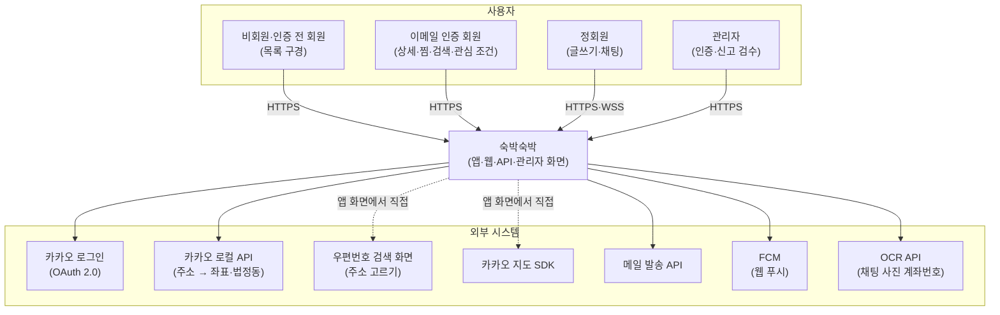
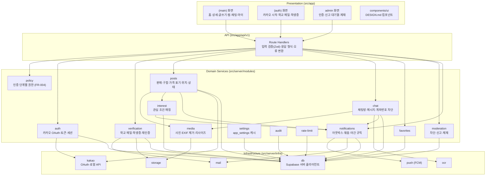
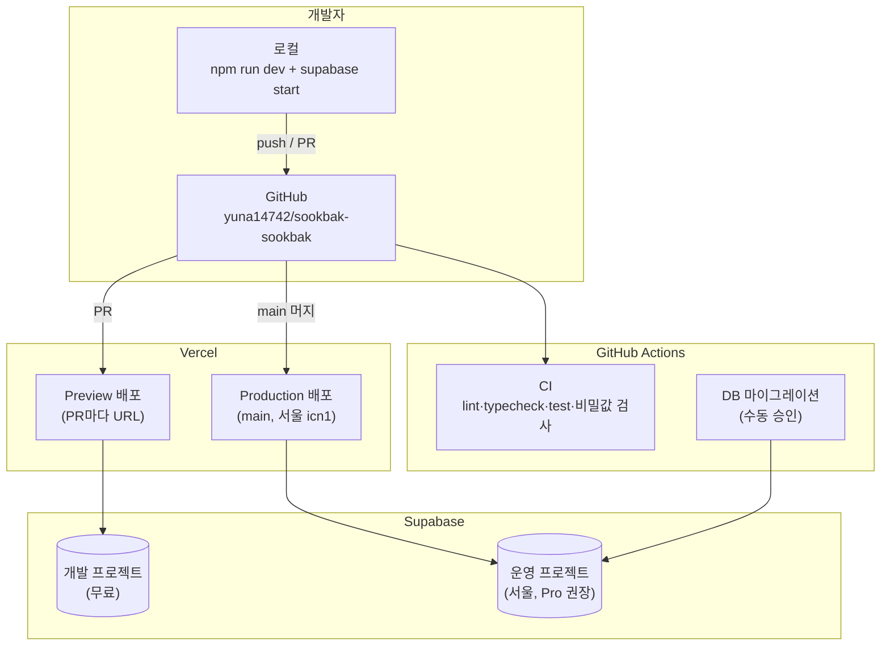
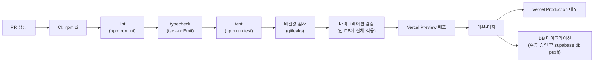
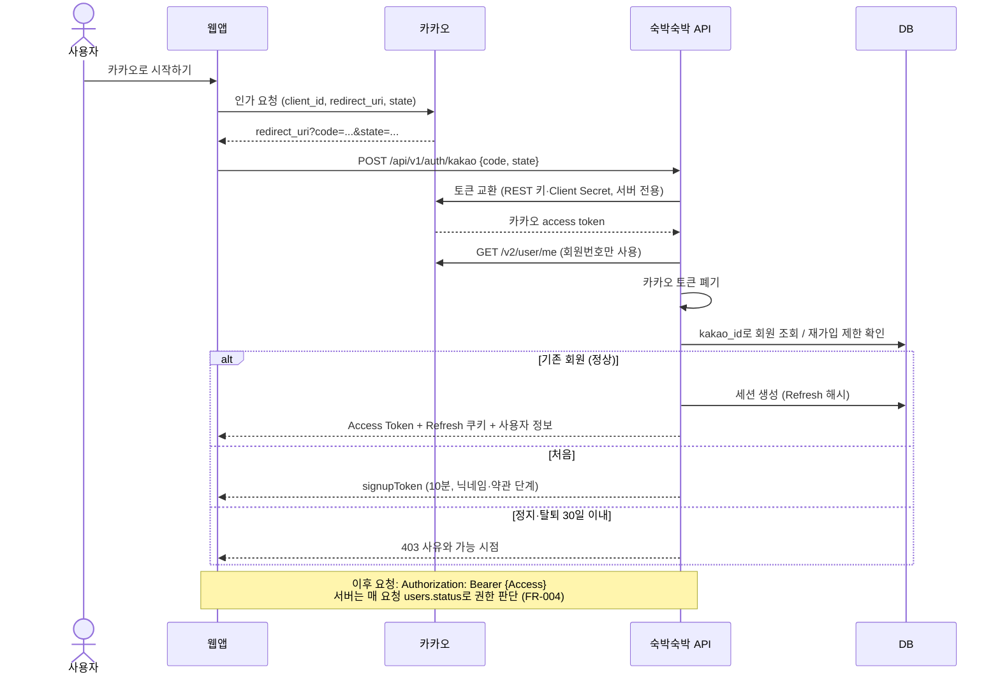

# 시스템 아키텍처 설계서 (SAD - System Architecture Document)

> 숙박숙박 Phase 2 시스템 설계 산출물이다. [SRS](../01-요구사항분석/요구사항명세서-SRS.md) v0.1이 Phase 2로 넘긴 결정(앱 구현 방식 DEC-010, 백엔드·DB·외부 API 업체, 요청 제한 수치)을 정하고, 시스템 경계와 구성 요소, 배포 구조, 비기능 요구사항 대응 방법을 정의한다. 근거는 SRS·[RTM](../01-요구사항분석/요구사항추적매트릭스-RTM.md)·[유스케이스 명세서](../01-요구사항분석/유스케이스명세서.md) v0.1, PRD.md v0.2, DESIGN.md, 저장소 AGENTS.md(Next.js), 2026-11-26 사용자 결정이다. 확인되지 않은 수치는 "초안", 결정되지 않은 사항은 "미결"로 표시했다.

| 항목 | 내용 |
|------|------|
| **프로젝트명** | 숙박숙박 (SookbakSookbak) |
| **문서 번호** | SAD-SOOKBAK-v0.1 |
| **문서 버전** | v0.1 (초안) |
| **작성일** | 2026-11-26 |
| **작성자** | 이유나 (기획) / Claude (초안 작성 지원) |
| **승인자** | 이유나 (기획 책임자) |
| **문서 상태** | 초안 (G2 검토 전) |

---

## 1. 문서 개요

### 1.1 목적

본 문서는 숙박숙박 MVP(v1.0)의 소프트웨어 아키텍처를 정의한다. 숙박숙박은 숙명여대 학생이 방을 내놓는 판매 글과 방을 찾는 구함 글을 올리고, 눈송이로 찜하고, 글별 1:1 채팅으로 연결되는 모바일 우선 앱이다. 앱은 연결까지만 돕고 계약·송금은 앱 밖에서 당사자끼리 한다.

이 문서는 다음 용도로 쓴다.

- 구현(Claude Code 등 AI 보조 개발)이 따를 기술 스택, 코드 구조, 모듈 경계의 기준
- [데이터베이스 설계서](데이터베이스설계서.md), [API 설계서](API설계서.md), [화면 설계서](화면설계서.md)가 공유하는 전제
- API 키 같은 비밀 정보를 저장소에 올리지 않기 위한 관리 규칙 (4.5)

### 1.2 범위

| 구분 | 내용 |
|------|------|
| **대상 시스템** | 숙박숙박 모바일 웹앱(PWA), API 서버, 관리자 화면, 실시간 채팅, 예약 작업 |
| **포함 범위** | SRS FR-001~FR-025 (P1, MVP) 구현에 필요한 아키텍처, NFR-001~012 대응 설계, 외부 연동(카카오 로그인, 메일, 푸시, 주소·지도, OCR) |
| **제외 범위** | FR-026~029(P2·P3)의 상세 설계(확장 지점만 표시), 결제·송금·에스크로(어떤 버전에도 없음, EX-001), 지도 중심 탐색(EX-003), 다른 학교 확장(NFR-009) |
| **대상 독자** | 기획 책임자(이유나), 구현 담당(AI 보조 개발 포함), 테스트·운영 담당 |

### 1.3 참조 문서

| 문서명 | 버전 | 위치 |
|--------|------|------|
| 요구사항 명세서 (SRS) | v0.1 | [../01-요구사항분석/요구사항명세서-SRS.md](../01-요구사항분석/요구사항명세서-SRS.md) |
| 요구사항 추적 매트릭스 (RTM) | v0.1 | [../01-요구사항분석/요구사항추적매트릭스-RTM.md](../01-요구사항분석/요구사항추적매트릭스-RTM.md) |
| 유스케이스 명세서 | v0.1 | [../01-요구사항분석/유스케이스명세서.md](../01-요구사항분석/유스케이스명세서.md) |
| 서비스 기획서 / 비즈니스 정책서 | v0.2 계열 | [../00-기획/](../00-기획/) |
| PRD.md / DESIGN.md | v0.2 / 2026-11-26 | 저장소 루트 (PR #2 / PR #1) |
| 데이터베이스 설계서 / API 설계서 / 화면 설계서 | v0.1 | 같은 폴더 |
| AGENTS.md | - | 저장소 루트 (Next.js, `npm run dev`, `npm run build` 금지) |

### 1.4 변경 이력

| 버전 | 날짜 | 작성자 | 변경 내용 |
|------|------|--------|-----------|
| v0.1 | 2026-11-26 | 이유나 / Claude | 초안 작성. 앱 구현 방식(DEC-010)을 Next.js 모바일 웹앱(PWA)으로 결정(ADR-001, 이유나 2026-11-26 승인, 앱 포장은 나중에 검토), 백엔드 Next.js Route Handlers + Supabase(ADR-002), 카카오 로그인 + 자체 토큰(ADR-003), 비밀 정보 관리 규칙(4.5) |
| v1.0 | [미정] | 이유나 | G2 검토 후 최종 승인 |

### 1.5 용어 정의

| 용어 | 정의 |
|------|------|
| SAD / ADR | 시스템 아키텍처 설계서 / 아키텍처 결정 기록 |
| Next.js App Router | React 기반 풀스택 프레임워크. 화면(서버·클라이언트 컴포넌트)과 API(Route Handlers)를 한 저장소에서 만든다 |
| Route Handler | Next.js의 서버 API 파일 (`src/app/api/v1/**/route.ts`) |
| PWA | Progressive Web App. 웹사이트를 홈 화면에 추가해 앱처럼 실행하고 웹 푸시를 받는 방식 |
| Capacitor | 웹앱을 iOS·Android 앱으로 포장하는 도구. 지금은 쓰지 않고 나중에 앱 스토어 출시가 필요할 때 검토한다 (ADR-001) |
| PWA | 홈 화면에 설치할 수 있는 웹앱 |
| Supabase | PostgreSQL·파일 저장소·실시간 연결·예약 작업을 제공하는 관리형 서비스 |
| RLS | Row Level Security. DB가 행 단위로 접근을 막는 기능 |
| FCM / 웹 푸시 | Firebase Cloud Messaging. 브라우저 표준 웹 푸시(Push API·서비스 워커)로 알림을 보낸다 |
| OCR | 사진 속 글자 인식. 채팅 사진의 계좌번호 검사에 쓴다 |
| 아웃박스 | 보낼 알림을 먼저 DB에 쓰고 별도 작업이 읽어 발송하는 방식 |
| 환경 변수 | 코드 밖에서 주입하는 설정값. API 키 등 비밀값은 여기에만 둔다 |
| 인증 단계 | `UNVERIFIED`(인증 전) → `EMAIL_VERIFIED`(학교 메일) → `MEMBER`(학생증, 정회원). [DB 설계서 4.2](데이터베이스설계서.md#42-열거형-enum-값-정의) |

---

## 2. 아키텍처 개요

### 2.1 아키텍처 스타일 선택

#### 선택된 아키텍처 스타일

**모듈형 모놀리스 (Next.js 풀스택 단일 애플리케이션) + 관리형 백엔드 서비스(Supabase)**

화면과 API를 하나의 Next.js 애플리케이션으로 만들고, 내부는 도메인 모듈(인증, 글, 채팅, 알림, 관리자 등)로 나눈다. DB·파일 저장소·실시간 연결·예약 작업은 Supabase 관리형 서비스를 쓴다. 지금은 모바일 브라우저와 홈 화면 추가(PWA)로 쓰고, 앱 스토어 출시는 나중에 필요할 때 검토한다 (ADR-001).

#### 후보 아키텍처 스타일 비교

| 기준 | 모듈형 모놀리스 + 관리형 서비스 | 마이크로서비스 | 앱(React Native) + 별도 API 서버 |
|------|------------------------------|---------------|----------------------------------|
| 개발 속도 (수업 일정, 1인 + AI 보조) | 높음 | 낮음 | 중간 |
| 저장소 AGENTS.md(Next.js)와 맞음 | 맞음 | 부분 | 부분 (API만 Next.js) |
| 운영 복잡도 | 낮음 (Vercel + Supabase) | 높음 | 중간 |
| 확장성 (가입자 1만 명, NFR-009) | 충분 (무상태 서버 수평 확장) | 높음 (과함) | 충분 |
| 푸시 알림 | 웹 푸시 (iOS는 홈 화면 추가 필요) | 별도 | 가장 자연스러움 |
| 앱 스토어 비용·심사 | 없음 | 없음 | 필요 (Apple 연간, Google 1회) |
| 비용 (무료~저비용, SRS 7.3) | 낮음 | 높음 | 중간 |
| 코드 벌 수 | 1벌 | 여러 벌 | 2벌 (앱 + 서버) |

#### 선택 근거

1. 규모: 가입자 1,000명·글 300건(3개월 가설)은 단일 애플리케이션과 단일 DB로 충분하다. 서비스를 쪼갤 이유가 없다.
2. 저장소 정합: 저장소 AGENTS.md가 Next.js 개발 서버(`npm run dev`)를 전제로 한다.
3. 코드 한 벌: 화면·API·관리자 화면을 TypeScript 하나로 만들고, 나중에 앱으로 포장하더라도 같은 화면 코드를 쓴다. AI 보조 개발에서 맥락을 한곳에 둘 수 있다.
4. 관리형 서비스: DB 백업, 파일 저장소, WebSocket 실시간 연결, 예약 작업을 직접 운영하지 않는다.

### 2.2 아키텍처 원칙

| 원칙 | 설명 |
|------|------|
| 서버가 최종 판단 | 권한(인증 단계), 필수 항목, 한도, 계좌번호 차단은 앱 화면에서 먼저 막더라도 서버 API에서 다시 검사한다 (BP-AUTH-003-2, AC-004-4, AC-015-4) |
| 클라이언트는 DB에 직접 쓰지 않음 | 모든 쓰기는 API를 거친다. 클라이언트가 Supabase에 직접 하는 일은 채팅 메시지 실시간 구독(읽기) 하나뿐이다 |
| 개인정보 최소 노출 | 응답 모델(DTO)을 따로 두어 실명·학번·학교 이메일·건물 주소·좌표가 다른 사용자 응답에 섞이지 않게 한다 (NFR-005, AC-010-1) |
| 비밀값은 코드 밖 | API 키·DB 접속 정보·서명 키는 환경 변수와 배포 플랫폼 비밀 저장소에만 둔다. 저장소에는 `.env.example`(값 없는 이름 목록)만 올린다 (4.5) |
| 설정값 분리 | 숙대 기준 위치, 동네 목록, 송금 감지 단어, 한도 값은 `app_settings`에서 읽는다 (NFR-009) |
| 무상태 API | 서버 인스턴스에 세션을 저장하지 않는다. 요청 제한 카운터도 DB에 둔다 |
| 장애 격리 | 외부 서비스(카카오, 메일, 푸시, OCR, 지도)가 실패해도 핵심 기능(목록·상세·채팅 저장)은 계속 동작하고 SRS 5.3의 대체 동작을 따른다 |
| 디자인 토큰 | 화면 색·서체·간격은 DESIGN.md 토큰으로만 참조하고 HEX를 코드에 직접 쓰지 않는다 (NFR-011) |

### 2.3 시스템 컨텍스트 다이어그램



| 외부 시스템 | 용도 | 연동 방향 | 장애 시 동작 (SRS 5.3) |
|-------------|------|-----------|------------------------|
| 카카오 로그인 | 가입·로그인 (카카오 회원번호만 받음), 탈퇴 시 연결 끊기 | 서버 → 카카오 | 새 로그인만 안내 문구. 이미 로그인한 사용자는 숙박숙박 토큰으로 계속 이용 |
| 카카오 로컬 API | 고른 주소의 좌표·법정동 코드 조회 | 서버 → 카카오 (REST 키는 서버에만) | 글쓰기 `완료` 비활성, 재시도 안내 |
| 우편번호 검색 화면 | 주소 검색·선택 UI (키 불필요) | 앱 화면에 삽입 | 재시도 안내 |
| 카카오 지도 SDK | 상세 대략 위치 지도 (원 + 숙대 위치) | 앱 화면 → 카카오 | 지도 대신 동네 이름·숙대 기준 위치 텍스트 |
| 메일 발송 API | 학교 메일 인증번호, 재인증·만료·제재 안내 | 서버 → 메일 서비스 | "메일을 보내지 못했어요" 안내 |
| FCM | 웹 푸시 (서비스 워커가 받음. iOS는 16.4 이상 + 홈 화면 추가 시) | 서버 → FCM → 브라우저 | 인앱 알림 목록에는 항상 남김 |
| OCR API | 채팅 사진 속 계좌번호 검사 | 서버 → OCR | 사진은 보내고 "송금 요구" 신고로 보완 (초안) |

### 2.4 컨테이너 다이어그램

```mermaid
graph TB
    subgraph "사용자 기기"
        APP["홈 화면 추가 PWA<br/>(서비스 워커 + 웹 푸시)"]
        WEB["모바일 브라우저"]
        ADMINW["관리자 브라우저<br/>(데스크톱)"]
    end

    subgraph "Vercel (서울 리전 icn1)"
        NEXT["Next.js 애플리케이션<br/>화면(App Router) + API(/api/v1)<br/>+ 관리자 화면(/admin)"]
        MW["미들웨어<br/>(토큰 확인·보안 헤더)"]
        JOBS["내부 작업 API<br/>(/api/internal/jobs/*)"]
    end

    subgraph "Supabase (서울 리전 ap-northeast-2)"
        PG[("PostgreSQL 15<br/>RLS·pg_trgm·pg_cron")]
        ST[("Storage<br/>post-photos(공개)·chat-photos(공개, 추측 불가 경로)<br/>verification-docs(비공개)")]
        RT["Realtime<br/>(WSS, 채팅 메시지 구독)"]
        CRON["pg_cron + pg_net<br/>(매분·매일 작업 호출)"]
    end

    APP -->|HTTPS| MW
    WEB -->|HTTPS| MW
    ADMINW -->|HTTPS| MW
    MW --> NEXT
    NEXT -->|SQL (서버 전용 키)| PG
    NEXT -->|업로드·삭제| ST
    APP <-->|WSS 구독| RT
    WEB <-->|WSS 구독| RT
    RT --> PG
    CRON -->|HTTPS + CRON_SECRET| JOBS
    JOBS --> PG
    APP -->|사진 내려받기| ST
```

| 컨테이너 | 책임 | 기술 | 통신 |
|----------|------|------|------|
| 홈 화면 추가 PWA | 전체 화면 실행, 웹 푸시 수신·토큰 등록, 사진 선택(`<input type="file" accept="image/*">`로 카메라·앨범) | Next.js 화면 + `manifest.webmanifest` + 서비스 워커, Firebase JS SDK(메시징) | HTTPS, WSS |
| 모바일 브라우저 | 같은 화면을 브라우저에서 (공유 링크, 홈 화면 추가 전) | Next.js 화면 | HTTPS, WSS |
| Next.js 애플리케이션 | 화면 렌더링, REST API, 권한 검사, 비즈니스 규칙, 외부 API 호출, 관리자 화면 | Next.js 15 App Router, TypeScript, Node.js 20 런타임 | HTTPS |
| 미들웨어 | Access Token 확인 후 요청에 사용자 정보 첨부, 관리자 경로 차단, 보안 헤더 | Next.js Middleware | 내부 |
| 내부 작업 API | 재인증·만료·자동 숨김·파기 배치, 푸시 발송, 관심 매물 묶음 발송 | Route Handlers (공개 경로 아님, `CRON_SECRET` 필요) | HTTPS |
| PostgreSQL | 영속 데이터, 제약조건, RLS | Supabase Postgres 15 | TCP(SSL) |
| Storage | 매물·채팅 사진(리사이즈본), 학생증 원본(비공개, 처리 즉시 삭제) | Supabase Storage + CDN | HTTPS |
| Realtime | 채팅 메시지 실시간 전달 (DB 변경 구독, RLS 적용) | Supabase Realtime | WSS |
| pg_cron | 정해진 시각에 내부 작업 API 호출 | pg_cron + pg_net | HTTPS |

### 2.5 컴포넌트 다이어그램

Next.js 애플리케이션 내부 모듈 구성이다. 화면(Presentation) → API 라우트 → 서비스(도메인 모듈) → 데이터 접근 순으로만 호출한다.



| 모듈 | 책임 | 관련 FR | 핵심 규칙 |
|------|------|---------|-----------|
| `auth` | 카카오 인가 코드 교환, 회원 조회·가입, Access/Refresh 토큰 발급·로테이션, 로그아웃, 탈퇴(카카오 연결 끊기) | FR-001, FR-002 | 카카오 토큰 저장 안 함 |
| `verification` | 학교 메일 인증번호 발송·확인·잠금, 학생증 제출, 관리자 승인·반려(원본 즉시 삭제), 재인증 일정 | FR-001, FR-003, FR-005, FR-019 | 상태 전이는 이 모듈만 |
| `policy` | 사용자 상태 → 허용 동작 판단, 403 응답에 `requiredLevel` | FR-004 | 화면·API 공통 권한 표 하나 |
| `posts` | 판매·구함 CRUD, 분류별 검증, 가격 계산·표기 문자열, 위치(동네·숙대 기준 위치·표시 중심), 거래 상태, 한도, 임시 저장, 조회 수 | FR-006~013, FR-024 | 주소·좌표는 응답에 넣지 않음 |
| `media` | 사진 업로드: 형식·크기 검사, EXIF 제거, 목록용·상세용 WebP 생성 | FR-007, FR-015 | `sharp`는 메타데이터를 기본으로 지움 |
| `favorites` | 찜·해제·목록, 찜 수 갱신 | FR-014 | 자기 글 찜 불가 |
| `chat` | 채팅방 열기, 메시지 저장, 계좌번호 차단(텍스트 정규식 + 사진 OCR), 송금 경고 표시, 읽음 | FR-015 | 차단된 내용은 저장 안 함 |
| `moderation` | 차단, 신고(3건 자동 숨김), 관리자 신고 처리·글 숨김·복구·제재 | FR-016, FR-018, FR-019 | |
| `notifications` | 알림 행 생성(아웃박스), 설정·야간·묶음 규칙, FCM 발송, 실패 토큰 정리 | FR-020 | 인앱 목록에는 항상 남김 |
| `interest` | 관심 조건 CRUD, 글 공개·가격 인하 시 매칭 | FR-021 | 같은 글 1회, 10분 3건 묶음 |
| `settings` | `app_settings` 읽기(1분 메모리 캐시)·관리자 수정 | FR-010-5 | |
| `audit` | 감사 로그 기록 | NFR-006 | 토큰·인증번호·학번 원문 금지 |
| `rate-limit` | 사용자·IP별 요청 제한 | NFR-004 | API 설계서 7장 수치 |

---

## 3. 기술 스택 선정

### 3.1 선정 기준 매트릭스

| 기준 | 가중치 | 설명 |
|------|--------|------|
| 요구사항 충족 | 30% | 푸시(NFR-003·FR-021), 실시간 채팅 1초(NFR-001), 모바일 우선 |
| 개발 생산성 | 25% | 1인 + AI 보조 개발, 수업 일정 (DEC-006) |
| 저장소·기존 결정 정합 | 15% | AGENTS.md(Next.js, TypeScript 우선) |
| 비용 | 15% | 무료 또는 저비용 관리형 서비스 우선 (SRS 7.3) |
| 운영 부담 | 10% | 서버·DB를 직접 운영하지 않음 |
| 생태계·자료 | 5% | 문서·예제가 많아 AI 보조 개발에 유리 |

### 3.2 프론트엔드 기술 선정

#### 선정 결과

| 항목 | 선정 기술 | 버전 | 비고 |
|------|-----------|------|------|
| 프레임워크 | Next.js (App Router) | 15.x | 화면 + API 한 저장소 |
| UI 라이브러리 | React | 19.x | Next.js 15 기본 |
| 언어 | TypeScript | 5.x | AGENTS.md 3장 |
| 스타일 | Tailwind CSS (DESIGN.md 토큰을 테마로 등록) | 4.x | 토큰 외 임의 HEX 금지. 컴포넌트별 스타일은 같은 폴더에 |
| 서버 데이터 | TanStack Query | 5.x | 목록 캐시·무한 스크롤·재시도(1·2·4초, FR-025) |
| 폼 | React Hook Form + Zod | 7.x / 3.x | 클라이언트·서버가 같은 Zod 스키마 공유 |
| PWA | Web App Manifest + 서비스 워커 (`public/sw.js`), Firebase JS SDK 메시징 | - / 11.x | 홈 화면 추가, 웹 푸시. 앱 포장(Capacitor)은 나중에 검토 |
| 실시간 | `@supabase/supabase-js` Realtime | 2.x | 채팅 구독만 |
| 지도 | 카카오 지도 JavaScript SDK | - | 상세 대략 위치 (도메인 제한 키) |
| 서체 | Pretendard (자체 호스팅, 400·700) | - | DESIGN.md |
| 테스트 | Vitest + Testing Library, Playwright(E2E) | - | `npm run test` |

#### 평가 상세

| 기준 | Next.js 모바일 웹앱(PWA) | React Native (Expo) | Flutter |
|------|-------------------------|---------------------|---------|
| 요구사항 충족 (30%) | 4 — 웹 푸시 가능, iOS는 홈 화면 추가가 필요해 알림 도달률이 낮을 수 있음 | 5 | 5 |
| 개발 생산성 (25%) | 5 — 화면·API 한 벌, 웹 개발 도구 그대로 | 4 | 3 (Dart) |
| 저장소 정합 (15%) | 5 — AGENTS.md Next.js | 2 | 1 |
| 비용 (15%) | 5 — 앱 스토어 비용 없음 | 3 — 스토어 계정 비용 | 3 |
| 운영 부담 (10%) | 5 — 웹 배포만으로 갱신, 심사 없음 | 3 — 스토어 심사·OTA 관리 | 3 |
| 생태계 (5%) | 5 | 5 | 4 |
| **가중 합계** | **4.75** | 3.75 | 3.3 |

### 3.3 백엔드 기술 선정

#### 선정 결과

| 항목 | 선정 기술 | 버전 | 비고 |
|------|-----------|------|------|
| 런타임 | Node.js | 20 LTS | Vercel Node.js 런타임 (사진 처리 `sharp` 사용을 위해 Edge 런타임은 쓰지 않음) |
| 프레임워크 | Next.js Route Handlers | 15.x | `/api/v1/*` REST |
| 입력 검증 | Zod | 3.x | 요청 스키마 = 화면 폼 스키마 |
| DB 접근 | `@supabase/supabase-js` (서버 전용 키) + SQL 함수(RPC) | 2.x | 트랜잭션이 필요한 작업(글 등록 한도, 신고 자동 숨김, 찜 수)은 Postgres 함수로 |
| 토큰 | `jose` (JWT 서명·검증) | 5.x | HS256, Supabase JWT 비밀키로 서명 (ADR-003) |
| 이미지 처리 | `sharp` | 0.33.x | EXIF 제거, WebP 리사이즈 |
| 메일 | Resend API (초안) | - | 학교 메일 도착 확인 필요 (DEP-001) |
| 푸시 | Firebase Admin SDK (FCM HTTP v1) | 12.x | 웹 푸시. 웹 푸시용 공개 키(VAPID)는 Firebase 콘솔에서 발급 |
| OCR | Google Cloud Vision `TEXT_DETECTION` (초안) | - | 한국어 지원, 월 1,000장 무료 구간. 대안 네이버 CLOVA OCR |
| 오류 추적 | Sentry (무료 플랜) | - | 개인정보 마스킹 설정 |

#### 평가 상세

| 기준 | Next.js Route Handlers + Supabase | NestJS 서버 + PostgreSQL 직접 운영 | Firebase (Firestore + Functions) |
|------|----------------------------------|-----------------------------------|----------------------------------|
| 요구사항 충족 | 5 — 관계형 제약·부분 인덱스로 한도·중복 정책 표현, Realtime 채팅 | 5 | 3 — 관계·유니크 제약·복합 필터가 약함 |
| 개발 생산성 | 5 — 화면과 같은 저장소 | 3 | 4 |
| 저장소 정합 | 5 | 2 | 3 |
| 비용 | 5 — 무료로 시작, 운영 Pro 월 25달러 | 3 — 서버 상시 비용 | 4 |
| 운영 부담 | 5 | 2 | 5 |
| **결론** | **채택** | 불채택 | 불채택 |

### 3.4 데이터베이스 기술 선정

| 항목 | 선정 기술 | 비고 |
|------|-----------|------|
| 주 DB | PostgreSQL 15 (Supabase, 서울) | [DB 설계서](데이터베이스설계서.md) |
| 검색 | PostgreSQL `pg_trgm` | 글 수백~수천 건 규모라 별도 검색 엔진 불필요 |
| 캐시 | 별도 캐시 서버 없음 | 목록 응답은 CDN·메모리 캐시 짧게(6.1). Redis는 NFR-002 미달 시 검토 |
| 파일 | Supabase Storage + CDN | 공개 버킷(사진 리사이즈본), 비공개 버킷(학생증 원본) |
| 실시간 | Supabase Realtime | 채팅 메시지 INSERT 구독, RLS로 참여자만 |
| 예약 작업 | pg_cron + pg_net | Vercel 무료 플랜 cron은 하루 1회 제한이라 매분 작업에 쓰지 않음 |

### 3.5 인프라 기술 선정

| 항목 | 선정 기술 | 비고 |
|------|-----------|------|
| 호스팅 | Vercel (Next.js), 함수 리전 서울 `icn1` | GitHub 연동 자동 배포, PR마다 미리보기 URL |
| DB·저장소·실시간 | Supabase (서울 `ap-northeast-2`) | 개발 프로젝트(무료) / 운영 프로젝트(Pro 권장, DB-Q3 미결) |
| CI/CD | GitHub Actions + Vercel | 4.3 |
| 비밀 정보 저장 | Vercel 환경 변수(암호화), GitHub Actions Secrets, Supabase 대시보드 | 4.5 |
| 모니터링 | Vercel 로그·Analytics, Sentry, Supabase 대시보드(쿼리·연결) | 6.4 |
| 도메인 | 미결 | 예: `sookbak.app` (API는 같은 도메인 `/api/v1`) |

### 3.6 대안 기술 및 불채택 사유

| 대안 기술 | 영역 | 불채택 사유 |
|-----------|------|-------------|
| React Native (Expo) | 앱 | 품질은 가장 좋지만 화면 코드가 Next.js와 따로 생겨 두 벌이 되고, 앱 스토어 계정 비용·심사가 필요하다. 수업 일정·1인 개발에 부담 (ADR-001 대안) |
| Capacitor 앱 포장 | 앱 | 지금은 보류. 앱 스토어 비용(Apple 연간, Google 1회)과 심사가 필요하다. iOS 웹 푸시 도달률이 낮으면 나중에 검토 (ADR-001) |
| Supabase Auth의 카카오 로그인 | 인증 | 카카오에서 이메일·프로필 동의 항목을 요구하는 구성이 기본이라 "카카오 회원번호만 받는다"(FR-001-2) 원칙과 맞추기 어렵고, 인증 단계(UNVERIFIED~MEMBER) 판단을 우리 DB가 해야 한다. 자체 토큰 발급으로 대체 (ADR-003) |
| Socket.IO 자체 서버 | 채팅 | Vercel 함수는 장시간 연결을 유지할 수 없어 별도 서버가 필요하다. Supabase Realtime으로 대체 (ADR-004) |
| Elasticsearch / OpenSearch | 검색 | 데이터가 작아 과하다. `pg_trgm`으로 충분 |
| Redis (Upstash) | 캐시·요청 제한 | 외부 서비스·키가 하나 더 늘어난다. MVP는 DB 카운터로 충분 |
| AWS (ECS·RDS·S3) | 인프라 | 설정·비용·운영 부담이 크다 |
| 행정안전부 도로명주소 API | 주소 | 좌표 변환에 별도 API가 필요하다. 카카오 로컬 API 하나로 좌표·법정동을 함께 받는다 |
| 네이버 지도 | 지도 | 카카오 로그인·로컬 API와 같은 개발자 계정으로 관리하려고 카카오 지도 선택. 기능상 차이는 없음 |

---

## 4. 배포 아키텍처

### 4.1 배포 다이어그램



사용자는 운영 웹 주소로 접속하거나 홈 화면에 추가해 쓴다. 화면·API 변경은 웹 배포만으로 모두에게 바로 반영되고, 앱 스토어 심사는 없다. 서비스 워커는 배포 때 새 버전으로 바뀐다.

### 4.2 환경 구성

| 환경 | 용도 | 인프라 | URL |
|------|------|--------|-----|
| Local | 개발자 로컬 개발 (AGENTS.md: `npm run dev`만, `npm run build` 금지) | Next.js 개발 서버 + `supabase start`(Docker 로컬 DB) | `http://localhost:3000` |
| Preview | PR 확인·테스트 | Vercel Preview + Supabase 개발 프로젝트 | Vercel이 PR마다 발급 |
| Production | 운영 | Vercel Production + Supabase 운영 프로젝트 | 미결 (도메인) |

#### 환경별 상세 구성

| 항목 | Local | Preview | Production |
|------|-------|---------|------------|
| DB | 로컬 Docker (seed 가짜 데이터) | Supabase 개발 프로젝트 | Supabase 운영 프로젝트 |
| 카카오 앱 | 개발용 카카오 앱 (Redirect URI `localhost`) | 개발용 카카오 앱 (Preview 도메인 등록) | 운영용 카카오 앱 |
| 메일 | 콘솔 출력 (실제 발송 안 함) | 테스트 수신 주소로만 | 실제 발송 |
| 푸시 | 끔 | 개발용 Firebase 프로젝트 | 운영 Firebase 프로젝트 |
| OCR | 가짜 응답 (테스트 이미지 규칙) | 실제 API (사용량 제한) | 실제 API |
| 로그 수준 | debug | info | info (개인정보 마스킹) |
| 데이터 | 가짜 데이터만 | 가짜 데이터만 | 실제 사용자 데이터 |

운영 데이터를 로컬·Preview로 복사하지 않는다 (개인정보).

### 4.3 CI/CD 파이프라인



#### CI 단계 상세

| 단계 | 도구 | 기준 | 실패 시 |
|------|------|------|---------|
| 의존성 설치 | `npm ci` | lockfile과 일치 (AGENTS.md 2장) | PR 차단 |
| 정적 분석 | ESLint (`npm run lint`) | 오류 0건 (NFR-011) | PR 차단 |
| 타입 검사 | `tsc --noEmit` | 오류 0건 | PR 차단 |
| 단위 테스트 | Vitest (`npm run test`) | 비즈니스 규칙 테스트 통과: 권한 표, 가격 표기, 필수 항목, 계좌번호 패턴, 관심 조건 매칭, 자동 숨김 (NFR-011) | PR 차단 |
| 비밀값 검사 | gitleaks | 커밋된 API 키·비밀키 0건 (4.5) | PR 차단 |
| 마이그레이션 검증 | Supabase CLI (CI 안 로컬 DB) | 전체 마이그레이션이 빈 DB에 적용됨 | PR 차단 |
| 빌드 | Vercel이 Preview 배포 시 수행 | 빌드 성공 | 배포 안 됨 |

CI 안의 프로덕션 빌드는 Vercel이 맡는다. 에이전트 세션에서는 `npm run build`를 실행하지 않는다 (AGENTS.md 1장).

#### CD 단계 상세

| 단계 | 방식 | 비고 |
|------|------|------|
| Preview 배포 | PR push마다 Vercel 자동 | 개발 Supabase에 연결 |
| Production 배포 | `main` 머지 시 Vercel 자동 | 문제가 있으면 Vercel에서 이전 배포로 즉시 되돌림 |
| DB 마이그레이션 | GitHub Actions `workflow_dispatch` + 환경 보호 규칙(승인자 이유나) | 하위 호환 순서(확장 → 전환 → 정리, DB 설계서 5.5)로 앱 배포와 독립 |

### 4.4 인프라 코드(IaC) 전략

| 항목 | 내용 |
|------|------|
| IaC 도구 | 해당 없음 (Terraform 미사용). 관리형 서비스 2개(Vercel, Supabase)라 대시보드 설정 + 저장소 설정 파일로 충분 |
| 코드로 관리하는 것 | `supabase/config.toml`, `supabase/migrations/*.sql`(스키마·RLS·pg_cron), `vercel.json`(리전·헤더), `public/manifest.webmanifest`, `.github/workflows/*.yml` |
| 대시보드에서만 관리하는 것 | 환경 변수 값(비밀), 도메인, 카카오·Firebase·OCR 콘솔 설정 |

#### IaC 디렉토리 구조

```
sookbak-sookbak/
├── .github/workflows/
│   ├── ci.yml                 # lint·typecheck·test·gitleaks·마이그레이션 검증
│   └── db-migrate.yml         # 수동 승인 운영 마이그레이션
├── supabase/
│   ├── config.toml
│   ├── migrations/
│   └── seed.sql               # 가짜 데이터만
├── src/
│   ├── app/                   # 화면 + API (App Router)
│   │   ├── (main)/            # 홈·상세·글쓰기·찜·채팅·마이
│   │   ├── (auth)/            # 카카오 시작·학교 메일·학생증
│   │   ├── admin/             # 관리자 화면
│   │   └── api/
│   │       ├── v1/            # 공개 REST API
│   │       └── internal/jobs/ # pg_cron이 호출하는 작업 (CRON_SECRET)
│   ├── components/ui/         # DESIGN.md 컴포넌트
│   ├── server/
│   │   ├── modules/           # 도메인 서비스 (2.5)
│   │   └── infra/             # 외부 연동 클라이언트
│   └── lib/                   # 공용 (Zod 스키마, 가격 표기, 토큰)
├── public/                # manifest.webmanifest, sw.js(서비스 워커), 아이콘
├── vercel.json
├── .env.example               # 이름만, 값 없음 (커밋)
├── .env.local                 # 실제 값 (커밋 금지, .gitignore)
└── .gitignore
```

### 4.5 비밀 정보(API 키) 관리

사용자 요청(2026-11-26): "깃허브에 API 안 올라가게 주의". 카카오·Supabase·Firebase·메일·OCR 키와 서명 키가 저장소에 올라가지 않도록 다음 규칙을 따른다 (NFR-005 비밀 정보).

#### 규칙

| # | 규칙 |
|---|------|
| S-1 | 비밀값은 환경 변수로만 읽는다. 소스 코드, 마이그레이션, seed, 테스트 코드, 문서, 커밋 메시지, PR 본문에 실제 키를 쓰지 않는다 |
| S-2 | 로컬 값은 `.env.local`에 둔다. `.gitignore`가 `.env`, `.env.*`를 무시하고 `.env.example`만 예외로 허용한다 |
| S-3 | `.env.example`에는 변수 이름과 설명만 쓰고 값은 비워 둔다 |
| S-4 | 배포 환경 값은 Vercel 환경 변수(Preview / Production 분리), DB 마이그레이션 작업 값은 GitHub Actions Secrets에만 넣는다 |
| S-5 | `NEXT_PUBLIC_` 접두사는 브라우저에 그대로 노출되므로 **원래 공개용인 값**(Supabase URL·anon 키, 카카오 JavaScript 키)에만 쓴다. 공개용 키도 콘솔에서 허용 도메인을 제한한다 |
| S-6 | 서버 전용 키(서비스 키, JWT 비밀키, 카카오 REST·Admin 키, Firebase 비공개 키, 메일·OCR 키)는 `src/server/**`에서만 읽고, 이 폴더에는 `import "server-only"`를 넣어 화면 코드에 섞이면 빌드가 실패하게 한다 |
| S-7 | CI에서 gitleaks로 커밋에 비밀값이 있는지 검사하고, GitHub 저장소 설정에서 Secret scanning과 Push protection을 켠다 |
| S-8 | 키가 실수로 커밋되면 커밋을 지우는 것만으로는 부족하다. 즉시 해당 콘솔에서 키를 폐기·재발급하고, 그다음 기록을 정리한다 |
| S-9 | 로그·오류 추적(Sentry)에 토큰·인증번호·키가 찍히지 않도록 마스킹한다 (NFR-006) |
| S-10 | 개발용·운영용 키를 분리한다 (카카오 앱, Firebase 프로젝트, Supabase 프로젝트 각각 2개) |

#### 환경 변수 목록 (`.env.example`)

| 변수 | 공개 여부 | 용도 |
|------|----------|------|
| `NEXT_PUBLIC_APP_URL` | 공개 | 앱 기본 주소 (카카오 Redirect URI 조합) |
| `NEXT_PUBLIC_SUPABASE_URL` | 공개 | Supabase 프로젝트 주소 |
| `NEXT_PUBLIC_SUPABASE_ANON_KEY` | 공개 | Realtime 연결용. RLS로 보호되며 단독으로 데이터 접근 불가 |
| `SUPABASE_SERVICE_ROLE_KEY` | **서버 전용** | 서버 DB·저장소 접근 (RLS 우회 권한) |
| `SUPABASE_JWT_SECRET` | **서버 전용** | Access Token 서명 (ADR-003) |
| `KAKAO_REST_API_KEY` | **서버 전용** | 카카오 OAuth 토큰 교환, 로컬 API |
| `KAKAO_CLIENT_SECRET` | **서버 전용** | 카카오 OAuth Client Secret |
| `KAKAO_ADMIN_KEY` | **서버 전용** | 탈퇴 시 연결 끊기 (카카오 토큰을 저장하지 않으므로) |
| `NEXT_PUBLIC_KAKAO_JS_KEY` | 공개 (도메인 제한) | 카카오 지도 SDK |
| `RESEND_API_KEY`, `MAIL_FROM` | **서버 전용** | 메일 발송 |
| `FIREBASE_PROJECT_ID`, `FIREBASE_CLIENT_EMAIL`, `FIREBASE_PRIVATE_KEY` | **서버 전용** | FCM 발송 |
| `NEXT_PUBLIC_FIREBASE_API_KEY`, `…_PROJECT_ID`, `…_MESSAGING_SENDER_ID`, `…_APP_ID`, `…_VAPID_KEY` | 공개 가능 | 웹 푸시 토큰 발급 (화면·서비스 워커). 공개 값이지만 저장소에는 올리지 않고 환경 변수로 넣는다 |
| `GOOGLE_VISION_API_KEY` | **서버 전용** | OCR |
| `IDENTIFIER_HASH_SECRET` | **서버 전용** | 학번·이메일·카카오 회원번호 HMAC (DB 설계서 `banned_identifiers`) |
| `EMAIL_CODE_HASH_SECRET` | **서버 전용** | 인증번호 HMAC |
| `CRON_SECRET` | **서버 전용** | 내부 작업 API 호출 확인 |
| `SENTRY_DSN` | 공개 | 오류 추적 (DSN은 공개 가능) |

나중에 앱으로 포장할 때 생기는 파일(`google-services.json`, `GoogleService-Info.plist`)도 미리 `.gitignore`에 넣어 두었다.

---

## 5. 아키텍처 결정 기록 (ADR)

### 5.1 ADR 템플릿

```markdown
## ADR-[NNN]: [결정 제목]

| 항목 | 내용 |
|------|------|
| **상태** | [제안됨 / 승인됨 / 폐기됨 / 대체됨(ADR-XXX)] |
| **결정일** | [YYYY-MM-DD] |
| **결정자** | [이름 / 역할] |

### 컨텍스트 (Context)
[결정이 필요한 배경, 관련 FR·NFR·DEC-ID]

### 결정 (Decision)
[내린 결정]

### 근거 (Rationale)
[대안 비교와 선택 이유]

### 결과 (Consequences)
- 긍정적: …
- 부정적: …
- 후속 조치: …
```

### 5.2 ADR 목록

| ADR 번호 | 제목 | 상태 | 결정일 | 관련 요구사항 |
|----------|------|------|--------|--------------|
| ADR-001 | 앱 구현 방식: Next.js 모바일 웹앱(PWA), 앱 포장은 나중에 | **승인됨 (이유나, DEC-010)** | 2026-11-26 | NFR-010, NFR-003, FR-021 |
| ADR-002 | 백엔드: Next.js Route Handlers + Supabase | 제안됨 | 2026-11-26 | NFR-002, NFR-008, SRS 7.3 |
| ADR-003 | 인증: 카카오 OAuth + 숙박숙박 자체 토큰 (Supabase Auth 미사용) | 제안됨 | 2026-11-26 | FR-001, FR-002, NFR-004 |
| ADR-004 | 실시간 채팅: 전송은 API, 수신은 Supabase Realtime 구독 | 제안됨 | 2026-11-26 | FR-015, NFR-001, NFR-003 |
| ADR-005 | 정확한 위치를 별도 비공개 테이블에 저장하고 표시 중심만 공개 | 제안됨 | 2026-11-26 | FR-010, AC-010-1·3 |
| ADR-006 | 알림: DB 아웃박스 + pg_cron 매분 발송 | 제안됨 | 2026-11-26 | FR-020, FR-021, NFR-001 |
| ADR-007 | 채팅 계좌번호 차단: 텍스트 정규식 + 사진 OCR, 서버 재검사 | 제안됨 | 2026-11-26 | FR-015, DEC-014 |
| ADR-008 | 비밀 정보는 환경 변수로만, CI 비밀값 검사 | 제안됨 | 2026-11-26 | NFR-005, 사용자 요청 2026-11-26 |

### 5.3 ADR 상세

#### ADR-001: 앱 구현 방식 — Next.js 모바일 웹앱(PWA)

| 항목 | 내용 |
|------|------|
| **상태** | 승인됨 (이유나 2026-11-26, DEC-010) |
| **결정일** | 2026-11-26 |
| **결정자** | 이유나 (기획 책임자) / Claude (제안) |

**컨텍스트**

SRS는 앱 구현 방식을 SAD에서 정하도록 남겼다 (DEC-010). 결정 기준은 푸시 알림(NFR-003, FR-021 관심 매물 알림 1분), 개발 속도, 비용, 저장소 AGENTS.md(Next.js) 정합성이다. 이유나는 처음에 웹앱 + 앱 포장을 골랐다가, 앱 스토어 비용(Apple 연간, Google 1회)을 듣고 "일단 지금은 웹앱으로" 만들기로 정했다. 모바일 우선(2026-11-26 결정)이며 데스크톱 최적화는 제외(EX-011)다.

**결정**

Next.js(App Router)로 모바일 우선 웹앱을 만들고 PWA(홈 화면 추가)로 쓴다. 푸시는 서비스 워커 + FCM 웹 푸시로 받는다. Android는 브라우저에서 바로, iOS는 16.4 이상에서 홈 화면에 추가한 뒤 받을 수 있으므로, 가입 직후와 관심 조건 저장 직후에 "홈 화면에 추가하면 알림을 받을 수 있어요" 안내를 띄운다(화면 설계서 1.3·S1-b·S5). 앱 스토어 출시는 지금 하지 않고, 나중에 필요하면 같은 화면을 Capacitor로 포장하는 방법을 검토한다.

**근거**

| 대안 | 장점 | 단점 |
|------|------|------|
| **Next.js 웹앱 PWA (선택)** | 가장 단순, 앱 스토어 비용·심사 없음, 코드 한 벌, AGENTS.md와 일치, 공유 링크가 바로 열림 | iOS는 홈 화면에 추가해야 푸시 가능 → 관심 매물·채팅 알림 도달률이 낮을 수 있음 |
| Next.js + Capacitor 앱 포장 | 앱 스토어 배포, 기기 푸시 | 스토어 계정 비용·심사. 나중에 필요할 때 검토 |
| React Native (Expo) | 가장 앱다운 품질, 푸시 안정 | 화면 코드가 Next.js와 따로 생겨 두 벌. 스토어 비용·일정 부담 |

**결과**

- 긍정적: 하나의 TypeScript 저장소로 화면·API·관리자 화면을 만든다. 공유 링크가 웹에서 바로 열린다.
- 부정적: iOS 사용자는 홈 화면에 추가하기 전까지 푸시를 못 받는다. 인앱 알림 목록(S12)과 하단 탭 배지로 보완한다.
- 후속 조치: 알림 도달률이 낮으면 Capacitor 앱 포장을 다시 검토한다. 그때도 API·DB 설계와 화면 코드는 그대로 쓰고, 2.4 컨테이너·3.2 프론트엔드·4.1 배포만 바뀐다.

#### ADR-002: 백엔드 — Next.js Route Handlers + Supabase

| 항목 | 내용 |
|------|------|
| **상태** | 제안됨 |
| **결정일** | 2026-11-26 |
| **결정자** | 이유나 / Claude |

**컨텍스트**: 1인 + AI 보조 개발, 무료~저비용, 서버 직접 운영 없음. 데이터는 관계형(회원·글·채팅·신고)이고 한도·중복 정책을 DB에서도 지켜야 한다. 채팅 실시간 연결과 매일·매분 예약 작업이 필요하다.

**결정**: API는 Next.js Route Handlers(`/api/v1`)로 만들고 Vercel 서울 리전에서 실행한다. DB·파일·실시간·예약 작업은 Supabase(서울) 하나로 해결한다.

**근거**: 별도 서버 프레임워크(NestJS 등)는 배포 대상을 하나 더 늘린다. Firebase는 관계·유니크 제약이 약해 "1인 공개 글 3건", "(글, 문의자)당 채팅방 1개" 같은 규칙을 지키기 어렵다. Supabase는 PostgreSQL을 그대로 쓰므로 나중에 다른 호스팅으로 옮길 수 있다.

**결과**: (+) 배포 2곳(Vercel, Supabase)만 관리. (−) Vercel 함수 실행 시간 제한(무료 10초, 초안) 안에 사진 처리·OCR을 끝내야 한다 → 사진은 1장씩 업로드 요청을 나눈다. (후속) 운영 Supabase Pro 플랜 전환 여부(DB-Q3).

#### ADR-003: 인증 — 카카오 OAuth + 숙박숙박 자체 토큰

| 항목 | 내용 |
|------|------|
| **상태** | 제안됨 |
| **결정일** | 2026-11-26 |
| **결정자** | 이유나 / Claude |

**컨텍스트**: 로그인은 카카오(DEC-009 확정). 카카오에서는 회원번호만 받고, 카카오 토큰은 저장하지 않으며, 로그인 유지는 숙박숙박 토큰으로 한다(FR-002, NFR-004). 인증 단계(학교 메일·학생증)는 우리 DB가 판단한다.

**결정**:
1. 앱이 카카오 인가 화면으로 보내고(state 값 포함), 돌아온 인가 코드를 `POST /api/v1/auth/kakao`로 서버에 보낸다.
2. 서버가 카카오에 토큰을 교환하고 `/v2/user/me`로 회원번호만 확인한 뒤 카카오 토큰은 버린다.
3. 서버가 Access Token(JWT, 1시간, HS256, Supabase JWT 비밀키로 서명, `sub` = 회원 ID, `role` = `authenticated`)과 Refresh Token(무작위 256비트, DB에는 해시만, 마지막 이용 + 30일, 쓸 때마다 교체)을 발급한다.
4. Refresh Token은 HttpOnly·Secure·SameSite=Lax 쿠키(`/api/v1/auth` 경로 한정)로 내려 화면 코드가 읽을 수 없게 한다. Access Token은 메모리에만 둔다.
5. 인증 단계·정지 여부는 토큰에 의존하지 않고 요청마다 DB의 현재 `users.status`로 판단한다 (승인·정지가 즉시 반영되도록).

**근거**: Supabase Auth의 카카오 연동은 이메일 동의 항목 요구 등 "회원번호만" 원칙과 맞추기 어렵다. Access Token을 Supabase JWT 비밀키로 서명하면 같은 토큰으로 Realtime 구독 시 RLS(`auth.uid()`)가 동작한다.

**결과**: (+) 비밀번호 없음(AC-002-2), 카카오 정보 최소 수집. (−) 토큰 로테이션·탈취 감지(같은 계열 재사용 시 전부 폐기)를 직접 구현해야 한다. (후속) Supabase가 비대칭 서명 키로 바꾸면 서명 방식을 맞춘다.

#### ADR-004: 실시간 채팅 — 전송은 API, 수신은 Realtime 구독

**컨텍스트**: 메시지는 1초 안에 상대 화면에 나타나야 하고(AC-015-1), 계좌번호가 든 메시지는 서버가 거부해야 한다(AC-015-4). Vercel 함수는 WebSocket 연결을 유지할 수 없다.

**결정**: 보내기는 `POST /api/v1/chat-rooms/{id}/messages`(권한·차단·계좌번호 검사 후 저장). 받기는 Supabase Realtime으로 `chat_messages` INSERT를 `room_id`로 구독하고, RLS가 참여자만 받게 한다. 앱이 꺼져 있거나 그 방을 보고 있지 않으면 푸시를 보낸다. 재접속 시 `GET .../messages?after={마지막 메시지 시각}`으로 놓친 메시지를 받는다.

**결과**: (+) 검사를 우회하는 직접 쓰기가 불가능. (−) 전송 경로가 HTTP라 순수 WebSocket보다 수십 ms 느림(1초 목표 안). 읽음 표시는 `PATCH .../read`로 갱신하고 Realtime으로 상대에게 전달한다.

#### ADR-005 ~ ADR-008 요약

| ADR | 결정 | 근거·결과 |
|-----|------|-----------|
| ADR-005 위치 비공개 | 건물 주소·좌표는 `post_private_locations`(RLS 정책 없음)에만, 상세 지도에는 글 생성 시 한 번 무작위로 옮겨 고정한 표시 중심(반경 150m 원) | 실수로 응답에 섞일 수 없는 구조. 다시 열어도 원이 같은 자리(AC-010-3) |
| ADR-006 알림 아웃박스 | 알림은 `notifications` 행으로 먼저 저장하고, API 응답 후 즉시 발송을 시도(`after()`), 실패·야간 지연분은 pg_cron 매분 작업이 발송 | 관심 매물 1분(NFR-001) 충족. 푸시가 실패해도 인앱 목록에 남음. 같은 글 1회는 `dedupe_key` 유니크 |
| ADR-007 계좌번호 차단 | 텍스트: `app_settings`의 패턴으로 앱·서버 두 번 검사. 사진: 업로드 시 OCR 후 같은 패턴 검사, 걸리면 `REJECTED` 처리해 메시지에 첨부 불가. OCR 실패 시 통과 + 신고로 보완 | DEC-014 확정 사항 구현. 패턴은 설정값이라 오탐·미탐을 운영 중 조정 |
| ADR-008 비밀 정보 | 4.5 규칙 | 사용자 요청. 키 노출 시 폐기·재발급 절차 포함 |

---

## 6. 비기능 요구사항 대응 설계

### 6.1 성능 (Performance)

#### 성능 목표

| 항목 | 목표 (NFR-001·002) | 대응 |
|------|-------------------|------|
| 홈 첫 화면 | 첫 카드 10개 2초, LCP 2.5초 (4G) | 첫 20개 목록을 서버 컴포넌트에서 렌더링해 HTML에 포함, 썸네일 336px WebP, 첫 10장만 즉시 로드 나머지 lazy-load, Pretendard 서브셋 |
| 목록·검색 API | p95 500ms | 부분 인덱스(DB 설계서 6.4), 커서 페이지네이션, 카드용 컬럼만 선택 |
| 상세 API | p95 300ms | PK 조회 + 사진 1쿼리 |
| 글 등록 | p95 1초 (사진 제외) | 사진은 미리 업로드, 등록은 DB 함수 1회 호출 |
| 사진 업로드 | 10MB 5초 | 앱에서 긴 변 2048px로 줄여 올림(원본 10MB 이하 허용), 서버에서 WebP 2종 생성 |
| 채팅 전달 | 1초 | ADR-004 |
| 관심 매물 푸시 | 1분 | ADR-006. 조건 5,000개 매칭은 SQL 1회 (분류·유형으로 후보를 좁힌 뒤 가격·위치·키워드 비교) |
| 동시 사용자 | 정상 200, 최대 500, 채팅 연결 300 | Vercel 함수 자동 확장, Supabase 연결 풀(Supavisor), Realtime 동시 연결은 Pro 기준 500 |

#### 캐싱 전략

| 대상 | 방식 | TTL | 비고 |
|------|------|-----|------|
| 사진 | Supabase Storage CDN | 1년 (파일명이 내용별로 고유) | 사진 수정 = 새 파일 |
| 비회원 목록 첫 페이지 | Vercel CDN `s-maxage` | 30초 | 로그인 사용자는 차단 목록이 달라 캐시하지 않음 |
| `app_settings` | 서버 메모리 | 1분 | 관리자 수정 후 1분 안 반영 |
| 클라이언트 목록 | TanStack Query | 30초 stale | 뒤로 가기 시 즉시 표시 |
| 정적 파일 (JS·CSS·서체) | Vercel CDN | 불변 해시 파일명 | |

#### CDN 구성

| 항목 | 설정 |
|------|------|
| 화면·정적 파일 | Vercel Edge Network |
| 사진 | Supabase Storage 공개 버킷 CDN (경로: `post-photos/{yyyy}/{mm}/{uuid}_{thumb|detail}.webp`) |
| 학생증 원본 | CDN 미사용, 비공개 버킷, 관리자 화면에서 60초 서명 URL로만 열람 |

#### 데이터베이스 최적화

[DB 설계서 6장](데이터베이스설계서.md#6-성능-설계)을 따른다. 연결은 Supabase 트랜잭션 풀러(포트 6543)를 쓰고 함수 인스턴스마다 연결을 재사용한다.

### 6.2 보안 (Security)

#### 인증/인가 아키텍처



| 계층 | 위협 | 대응 |
|------|------|------|
| 전송 | 도청 | HTTPS·WSS(TLS 1.2+), HSTS |
| 인증 | OAuth 위변조·CSRF | state 검증, 서버에서 카카오 확인, Refresh 쿠키 SameSite=Lax + 경로 한정 + `X-Requested-With` 헤더 확인 |
| 토큰 탈취 | Refresh 재사용 | 로테이션 + 계열 재사용 감지 시 계열 전체 폐기, Access 1시간 |
| 인가 | 권한 우회 (직접 API 호출) | 모든 Route Handler 첫 줄에서 `policy.require(level)` (AC-004-4) |
| 데이터 노출 | 주소·학번·이메일 유출 | 응답 DTO 분리, 위치 비공개 테이블, 학번 해시 |
| 입력 | XSS·SQL 주입 | React 기본 이스케이프, 본문은 텍스트로만 렌더링(HTML 미허용), 파라미터 바인딩, Zod 검증 |
| 파일 | 악성 파일·위치 노출 | MIME·크기 검사, `sharp`로 다시 인코딩(EXIF 제거), 원본 저장 안 함 |
| 남용 | 인증번호 폭탄·도배 | 요청 제한 (API 설계서 7장), 인증번호 60초·5회 잠금 |
| 관리자 | 권한 상승 | `role = 'ADMIN'`은 DB에서만 지정, `/admin`·`/api/v1/admin` 이중 확인, 모든 작업 감사 로그 |
| 비밀 정보 | 키 유출 | 4.5 |
| 보안 헤더 | 클릭재킹 등 | CSP(카카오·Supabase 도메인만 허용), `X-Frame-Options: DENY`, `Referrer-Policy: strict-origin-when-cross-origin` |

#### 보안 계층별 대응

| 계층 | 담당 | 방법 |
|------|------|------|
| 네트워크 | Vercel·Supabase | TLS, DDoS 기본 방어 |
| 애플리케이션 | 미들웨어·Route Handler | 토큰 검증, 권한 검사, 입력 검증, 요청 제한 |
| 데이터 | PostgreSQL | RLS(클라이언트 직접 접근 차단), CHECK·UNIQUE 제약 |
| 저장소 | Supabase Storage | 학생증 비공개 버킷 + 처리 즉시 삭제, 사진 경로는 UUID |

#### 데이터 암호화

| 대상 | 방식 |
|------|------|
| 전송 | TLS 1.2 이상 |
| 저장 (DB·파일) | Supabase 기본 디스크 암호화 (AES-256) |
| Refresh Token·인증번호 | SHA-256 / HMAC 해시만 저장 |
| 학번·차단용 식별자 | HMAC-SHA256 (`IDENTIFIER_HASH_SECRET`) |
| 학생증 원본 | 비공개 버킷, 처리 즉시 삭제, 백업 제외 |

### 6.3 확장성 (Scalability)

#### 수평 확장 전략

| 구성 요소 | 방식 | 한계·다음 단계 |
|-----------|------|---------------|
| Next.js API | Vercel 함수 자동 확장 (무상태) | 요청 수 증가 시 자동 |
| DB | 단일 인스턴스 + 연결 풀 | 10배 규모(NFR-009)까지 인스턴스 크기 상향으로 대응, 이후 읽기 복제본 |
| Realtime | Supabase 관리 | 동시 연결 한도는 플랜 상향 |
| 설정값 | `app_settings` | 숙대 기준 위치·동네·분류 문구를 코드 수정 없이 변경 |

#### 오토스케일링 정책

해당 없음 (관리형 서비스가 자동 확장). 비용 급증을 막기 위해 Vercel 사용량 알림과 Supabase 사용량 알림을 켠다.

### 6.4 가용성 (Availability)

#### 가용성 목표

| 항목 | 목표 | 근거 |
|------|------|------|
| 월간 가용성 | 99.5% (초안) | NFR-007, 관리형 서비스 SLA |
| RPO / RTO | 24시간 / 4시간 | NFR-008, DB 설계서 7장 |
| 계획 점검 | 새벽 2~5시 KST, 사전 공지, 503 + 종료 예정 시각 | NFR-007 |

#### 이중화 구성

해당 없음 (MVP). Vercel은 여러 지점에서 정적 파일을 제공하고, 함수·DB는 서울 단일 리전이다.

#### 장애 복구 (DR)

| 장애 | 대응 |
|------|------|
| 잘못된 배포 | Vercel 이전 배포로 즉시 되돌림 |
| DB 데이터 손상 | 일일 백업 복원 (DB 설계서 7.3) |
| 외부 서비스 장애 | 2.3 표의 대체 동작 |
| 키 유출 | 4.5 S-8 절차 |

#### 헬스체크 구성

| 엔드포인트 | 확인 내용 | 주기 |
|-----------|-----------|------|
| `GET /api/health` | 앱 응답 | 외부 업타임 모니터 5분 (무료 서비스, 초안) |
| `GET /api/health/db` | DB 쿼리 1회 (`select 1`) | 5분 |
| pg_cron 작업 결과 | `cron.job_run_details` 실패 여부 | 매일 운영자 확인, 실패 시 Sentry 알림 |

오류율 급증(5분간 5xx 5% 이상) 시 Sentry 알림을 운영자(이유나) 이메일로 보낸다 (NFR-008 장애 감지).

---

## 7. 통합 패턴

### 7.1 API Gateway 패턴

별도 API Gateway 제품은 쓰지 않는다. Next.js 미들웨어와 공통 Route Handler 래퍼가 그 역할을 한다.

| 기능 | 담당 |
|------|------|
| 인증 | 미들웨어가 Access Token을 검증해 사용자 ID를 요청에 붙임 |
| 인가 | Route Handler 래퍼 `withPolicy(level)` |
| 요청 제한 | 래퍼 `withRateLimit(key, limit)` (DB 카운터) |
| 입력 검증·오류 형식 | 래퍼 `withSchema(zod)` + 공통 오류 변환 (API 설계서 3.3) |
| 버전 | 경로 `/api/v1` |

#### API Gateway 라우팅 규칙

| 경로 | 대상 | 인증 |
|------|------|------|
| `/api/v1/auth/*` | `auth` 모듈 | 없음 / Refresh 쿠키 |
| `/api/v1/posts*`, `/favorites`, `/drafts/*`, `/uploads/*` | `posts`·`favorites`·`media` | 단계별 (API 설계서 2.4) |
| `/api/v1/chat-rooms*` | `chat` | 정회원 (권한 제한은 조회만) |
| `/api/v1/admin/*` | 관리자 서비스 | `role = ADMIN` |
| `/api/internal/jobs/*` | 예약 작업 | `CRON_SECRET` 헤더, 외부 공개 안 함 |
| `/api/health*` | 헬스체크 | 없음 |

### 7.2 메시지 큐 패턴

별도 메시지 큐(RabbitMQ·Kafka)는 쓰지 않는다. 비동기 작업은 DB 테이블 + pg_cron 작업으로 처리한다.

| 작업 | 저장 위치 | 처리 | 주기 |
|------|-----------|------|------|
| 푸시 발송 | `notifications` (`push_status = QUEUED/DEFERRED`) | `POST /api/internal/jobs/push` | 매분 + API 응답 직후 즉시 시도 |
| 관심 매물 묶음 (10분 3건) | `notifications.group_key` | 같은 작업 안에서 묶어 1건 발송, 나머지 `MERGED` | 매분 |
| 메일 발송 (재인증·제재 안내) | `notifications` (이메일 채널 표시) | 같은 작업 | 매분 |

#### 큐/토픽 목록 (예약 작업)

| 작업 | 시각 (KST) | 내용 | 관련 FR |
|------|-----------|------|---------|
| `push` | 매분 | 대기 푸시·메일 발송, 08:00에 야간 지연분 발송 | FR-020, FR-021 |
| `daily-visibility` | 매일 00:00 | 거래완료·구함완료 30일 숨김, 재인증 마감 다음 날 권한 제한 + 글 비공개, 졸업 1년 만료, 7일 정지 해제 | FR-005, FR-012, FR-019 |
| `daily-reminders` | 매일 09:00 | 재인증 안내(기간 시작일·마감 7일 전·1일 전), 졸업 만료 30·7일 전, 방치 글(60일)·구함 글(입주 희망일 + 14일) 확인 알림, 무응답 7일 숨김 | FR-005, FR-011, FR-012 |
| `daily-purge` | 매일 00:30 | 보존 기간 지난 데이터 파기 (DB 설계서 7.5) | SRS 6.3 |
| `hourly-cleanup` | 매시 | 요청 제한 카운터·만료 업로드 정리 | - |
| `weekly-kpi` | 월요일 03:00 | KPI 집계 (문의 비율, 거래완료 비율, 신고 숨김 비율) | FR-024 |

#### 메시지 포맷 표준

푸시 페이로드 (FCM):

```json
{
  "notification": { "title": "관심 조건 새 매물", "body": "원룸 · 월세 500/45 · 청파동 · 도서관 후문 근처" },
  "data": { "notificationId": "8c1e…", "type": "INTEREST_MATCH", "link": "/posts/3f2a…" }
}
```

푸시 본문에는 닉네임 외 개인정보(실명·이메일·주소)를 넣지 않는다. 채팅 푸시 본문은 메시지 앞 40자까지, 사진은 "사진을 보냈어요".

### 7.3 이벤트 버스 패턴

별도 이벤트 버스는 쓰지 않는다. 도메인 이벤트는 같은 프로세스 안에서 서비스 함수 호출로 처리하고, 오래 걸리거나 실패할 수 있는 후속 작업(푸시·메일)만 아웃박스로 넘긴다.

#### 도메인 이벤트 목록

| 이벤트 | 발생 | 후속 처리 |
|--------|------|-----------|
| `PostPublished` | 글 작성, 재인증·신고 검토 후 재공개 | 관심 조건 매칭 → 알림 (FR-021) |
| `PostPriceCut` | 가격 인하 수정 | "가격 인하" 3일 표시, 찜한 사용자 알림(하루 1회), 새로 일치한 관심 조건 1회 알림 |
| `PostStatusChanged` | 예약중·거래완료 | 찜한 사용자 알림, 채팅방 시스템 메시지 |
| `MessageSent` | 채팅 메시지 저장 | Realtime 전달(자동), 상대가 방을 안 보고 있으면 푸시(1분 묶음) |
| `VerificationReviewed` | 학생증 승인·반려 | 원본 삭제, 상태 전이, 알림, 재인증 승인 시 비공개 글 재공개 |
| `ReportThresholdReached` | 신고 3건 | 글 숨김, 작성자 알림, 관리자 대기열 맨 위 |
| `UserSanctioned` | 정지·영구 정지 | 세션 폐기, 글 비공개·숨김, 관심 조건 알림 중지, 영구 정지 시 식별자 차단 등록 |
| `UserWithdrew` | 탈퇴 | 카카오 연결 끊기, 세션 폐기, 글 숨김, 식별자 30일 차단 |

---

## 부록

### A. 다이어그램 목록

| 다이어그램 | 위치 | 설명 |
|-----------|------|------|
| 시스템 컨텍스트 | 2.3 | 사용자·외부 시스템과의 경계 |
| 컨테이너 | 2.4 | 앱·Next.js·Supabase 구성 |
| 컴포넌트 | 2.5 | Next.js 내부 도메인 모듈 |
| 배포 | 4.1 | GitHub → Vercel·Supabase |
| CI/CD | 4.3 | PR 검사와 배포 단계 |
| 인증 시퀀스 | 6.2 | 카카오 OAuth + 자체 토큰 |

### B. 기술 스택 요약

| 계층 | 기술 |
|------|------|
| 앱 | Next.js 15 (App Router) 모바일 웹앱(PWA, 서비스 워커·웹 푸시), Tailwind CSS(DESIGN.md 토큰), TanStack Query, React Hook Form + Zod |
| API | Next.js Route Handlers (Node.js 20, Vercel 서울), Zod, jose, sharp |
| 데이터 | Supabase PostgreSQL 15 (서울), Storage, Realtime, pg_cron |
| 외부 연동 | 카카오 로그인·로컬 API·지도 SDK, 우편번호 검색 화면, FCM 웹 푸시, Resend(초안), Google Cloud Vision OCR(초안) |
| 운영 | GitHub Actions(lint·test·gitleaks), Vercel, Sentry, 업타임 모니터 |

### C. 요구사항 대응 요약 (NFR → 설계)

| NFR | 대응 위치 |
|-----|-----------|
| NFR-001 응답 시간 | 6.1, DB 설계서 6.4 |
| NFR-002 동시 사용자 | 6.1, 6.3 |
| NFR-003 실시간 채팅·푸시 | ADR-004, ADR-006, 7.2 |
| NFR-004 인증·인가 | ADR-003, 6.2, API 설계서 2장·7장 |
| NFR-005 데이터 보호 | ADR-005, 4.5, 6.2 |
| NFR-006 감사 로깅 | 2.5 `audit`, DB 설계서 `audit_logs` |
| NFR-007·008 가용성·백업 | 6.4, DB 설계서 7장 |
| NFR-009 확장 | 6.3, `app_settings` |
| NFR-010 기기 호환 | ADR-001, 화면 설계서 1.3 |
| NFR-011 코드 품질 | 4.3 CI, 4.4 구조 |
| NFR-012 접근성·디자인 | 화면 설계서 1.2·7장 |

### D. 미결 사항

| ID | 내용 | 담당 | 제안 |
|----|------|------|------|
| DEC-010 | 앱 구현 방식 (ADR-001) | 이유나 | 결정됨: Next.js 웹앱(PWA). 앱 포장은 나중에 검토 |
| SAD-Q1 | 서비스 도메인 | 이유나 | 출시 전 결정 |
| SAD-Q2 | 메일 발송 서비스가 `@sookmyung.ac.kr`로 잘 도착하는지 (DEP-001) | 구현 초기 | 실제 학교 메일로 시험. 스팸함으로 가면 발신 도메인 인증(SPF·DKIM) 설정 |
| SAD-Q3 | 홈 화면 추가 PWA에서 카카오 로그인 후 앱으로 잘 돌아오는지 (iOS 독립 실행 모드) | 상세 설계 | 실제 기기로 시험. 안 되면 로그인만 브라우저 창에서 진행 |
| SAD-Q4 | OCR 업체·비용 | 구현 초기 | Google Cloud Vision 무료 구간으로 시작 |
| DB-Q3 | 운영 Supabase Pro 플랜 (백업) | 이유나 | 실제 사용자 받기 전 전환 |

### E. 관련 문서 링크

| 문서 | 경로 |
|------|------|
| 데이터베이스 설계서 | [데이터베이스설계서.md](데이터베이스설계서.md) |
| API 설계서 | [API설계서.md](API설계서.md) |
| 화면 설계서 | [화면설계서.md](화면설계서.md) |
| 요구사항 명세서 | [../01-요구사항분석/요구사항명세서-SRS.md](../01-요구사항분석/요구사항명세서-SRS.md) |
| 상세 설계서 | [../03-상세설계/상세설계서.md](../03-상세설계/상세설계서.md) (다음 단계) |
