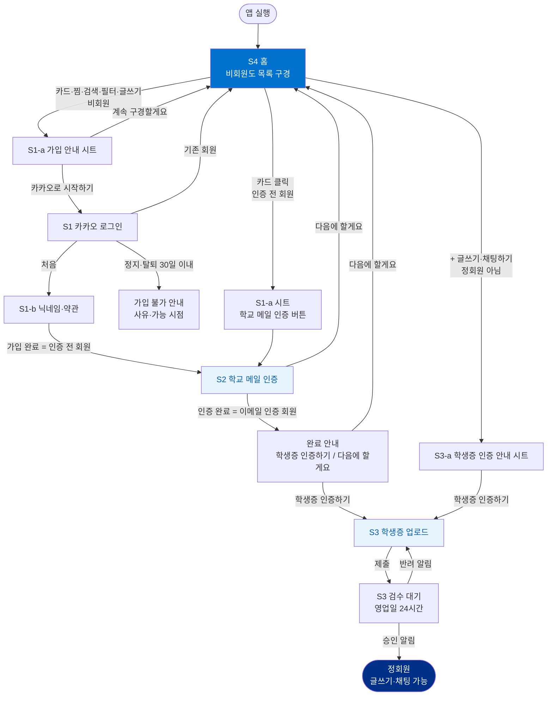
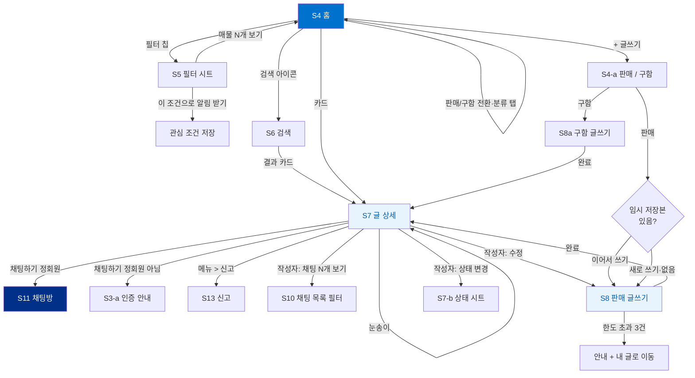
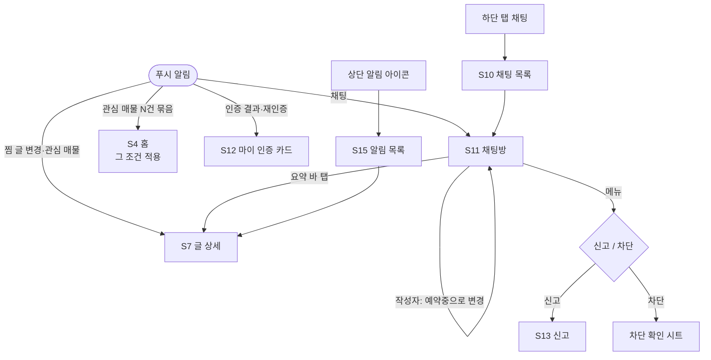
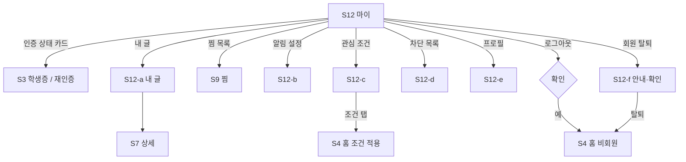

# 화면(UI/UX) 설계서

> 숙박숙박 Phase 2 시스템 설계 산출물이다. [SRS](../01-요구사항분석/요구사항명세서-SRS.md) v0.1의 화면 목록(S1~S15)과 FR, DESIGN.md(2026-11-26, 토큰·컴포넌트), PRD.md v0.2 9·10장, 2026-11-26 사용자 결정을 화면 단위 명세로 옮겼다. 사용자가 공유한 홈 목록 시안 이미지는 **레이아웃 참고용**이며, 시안에 남아 있는 아파트 탭·"도보 10분" 필터·"숙대 정문 도보 N분" 위치 표기는 최신 결정에 따라 쓰지 않는다 (5.4 표). 컴포넌트 이름(`listing-card` 등)은 DESIGN.md YAML 키다. 확인되지 않은 값은 "초안", 결정되지 않은 사항은 "미결"로 표시했다.

| 항목 | 내용 |
|------|------|
| **프로젝트명** | 숙박숙박 (SookbakSookbak) |
| **문서 번호** | UIX-SOOKBAK-v0.1 |
| **문서 버전** | v0.1 (초안) |
| **작성일** | 2026-11-26 |
| **작성자** | 이유나 (기획) / Claude (초안 작성 지원) |
| **승인자** | 이유나 (기획 책임자) |
| **문서 상태** | 초안 (G2 검토 전) |
| **디자인 시스템** | DESIGN.md (파랑·하늘 팔레트, Pretendard, 눈송이 찜) |

---

## 1. 설계 원칙

### 1.1 사용성 (Usability)

| 원칙 | 설명 | 적용 방법 |
|------|------|-----------|
| 바로 목록 | 앱을 열면 지도가 아니라 판매·구함 글 목록이 보인다 (당근마켓식) | 첫 화면 S4 홈, 로그인 없이도 목록 구경 (FR-004, FR-006) |
| 한눈에 비교 | 카드 정보 순서를 모든 글에서 같게 | 가격(18px/700) → 분류 → 층·면적·관리비 → 위치 → 입주일 → 태그 → 메타 (DESIGN.md `listing-card`) |
| 같은 가격 표기 | 목록·상세·채팅·알림에서 똑같은 문자열 | 가격 문자열은 서버가 만들어 내려 준다(`priceText`). 화면은 그대로 표시 (AC-009-1) |
| 잠긴 기능도 보이기 | 인증이 필요한 버튼을 숨기지 않음 | 같은 자리·같은 모양에 자물쇠 아이콘. 누르면 이유와 다음 단계 시트 (DESIGN.md Verification Gate) |
| 한 화면 한 일 | 인증 화면은 단계 하나씩 | S2 학교 메일 → S3 학생증, 위에 단계 표시 |
| 오류 방지 | 필수 항목을 다 채워야 `완료` | 비활성 `완료`를 누르면 첫 빈 항목으로 스크롤 + 오류 문구 (AC-007-1) |
| 끊겨도 안 잃기 | 글쓰기 중 이탈·오프라인 | 임시 저장, 오프라인 배너, 전송 실패 메시지 다시 보내기 (FR-025) |
| 안전 안내 | 앱은 연결까지만 | 상세·채팅·글쓰기에 송금 금지·비개입 안내 (FR-023) |
| 핵심 동선 | 방 찾기: 홈 → 카드 → 상세 → 채팅하기 (3번 누름) | 하단 탭 `홈`·`찜`·`채팅`·`마이`, 떠 있는 `+ 글쓰기` |

### 1.2 접근성 (Accessibility)

| 기준 | 수준 | 적용 항목 |
|------|------|-----------|
| WCAG | 2.1 AA (NFR-012) | 전체 화면 |
| 색상 대비 | 본문 4.5:1 이상 | `{colors.placeholder}`(#979797)·`{colors.snowflake}`(#2B8FE6)·`{colors.sky}`(#8FCBF5)는 흰 바탕 본문 글자로 쓰지 않음 (DESIGN.md Don't). 거래완료 카드의 흐린 글자는 장식이 아닌 상태 표시이므로 상태 배지 `거래완료` 텍스트를 함께 둔다 |
| 터치 영역 | 44 × 44px 이상 | 24px 눈송이 찜 아이콘·필터 칩(36px)도 터치 영역 44px |
| 스크린 리더 | 필수 | 찜 아이콘 "찜하기, 현재 찜 안 함" / "찜 해제", 잠긴 버튼 "인증하고 채팅하기, 학생증 인증 필요", 사진 "방 사진 1/8" |
| 글꼴 확대 | 시스템 글꼴 200%까지 가격·버튼 글자 안 잘림 (NFR-010) | 고정 높이 대신 최소 높이, 가격 줄은 줄바꿈 허용 |
| 포커스 표시 | 필수 | `outline: 2px solid {colors.focus-ring}; outline-offset: 2px` |
| 대체 텍스트 | 필수 | 매물 사진 alt = "{분류} {사진 종류} 사진" |
| 동작 줄이기 | 기기 설정 존중 | `prefers-reduced-motion`이면 눈송이 튀어 오름(1→1.2→1) 생략 |
| 언어 | 한국어 단일, KST | `lang="ko"` |

### 1.3 반응형 디자인 (Responsive)

앱 구현 방식은 Next.js 모바일 웹앱(PWA)으로 정했다 ([SAD ADR-001](시스템아키텍처설계서-SAD.md#adr-001-앱-구현-방식--nextjs-모바일-웹앱pwa), 이유나 2026-11-26). 앱 스토어 출시는 나중에 검토한다. 화면은 휴대폰 기준으로 만들고 넓은 화면은 가운데 정렬만 한다.

**홈 화면 추가 안내 (PWA)**: iOS는 홈 화면에 추가해야 푸시를 받을 수 있다(iOS 16.4 이상). 가입 직후(S1-b)와 관심 조건 저장 직후(S5)에 바텀시트로 "홈 화면에 추가하면 새 매물·채팅 알림을 받을 수 있어요"를 보여 준다. iOS는 `공유 → 홈 화면에 추가` 그림 안내, Android는 브라우저 설치 창(`beforeinstallprompt`)을 띄운다. `나중에`를 누르면 7일 동안 다시 띄우지 않는다(초안). 이미 홈 화면에서 실행 중(`display-mode: standalone`)이면 띄우지 않는다.

| 브레이크포인트 | 범위 | 대상 기기 | 레이아웃 |
|--------------|------|-----------|----------|
| Phone (기준) | 360 ~ 767px | 스마트폰 (기준 폭 360~430px) | 한 열 피드, 하단 탭 바, 떠 있는 `+ 글쓰기`, 필터·정렬은 바텀시트 |
| Tablet | 768 ~ 1023px | 태블릿 | 같은 구조, 콘텐츠 폭 720px 가운데, 썸네일 128px |
| Desktop (웹으로 열 때만) | 1024px ~ | 브라우저 | 하단 탭 → 상단 헤더 메뉴, `+ 글쓰기` → 헤더 버튼, 바텀시트 → 가운데 모달(폭 480px). 전용 최적화는 하지 않음 (EX-011) |
| 관리자 화면 | 1280px 기준 | 데스크톱 Chrome | 표 중심 화면 (S14) |

- 안전 영역(노치·홈 표시줄)은 `env(safe-area-inset-*)`로 하단 탭 바와 상세 하단 고정 바에 더한다.
- 다크 모드는 지원하지 않는다 (MVP, SRS 5.1.1).

### 1.4 변경 이력

| 버전 | 날짜 | 작성자 | 변경 내용 |
|------|------|--------|-----------|
| v0.1 | 2026-11-26 | 이유나 / Claude | 초안 작성. S1~S15 화면 목록·흐름·상세 명세. 카카오 로그인 + 2단계 인증 게이트, 판매/구함 전환, 분류 7개(아파트 없음), 위치는 동네 이름 + 숙대 기준 위치만(도보 시간 없음), 사진 2~10장·방/화장실 필수, 채팅 사진 허용·계좌번호 차단, 관심 조건 칩, 눈송이 찜 반영. 홈 시안과의 차이(5.4) 정리. 웹앱(PWA) 결정에 따라 홈 화면 추가 안내(1.3) 추가 |
| v1.0 | [미정] | 이유나 | G2 검토 후 최종 승인 |

---

## 2. 화면 목록

### 2.1 전체 화면 목록

화면 ID는 PRD 9장·SRS 5.1.2의 S1~S15를 그대로 쓰고, 시트·하위 화면은 `S4-a`처럼 붙인다. 접근 권한 표기: **전체**(비회원 포함), **로그인**(인증 전 회원 이상), **이메일**(이메일 인증 회원 이상), **정회원**, **작성자**, **관리자**.

| 화면 ID | 화면명 | URL (Next.js 경로) | 접근 권한 | 관련 FR | 상태 |
|---------|--------|---------------------|-----------|---------|------|
| S1 | 카카오로 시작하기 | `/start` | 전체 | FR-001, FR-002 | 설계완료 |
| S1-a | 가입 안내 시트 (`signup-gate-sheet`) | (시트) | 비회원·인증 전 회원 | FR-004 | 설계완료 |
| S1-b | 닉네임·약관 동의 | `/start/profile` | 카카오 확인 후 | FR-001 | 설계완료 |
| S2 | 학교 메일 인증 | `/verify/email` | 로그인 | FR-001 | 설계완료 |
| S3 | 학생증·증명서 업로드 / 검수 대기 | `/verify/student` | 이메일 | FR-003, FR-005 | 설계완료 |
| S3-a | 학생증 인증 안내 시트 (`verify-gate-sheet`) | (시트) | 이메일 (정회원 아님) | FR-004 | 설계완료 |
| S4 | 홈 (판매·구함 목록) | `/` | 전체 (카드 열기는 이메일) | FR-006, FR-014, FR-021 | 설계완료 |
| S4-a | 글쓰기 유형 선택 시트 (판매 / 구함) | (시트) | 정회원 | FR-007, FR-011 | 설계완료 |
| S4-b | 정렬 선택 시트 | (시트) | 이메일 | FR-017 | 설계완료 |
| S5 | 필터 바텀시트 | (시트) | 이메일 | FR-017, FR-021 | 설계완료 |
| S6 | 검색 | `/search` | 이메일 | FR-017, FR-021 | 설계완료 |
| S7 | 판매·구함 글 상세 | `/posts/[id]` | 이메일 (본인 비공개 글은 작성자) | FR-013, FR-014, FR-015, FR-023 | 설계완료 |
| S7-a | 사진 전체 화면 | `/posts/[id]/photos` | 이메일 | FR-013 | 설계완료 |
| S7-b | 거래 상태 변경 시트 | (시트) | 작성자 | FR-012 | 설계완료 |
| S8 | 판매 글쓰기 / 수정 | `/posts/new/sale`, `/posts/[id]/edit` | 정회원 / 작성자 | FR-007~010, FR-023 | 설계완료 |
| S8-b | 숙대 기준 위치 선택 시트 | (시트) | 정회원 | FR-010 | 설계완료 |
| S8a | 구함 글쓰기 / 수정 | `/posts/new/wanted`, `/posts/[id]/edit` | 정회원 / 작성자 | FR-011 | 설계완료 |
| S9 | 찜 목록 | `/favorites` | 이메일 | FR-014 | 설계완료 |
| S10 | 채팅 목록 | `/chats` | 이메일 (정회원 아니면 빈 상태 + 인증 안내) | FR-015 | 설계완료 |
| S11 | 채팅방 | `/chats/[roomId]` | 정회원 (권한 제한은 읽기만) | FR-015, FR-016, FR-018 | 설계완료 |
| S12 | 마이 | `/me` | 전체 (비회원은 S1 안내) | FR-022 | 설계완료 |
| S12-a | 내 글 | `/me/posts` | 로그인 | FR-022, FR-012 | 설계완료 |
| S12-b | 알림 설정 | `/me/notifications` | 이메일 | FR-020 | 설계완료 |
| S12-c | 관심 조건 관리 | `/me/interests` | 이메일 | FR-021 | 설계완료 |
| S12-d | 차단 목록 | `/me/blocks` | 이메일 | FR-016 | 설계완료 |
| S12-e | 프로필 수정 | `/me/profile` | 로그인 | FR-022 | 설계완료 |
| S12-f | 회원 탈퇴 | `/me/withdraw` | 로그인 | FR-002 | 설계완료 |
| S12-g | 이용약관 / 개인정보처리방침 | `/terms`, `/privacy` | 전체 | FR-023 | 설계완료 |
| S13 | 신고 | (시트) | 이메일 (채팅 상대 신고는 정회원) | FR-018 | 설계완료 |
| S14-1 | 관리자: 인증 대기열 | `/admin/verifications` | 관리자 | FR-019 | 설계완료 |
| S14-2 | 관리자: 신고 대기열 | `/admin/reports` | 관리자 | FR-019 | 설계완료 |
| S14-3 | 관리자: 사용자·제재 | `/admin/users/[id]` | 관리자 | FR-019 | 설계완료 |
| S14-4 | 관리자: 설정값 | `/admin/settings` | 관리자 | FR-010, FR-015 | 설계완료 |
| S15 | 알림 목록 | `/notifications` | 이메일 | FR-020 | 설계완료 |
| E1 | 없는 글·숨김 글 | (S7 안 상태) | 전체 | FR-013 | 설계완료 |
| E2 | 오프라인 배너 / 점검 중 | (공통) | 전체 | FR-025, NFR-007 | 설계완료 |

---

## 3. 화면 흐름도

### 3.1 인증 플로우 (가입·2단계 인증·권한 게이트)



### 3.2 글 플로우 (방 찾기·방 내놓기·방 구하기)



### 3.3 채팅·알림 플로우



### 3.4 마이·설정 플로우



---

## 4. 화면 상세 명세 작성 규칙

5장의 각 화면은 아래 항목으로 쓴다. 공통 요소(하단 탭 바, 오프라인 배너, 오류 토스트)는 5.0에 한 번만 적는다.

| 항목 | 내용 |
|------|------|
| 기본 정보 | 화면 ID, 화면명, URL, 접근 권한, 관련 FR·UC, 관련 API, 디자인 기준(DESIGN.md 컴포넌트) |
| 레이아웃 | 360px 기준 와이어프레임(ASCII) |
| 구성 요소 | 요소 ID, 유형, 설명, 동작, 검증 규칙 |
| 이벤트 | 트리거, 동작, API |
| 상태별 화면 | 로딩, 빈 상태, 오류, 권한별 차이 |

오류 문구는 비즈니스 정책서 BP-ERROR-003 표를 따른다. 기술적 상세(코드, 스택)는 보여 주지 않는다 (FR-025-5).

---

## 5. 화면 상세 명세

### 5.0 공통 요소

| 요소 | 컴포넌트 | 규칙 |
|------|----------|------|
| 하단 탭 바 | `bottom-tab-bar` | 홈 · 찜(눈송이 아이콘) · 채팅(`unread-badge`) · 마이. 높이 56px + 안전 영역. S4·S9·S10·S12에서만 보임 |
| 상단 바 | `app-bar` | 높이 56px, 아래 1px `{colors.divider-soft}`. 상세·글쓰기는 왼쪽 뒤로 가기 |
| 바텀시트 | `bottom-sheet` | 위 모서리 16px, 손잡이 36×4px, 뒤 `{colors.dim}`. 아래로 끌거나 바깥을 누르면 닫힘 |
| 오프라인 배너 | `notice-banner` 변형 | 상단 바 아래 "인터넷 연결이 끊겼어요. 이전에 불러온 내용만 볼 수 있어요". 쓰기 버튼 비활성 (FR-025-3) |
| 재시도 | 목록·상세 | 조회 실패 시 1·2·4초 자동 재시도 3회 후 "네트워크 연결을 확인해 주세요" + `다시 시도` (FR-025) |
| 토스트 | 화면 아래 | 성공 "찜했어요", 실패 BP-ERROR 문구. 3초 |
| 점검 화면 | 전체 화면 | 503 응답 시 "점검 중이에요. {종료 예정 시각}에 다시 만나요" (NFR-007) |
| 로딩 | 목록 스켈레톤 | `listing-card` 모양 회색 블록 5개. 그 밖은 버튼 안 스피너 |

### 5.1 S1: 카카오로 시작하기 / S1-a 가입 안내 시트 / S1-b 닉네임·약관

#### 기본 정보

| 항목 | 내용 |
|------|------|
| **화면 ID** | S1, S1-a, S1-b |
| **URL** | `/start`, `/start/profile` |
| **접근 권한** | 전체. 로그인 상태로 `/start`에 오면 홈으로 이동 |
| **관련 FR·UC** | FR-001, FR-002, FR-004 / UC-001, UC-002, UC-005 |
| **관련 API** | `POST /api/v1/auth/kakao`, `GET /api/v1/users/nickname-availability`, `POST /api/v1/auth/signup` |
| **디자인 기준** | `signup-gate-sheet`, `button-primary`, `text-input`, `text-link` |

#### 레이아웃

```
S1-a 가입 안내 시트 (홈 위에 올라옴)       S1 카카오로 시작하기 (/start)
+------------------------------------+    +------------------------------------+
|              ────                  |    | ←                                  |
|  숙대생만 글을 볼 수 있어요         |    |                                    |
|  카카오로 시작하고 학교 메일로      |    |        [앱 로고 · 눈송이]          |
|  인증해 주세요                     |    |         숙박숙박                   |
|                                    |    |   숙대생끼리 방 구하고 내놓는 곳   |
| +--------------------------------+ |    |                                    |
| |  [K] 카카오로 시작하기          | |    |                                    |
| +--------------------------------+ |    | +--------------------------------+ |
|          계속 구경할게요            |    | |  [K] 카카오로 시작하기          | |
+------------------------------------+    | +--------------------------------+ |
  인증 전 회원에게는 제목 "학교 메일로     |  가입하면 이용약관·개인정보처리방침  |
  인증하면 글을 볼 수 있어요" +          |  에 동의하게 돼요 (다음 단계에서)    |
  버튼 "학교 메일 인증하기"              +------------------------------------+

S1-b 닉네임·약관 (/start/profile)
+------------------------------------+
| ←  가입하기                ① ─ ② ─ ③|  ← verify-step-indicator: ①카카오 ②학교 메일 ③학생증
|                                    |
|  닉네임을 정해 주세요               |
|  다른 사람에게는 닉네임만 보여요     |
| +--------------------------------+ |
| | 눈송이123                   ✓  | |  2~10자, 한글·영문·숫자
| +--------------------------------+ |
|  사용할 수 있는 닉네임이에요        |
|                                    |
|  [✓] 모두 동의                     |
|  [✓] (필수) 이용약관          보기 > |  "회사는 거래 당사자가 아니며 중개하지 않는다" 포함
|  [✓] (필수) 개인정보 처리방침  보기 > |
|                                    |
| +--------------------------------+ |
| |            가입하기             | |  button-primary (조건 충족 전 -disabled)
| +--------------------------------+ |
+------------------------------------+
```

#### 구성 요소

| 요소 ID | 유형 | 설명 | 동작 | 검증 규칙 |
|---------|------|------|------|-----------|
| S1-EL-01 | Button (카카오) | 카카오로 시작하기 | 카카오 인가 화면으로 이동 (state 포함) | - |
| S1-EL-02 | Link | 계속 구경할게요 (S1-a) | 시트 닫기 | - |
| S1-EL-03 | Input | 닉네임 | 입력 0.5초 후 중복 확인 | 2~10자, `^[가-힣A-Za-z0-9]+$`, 중복 불가 |
| S1-EL-04 | Checkbox | 모두 동의 / 필수 2개 | 각 약관 보기 링크 S12-g | 필수 2개 모두 체크 |
| S1-EL-05 | Button | 가입하기 | 가입 → S2 | EL-03 유효 + EL-04 체크 시 활성 |

카카오 버튼은 카카오 디자인 가이드의 노란색 버튼을 그대로 쓴다. 숙박숙박 팔레트(주황·노랑 금지)의 예외이며 카카오 로그인 버튼에만 허용한다.

#### 이벤트

| 이벤트 | 트리거 | 동작 | API 연동 |
|--------|--------|------|----------|
| 카카오 인가 완료 | 카카오가 `/start/callback?code&state`로 돌려줌 | state 확인 후 서버로 코드 전달 | `POST /auth/kakao` |
| 기존 회원 | 응답 `LOGGED_IN` | 토큰 저장 후 원래 보던 화면으로 (카드를 눌러 왔으면 그 글 상세, 권한이 되면) | - |
| 신규 | 응답 `SIGNUP_REQUIRED` | S1-b로 이동 (signupToken 10분) | - |
| 가입 | 가입하기 | 계정 생성 → 홈 화면 추가 안내(1.3) → 알림 허용 요청(브라우저가 지원할 때) → S2 | `POST /auth/signup`, `PUT /devices/push-token` |
| 카카오 취소 | 사용자가 카카오 화면에서 취소 | "카카오 로그인을 완료하지 못했어요. 다시 시도해 주세요" | - |

#### 상태별 화면

| 상태 | 조건 | 화면 구성 |
|------|------|-----------|
| 로딩 | 서버 확인 중 | 버튼 안 스피너, 버튼 비활성 |
| 재가입 제한 (403) | 탈퇴 30일 이내·영구 정지 | 시트: "{날짜}부터 다시 가입할 수 있어요" / "이용이 제한된 계정이에요" |
| 이용 정지 (403) | 7일 정지 | "{날짜}까지 이용이 정지됐어요. 사유: {사유}" |
| 카카오 장애 (502) | 카카오 응답 없음 | "카카오 로그인이 잠시 안 돼요. 잠시 후 다시 시도해 주세요" |
| 닉네임 중복 | 409 | 입력 아래 `{colors.danger}` "이미 쓰고 있는 닉네임이에요" |

### 5.2 S2: 학교 메일 인증

#### 기본 정보

| 항목 | 내용 |
|------|------|
| **화면 ID** | S2 |
| **URL** | `/verify/email` |
| **접근 권한** | 로그인 (인증 전 회원). 이미 인증했으면 S3 또는 마이로 이동 |
| **관련 FR·UC** | FR-001 / UC-001 |
| **관련 API** | `POST /api/v1/verifications/email-codes`, `POST /api/v1/verifications/email-codes/verify` |
| **디자인 기준** | `verify-step-indicator`, `text-input`(6칸 분리), `button-primary` |

#### 레이아웃

```
+------------------------------------+     +------------------------------------+
| ←                       ✓ ─ ② ─ ③  |     | ←                       ✓ ─ ② ─ ③  |
|                                    |     |                                    |
|  학교 메일로 인증해 주세요          |     |  메일로 받은 인증번호 6자리를       |
|  숙대생인지 확인하는 데만 쓰고       |     |  입력해 주세요                      |
|  다른 사람에게 보이지 않아요         |     |  yuna@sookmyung.ac.kr  주소 바꾸기 |
|                                    |     |                                    |
| +--------------------------------+ |     |  [ 1 ][ 2 ][ 3 ][ 4 ][  ][  ]      |
| | yuna            @sookmyung.ac.kr| |     |                         9:42       |  ← {colors.danger}
| +--------------------------------+ |     |  인증번호가 맞지 않아요 (남은 횟수 3회)|
|                                    |     |                                    |
|                                    |     |  메일이 안 왔나요? 다시 받기 (0:38) |  ← 60초 후 활성
| +--------------------------------+ |     | +--------------------------------+ |
| |        인증번호 받기            | |     | |            확인                 | |
| +--------------------------------+ |     | +--------------------------------+ |
|            다음에 할게요            |     |            다음에 할게요            |
+------------------------------------+     +------------------------------------+

완료 화면
+------------------------------------+
|           (✓ 큰 체크)              |
|  학교 메일 인증을 마쳤어요          |
|  이제 글을 보고 찜할 수 있어요.      |
|  학생증 인증을 마치면 글쓰기와 채팅을 |
|  할 수 있어요                       |
| [        학생증 인증하기          ] |
|            다음에 할게요            |
+------------------------------------+
```

#### 구성 요소

| 요소 ID | 유형 | 설명 | 동작 | 검증 규칙 |
|---------|------|------|------|-----------|
| S2-EL-01 | Input | 이메일 앞부분 + 고정 꼬리표 `@sookmyung.ac.kr` | 다른 도메인 붙여넣기 시 앞부분만 남김 | 영문·숫자·`._-`, 필수 |
| S2-EL-02 | Button | 인증번호 받기 | 발송 후 번호 입력 단계 | 60초 안 재요청 불가 |
| S2-EL-03 | OTP Input | 6칸 숫자 | 6자리 채우면 자동 확인 | 숫자 6자리 |
| S2-EL-04 | Timer | 남은 시간 10:00부터 | 0이면 "인증번호가 만료됐어요. 다시 받아 주세요" | - |
| S2-EL-05 | Link | 다시 받기 | 60초 후 활성, 이전 번호 무효 | - |
| S2-EL-06 | Link | 다음에 할게요 | 홈으로 (인증 전 회원 유지) | - |

#### 상태별 화면

| 상태 | 조건 | 화면 구성 |
|------|------|-----------|
| 다른 학교 메일 (400) | 도메인 불일치 | "숙명여대 학교 이메일(@sookmyung.ac.kr)만 사용할 수 있어요" |
| 이미 연결된 메일 (409) | 다른 계정에 인증됨 | "이미 다른 계정에서 인증한 학교 이메일이에요" |
| 틀림 (400) | 번호 불일치 | "인증번호가 맞지 않아요 (남은 횟수 N회)" |
| 잠금 (429) | 5회 실패 | 버튼 비활성 + "{HH:mm}부터 다시 요청할 수 있어요" (AC-001-4) |
| 발송 실패 (502) | 메일 서비스 오류 | "메일을 보내지 못했어요. 잠시 후 다시 시도해 주세요" |

### 5.3 S3: 학생증·증명서 업로드 / 검수 대기 / S3-a 인증 안내 시트

#### 기본 정보

| 항목 | 내용 |
|------|------|
| **화면 ID** | S3, S3-a |
| **URL** | `/verify/student` |
| **접근 권한** | 이메일 인증 회원 이상 (재인증은 정회원·권한 제한 회원) |
| **관련 FR·UC** | FR-003, FR-004, FR-005 / UC-003, UC-004 |
| **관련 API** | `POST /api/v1/verifications` (multipart), `GET /api/v1/verifications/me` |
| **디자인 기준** | `verify-gate-sheet`, `verify-status-card`, `segmented-control`, 업로드 상자(점선 1px, `{rounded.lg}`, 160px) |

#### 레이아웃

```
S3 업로드                                   S3 검수 대기
+------------------------------------+     +------------------------------------+
| ←                       ✓ ─ ✓ ─ ③  |     | ←                                  |
|  학생증으로 숙대생임을 확인할게요     |     |  학생증을 확인하고 있어요           |
|                                    |     |  영업일 24시간 안에 알려드릴게요     |
|  지금 학적 상태                     |     | +--------------------------------+ |
|  [ 재학생 | 휴학생 | 졸업생 ]       |     | | 접수 11월 26일 19:30            | |  ← verify-status-card
|                                    |     | | 예상 완료 11월 27일 19:30까지    | |
|  올릴 자료                          |     | +--------------------------------+ |
|  (●) 모바일 학생증 캡처             |     |  결과는 알림으로 보내 드려요         |
|  ( ) 실물 학생증 사진               |     | [          홈으로 가기          ]  |
|  ( ) 재학증명서 (발급 30일 이내)    |     +------------------------------------+
|                                    |
|  ┌ ─ ─ ─ ─ ─ ─ ─ ─ ─ ─ ─ ─ ─ ─ ┐ |     S3-a 학생증 인증 안내 시트
|    [+] 사진 올리기 (1~2장)          |     +------------------------------------+
|  └ ─ ─ ─ ─ ─ ─ ─ ─ ─ ─ ─ ─ ─ ─ ┘ |     |  학생증 인증 후 이용할 수 있어요    |
|  이름·학번·학적 상태가 보이게 찍어   |     |  글쓰기와 채팅은 학생증 인증을 마친  |
|  주세요. 확인이 끝나면 사진은 바로   |     |  눈송이만 할 수 있어요. 인증은 영업일 |
|  지워져요                           |     |  24시간 안에 끝나요.                |
| +--------------------------------+ |     |   (✓)학교 메일 ──── (2)학생증       |
| |           제출하기              | |     | [        학생증 인증하기        ]  |
| +--------------------------------+ |     |            다음에 할게요            |
+------------------------------------+     +------------------------------------+
```

학적 상태별 자료 선택지 (FR-003): 재학생 — 모바일 학생증 캡처 / 실물 학생증 사진 / 재학증명서, 휴학생 — 휴학증명서, 졸업생 — 졸업일이 적힌 졸업증명서.

#### 상태별 화면

| 상태 | 조건 | 화면 구성 |
|------|------|-----------|
| 검수 대기 중 재제출 (409) | 대기 제출 있음 | 대기 화면으로 이동 |
| 파일 오류 (400·413) | 형식·크기 | "10MB 이하 사진만 올릴 수 있어요" (JPG·PNG·HEIC) |
| 반려 | 알림으로 진입 | 상단 `{colors.danger}` 사유 + `다시 올리기` |
| 재인증 기간 | 3월·9월 | 제목 "학기 재인증을 해 주세요", 마감일 표시 |
| S3-a 검수 대기 변형 | 대기 중 잠긴 버튼 누름 | 제목 "학생증 확인 중이에요", 버튼 대신 `verify-status-card` |
| S3-a 재인증 변형 | 권한 제한 회원 | 제목 "재인증하면 다시 글쓰기와 채팅을 할 수 있어요" |

### 5.4 S4: 홈 (판매·구함 목록)

#### 기본 정보

| 항목 | 내용 |
|------|------|
| **화면 ID** | S4 |
| **URL** | `/` (쿼리로 상태 유지: `?type=SALE&category=ONE_ROOM&landmark=LIB_BACK&rentMax=50`) |
| **접근 권한** | 전체. 비회원·인증 전 회원은 목록 스크롤·판매/구함 전환·분류 탭만 (FR-004) |
| **관련 FR·UC** | FR-006, FR-014, FR-017, FR-021, FR-024 / UC-005, UC-006, UC-012 |
| **관련 API** | `GET /api/v1/posts`, `PUT·DELETE /api/v1/posts/{id}/favorite`, `GET /api/v1/interest-conditions`, `GET /api/v1/settings/public` |
| **디자인 기준** | `app-bar`, `sell-want-toggle`, `category-tab`, `interest-chip`, `filter-chip`, `filter-reset-button`, `sort-selector`, `listing-card`, `wanted-card`, `snowflake-toggle`, `fab-write`, `bottom-tab-bar` |

#### 레이아웃

공유된 홈 시안의 배치(상단 바 → 분류 탭 → 필터 칩 → 개수·정렬 → 카드 목록 → 떠 있는 글쓰기 → 하단 탭)를 따르되 내용은 최신 결정으로 바꿨다.

```
판매 목록 (정회원 기준, 360px)
+------------------------------------+
| [ 판매 | 구함 ]          🔍   🔔•   |  app-bar: 왼쪽 sell-want-toggle, 오른쪽 검색·알림
+------------------------------------+
| 전체 원룸 투룸 오피스텔 쉐어하우스 하숙 단기임대 단기숙박 →|  category-tab 가로 스크롤 (아파트 없음)
| ━━━                                |
+------------------------------------+
| (↻) [🔔 내 관심 조건] [도서관 후문 ✕] [가격⌄] [동네⌄] [입주일⌄] [여성전용] [거래가능만] →|
|                                    |  reset 버튼은 적용 필터 있을 때만, interest-chip은 조건 저장한 회원만
| 매물 128개                 최신순 ⌄ |  sort-selector
+------------------------------------+
| +--------+  월세 500/45            |  가격 18px/700
| | 사진 ❄ |  원룸 · 분리형            |  분류·구조
| |  112px |  3층 · 20㎡ · 관리비 5만  |
| +--------+  청파동 · 도서관 후문 근처 |  위치 {colors.accent} 14px/700
|             12월 20일부터            |
|             [숙대생 인증][여성전용]   |  태그 최대 3개
|             2시간 전 · 채팅 3 · 찜 12 |
+------------------------------------+
| +--------+  [예약중] 하숙 월 65      |  status-badge-reserved
| | 사진 ❄ |  하숙 · 청파하숙 · 식사 포함|  하숙 이름 표시
| |        |  2층 · 16㎡ · 관리비 없음  |
| +--------+  효창동 · 1캠 후문 근처   |
|             즉시 입주                |
|             5시간 전 · 채팅 8 · 찜 24 |
+------------------------------------+
| +--------+  월세 100/60            |
| | 사진 ❄ |  단기임대 · 오피스텔       |
| |        |  6층 · 23㎡ · 관리비 7만  |
| +--------+  신수동                  |  숙대 근처 아님 → 동네 이름만
|             1~2월 단기 [가격 인하]   |
|             1일 전 · 채팅 5 · 찜 38  |
+------------------------------------+
| (흐림) [거래완료] 월세 300/38        |  listing-card-done: 목록 아래로, 썸네일 50%
|                       (+ 글쓰기)    |  fab-write (스크롤하면 + 원으로 축소)
+------------------------------------+
|  홈      ❄ 찜     💬 채팅²    마이  |  bottom-tab-bar
+------------------------------------+

구함 목록 (wanted-card, 썸네일 없음)
+------------------------------------+
| [구하는 중] 3월부터 1년 살 원룸 구해요|  status-badge-wanted + 제목 16px/700
| 원룸 · 투룸 · 청파동 · 1캠 후문      |
| 보증금 500 이하 · 월 60 이하         |  예산 14px/700
| 3월 1일부터 · 1년                   |
| 2시간 전 · 채팅 1 · 찜 4             |
+------------------------------------+
```

#### 홈 시안과 최신 결정의 차이

| 시안 이미지 | 이 설계 | 근거 |
|-------------|---------|------|
| 왼쪽 위 "숙대 정문 ⌄" 위치 선택 | `판매` / `구함` 전환 (`sell-want-toggle`) | 판매/구함 결정, DESIGN.md `app-bar` |
| 분류 탭에 "아파트" | 아파트 없음. 전체 + 7개 (원룸·투룸·오피스텔·쉐어하우스·하숙·단기임대·단기숙박) | DEC-001, EX-004, AC-008-1 |
| 분류 "투룸+" | "투룸" (쓰리룸 이상 포함) | FR-008 |
| 필터 칩 "도보 10분 이내" | "숙대 기준 위치"(값 예: 도서관 후문)·"동네" 칩 | EX-005, AC-006-4 |
| 위치 "숙대 정문 도보 7분" | "청파동 · 도서관 후문 근처", 숙대 근처가 아니면 "신수동" | FR-010, 2026-11-26 결정 |
| 필터 칩 "월세·전세" | 가격 칩 하나 (시트 안에서 거래 방식 선택) | DESIGN.md 칩 순서 |
| `+ 매물 올리기` | `+ 글쓰기` → 판매 / 구함 선택 | SRS C-2 |
| 메타 "2시간 전 · 채팅 3 · 찜 12" | 같음 (0이면 숨김) | FR-024 |
| 눈송이 찜, 파랑 팔레트, 상태 배지 | 같음 | DESIGN.md |

#### 구성 요소

| 요소 ID | 유형 | 설명 | 동작 | 검증·권한 |
|---------|------|------|------|-----------|
| S4-EL-01 | Toggle | 판매 / 구함 | 목록 유형 전환. 분류 탭·필터 유지 | 전체 |
| S4-EL-02 | Icon | 검색 | S6 | 비회원 → S1-a |
| S4-EL-03 | Icon | 알림 (안 읽음 점) | S15 | 비회원 → S1-a |
| S4-EL-04 | Tabs | 분류 탭 8개 | 목록 재조회, 필터 유지 (AC-006-3) | 전체 |
| S4-EL-05 | Chip | 내 관심 조건 | 저장한 조건(1개면 바로, 여러 개면 선택 시트)을 필터로 적용 | 조건 저장한 회원만 보임 |
| S4-EL-06 | Chip row | 필터 칩 (가격·숙대 기준 위치·동네·입주 가능일·여성전용·거래가능만) | 해당 섹션이 펼쳐진 S5 열기. 토글형(여성전용·거래가능만)은 바로 적용 | 비회원 → S1-a |
| S4-EL-07 | Button | 필터 초기화 (↻) | 모든 칩 해제 (AC-017-3) | 적용 필터 있을 때만 |
| S4-EL-08 | Text + Select | "매물 N개" + 정렬 | S4-b 시트: 최신순 / 낮은 가격순 / 찜 많은순 (거리순 없음) | 비회원은 정렬 고정(최신순) |
| S4-EL-09 | Card list | `listing-card` / `wanted-card` 무한 스크롤 (20개씩) | 카드 → S7 | 비회원·인증 전 → S1-a (AC-004-2) |
| S4-EL-10 | Icon toggle | 썸네일 위 눈송이 | 찜·해제 즉시 반영 (낙관적 갱신, 실패 시 되돌림) | 이메일 인증 이상, 자기 글은 아이콘 없음 |
| S4-EL-11 | FAB | `+ 글쓰기` | S4-a (판매 / 구함) | 정회원. 아니면 자물쇠 + S3-a, 비회원 S1-a |

카드 문자열(가격·분류·층·위치·입주일·메타)은 API가 만든 표시용 문자열(`priceText`, `categoryText`, `specText`, `locationText`, `moveInText`, `metaText`)을 그대로 쓴다 ([API 설계서 5.3](API설계서.md)). 카드 어디에도 건물 주소·도보 시간이 없다 (AC-006-4·5).

#### 이벤트

| 이벤트 | 트리거 | 동작 | API 연동 |
|--------|--------|------|----------|
| 첫 진입 | 앱 실행 | 서버에서 첫 20개 렌더링, 첫 10장 썸네일 먼저 (AC-006-1) | `GET /posts?type=SALE&limit=20` |
| 무한 스크롤 | 끝에서 3번째 카드가 보임 | 다음 커서로 20개 더 | `GET /posts?cursor=…` |
| 당겨서 새로고침 | 아래로 당김 | 첫 페이지 다시 | `GET /posts` |
| 찜 | 눈송이 탭 | 아이콘 채움 + 1→1.2→1 애니메이션 + 찜 수 +1 | `PUT /posts/{id}/favorite` |
| 관심 조건 적용 | S4-EL-05 | 조건 → 필터 칩 값으로 변환 | - |

#### 상태별 화면

| 상태 | 조건 | 화면 구성 |
|------|------|-----------|
| 로딩 | 첫 조회 | 카드 스켈레톤 5개 |
| 빈 상태 (판매) | 결과 0 | "조건에 맞는 매물이 없어요" + `필터 초기화` + (이메일 이상) `이 조건으로 알림 받기` |
| 빈 상태 (구함) | 결과 0 | "아직 구함 글이 없어요" + 정회원 `구함 글 올리기` |
| 비회원 | 로그인 안 함 | 목록·전환·탭만 동작. 필터 칩은 보이되 누르면 S1-a. 관심 조건 칩 없음 |
| 오프라인 | 연결 끊김 | 배너 + 이전에 불러온 목록 읽기 전용 (AC-025-1) |
| 오류 | 3회 재시도 실패 | 목록 자리에 "네트워크 연결을 확인해 주세요" + `다시 시도` |

### 5.5 S5: 필터 바텀시트 / S6: 검색

#### 기본 정보

| 항목 | 내용 |
|------|------|
| **화면 ID** | S5, S6 |
| **URL** | S5 시트(홈 위), `/search?q=` |
| **접근 권한** | 이메일 인증 회원 이상 |
| **관련 FR·UC** | FR-017, FR-021 / UC-006, UC-016 |
| **관련 API** | `GET /api/v1/posts/count`(결과 수 미리보기), `GET /api/v1/posts`, `POST /api/v1/interest-conditions` |
| **디자인 기준** | `bottom-sheet`, `segmented-control`, `range-slider-*`, `filter-chip`, `button-outline` + `button-primary` |

#### 레이아웃

```
S5 필터 (판매)                              S6 검색
+------------------------------------+     +------------------------------------+
|              ────                  |     | ← [🔍 동네·역 이름, 제목으로 검색 ] |
|  필터                          닫기 |     +------------------------------------+
|  거래 방식  [ 월세 | 전세 ]         |     |  최근 검색어              전체 삭제 |
|  보증금     0 ~ 1,000만             |     |  청파동 ✕   숙대입구역 ✕  하숙 ✕    |
|  ○━━━━━●──────────── 1억+         |     |                                    |
|  월세       0 ~ 50만                |     |  (검색 후) 결과 카드 목록 = S4 카드 |
|  ○━━━━●────────────── 150만+      |     |  필터 칩 줄도 함께 사용             |
|  [ ] 관리비 포함해서 비교           |     |                                    |
|  분류       [원룸][투룸][오피스텔]…  |     | +--------------------------------+ |
|  원룸 구조  [오픈형][분리형][복층]   |     | | 🔔 이 조건으로 알림 받기         | |
|  숙대 기준 위치                     |     | +--------------------------------+ |
|  [1캠 정문][1캠 후문][도서관 후문]   |     +------------------------------------+
|  [2캠][숙대입구역][효창공원앞역][남영역]|
|  동네 [청파동][효창동][남영동][용산동][기타]|
|  입주 가능일 [날짜 선택] [즉시 입주] |
|  기간 [ 단기숙박 | 단기임대 | 장기 ] |
|  조건 [여성전용][반려동물][엘리베이터][주차][풀옵션]|
|  ────────────────────────────────  |
|  🔔 이 조건으로 알림 받기       >   |  text-link (관심 조건 저장, 5개 한도)
| [ 초기화 ] [   매물 128개 보기    ] |  하단 고정
+------------------------------------+
```

- 여러 필터는 AND, 한 필터 안의 여러 값은 OR (FR-017-3). 결과 수는 값을 바꿀 때마다 0.3초 뒤 다시 센다.
- 숙대 기준 위치·동네 선택지는 `GET /settings/public`에서 받는다 (DEC-012 확정 후 화면 수정 없이 바뀜).
- 최근 검색어는 기기에만 최대 10개 저장한다 (서버 저장 안 함).
- "이 조건으로 알림 받기"는 이름을 자동으로 만들어("원룸 · 도서관 후문 · 월 50 이하") 저장하고 토스트 "관심 조건을 저장했어요. 맞는 새 매물이 올라오면 알려드릴게요". 알림을 받을 수 없는 상태(iOS 홈 화면 추가 전, 알림 권한 미허용)면 이어서 홈 화면 추가 안내(1.3)를 띄운다. 6번째면 "관심 조건은 5개까지 저장할 수 있어요" + `관리하기`.

### 5.6 S7: 판매·구함 글 상세

#### 기본 정보

| 항목 | 내용 |
|------|------|
| **화면 ID** | S7 (S7-a 사진 전체 화면, S7-b 상태 변경 시트) |
| **URL** | `/posts/[id]` |
| **접근 권한** | 이메일 인증 회원 이상. 비회원이 공유 링크로 열면 S1-a (FR-013-3) |
| **관련 FR·UC** | FR-009, FR-010, FR-012, FR-013, FR-014, FR-015, FR-023, FR-024 / UC-007, UC-011, UC-012 |
| **관련 API** | `GET /api/v1/posts/{id}`, `PUT·DELETE /posts/{id}/favorite`, `POST /api/v1/chat-rooms`, `PATCH /posts/{id}/status`, `DELETE /posts/{id}` |
| **디자인 기준** | `photo-type-label`, `detail-author-row`, `detail-price-block`, `tag-option`, `detail-mini-map`, `map-pin-area`, `map-pin-campus`, `notice-banner`, `detail-bottom-bar`, `button-primary-locked` |

#### 레이아웃

```
+------------------------------------+
| ←                        ↗  ⋮      |  공유, 메뉴(신고 / 작성자: 수정·상태 변경·삭제)
| +--------------------------------+ |
| |                                | |
| |        사진 4:3 캐러셀          | |
| | [방]                    1 / 8  | |  photo-type-label, 카운터
| +--------------------------------+ |
| (●) 눈송이123 [숙대생 인증]         |  detail-author-row (실명·학번 없음)
|     가입 8개월 · 매물 2개           |
|------------------------------------|
| 12월부터 살 분 구해요, 분리형 원룸   |  제목 20px/700
| 원룸 · 분리형 · 2시간 전            |
| +--------------------------------+ |
| | 월세 500/45                    | |  detail-price-block, 가격 24px/700
| | 보증금        500만             | |
| | 월세          45만              | |
| | 관리비        5만 (수도·인터넷)  | |
| | 월 예상 비용  50만              | |  {colors.primary} 14px/700
| | [가격 협의 가능]                | |
| +--------------------------------+ |
|  분류        원룸 · 분리형          |  기본 정보 표 (라벨 96px)
|  전용면적    20㎡ (6.0평)           |
|  층          3층 / 5층              |
|  방·욕실     1개 · 1개              |
|  입주 가능일 12월 20일              |
|  계약 형태   계약 승계 · 집주인 동의 받음 |  해당 시
|  [에어컨][세탁기][냉장고][침대]…     |  tag-option 그리드
|  본문 …                             |
|  위치                               |
| +--------------------------------+ |
| |   ( 반경 원 )        ● 숙대     | |  detail-mini-map 180px, 건물 핀 없음
| +--------------------------------+ |
|  청파동 · 도서관 후문 근처           |
|  조회 120 · 찜 12 · 채팅 3          |
| +--------------------------------+ |
| | ⓘ 숙박숙박은 방을 보고 연결되는   | |  notice-banner (항상, AC-013-2)
| |   데까지만 도와요. 앱 안에서는 송금 | |
| |   할 수 없고, 계약 전에는 절대 송금 | |
| |   하지 마세요. 반드시 직접 방문하고 | |
| |   등기부등본을 확인하세요.         | |
| +--------------------------------+ |
+------------------------------------+
| ❄ │ 월세 500/45        [ 채팅하기 ] |  detail-bottom-bar 72px + 안전 영역
|   │ 관리비 5만                      |
+------------------------------------+
```

#### 하단 고정 바 변형

| 사용자 | 버튼 | 동작 |
|--------|------|------|
| 정회원 (남의 글, 거래가능·예약중) | `채팅하기` (`button-primary`) | 채팅방 열기 → S11 |
| 정회원 (남의 글, 거래완료) | `거래가 끝난 매물이에요` (비활성) | 새 채팅 불가 (FR-012-4). 기존 채팅방이 있으면 `채팅방으로 가기` |
| 이메일 인증 회원·검수 대기 | `🔒 인증하고 채팅하기` (`button-primary-locked`) | S3-a |
| 권한 제한 회원 | `🔒 재인증하고 채팅하기` | S3-a 재인증 변형 |
| 작성자 본인 | `채팅 3개 보기` (`button-outline`) | S10 (이 글 채팅만) |
| 구함 글 (남의 글) | `방 제안하기` (= 채팅하기) | S11 |

#### 구성 요소·이벤트

| 요소 ID | 유형 | 동작 | API |
|---------|------|------|-----|
| S7-EL-01 | Carousel | 좌우 스와이프, 탭 → S7-a 전체 화면 | - |
| S7-EL-02 | Icon | 공유 → 기기 공유 시트(앱 링크 `/posts/{id}`) | - |
| S7-EL-03 | Menu | 신고(S13) / 작성자: 수정(S8) · 상태 변경(S7-b) · 삭제(확인 후) | `DELETE /posts/{id}` |
| S7-EL-04 | Snowflake | 찜·해제 (자기 글에는 없음) | `PUT·DELETE /posts/{id}/favorite` |
| S7-EL-05 | Map | 표시 중심 + 반경 150m 원, 숙대 위치 핀. 줌 고정 범위 | 카카오 지도 SDK |
| S7-EL-06 | Button | 하단 바 표 | `POST /chat-rooms` |

S7-b 상태 변경 시트: `거래가능` / `예약중` / `거래완료` 라디오. 거래완료 후 24시간이 지나면 되돌릴 수 없다는 안내를 함께 표시하고, 24시간이 지난 글은 시트를 열지 않는다 (AC-012-3). 구함 글은 `구하는 중` / `구함완료`.

#### 상태별 화면

| 상태 | 조건 | 화면 구성 |
|------|------|-----------|
| 로딩 | 조회 중 | 사진 자리 회색 4:3 + 텍스트 스켈레톤 |
| 없음·숨김 (404) | 삭제·숨김·비공개 (E1) | "삭제되었거나 숨겨진 글이에요" + `홈으로` |
| 작성자 본인 숨김 글 | 신고·방치 숨김 | 상단 `notice-banner` "신고가 접수되어 매물이 잠시 숨겨졌어요" 등 사유 |
| 비회원 (401) | 공유 링크 | S1-a 시트 |
| 지도 실패 | 지도 SDK 오류 | 지도 자리에 동네 이름·숙대 기준 위치 텍스트만 |

구함 글 상세는 사진(있으면) → 작성자 → 제목·상태 배지 → 원하는 분류 · 희망 위치 · 예산 · 입주 희망일·기간 표 → 본문 → 메타 → 안내 문구 → 하단 바 `방 제안하기` 순서다.

### 5.7 S8: 판매 글쓰기 / 수정 (S8-b 숙대 기준 위치 시트)

#### 기본 정보

| 항목 | 내용 |
|------|------|
| **화면 ID** | S8, S8-b |
| **URL** | `/posts/new/sale`, `/posts/[id]/edit` |
| **접근 권한** | 정회원 (수정은 작성자) |
| **관련 FR·UC** | FR-007, FR-008, FR-009, FR-010, FR-023, FR-025 / UC-008, UC-010 |
| **관련 API** | `POST /api/v1/uploads/photos`, `POST /api/v1/addresses/resolve`, `GET·PUT·DELETE /api/v1/drafts/me`, `POST /api/v1/posts`, `PATCH /api/v1/posts/{id}` |
| **디자인 기준** | 사진 그리드(80px, `photo-type-label`), `segmented-control`, `text-input`(단위 "만원"), `filter-chip`(복수 선택), `bottom-sheet` |

#### 레이아웃

한 화면 세로 스크롤. 섹션 순서는 PRD 7.4·DESIGN.md Forms를 따른다.

```
+------------------------------------+
| ✕  판매 글쓰기               완료   |  필수 다 채우면 {colors.primary} 700, 아니면 {colors.placeholder}
+------------------------------------+
| 사진 *  (방·화장실 사진 각 1장 이상) |
| [ +  ][대표 ][    ][    ]           |  80px 그리드 2~10장, 끌어서 순서 변경
|  3/10 [방 ] [화장실][기타]          |  라벨 누르면 방→화장실→기타 순환
|  방 사진과 화장실 사진을 1장 이상    |  ← 모자랄 때만 {colors.danger}
|  올려 주세요                        |
| 분류 *                              |
| [원룸][투룸][오피스텔][쉐어하우스]    |
| [하숙][단기임대][단기숙박]           |  segmented / chip (아파트 없음)
| 구조 *  [ 오픈형 | 분리형 | 복층 ]   |  ← 분류별 항목 (원룸 예)
| 가격 *  [ 월세 | 전세 ]             |
|  보증금 [        500 ] 만원          |
|  월세   [         45 ] 만원          |
|  [ ] 가격 협의 가능                  |
| 관리비 * [   5 ] 만원  [ ] 없음       |
|  포함 * [수도][전기][가스][인터넷][TV][청소][없음] |
| 주소 *  [ 주소 검색                > ]|  우편번호 검색 화면 → 고른 주소
|  서울 용산구 청파로47길 00           |  동·호수 입력칸 없음
|  동네: 청파동 (자동)                 |  {colors.body}, 수정 불가
| 숙대 기준 위치 * [ 도서관 후문     > ]|  S8-b 시트, "숙대 근처 아님" 포함
| 층 *   [ 3 ]층 / 전체 [ 5 ]층  [반지하][옥탑] |
| 전용면적 * [ 20 ]㎡  = 6.0평         |
| 제목 *  [                        ]  |  1~40자
| 입주 가능일 [ 12월 20일 ] [즉시]     |
| 계약 만료일 [ 선택 ]                 |
| 방·욕실 수  [1] [1]                 |
| 계약 형태  [일반][계약 승계][전대]    |
|  집주인 동의 * [받음][받지 않음][확인 중] |  승계·전대 선택 시
| 옵션   [에어컨][세탁기][냉장고]…      |
| 건물   [엘리베이터][주차][여성전용 건물][현관 보안][반려동물] |
| 글쓰기란 (통금, 하우스 규칙 등)      |
| [                                ]  |  2,000자
|  ⚠ 건물 이름·호수는 적지 마세요       |
| ────────────────────────────────── |
| [✓] 실제 거래는 앱 밖에서 당사자 간에 |  * 비개입 고지 동의 (FR-023)
|     이루어지며, 앱 안 송금은 없습니다.|
|     허위 매물은 제재됩니다            |
+------------------------------------+
```

#### 분류별 추가 입력 (FR-008)

| 분류 | 추가 입력 (필수) | 가격 필드 |
|------|------------------|-----------|
| 원룸 | 구조 (오픈형 / 분리형 / 복층) | 월세 또는 전세 |
| 투룸 | 방 수 (2 이상) | 월세 또는 전세 |
| 오피스텔 | - | 월세 또는 전세 |
| 쉐어하우스 | 모집 인원, 현재 거주 인원, 1인실 / 다인실 | 월세 (보증금 0 가능) |
| 하숙 | **하숙 이름**(2~20자, 예: 청파하숙), 식사(조식·석식·없음), 1인실 / 2인실 | 하숙 월 금액 |
| 단기임대 | 임대 가능 기간(30~183일), 집주인 동의 여부 | 월세 또는 주 단위 금액 |
| 단기숙박 | 숙박 가능 기간(1~29일), 1박 / 1주, 집주인 동의 여부, **본인 거주 확인 + 단기숙박 주의 안내 동의** | 숙박비 |

단기숙박을 고르면 분류 아래에 `notice-banner`로 "며칠 단위로 돈을 받고 반복해서 방을 빌려주는 것은 숙박업 신고 대상이 될 수 있어요. 숙박숙박은 숙박 영업 글을 받지 않아요"를 보여 준다 (FR-008-4e). 분류를 바꾸면 이전 분류의 추가 입력 값은 지운다.

#### 이벤트

| 이벤트 | 트리거 | 동작 | API 연동 |
|--------|--------|------|----------|
| 진입 | S4-a 판매 | 공개 판매 글 3건이면 진입 전에 안내 시트 + `내 글 보기` (AC-007-4). 임시 저장본 있으면 "작성 중인 글이 있어요. 이어서 쓸까요?" | `GET /drafts/me` |
| 사진 추가 | `+` | 기기에서 여러 장 선택 → 앱에서 긴 변 2048px로 줄여 1장씩 업로드, 각 칸에 진행률 | `POST /uploads/photos` (purpose=POST) |
| 주소 선택 | 주소 검색 결과 선택 | 서버가 좌표·동네 확인 후 동네 이름만 돌려줌 | `POST /addresses/resolve` |
| 자동 임시 저장 | 입력 후 3초 멈춤, 화면 이탈, 앱 백그라운드 | 서버 임시 저장 (오프라인이면 기기에 저장 후 복구 시 동기화) | `PUT /drafts/me` |
| 비활성 완료 누름 | `완료`(회색) | 첫 빈 필수 항목으로 스크롤 + 그 항목 아래 오류 문구 | - |
| 등록 | `완료` | 서버 검증 → S7(새 글)로 이동, 토스트 "글을 올렸어요" | `POST /posts` (`Idempotency-Key`) |
| 나가기 | `✕` | "작성 중인 내용은 임시 저장돼요" 확인 | - |

#### 상태별 화면

| 상태 | 조건 | 화면 구성 |
|------|------|-----------|
| 검증 오류 (400) | 서버 검증 실패 | `details[].field`의 첫 항목으로 스크롤, 필드별 문구 |
| 한도 초과 (409) | 공개 판매 3건 / 단기숙박 1건 | "공개 중인 매물은 최대 3건까지 올릴 수 있어요. 기존 매물을 거래완료로 바꾸거나 삭제해 주세요" |
| 사진 크기 (413) | 10MB 초과 | 해당 사진 칸만 빨간 테두리 + "10MB 이하 사진만 올릴 수 있어요" |
| 주소 검색 실패 | 외부 API 오류 | `완료` 비활성, "주소를 확인하지 못했어요. 다시 시도해 주세요" |
| 수정 모드 | `/posts/[id]/edit` | 제목 "글 수정", 비개입 동의는 이미 체크(수정 불가), 가격을 내리면 저장 전 "가격을 내리면 찜한 분들에게 알림이 가요" 안내 |
| 신고 숨김 글 수정 | 숨김 사유 `REPORTED` | 상단 안내 "수정해도 관리자 확인 전까지 다시 공개되지 않아요" |

### 5.8 S8a: 구함 글쓰기 / 수정

| 항목 | 내용 |
|------|------|
| **URL** | `/posts/new/wanted`, `/posts/[id]/edit` |
| **접근 권한** | 정회원. `구하는 중` 글이 이미 있으면 진입 전 안내 (AC-011-3) |
| **관련 FR·UC / API** | FR-011 / UC-009 / `POST /api/v1/posts` (type=WANTED) |

섹션 순서 (DESIGN.md Forms): 원하는 분류*(복수 `filter-chip`) → 희망 위치*(숙대 기준 위치·동네 복수, 1개 이상) → 예산*(보증금 상한·월 비용 상한 중 1개 이상) → 입주 희망일*(날짜 / 즉시) → 희망 기간(선택, 예 "1년") → 제목*(1~40자) → 사진(선택, 0~10장) → 글쓰기란(2,000자). 비개입 동의는 판매 글만 필수다. 상태별 화면은 S8과 같다.

### 5.9 S9: 찜 목록

| 항목 | 내용 |
|------|------|
| **URL / 권한** | `/favorites` / 이메일 인증 회원 이상 (비회원은 S1-a 안내 화면) |
| **관련 FR / API** | FR-014 / `GET /api/v1/favorites`, `DELETE /posts/{id}/favorite` |
| **레이아웃** | 상단 "찜 N" + 분류 필터 칩(전체·7개) + 판매/구함 전환. `listing-card` 목록, 최신 찜순. 눈송이는 흰 바탕용 `{colors.body}` 선 → 찜한 상태 `{colors.snowflake}` 채움 |
| **규칙** | 숨김·삭제 글은 보이지 않고, 거래완료 글은 `거래완료` 배지로 남긴다 (FR-014-3). 해제하면 카드가 바로 빠지고 토스트 `되돌리기` 3초 |
| **빈 상태** | 눈송이 그림 + "마음에 드는 방을 눈송이로 찜해 보세요" + `방 구경하기` |

### 5.10 S10: 채팅 목록

| 항목 | 내용 |
|------|------|
| **URL / 권한** | `/chats` (`?postId=` 이면 그 글의 채팅만) / 이메일 인증 회원 이상 |
| **관련 FR / API** | FR-015 / `GET /api/v1/chat-rooms` |
| **행 구성** | 상대 프로필 40px + 닉네임 14px/700 + 마지막 메시지 한 줄(사진은 "사진 3장") + 시각, 오른쪽 매물 썸네일 40px + `unread-badge` |
| **정렬** | 최근 메시지순. 새 메시지가 오면 Realtime으로 맨 위로 |
| **표시 규칙** | 삭제된 글: 썸네일 자리 회색 + "삭제된 매물". 탈퇴 상대: "탈퇴한 사용자" |
| **빈 상태** | 정회원: "아직 대화가 없어요. 마음에 드는 방에서 채팅을 시작해 보세요". 이메일 인증 회원: "학생증 인증을 마치면 채팅할 수 있어요" + `학생증 인증하기` |

### 5.11 S11: 채팅방

#### 기본 정보

| 항목 | 내용 |
|------|------|
| **화면 ID** | S11 |
| **URL** | `/chats/[roomId]` |
| **접근 권한** | 채팅방 참여자. 보내기는 정회원, 권한 제한 회원은 읽기만 (AC-005-2) |
| **관련 FR·UC** | FR-012, FR-015, FR-016, FR-018, FR-023 / UC-013, UC-014, UC-015 |
| **관련 API** | `GET /api/v1/chat-rooms/{id}`, `GET·POST /api/v1/chat-rooms/{id}/messages`, `PATCH /api/v1/chat-rooms/{id}/read`, `POST /api/v1/uploads/photos`(purpose=CHAT), `PATCH /posts/{id}/status`, Realtime 채널 |
| **디자인 기준** | `chat-listing-header`, `chat-bubble-mine`, `chat-bubble-theirs`, `chat-transfer-warning`, `button-outline` |

#### 레이아웃

```
+------------------------------------+
| ←  눈송이123                    ⋮  |  메뉴: 신고 / 차단
+------------------------------------+
| [썸네일] [예약중] 월세 500/45        |  chat-listing-header 72px, 탭 → S7
|          12월부터 살 분 구해요   [예약중으로 변경] |  ← 작성자에게만
+------------------------------------+
| ⓘ 숙박숙박은 송금을 중개하지 않아요. |  첫 진입 1회 notice-banner (FR-023-3)
|   계약 전에는 절대 송금하지 마세요    |
|                                    |
|  ( 안녕하세요! 방 보러 가도 될까요? )|  chat-bubble-theirs
|                          오후 2:10  |
|        ( 네 토요일 2시 어떠세요? ) ◀ |  chat-bubble-mine {colors.primary}
|                     읽음 오후 2:11  |
|        [사진][사진][사진]           |  사진 메시지 썸네일 그리드
|  ( 계약금 먼저 입금해 주시면 … )     |
|  +------------------------------+  |
|  | ⚠ 계약 전에는 절대 송금하지 마세요 |  chat-transfer-warning
|  |                  송금 요구 신고 > |  ← 받는 사람에게만 신고 버튼
|  +------------------------------+  |
+------------------------------------+
| 계좌번호는 보낼 수 없어요. 숙박숙박은 |  ← 차단 시 입력창 위 {colors.danger} 12px
| 송금을 중개하지 않고, 계약 전에는 절대 |
| 송금하면 안 돼요                     |
| [📷] [ 메시지 보내기            ] [↑]|
+------------------------------------+
```

#### 구성 요소

| 요소 ID | 유형 | 설명 | 동작 | 검증 규칙 |
|---------|------|------|------|-----------|
| S11-EL-01 | Header | 글 요약 (썸네일·상태·가격·제목) | 탭 → S7. 삭제된 글은 "삭제된 매물" | - |
| S11-EL-02 | Button | 예약중으로 변경 (작성자) | 확인 후 상태 변경, 방에 시스템 메시지 "예약중으로 바뀌었어요" | 거래가능일 때만 |
| S11-EL-03 | Message list | 말풍선, 날짜 구분선, 읽음 표시 | 위로 스크롤 시 이전 30개 | - |
| S11-EL-04 | Warning | `chat-transfer-warning` | 송금 요청 표현 감지 메시지 아래 두 사람 모두에게, "송금 요구 신고"는 받는 사람에게만 (AC-015-6) | - |
| S11-EL-05 | Input | 텍스트 | 보내기 전 앱에서 계좌번호 패턴 검사 → 걸리면 보내지 않고 안내, 입력 내용 유지 | 1~1,000자 |
| S11-EL-06 | Button | 사진 | 최대 10장 선택 → 1장씩 업로드(서버 OCR) → 통과한 사진만 메시지로 | 장당 10MB |
| S11-EL-07 | Menu | 신고 → S13 / 차단 → 확인 시트 "차단하면 서로 메시지를 보낼 수 없어요" | - | - |

전화번호(010으로 시작하는 11자리 등)는 막거나 경고하지 않는다 (AC-015-3).

#### 이벤트

| 이벤트 | 트리거 | 동작 | API 연동 |
|--------|--------|------|----------|
| 진입 | 방 열기 | 최근 30개 조회 + Realtime 구독 + 읽음 처리 | `GET .../messages`, Realtime `room:{id}`, `PATCH .../read` |
| 보내기 | ↑ | 말풍선을 바로 그리고(전송 중 표시) 서버 응답으로 확정 | `POST .../messages` (`clientMsgId`) |
| 서버 거부 (422) | 계좌번호 | 말풍선 제거, 입력창 위 안내, 입력 내용 복원 | - |
| 사진 거부 (422) | OCR 계좌번호 | 해당 사진만 빼고 "계좌번호가 보이는 사진은 보낼 수 없어요" | `POST /uploads/photos` |
| 전송 실패 | 네트워크 | 말풍선 옆 "전송 실패" + `다시 보내기` (같은 `clientMsgId`) | - |
| 재연결 | 연결 복구 | 마지막 메시지 이후 동기화 | `GET .../messages?after=` |

#### 상태별 화면

| 상태 | 조건 | 화면 구성 |
|------|------|-----------|
| 권한 제한 | 재인증 미완료 | 입력창 자리에 "재인증하면 다시 채팅할 수 있어요" + `button-primary-locked` |
| 차단당함 | 상대가 나를 차단 | 보내면 "메시지를 보낼 수 없는 상대예요" (차단 사실은 알리지 않음) |
| 상대 탈퇴 | 상대 WITHDRAWN | 닉네임 "탈퇴한 사용자", 입력창 비활성 |
| 거래완료 | 글 DONE | 기존 대화 계속 가능, 요약 바에 `거래완료` |
| 오프라인 | 연결 끊김 | 상단 배너, 보낸 메시지는 "전송 실패" |

### 5.12 S12: 마이 (S12-a~g)

#### 레이아웃

```
+------------------------------------+
| 마이                            ⚙  |
| +--------------------------------+ |
| | 정회원 · 재학생                 | |  verify-status-card
| | 다음 재인증  2027년 3월 31일까지 | |  (졸업생: 권한 만료일)
| +--------------------------------+ |
| (●) 눈송이123          프로필 수정 > |
|------------------------------------|
| 내 글                            > |  판매 2 · 구함 1
| 찜 목록                          > |
| 관심 조건 (2/5)                  > |
| 알림 설정                        > |
| 차단 목록                        > |
|------------------------------------|
| 이용약관 · 개인정보처리방침         |
| 로그아웃                           |
| 회원 탈퇴                          |
+------------------------------------+
```

| 화면 | 내용 | API |
|------|------|-----|
| 인증 상태 카드 | 정회원 / 검수 중 / 반려됨(사유 + `다시 올리기`) / 재인증 필요(기간 중) / 권한 제한. 인증 전 회원은 맨 위에 "학교 메일 인증하기" (FR-022-7) | `GET /users/me` |
| S12-a 내 글 | 탭 판매(거래가능·예약중·거래완료) / 구함(구하는 중·구함완료). 비공개·숨김 글은 회색 + 사유("신고로 숨겨짐", "재인증 후 다시 공개돼요") (AC-022-2). 행 메뉴: 상태 변경·수정·삭제. 방치 글 확인 알림에서 오면 `계속 올려 둘게요` 버튼 | `GET /users/me/posts`, `POST /posts/{id}/keep` |
| S12-b 알림 설정 | 채팅 / 찜한 글 변경 / 관심 매물 (켜기·끄기), "밤에는 관심 매물 알림 받지 않기". 끌 수 없는 알림 목록 안내. 브라우저 알림 권한이 꺼져 있으면 "브라우저(또는 휴대폰) 설정에서 숙박숙박 알림을 켜 주세요" 안내. iOS에서 홈 화면 추가 전이면 홈 화면 추가 안내(1.3) | `GET·PUT /notification-settings` |
| S12-c 관심 조건 | 조건 카드(이름·요약·켜기 스위치), 탭하면 그 조건으로 홈, 편집·삭제. `+ 조건 추가`(5개 한도) | `GET·POST·PATCH·DELETE /interest-conditions` |
| S12-d 차단 목록 | 닉네임 + `해제` | `GET /blocks`, `DELETE /blocks/{userId}` |
| S12-e 프로필 | 닉네임(30일 1회 변경, 다음 변경 가능일 표시), 프로필 사진(선택) | `PATCH /users/me` |
| S12-f 탈퇴 | 안내: 공개 글 즉시 숨김, 30일 후 개인정보 파기, 30일 동안 같은 카카오 계정·학교 메일로 재가입 불가 → 확인 입력 → 탈퇴 | `DELETE /users/me` |
| 비회원 | 마이 탭 = S1 `카카오로 시작하기` | - |

### 5.13 S13: 신고

| 항목 | 내용 |
|------|------|
| **형태 / 권한** | 바텀시트 / 글 신고는 이메일 인증 회원 이상, 채팅 상대 신고는 정회원 |
| **관련 FR / API** | FR-018 / `POST /api/v1/reports` |
| **구성** | 제목 "신고 사유를 골라 주세요" → 사유 라디오: 허위 매물 · 이미 거래된 매물 · 중개업자·광고 · 숙박 영업 의심 · 부적절한 사진·내용 · 사기 의심 · 송금 요구 · 욕설·괴롭힘 · 기타 → 기타면 상세 내용(500자, 필수) → `신고하기` |
| **"송금 요구 신고" 진입** | 채팅 경고에서 오면 사유 "송금 요구"가 미리 선택되고 해당 메시지가 증거로 묶임 |
| **완료** | "신고가 접수됐어요. 처리 결과를 알림으로 알려드릴게요" + (채팅 상대) "이 사용자를 차단할까요?" `차단하기` |
| **이미 신고 (409)** | "이미 신고한 글이에요" (AC-018-2) |

### 5.14 S14: 관리자 화면 (데스크톱)

DESIGN.md는 관리자 화면을 다루지 않는다(Known Gaps). 같은 토큰(색·서체)을 쓰되 표 중심의 데스크톱 레이아웃으로 만든다. 왼쪽 메뉴: 인증 대기열 · 신고 대기열 · 사용자 · 설정값 · 감사 로그.

| 화면 | 구성 | 동작 | API |
|------|------|------|-----|
| S14-1 인증 대기열 | 표: 제출 시각, 대기 시간(24시간 넘으면 `{colors.danger}`), 닉네임, 학적 상태, 자료 종류, 구분(첫 인증/재인증). 행 클릭 → 오른쪽 패널에 자료 이미지(60초 서명 URL) | 승인: 학적 상태·학번(전체 입력, 저장은 앞 4자리 + 해시)·졸업일(졸업생, 1년 경과 시 경고 후 승인 불가) 입력 → 승인. 반려: 사유 선택. **처리 즉시 이미지 사라짐** (AC-003-1·2) | `GET /admin/verifications`, `POST /admin/verifications/{id}/approve·reject` |
| S14-2 신고 대기열 | 자동 숨김 글이 맨 위. 표: 대상(글·채팅 상대), 사유별 건수, 최초 신고 시각, 상태. 상세: 글 미리보기, 신고 사유·내용 목록(신고자 닉네임은 관리자에게만), 채팅 신고는 증거 메시지 | `복구` / `숨김 유지` + 제재(경고·7일 정지·영구 정지) 선택, 사유 입력 → 신고자에게 결과 알림 | `GET /admin/reports`, `POST /admin/reports/{id}/resolve` |
| S14-3 사용자 | 닉네임 검색 → 상태, 인증 이력, 제재 이력, 글 목록 | 제재, 글 숨김·복구 | `GET /admin/users/{id}`, `POST /admin/users/{id}/sanctions`, `POST /admin/posts/{id}/hide·restore` |
| S14-4 설정값 | 숙대 기준 위치 목록, 동네 목록, 송금 감지 단어, 한도 값 (JSON 편집 + 미리보기) | 저장 후 1분 안 앱 반영 | `GET·PUT /admin/settings/{key}` |

모든 관리자 작업은 감사 로그에 남고(AC-019-3), 화면 상단에 "학생증 이미지는 처리 즉시 삭제돼요. 캡처·저장하지 마세요" 안내를 고정한다.

### 5.15 S15: 알림 목록

| 항목 | 내용 |
|------|------|
| **URL / 권한** | `/notifications` / 이메일 인증 회원 이상 (인증 전 회원은 인증 결과만 보이도록 로그인 이상 허용) |
| **관련 FR / API** | FR-020 / `GET /api/v1/notifications`, `PATCH /api/v1/notifications/read` |
| **행** | 유형 아이콘(채팅·눈송이·종·방패) + 제목 14px/700 + 내용 + 시각. 안 읽은 행은 `{colors.primary-tint}` 배경 |
| **동작** | 탭 → `link`로 이동(채팅방·글 상세·인증 화면), 읽음 처리. `모두 읽음` |
| **빈 상태** | "아직 알림이 없어요" |
| **보관** | 90일 (초안) |

---

## 6. UX 검토 체크리스트

상태: **설계 반영**(이 문서에 반영) / **구현 시 확인**(구현·테스트 단계에서 확인).

### 6.1 사용성 (Usability)

| # | 점검 항목 | 상태 | 관련 |
|---|-----------|------|------|
| U-1 | 앱을 열면 로그인 없이 목록이 보인다 | 설계 반영 | S4, AC-004-1 |
| U-2 | 잠긴 버튼은 숨기지 않고 자물쇠와 함께 보이며, 누르면 이유와 다음 단계가 나온다 | 설계 반영 | S1-a, S3-a |
| U-3 | 필수 항목을 다 채우기 전 `완료`는 비활성이고, 누르면 빈 항목으로 이동한다 | 설계 반영 | S8, AC-007-1 |
| U-4 | 분류 탭을 바꿔도 필터가 유지된다 | 설계 반영 | S4, AC-006-3 |
| U-5 | 가격 문자열이 카드·상세·채팅 요약·알림에서 같다 | 구현 시 확인 | AC-009-1 |
| U-6 | 글쓰기 중 앱을 닫아도 이어서 쓸 수 있다 | 설계 반영 | S8, AC-007-5 |
| U-7 | 관심 조건 알림을 누르면 그 글 상세가 바로 열린다 | 설계 반영 | 3.3, AC-021-5 |
| U-8 | 빈 화면마다 다음 행동 버튼이 있다 | 설계 반영 | S4·S9·S10·S15 |

### 6.2 접근성 (Accessibility)

| # | 점검 항목 | 상태 | 관련 |
|---|-----------|------|------|
| A-1 | 주요 화면(S4, S7, S8, S11) 글자 대비 AA | 구현 시 확인 | AC-NFR-012-1 |
| A-2 | 모든 터치 대상 44×44px | 설계 반영 | 1.2 |
| A-3 | 찜·잠긴 버튼·사진에 스크린 리더 레이블 | 설계 반영 | 1.2 |
| A-4 | 글꼴 200%에서 가격·버튼 안 잘림 | 구현 시 확인 | NFR-010 |
| A-5 | 하트 아이콘이 어디에도 없다 | 설계 반영 | AC-NFR-012-2 |
| A-6 | 색만으로 상태를 전달하지 않는다 (배지 텍스트 병기) | 설계 반영 | 1.2 |

### 6.3 반응형 (Responsive)

| # | 점검 항목 | 상태 | 관련 |
|---|-----------|------|------|
| R-1 | 360px에서 가로 스크롤은 분류 탭·필터 칩 줄에만 | 설계 반영 | S4 |
| R-2 | 안전 영역에 하단 탭·고정 바가 가려지지 않음 | 구현 시 확인 | 1.3 |
| R-3 | 태블릿에서 콘텐츠 폭 720px 가운데 | 설계 반영 | 1.3 |
| R-4 | 웹(데스크톱)에서 시트가 가운데 모달로 | 구현 시 확인 | 1.3 |

### 6.4 성능 (Performance)

| # | 점검 항목 | 상태 | 관련 |
|---|-----------|------|------|
| P-1 | 홈 첫 카드 10개 2초, LCP 2.5초 (4G) | 구현 시 확인 | AC-006-1, NFR-001 |
| P-2 | 썸네일 lazy-load, 첫 10장 우선 | 설계 반영 | S4 |
| P-3 | 채팅 메시지 1초 안 표시 | 구현 시 확인 | AC-015-1 |
| P-4 | 사진 업로드 진행률 표시, 1장씩 | 설계 반영 | S8, S11 |

### 6.5 에러 처리 (Error Handling)

| # | 점검 항목 | 상태 | 관련 |
|---|-----------|------|------|
| E-1 | 조회 실패 자동 재시도 3회 후 `다시 시도` | 설계 반영 | 5.0, FR-025 |
| E-2 | 오프라인 배너 + 이전 목록 읽기 | 설계 반영 | 5.0, AC-025-1 |
| E-3 | 계좌번호 메시지·사진 거부 시 안내, 입력 유지 | 설계 반영 | S11, AC-015-4·5 |
| E-4 | 404 글은 "삭제되었거나 숨겨진 글이에요" | 설계 반영 | S7 |
| E-5 | 기술적 오류 내용이 사용자 화면에 나오지 않는다 | 구현 시 확인 | FR-025-5 |
| E-6 | 지도·주소 외부 서비스 실패 시 대체 화면 | 설계 반영 | S7, S8 |

---

## 7. 디자인 시스템 참조

값의 원본은 DESIGN.md YAML이다. 아래는 화면 설계에서 자주 쓰는 값의 요약이며, 다르면 DESIGN.md를 따른다. 코드에서는 HEX를 쓰지 않고 토큰 이름으로만 참조한다 (NFR-011).

### 7.1 컬러 팔레트

| 토큰 | 값 | 용도 |
|------|-----|------|
| `primary` / `accent` | #0072CE | 선택·주요 버튼·위치 글자·내 말풍선 (숙명 Royal Light Blue) |
| `primary-pressed` / `primary-deep` | #003087 | 눌림, 숙대 위치 핀, 가격 인하 글자 |
| `primary-ink` | #005BB0 | 틴트 위 글자 (적용 필터 칩, 인증 태그) |
| `primary-tint` | #E8F4FD | 적용 칩·인증 태그·잠긴 버튼 배경, 안 읽은 알림 |
| `primary-tint-strong` | #CDE7FB | 가격 인하 태그 |
| `snowflake` | #2B8FE6 | 찜한 눈송이 채움 (본문 글자로 쓰지 않음) |
| `ink` / `body` / `body-muted` | #222222 / #656565 / #757575 | 제목·가격 / 본문 / 보조 |
| `placeholder` | #979797 | 비선택 탭 라벨, 거래완료 카드 (본문 금지) |
| `hairline` / `divider-soft` | #DFDFDF / #EDEDED | 칩 테두리 / 카드 구분선 |
| `surface-soft` / `surface-pearl` | #F5F5F5 / #FAFAFA | 상대 말풍선·안내 상자 / 가격 블록·인증 카드 |
| `women-tint` / `women-ink` | #EEF0FF / #3D4FC4 | 여성전용 태그 |
| `status-reserved` / `status-done` | #157A4A / #656565 | 예약중 / 거래완료 배지 |
| `success` / `danger` | #1A9E5C / #E5484D | 인증 완료 체크 / 오류·타이머·계좌번호 안내 |

주황·노랑은 쓰지 않는다. 예외: 카카오 로그인 버튼(카카오 디자인 가이드).

### 7.2 타이포그래피

| 토큰 | 크기 / 굵기 | 용도 |
|------|------------|------|
| `display` | 28 / 700 | (거의 안 씀) |
| `page-title` | 20 / 700 | 화면·시트 제목, 상세 제목 |
| `price-lg` | 24 / 700 | 상세 가격 |
| `price` | 18 / 700 | 카드 가격 (카드에서 18px/700은 가격뿐) |
| `body-lg` / `body-lg-strong` | 16 / 400·700 | 분류 탭, 말풍선, 입력 / 버튼, 구함 카드 제목 |
| `body` / `body-strong` | 14 / 400·700 | 카드 본문 / 위치, 예산 |
| `caption` / `caption-strong` | 12 / 400·700 | 메타, 오류 문구 / 배지·태그 |
| `micro` | 10 / 700 | 하단 탭 라벨, 안 읽음 수 |

서체 Pretendard, 굵기 400·700만 (500·600 금지).

### 7.3 주요 컴포넌트

| 컴포넌트 | 사용 화면 |
|----------|-----------|
| `app-bar`, `sell-want-toggle` | S4 |
| `category-tab`, `filter-chip(-applied)`, `interest-chip`, `filter-reset-button`, `sort-selector` | S4, S5, S6, S9 |
| `listing-card(-done)`, `wanted-card`, `listing-thumbnail`, `snowflake-toggle(-active)` | S4, S6, S9 |
| `status-badge-*`, `tag-verified`, `tag-women-only`, `tag-price-drop`, `tag-option`, `photo-type-label` | S4, S7, S8 |
| `detail-author-row`, `detail-price-block`, `detail-mini-map`, `map-pin-area`, `map-pin-campus`, `notice-banner`, `detail-bottom-bar` | S7 |
| `fab-write(-locked)` | S4 |
| `button-primary(-pressed/-disabled/-locked)`, `button-outline`, `text-link` | 전체 |
| `signup-gate-sheet`, `verify-gate-sheet`, `verify-status-card`, `verify-step-indicator` | S1-a, S2, S3, S3-a, S12 |
| `bottom-sheet`, `segmented-control`, `range-slider-*`, `text-input` | S5, S8, S8a, S13 |
| `chat-listing-header`, `chat-bubble-mine/theirs`, `chat-transfer-warning`, `unread-badge` | S10, S11 |
| `bottom-tab-bar`, `bottom-tab-item-active` | S4, S9, S10, S12 |

### 7.4 스페이싱 (Spacing)

| 토큰 | 값 | 용도 |
|------|-----|------|
| `xxs` | 4px | 아이콘-텍스트 |
| `xs` | 8px | 칩 사이 |
| `sm` | 12px | 카드 안 줄 사이 |
| `md` | 16px | 화면 좌우 여백, 카드 패딩 |
| `lg` | 20px | 시트 패딩 |
| `xl` | 24px | 상세 섹션 사이 (+ 8px 회색 띠) |
| `xxl` / `section` | 32px / 48px | 큰 구획 |

### 7.5 그림자 (Elevation)

그림자는 떠 있는 요소에만: `fab-write`, `detail-bottom-bar`, `bottom-tab-bar`, `bottom-sheet`. 피드 카드에는 그림자·둥근 테두리를 넣지 않는다 (DESIGN.md Don't).

### 7.6 라운드 (Border Radius)

| 토큰 | 값 | 용도 |
|------|-----|------|
| `xs` | 4px | 배지·태그, 채팅 목록 썸네일 |
| `md` | 8px | 버튼, 입력, 피드 썸네일 |
| `lg` | 12px | 가격 블록, 지도, 말풍선, 업로드 상자 |
| `sheet` | 16px | 바텀시트 위 모서리 |
| `pill` | 9999px | 필터 칩, 판매/구함 전환, 글쓰기 버튼 |
| `full` | 50% | 프로필, 초기화 버튼, 지도 원 |

---

## 부록

### A. 참조 문서

| 문서 | 경로 |
|------|------|
| 요구사항 명세서 (SRS) 5.1 | [../01-요구사항분석/요구사항명세서-SRS.md](../01-요구사항분석/요구사항명세서-SRS.md) |
| 유스케이스 명세서 | [../01-요구사항분석/유스케이스명세서.md](../01-요구사항분석/유스케이스명세서.md) |
| 시스템 아키텍처 설계서 | [시스템아키텍처설계서-SAD.md](시스템아키텍처설계서-SAD.md) |
| API 설계서 | [API설계서.md](API설계서.md) |
| 데이터베이스 설계서 | [데이터베이스설계서.md](데이터베이스설계서.md) |
| DESIGN.md / PRD.md | 저장소 루트 (PR #1 / PR #2) |
| UX 검토서 | [../08-검토/UX검토서.md](../08-검토/UX검토서.md) |

### B. 다른 문서와의 차이 (후속 수정 필요)

| 문서 | 현재 내용 | 본 문서 기준 | 조치 |
|------|-----------|-------------|------|
| DESIGN.md `signup-gate-sheet` | 버튼 "학교 메일로 가입하기", 설명 "학교 메일로 인증해 주세요" | 비회원: "카카오로 시작하기" / 인증 전 회원: "학교 메일 인증하기" (DEC-009) | DESIGN.md 수정 |
| DESIGN.md | 관리자 화면 없음 | S14 표 중심 데스크톱 화면 | DESIGN.md Known Gaps 유지, 필요 시 컴포넌트 추가 |
| DESIGN.md | 카카오 로그인 버튼 색 규칙 없음 | 카카오 가이드 노란 버튼만 예외 허용 | DESIGN.md Don't에 예외 한 줄 추가 |
| SRS 1.4 | 화면 설계서 "미작성" | 본 문서 v0.1 | SRS 개정 시 갱신 |
| 홈 시안 이미지 | 아파트 탭, 도보 10분 필터, 도보 N분 위치, "숙대 정문" 위치 선택, `+ 매물 올리기` | 5.4 표 | 시안 갱신 시 반영 |

### C. 미결 사항

| ID | 내용 | 영향 화면 | 상태 |
|----|------|-----------|------|
| DEC-010 | 앱 구현 방식 (SAD ADR-001) | 1.3 | 결정됨: 웹앱(PWA), 앱 포장은 나중에 |
| DEC-012 | 숙대 기준 위치 목록 | S4, S5, S8, S8a | 미결 (설정값이라 화면 수정 불필요) |
| UIX-Q1 | 홈 화면에서 실행한 PWA에서 카카오 로그인 후 돌아오는지 (iOS) | S1 | 상세 설계에서 실제 기기로 시험 (SAD-Q3) |
| UIX-Q2 | 눈송이 아이콘 SVG 제작 | 전체 | DESIGN.md Known Gaps, 구현 초기 |
| UIX-Q3 | 앱 로고·스플래시 | S1 | 미결 (학교 심볼 사용 금지, DEC-011) |
