# 상세 설계서 (Detailed Design Document)

> 숙박숙박 Phase 3 상세 설계 산출물이다. [시스템 아키텍처 설계서](../02-시스템설계/시스템아키텍처설계서-SAD.md)의 모듈 구성(2.5)과 ADR-001~008을 구현 단위(파일·함수·트랜잭션·상태 전이)로 풀었다. 근거는 [SRS](../01-요구사항분석/요구사항명세서-SRS.md) v0.2·[RTM](../01-요구사항분석/요구사항추적매트릭스-RTM.md) v0.2·[유스케이스 명세서](../01-요구사항분석/유스케이스명세서.md), [비즈니스 정책서](../00-기획/비즈니스정책서.md), PRD.md v0.2, DESIGN.md, 02 설계서 v0.1([DB](../02-시스템설계/데이터베이스설계서.md)·[API](../02-시스템설계/API설계서.md)·[화면](../02-시스템설계/화면설계서.md)), 2026-11-26 사용자 결정(웹앱 PWA)이다. 확인되지 않은 수치는 "초안", 결정되지 않은 사항은 "미결"로 표시하고 부록 D에 모았다.

| 항목 | 내용 |
|------|------|
| **프로젝트명** | 숙박숙박 (SookbakSookbak) |
| **문서 번호** | DDD-SOOKBAK-v0.1 |
| **문서 버전** | v0.1 (초안) |
| **작성일** | 2026-11-26 |
| **작성자** | 이유나 (기획) / Claude (초안 작성 지원) |
| **승인자** | 이유나 (기획 책임자) |
| **문서 상태** | 초안 (G3 검토 전) |

---

## 1. 문서 개요

### 1.1 목적

본 문서는 숙박숙박 MVP(v1.0)를 Claude Code 등 AI 보조 개발로 구현할 때 바로 따라 쓸 수 있는 수준의 설계를 정의한다. SAD가 "무엇을 어디에 둘지"를 정했다면, 이 문서는 "각 모듈이 어떤 함수로, 어떤 순서로, 어떤 트랜잭션 안에서, 어떤 규칙을 지키며 동작하는지"를 정한다.

특히 아래 규칙은 구현에서 틀리기 쉬워 알고리즘 수준으로 적었다.

| 규칙 | 위치 |
|------|------|
| 인증 단계별 권한과 `requiredLevel` (FR-004) | 5.3 `policy` |
| Refresh Token 교체와 탈취 감지 (NFR-004) | 5.1 `auth` |
| 공개 글 한도(판매 3·구함 1·단기숙박 1)와 중복 등록 방지 (AC-007-4, FR-007-6) | 5.4 `posts` |
| 가격 계산·표기 문자열 (FR-009) | 5.4.3 |
| 위치 비공개와 표시 중심 무작위 이동 (FR-010, AC-010-1·3) | 5.4.4 |
| 채팅 계좌번호 차단 (텍스트·사진, AC-015-4·5) | 5.6 `chat` |
| 신고 3건 자동 숨김 (AC-018-1) | 5.7 `moderation` |
| 알림 야간·묶음·중복 방지 (FR-020, FR-021) | 5.8 `notifications`·`interest` |
| 학생증 원본 즉시 삭제 (AC-003-1) | 5.2 `verification` |
| 비밀 정보를 저장소에 올리지 않기 (사용자 요청) | 7.6 |

### 1.2 범위

| 구분 | 내용 |
|------|------|
| **포함 범위** | SRS FR-001~FR-025(P1)의 서버 모듈, 화면 공통 구조(데이터 조회·권한 게이트·PWA), 예약 작업, 코딩 표준, 리뷰 체크리스트 |
| **제외 범위** | FR-026~029(P2·P3), 앱 스토어 포장(Capacitor, ADR-001 "나중에"), 화면별 픽셀 명세(화면 설계서·DESIGN.md가 기준), 인프라 설정값의 실제 값(비밀 정보) |
| **대상 독자** | 구현 담당(이유나 + Claude Code), 테스트 케이스 작성자, 수업 검토자 |

### 1.3 참조 문서

| 문서 | 버전 | 쓰는 내용 |
|------|------|-----------|
| SRS | v0.2 | FR·NFR·AC, 6장 데이터 보존 |
| RTM | v0.2 | 요구사항 ↔ 설계 연결 (이 문서 완료 후 상세 설계 위치 추가) |
| 유스케이스 명세서 | v0.1 | 기본·대안·예외 흐름 (3장 시퀀스의 근거) |
| 비즈니스 정책서 | v0.2a | BP 규칙 |
| SAD | v0.1 | 모듈(2.5), ADR, 예약 작업(7.2), 도메인 이벤트(7.3), 디렉터리(4.4), 비밀 정보 규칙(4.5) |
| DB 설계서 | v0.1 | 테이블·제약조건·열거형(4.2) |
| API 설계서 | v0.1 | 엔드포인트·오류 코드·요청 제한 |
| 화면 설계서 | v0.1 | 화면 ID(S1~S15), 이벤트, 상태별 화면 |
| DESIGN.md / PRD.md | 2026-11-26 / v0.2 | 디자인 토큰·컴포넌트 / 제품 요구 |
| 저장소 AGENTS.md | - | `npm run dev`·`lint`·`test`, `npm run build` 금지 |

### 1.4 변경 이력

| 버전 | 날짜 | 작성자 | 변경 내용 |
|------|------|--------|-----------|
| v0.1 | 2026-11-26 | 이유나 / Claude | 초안 작성. 도메인 모델, 서버 모듈 11개 인터페이스, 핵심 시퀀스 6개, 상태 전이 5개, 핵심 알고리즘(한도·가격·위치·계좌번호·신고·알림), 코딩 표준, 비밀 정보 규칙 |
| v1.0 | [미정] | 이유나 | G3 검토 후 최종 승인 |

### 1.5 설계 방식 요약

숙박숙박은 클래스 중심 프레임워크(NestJS 등)를 쓰지 않는다 (ADR-002). 그래서 템플릿의 "클래스"는 아래처럼 읽는다.

| 템플릿 용어 | 이 문서에서 |
|-------------|-------------|
| Entity / Domain Model | TypeScript `type` (DB 행을 camelCase로 바꾼 모양) + Zod 스키마 |
| Service 클래스 | `src/server/modules/{모듈}/service.ts`의 함수 묶음 |
| Repository | `src/server/modules/{모듈}/repo.ts`의 SQL 함수 (Supabase 서버 클라이언트 또는 Postgres RPC) |
| Controller | `src/app/api/v1/**/route.ts` Route Handler (얇게: 래퍼 + 서비스 호출만) |
| Infrastructure | `src/server/infra/*` 외부 연동 클라이언트 (카카오, 메일, FCM, OCR, 저장소) |
| DTO | `src/lib/schemas/*` Zod 스키마 (요청) + `src/server/modules/*/dto.ts` (응답 변환) |

---

## 2. 클래스 다이어그램

### 2.1 도메인 모델 전체 뷰

DB 설계서 2.1 ER 다이어그램을 코드 타입 기준으로 줄였다. 필드는 대표만 적는다.

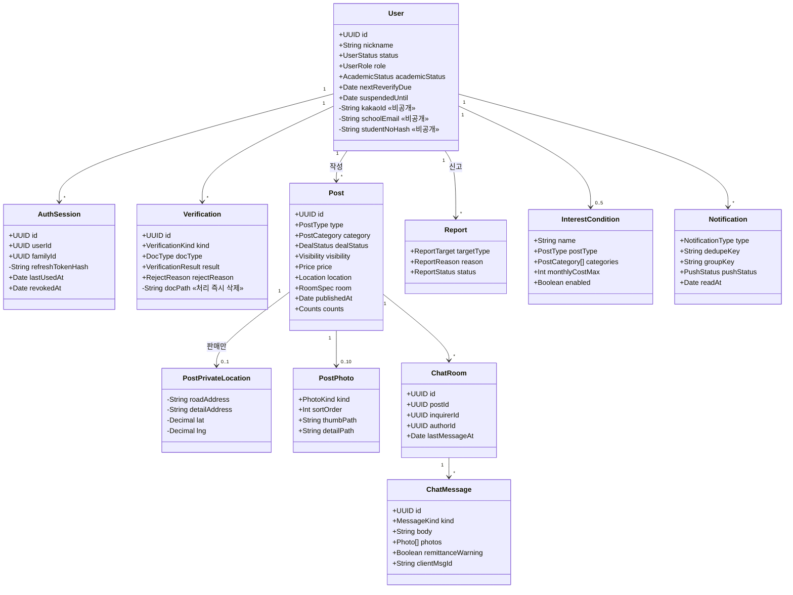

`«비공개»` 필드는 다른 사용자에게 가는 응답 DTO에 절대 넣지 않는다. 응답 변환 함수(`toPublicPost`, `toPublicUser`)가 이 필드를 받지 않도록 타입으로 막는다 (7.4).

#### 값 객체 (Value Object)

| 이름 | 구성 | 규칙 |
|------|------|------|
| `Price` | `priceType`, `rentUnit`, `stayUnit`, `deposit`, `monthlyRent`, `jeonsePrice`, `stayPrice`, `maintenanceFee`, `maintenanceIncludes`, `negotiable` | 금액은 만 원 정수. 분류별 허용 조합은 DB `ck_posts_price_by_category`와 같은 Zod `refine` |
| `Location` | `neighborhood`, `campusLandmark`, `displayLat`, `displayLng` (판매) / `wantedLandmarks`, `wantedNeighborhoods` (구함) | 건물 주소·좌표는 `PostPrivateLocation`에만 |
| `RoomSpec` | 층, 전체 층, 면적, 구조, 방·욕실 수, 옵션, 건물 특징 | 분류별 필수 항목은 5.4.2 |
| `Counts` | `views`, `favorites`, `chats` | 반정규화 컬럼, 트리거·서비스에서만 갱신 |

### 2.2 서비스 계층 다이어그램

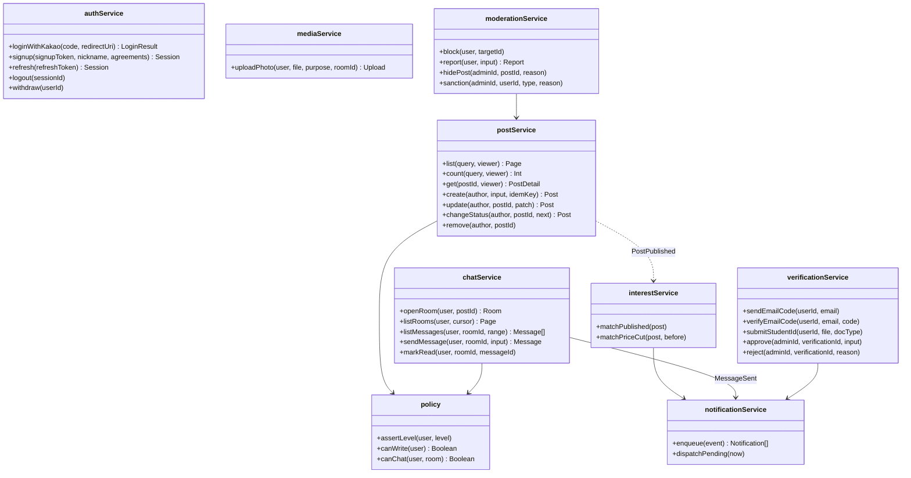

### 2.3 Infrastructure 계층 다이어그램

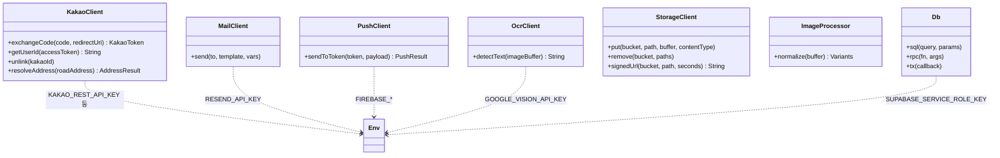

| 클라이언트 | 구현 | 시간 제한 | 실패 시 |
|------------|------|-----------|---------|
| `KakaoClient` | `fetch` + REST API | 3초 | 502 `KAKAO_UNAVAILABLE` / 주소는 `ADDRESS_SERVICE_UNAVAILABLE` |
| `MailClient` | Resend REST (초안) | 5초 | 502 `MAIL_UNAVAILABLE` |
| `PushClient` | Firebase Admin SDK `messaging().send` | 5초 | `FAILED`, 등록 안 된 토큰은 `devices` 행 삭제 |
| `OcrClient` | Google Cloud Vision `TEXT_DETECTION` (초안) | 4초 | 통과 처리 + 경고 로그 (SAD 2.3) |
| `StorageClient` | Supabase Storage (서버 전용 키) | 10초 | 500, 업로드 재시도 안내 |
| `ImageProcessor` | `sharp` (EXIF 제거, 회전 보정, WebP 336px·1280px) | - | 400 `UPLOAD_INVALID` |

모든 클라이언트는 `src/server/env.ts`에서 Zod로 검증한 환경 변수만 읽는다. 환경 변수가 없으면 서버가 시작할 때 실패한다 (7.6).

---

## 3. 시퀀스 다이어그램

### 3.1 카카오 로그인·가입 플로우 (UC-001, UC-002)

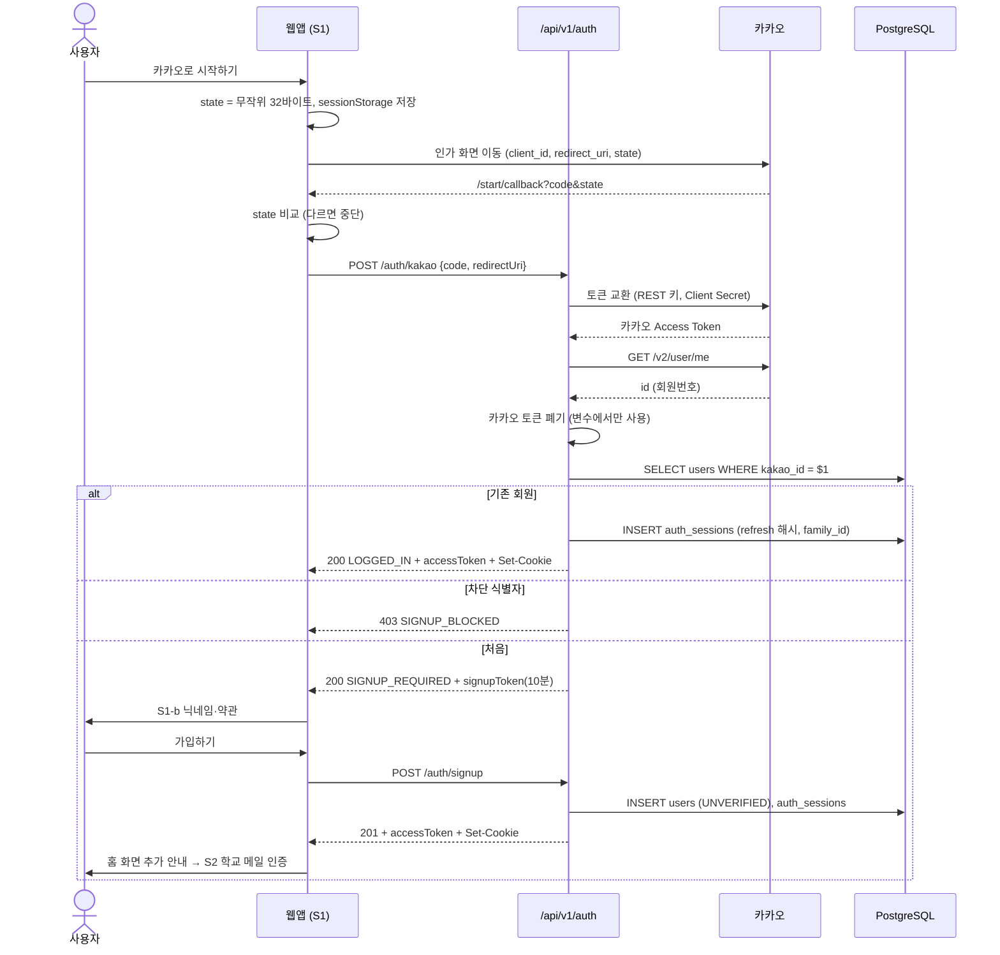

### 3.2 학교 메일 인증 → 학생증 검수 플로우 (UC-001, UC-003, UC-018)

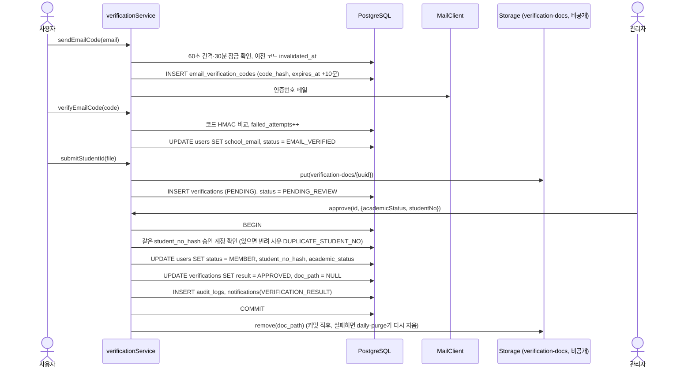

### 3.3 판매 글 등록 플로우 (UC-008)

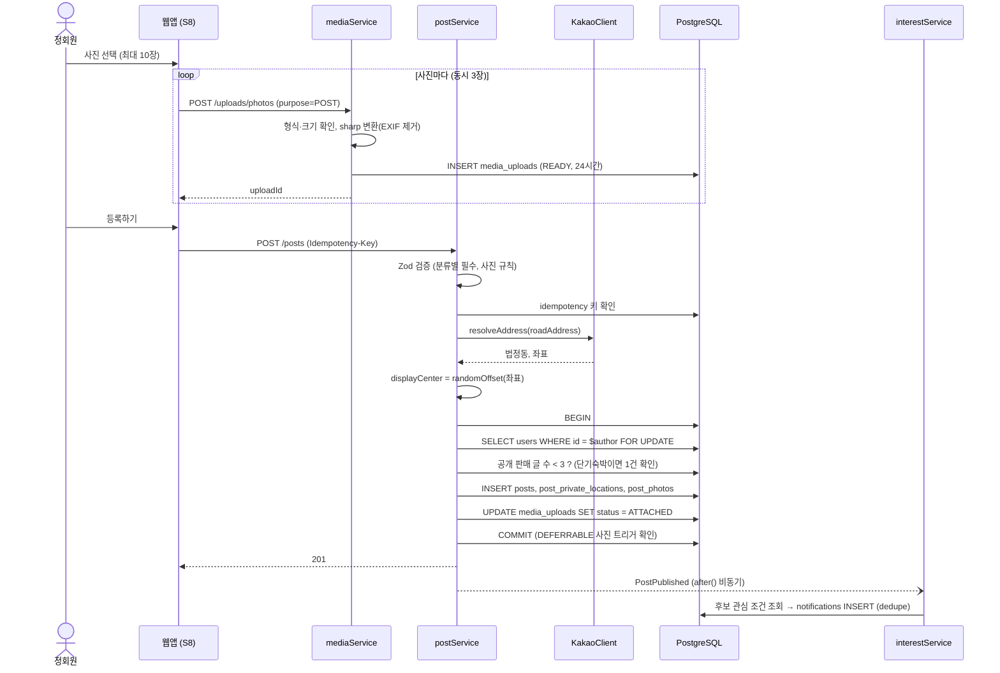

### 3.4 글 상세 조회 플로우 (UC-007)

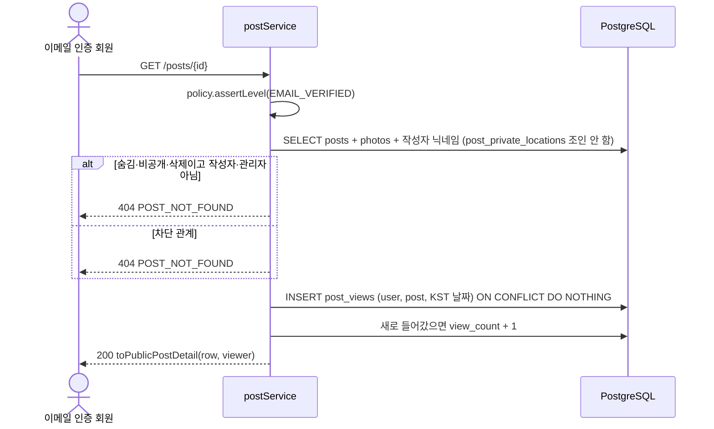

### 3.5 채팅 메시지 전송·수신 플로우 (UC-013)

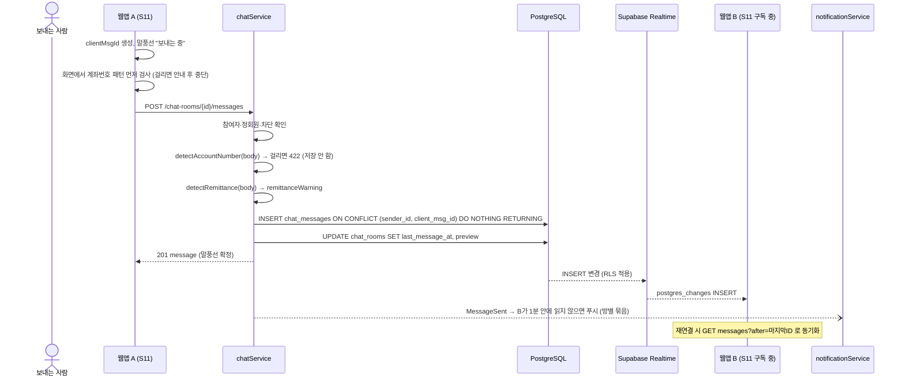

### 3.6 신고 → 자동 숨김 → 관리자 처리 플로우 (UC-015, UC-019)

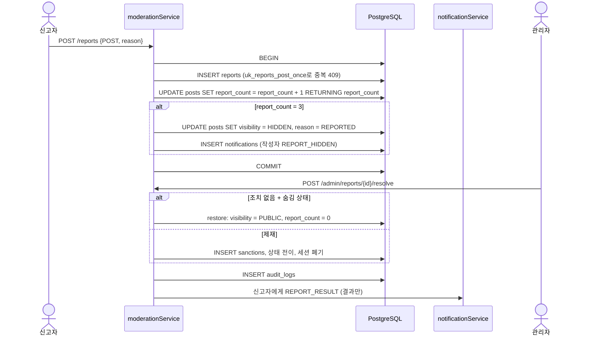

---

## 4. 상태 다이어그램

### 4.1 판매 글 거래 상태 (`deal_status`, FR-012)

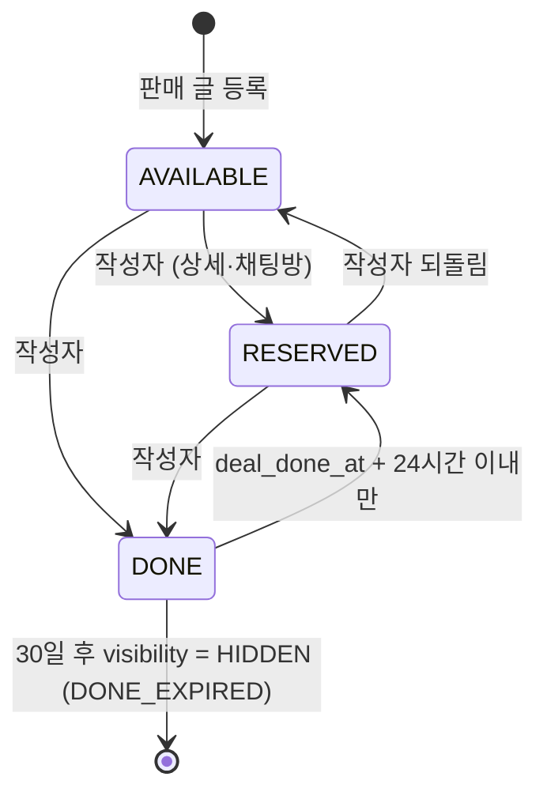

#### 상태 전이 규칙

| 현재 | 이벤트 | 다음 | 조건 | 부수 효과 |
|------|--------|------|------|-----------|
| `AVAILABLE` | 예약중으로 | `RESERVED` | 작성자 | 찜한 사용자 알림(`FAVORITE_STATUS_CHANGE`, 야간이면 08:00), 열린 채팅방마다 시스템 메시지 |
| `RESERVED` | 거래가능으로 | `AVAILABLE` | 작성자 | 채팅방 시스템 메시지 |
| `AVAILABLE`·`RESERVED` | 거래완료 | `DONE` | 작성자 | `deal_done_at = now()`, 목록 아래로, 공개 한도에서 빠짐 |
| `DONE` | 되돌리기 | `RESERVED` | `now() < deal_done_at + 24h`, 한도 여유 | `deal_done_at = NULL`. 한도 초과면 409 `POST_LIMIT_EXCEEDED` |
| 그 외 | - | - | - | 409 `INVALID_STATUS_TRANSITION` |

전이 표는 `src/server/modules/posts/status.ts`의 상수 하나로 두고 API 검사와 화면 버튼 표시(S7-b)가 같이 쓴다.

```ts
export const SALE_TRANSITIONS: Record<SaleStatus, SaleStatus[]> = {
  AVAILABLE: ["RESERVED", "DONE"],
  RESERVED: ["AVAILABLE", "DONE"],
  DONE: ["RESERVED"], // 24시간 조건은 canTransition()에서 확인
};
export const WANTED_TRANSITIONS: Record<WantedStatus, WantedStatus[]> = {
  SEEKING: ["FOUND"],
  FOUND: [],
};
```

### 4.2 글 공개 상태 (`visibility`)

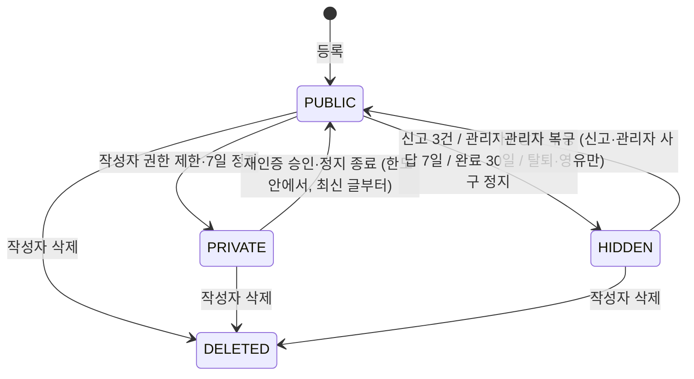

| 사유 (`visibility_reason`) | 되돌릴 수 있는 주체 |
|----------------------------|---------------------|
| `AUTHOR_RESTRICTED`, `AUTHOR_SUSPENDED` | 시스템 (재인증 승인·정지 종료) |
| `REPORTED`, `ADMIN` | 관리자 |
| `STALE` | 작성자 (`POST /posts/{id}/keep`) |
| `DONE_EXPIRED`, `AUTHOR_WITHDRAWN`, `AUTHOR_DELETED` | 없음 |

### 4.3 사용자 상태 (`user_status`, FR-004·FR-005)

DB 설계서 4.2 상태도를 그대로 따른다. 상태는 `verificationService`와 `moderationService`의 함수 `transitionUser(userId, next, reason)`만 바꾼다. 이 함수가 하는 일:

1. 허용 전이인지 확인한다 (DB 설계서 4.2 표를 상수로).
2. `UPDATE users SET status = $next` (정지면 `status_before_suspension`, `suspended_until`도).
3. 부수 효과를 같은 트랜잭션에서 실행한다.

| 전이 | 부수 효과 |
|------|-----------|
| → `MEMBER` (첫 승인) | 재인증 마감일 계산 (1.1 기간 면제 규칙) |
| `MEMBER` → `RESTRICTED` | 공개 글 `PRIVATE`(`AUTHOR_RESTRICTED`), 관심 조건 알림 유지 |
| `RESTRICTED` → `MEMBER` | `PRIVATE` 글 재공개 (한도 안에서 최신순) |
| → `SUSPENDED` | 세션 전부 폐기, 글 `PRIVATE`(`AUTHOR_SUSPENDED`), 관심 조건 알림 중지 |
| → `SUSPENDED` 영구 | 위 + 글 `HIDDEN`, `banned_identifiers` 등록(카카오·이메일·학번 해시) |
| → `WITHDRAWN` | 카카오 연결 끊기(트랜잭션 밖, 실패 시 재시도 대기열), 세션 폐기, 글 `HIDDEN`, 30일 차단 식별자 |

4. `audit_logs`에 이전·다음 상태와 사유를 남긴다.

### 4.4 인증 제출 상태 (`verification_result`)

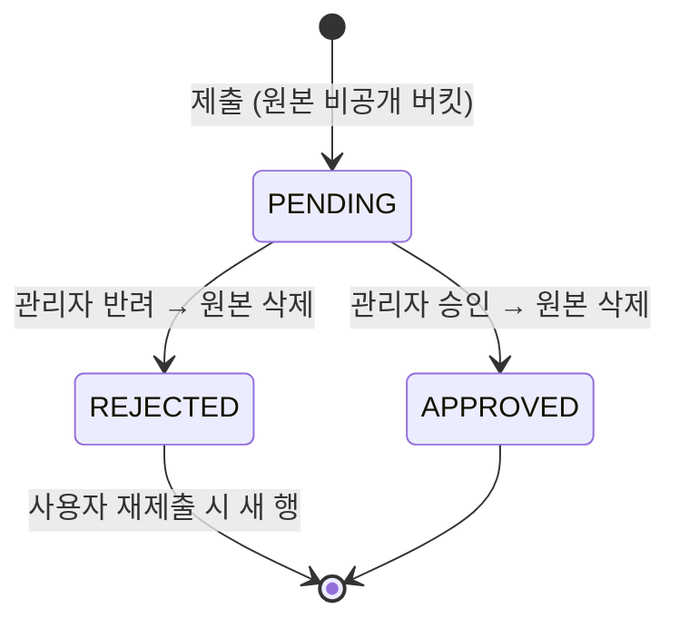

`PENDING`인 제출이 있으면 새 제출은 409 `VERIFICATION_ALREADY_PENDING`. 원본 경로(`doc_path`)는 `APPROVED`·`REJECTED` 행에서 항상 NULL이어야 한다 (DB CHECK).

### 4.5 업로드·알림 상태

| 대상 | 상태 흐름 | 규칙 |
|------|-----------|------|
| `media_uploads.status` | `READY` → `ATTACHED` / (24시간) 삭제 / `REJECTED`(OCR 계좌번호) | `ATTACHED`만 글·메시지에서 참조 |
| `notifications.push_status` | `NONE`(인앱만) / `QUEUED` → `SENT`·`FAILED` / `DEFERRED`(야간) → `QUEUED` / `MERGED`(묶음) / `SUPPRESSED`(설정 꺼짐·차단) | 인앱 목록에는 상태와 관계없이 남김 |

---

## 5. 모듈 상세 설계

모든 서비스 함수는 첫 인자로 `ctx: RequestContext`를 받는다.

```ts
export type RequestContext = {
  requestId: string;
  now: Date;              // 테스트에서 고정 가능
  viewer: Viewer | null;  // 미들웨어가 붙임. 비회원이면 null
};
export type Viewer = {
  id: string;
  status: UserStatus;     // 매 요청 DB에서 읽은 현재 값 (ADR-003)
  role: "USER" | "ADMIN";
  sessionId: string;
};
```

### 5.1 auth 모듈

| 항목 | 내용 |
|------|------|
| **위치** | `src/server/modules/auth/` |
| **책임** | 카카오 로그인, 가입, 토큰 발급·교체, 로그아웃, 탈퇴 |
| **관련 FR·API** | FR-001, FR-002 / API 4.1, 5.1, 5.2, 5.10 |
| **의존** | `KakaoClient`, `Db`, `jose`, `verification`(탈퇴 시 식별자 차단) |

#### 인터페이스 정의

```ts
type LoginResult =
  | { result: "LOGGED_IN"; session: IssuedSession; user: MeDto }
  | { result: "SIGNUP_REQUIRED"; signupToken: string };

export async function loginWithKakao(ctx: RequestContext, code: string, redirectUri: string): Promise<LoginResult>;
export async function signup(ctx: RequestContext, input: SignupInput): Promise<{ session: IssuedSession; user: MeDto }>;
export async function refresh(ctx: RequestContext, rawRefreshToken: string): Promise<IssuedSession>;
export async function logout(ctx: RequestContext): Promise<void>;
export async function withdraw(ctx: RequestContext): Promise<void>;

type IssuedSession = { accessToken: string; expiresIn: 3600; refreshToken: string /* 쿠키로만 내려감 */ };
```

#### 주요 로직/알고리즘

**Access Token 발급**

```ts
new SignJWT({ role: "authenticated", sid: session.id })
  .setProtectedHeader({ alg: "HS256" })
  .setSubject(user.id)
  .setAudience("authenticated")
  .setIssuedAt()
  .setExpirationTime("1h")
  .sign(env.SUPABASE_JWT_SECRET_BYTES);
```

**Refresh Token 교체와 탈취 감지**

1. 쿠키 값의 SHA-256 해시로 `auth_sessions`를 찾는다. 없으면 401 `REFRESH_TOKEN_INVALID`.
2. 행이 `revoked_at`(교체되어 폐기됨)이면 **재사용**이다. 같은 `family_id`의 모든 세션을 폐기하고 401 `REFRESH_TOKEN_REUSED`.
3. `last_used_at + 30일 < now`면 만료 → 401.
4. 트랜잭션: 기존 행 `revoked_at = now`, 같은 `family_id`로 새 행 INSERT(새 해시). 동시 요청 두 개가 같은 토큰으로 오면 `UPDATE … WHERE revoked_at IS NULL RETURNING`이 하나만 성공한다. 실패한 쪽은 3초 안이면 재사용으로 보지 않고 409로 돌려 화면이 다시 시도하게 한다 (초안, 탭 여러 개 대비).
5. 사용자 상태가 `SUSPENDED`·`WITHDRAWN`이면 발급하지 않는다.

**가입 대기 토큰**: `{ kid: 카카오 회원번호, exp: 10분 }`을 `IDENTIFIER_HASH_SECRET`과 다른 전용 키로 서명한다(초안: `SUPABASE_JWT_SECRET`에서 HKDF로 파생). 회원번호는 서버만 읽는다.

**탈퇴**: 트랜잭션에서 상태 `WITHDRAWN`, 글 숨김, 세션 폐기, `banned_identifiers`(30일) 등록 → 커밋 후 카카오 `unlink` 호출. 실패하면 `notifications`와 같은 방식의 재시도 행을 남겨 `hourly-cleanup`이 다시 시도한다.

### 5.2 verification 모듈

| 항목 | 내용 |
|------|------|
| **위치** | `src/server/modules/verification/` |
| **책임** | 학교 메일 인증번호, 학생증 제출·검수, 재인증 일정, 사용자 상태 전이(`transitionUser`) |
| **관련 FR·API** | FR-001, FR-003, FR-005, FR-019 / API 5.6, 4.2, 4.9 |

#### 인터페이스 정의

```ts
export async function sendEmailCode(ctx: RequestContext, email: string): Promise<{ expiresAt: Date; resendAvailableAt: Date }>;
export async function verifyEmailCode(ctx: RequestContext, email: string, code: string): Promise<void>;
export async function submitStudentId(ctx: RequestContext, file: File, docType: DocType): Promise<VerificationDto>;
export async function approve(ctx: RequestContext, id: string, input: ApproveInput): Promise<void>;
export async function reject(ctx: RequestContext, id: string, reason: RejectReason, memo?: string): Promise<void>;
export async function transitionUser(tx: Tx, userId: string, next: UserStatus, reason: TransitionReason): Promise<void>;
export function nextReverifyDue(approvedAt: Date): Date; // 5.2 알고리즘
```

#### 주요 로직/알고리즘

**인증번호**

- 6자리: `crypto.randomInt(0, 1_000_000)`을 0으로 채운다. 저장은 `HMAC-SHA256(EMAIL_CODE_HASH_SECRET, email + ":" + code)`.
- 비교는 `crypto.timingSafeEqual`.
- 틀리면 `failed_attempts + 1`. 5가 되면 그 이메일로 30분 동안 발송·확인을 막는다 (429 `CODE_LOCKED`).
- 메일 본문에는 번호와 유효 시간만 넣는다. 로그에는 이메일 앞 2글자만 남긴다(`sn***@sookmyung.ac.kr`).

**학번 해시 (DB-Q1)**

`student_no_hash = HMAC-SHA256(IDENTIFIER_HASH_SECRET, normalize(studentNo))`. `normalize`는 공백·하이픈 제거 후 숫자만. 관리자 화면 표시는 입력값 앞 4자리만 화면 상태로 들고, DB에는 원문을 쓰지 않는다.

**재인증 마감일**

```
기간 = [3/1~3/31, 9/1~9/30] (KST)
승인일로부터 다음 기간을 찾는다.
그 기간의 시작일이 승인일 + 30일 이내면 그 기간은 면제하고 다음 기간을 쓴다 (SRS FR-005-1).
마감일 = 선택한 기간의 마지막 날 23:59:59 KST
```

졸업생(`GRADUATED`)은 재인증 대신 `graduated_on + 1년`을 `member_expires_on`으로 쓴다.

**학생증 처리**

- 업로드는 `verification-docs` 비공개 버킷, 경로는 `{userId}/{uuid}`. 백업 대상 아님 (DB 설계서 7장).
- 관리자 열람은 5분짜리 서명 URL만 (`StorageClient.signedUrl`).
- 승인·반려 트랜잭션이 커밋되면 즉시 `remove`. 실패하면 `doc_path`는 이미 NULL이므로 `daily-purge`가 버킷에서 24시간 지난 파일을 목록으로 찾아 지운다.

### 5.3 policy 모듈 (인가)

| 항목 | 내용 |
|------|------|
| **위치** | `src/server/modules/policy/` + `src/lib/policy.ts`(화면 공유) |
| **책임** | 상태 → 허용 동작, 403 응답의 `requiredLevel` |
| **관련 FR** | FR-004, AC-004-1~4, API 2.4 |

#### 인터페이스 정의

```ts
export type Level = "GUEST" | "LOGGED_IN" | "EMAIL_VERIFIED" | "MEMBER" | "ADMIN";

const LEVEL_OF: Record<UserStatus, Level> = {
  UNVERIFIED: "LOGGED_IN",
  EMAIL_VERIFIED: "EMAIL_VERIFIED",
  PENDING_REVIEW: "EMAIL_VERIFIED",
  MEMBER: "MEMBER",
  RESTRICTED: "EMAIL_VERIFIED",  // 읽기 권한만 남음
  SUSPENDED: "GUEST",
  WITHDRAWN: "GUEST",
};
const ORDER: Level[] = ["GUEST", "LOGGED_IN", "EMAIL_VERIFIED", "MEMBER"];

export function levelOf(viewer: Viewer | null): Level;
export function assertLevel(viewer: Viewer | null, required: Level): void; // 실패 시 AppError
```

#### 주요 로직/알고리즘

1. `viewer`가 없고 `required`가 `GUEST`보다 높으면 401 `UNAUTHORIZED`.
2. `SUSPENDED`면 403 `ACCOUNT_SUSPENDED` (허용 경로: 로그아웃, `GET·DELETE /users/me`).
3. `required = ADMIN`이면 `role`만 본다.
4. `ORDER.indexOf(levelOf(viewer)) < ORDER.indexOf(required)`면 403 `VERIFICATION_REQUIRED`, `requiredLevel = required`. `RESTRICTED`가 `MEMBER`를 요구받으면 `details`에 `REVERIFY`를 넣어 화면이 재인증 안내(S3)를 띄우게 한다.

화면은 같은 `src/lib/policy.ts`로 버튼에 자물쇠를 그리고 S1-a·S3-a 시트를 고른다. 화면 판단은 안내용일 뿐이고 최종 판단은 서버다 (SAD 2.2).

### 5.4 posts 모듈

| 항목 | 내용 |
|------|------|
| **위치** | `src/server/modules/posts/` (`service.ts`, `repo.ts`, `status.ts`, `price.ts`, `location.ts`, `dto.ts`) |
| **책임** | 판매·구함 CRUD, 분류별 검증, 가격 표기, 위치, 거래 상태, 한도, 임시 저장, 조회 수 |
| **관련 FR·API** | FR-006~013, FR-017, FR-024 / API 4.3, 5.3, 5.4, 5.8 |

#### 5.4.1 인터페이스 정의

```ts
export async function list(ctx: RequestContext, q: PostListQuery): Promise<Page<PostCardDto>>;
export async function count(ctx: RequestContext, q: PostListQuery): Promise<number>;
export async function get(ctx: RequestContext, postId: string, view?: "edit"): Promise<PostDetailDto>;
export async function create(ctx: RequestContext, input: PostCreateInput, idempotencyKey: string): Promise<PostCreatedDto>;
export async function update(ctx: RequestContext, postId: string, patch: PostPatchInput): Promise<PostDetailDto>;
export async function changeStatus(ctx: RequestContext, postId: string, next: DealStatus): Promise<PostDetailDto>;
export async function keep(ctx: RequestContext, postId: string): Promise<void>;
export async function remove(ctx: RequestContext, postId: string): Promise<void>;
```

#### 5.4.2 검증 (Zod)

`src/lib/schemas/post.ts`에 판별 유니언으로 둔다. 화면(S8·S8a)과 서버가 같은 스키마를 쓴다.

```ts
export const SaleInput = z.discriminatedUnion("category", [
  OneRoom, TwoRoom, Officetel, ShareHouse, Boarding, ShortTermRent, ShortStay,
]).superRefine(checkPhotos).superRefine(checkPriceByCategory);
export const PostCreateInput = z.union([SaleInput, WantedInput]);
```

| 분류 | 추가 필수 | 가격 방식 |
|------|-----------|-----------|
| `ONE_ROOM` | `roomStructure` | 월세 / 전세 |
| `TWO_ROOM` | `roomCount >= 2` | 월세 / 전세 |
| `OFFICETEL` | - | 월세 / 전세 |
| `SHARE_HOUSE` | `shareCapacity`, `shareResidents`, `roomOccupancy` | 월세 |
| `BOARDING` | `boardingName`(2~20자), `meals`, `roomOccupancy` | 월세(하숙비) |
| `SHORT_TERM_RENT` | 기간 30~183일, `landlordConsent` | 월세(월·주 단위) |
| `SHORT_STAY` | 기간 1~29일, `landlordConsent`, `selfResidenceConfirmed = true` | 숙박비(1박·1주) |

`checkPhotos`: 판매는 2~10장, `ROOM` ≥ 1, `BATHROOM` ≥ 1. 오류는 `photos` 필드에 한 번만 "방 사진과 화장실 사진을 1장 이상씩 올려 주세요"처럼 빠진 종류를 말한다.

제목·본문에는 `detectContactInfo()`(전화번호·이메일·카카오 오픈채팅 링크·계좌번호)를 돌려 422 `CONTACT_INFO_NOT_ALLOWED`.

#### 5.4.3 가격 계산·표기 (`price.ts`, FR-009)

```ts
export function monthlyCost(p: Price): number | null {
  if (p.priceType === "MONTHLY") {
    const rent = p.rentUnit === "WEEK" ? Math.round(p.monthlyRent! * 4.3) : p.monthlyRent!;
    return rent + p.maintenanceFee;
  }
  if (p.priceType === "JEONSE") return p.maintenanceFee;
  return null; // STAY
}
```

DB의 생성 컬럼 `monthly_cost`와 같은 식이다. 단위 테스트에서 두 값이 같은지 확인한다.

| 입력 | `priceText` | `subPriceText` |
|------|-------------|----------------|
| 월세 500 / 45, 관리비 7 | `월세 500/45` | `관리비 7만` |
| 보증금 0 / 월 55 (하숙) | `월 55` | `식사 아침·저녁 포함` |
| 단기임대 주 단위 18 | `주 18만` | `관리비 없음` |
| 전세 12,000 | `전세 1억 2,000` | `관리비 5만` |
| 전세 9,500 | `전세 9,500` | |
| 단기숙박 1박 4 | `1박 4만` | |
| 협의 가능 | 끝에 ` · 협의` | |

금액 표기 규칙: 1만 이상은 쉼표, 10,000만 원 이상은 `{억}억 {나머지}`(나머지 0이면 생략). 모든 문자열 함수는 `src/lib/format/price.ts`에 두고 목록·상세·알림 본문·관심 조건 이름이 같이 쓴다.

**가격 인하 판단**: 수정 전후 `monthlyCost`(숙박비는 `stayPrice`, 전세는 `jeonsePrice`)가 줄었으면 `post_price_history` 기록, `price_cut_until = now + 3일`, `PostPriceCut` 이벤트.

#### 5.4.4 위치 (`location.ts`, FR-010, ADR-005)

```ts
// 건물 좌표에서 무작위 방향으로 30~120m 옮긴 점을 표시 중심으로 쓴다.
// 반경 150m 원 안에 실제 위치가 항상 들어가고, 원의 중심은 실제 위치가 아니다.
export function randomDisplayCenter(lat: number, lng: number): { lat: number; lng: number } {
  const distanceM = 30 + crypto.randomInt(0, 91);        // 30~120m
  const bearing = (crypto.randomInt(0, 360) * Math.PI) / 180;
  const dLat = (distanceM * Math.cos(bearing)) / 111_320;
  const dLng = (distanceM * Math.sin(bearing)) / (111_320 * Math.cos((lat * Math.PI) / 180));
  return { lat: round6(lat + dLat), lng: round6(lng + dLng) };
}
```

- 글 생성 시 한 번만 정하고, 주소가 바뀔 때만 다시 정한다 (AC-010-3). 조회할 때마다 다시 계산하지 않는다.
- `neighborhood`는 카카오 로컬 API 결과의 법정동(`region_3depth_name`)이다. 작성자가 고칠 수 없다.
- `locationText`: `campusLandmark === "NOT_NEAR"`면 `{동네}`, 아니면 `{동네} · {기준 위치 라벨} 근처`. 라벨은 `app_settings.campus_landmarks`에서 읽는다(1분 캐시).
- `post_private_locations`를 읽는 함수는 `repo.getPrivateLocationForEdit(postId, authorId)` 하나뿐이고, 작성자 본인 수정 화면에서만 부른다. 코드 리뷰에서 이 테이블을 다른 곳에서 조인하면 반려한다 (7.5).

#### 5.4.5 등록 트랜잭션과 한도

```ts
await db.tx(async (tx) => {
  await tx.sql`SELECT id FROM users WHERE id = ${author.id} FOR UPDATE`;
  const limits = await settings.get("limits");
  if (input.type === "SALE") {
    const n = await tx.countPublicSale(author.id); // AVAILABLE·RESERVED, PUBLIC
    if (n >= limits.salePublicMax) throw conflict("POST_LIMIT_EXCEEDED", { kind: "SALE", limit: limits.salePublicMax });
  }
  // 구함 1건, 단기숙박 1건은 부분 유니크 인덱스가 막는다. 23505를 POST_LIMIT_EXCEEDED로 바꾼다.
  const post = await tx.insertPost(row);
  await tx.insertPrivateLocation(post.id, privateLoc);
  await tx.attachPhotos(post.id, photos, author.id); // 본인 READY 업로드만, 아니면 UPLOAD_INVALID
  return post;
});
```

**멱등 키**: `idempotency_keys(user_id, key, request_hash, response, created_at)` 테이블(초안, DB 설계서에 추가 필요, DDD-Q2). 같은 키 + 같은 본문 해시면 저장된 응답을, 다른 본문이면 409 `IDEMPOTENCY_KEY_REUSED`. 24시간 뒤 `hourly-cleanup`이 지운다.

#### 5.4.6 목록 조회 (FR-006, FR-017)

1. `q`(쿼리)를 Zod로 파싱한다. 비회원·인증 전이 필터·정렬·검색을 보내면 403.
2. 커서 디코드 → `(정렬값, publishedAt, id)` 비교식으로 다음 페이지.
3. 공통 조건: `visibility = 'PUBLIC'`, 차단 관계 작성자 제외(`NOT EXISTS blocks`), `type`.
4. 정렬: `LATEST`는 `(deal_status IN ('DONE','FOUND')), published_at DESC, id DESC`. `PRICE_ASC`는 `monthly_cost ASC NULLS LAST`(단기숙박 탭은 `stay_price`). `FAVORITES`는 `favorite_count DESC`.
5. `limit + 1`개를 읽어 다음 커서 여부를 판단한다.
6. `toPostCardDto`로 표시 문자열을 만든다. `isFavorited`는 결과 ID 목록으로 `favorites`를 한 번에 조회한다(N+1 금지).

검색 `q`는 `search_text ILIKE '%' || $q || '%'`(`pg_trgm` 인덱스). `%`·`_`는 이스케이프한다.

### 5.5 media 모듈

| 항목 | 내용 |
|------|------|
| **위치** | `src/server/modules/media/` |
| **책임** | 사진 1장 업로드, 형식 확인, EXIF 제거, 변환본 생성, 채팅 사진 OCR |
| **관련 FR·API** | FR-007, FR-015 / API 5.5 |

#### 인터페이스 정의

```ts
export async function uploadPhoto(ctx: RequestContext, file: File, purpose: UploadPurpose, roomId?: string): Promise<UploadDto>;
```

#### 주요 로직/알고리즘

1. 크기 ≤ 10MB 확인 (Route Handler에서 `Content-Length` 먼저, 스트림 읽으며 다시).
2. 첫 12바이트로 형식 확인 (JPEG `FF D8 FF`, PNG `89 50 4E 47`, WebP `RIFF….WEBP`, HEIC `ftypheic/heix/mif1`).
3. `sharp(buffer).rotate()`로 방향 보정 후 메타데이터 없이 출력(`sharp`는 기본으로 EXIF·GPS를 지움). 목록용 336×336 `cover`, 상세용 긴 변 1280 `inside`, WebP 품질 80.
4. `purpose = CHAT`이면 상세용 이미지를 `OcrClient.detectText`에 보내고 `detectAccountNumber(text)`(5.6). 걸리면 저장하지 않고 422 `ACCOUNT_NUMBER_BLOCKED`, `media_uploads`에 `REJECTED` 행만(파일 없음) 남겨 남용을 센다.
5. `{bucket}/{yyyy}/{mm}/{uuid}_{thumb|detail}.webp`로 저장, `media_uploads`(READY, 24시간).

원본 파일은 어디에도 저장하지 않는다.

### 5.6 chat 모듈

| 항목 | 내용 |
|------|------|
| **위치** | `src/server/modules/chat/` (`service.ts`, `repo.ts`, `account-number.ts`, `remittance.ts`) |
| **책임** | 채팅방 열기, 메시지 저장, 계좌번호 차단, 송금 경고, 읽음 |
| **관련 FR·API** | FR-015, FR-016, FR-023 / API 4.6, 5.7 / ADR-004, ADR-007 |

#### 인터페이스 정의

```ts
export async function openRoom(ctx: RequestContext, postId: string): Promise<{ room: RoomDto; created: boolean }>;
export async function listRooms(ctx: RequestContext, cursor?: string): Promise<Page<RoomListItemDto>>;
export async function listMessages(ctx: RequestContext, roomId: string, range: { before?: string; after?: string; limit: number }): Promise<MessageDto[]>;
export async function sendMessage(ctx: RequestContext, roomId: string, input: SendMessageInput): Promise<MessageDto>;
export async function markRead(ctx: RequestContext, roomId: string, lastReadMessageId: string): Promise<void>;
export function detectAccountNumber(text: string, pattern: AccountPatternSetting): boolean;
export function detectRemittance(text: string, words: string[]): boolean;
```

#### 주요 로직/알고리즘

**채팅방 열기**: 정회원, 자기 글 아님(409 `CANNOT_CHAT_OWN_POST`), 글이 `PUBLIC`이고 거래완료·구함완료 아님, 차단 관계 아님. `INSERT … ON CONFLICT (post_id, inquirer_id) DO NOTHING RETURNING`으로 있으면 기존 방(200), 새로 만들면 `chat_count + 1`(201). 첫 진입 시 비개입 안내(FR-023-3)를 띄울지 `notice_shown_at`으로 판단한다.

**계좌번호 판별** (`account-number.ts`, 초안 규칙은 `app_settings.account_number_pattern`)

```
1. 정규화: 전각 숫자 → 반각, 한글 숫자 표기(공일이삼…)는 MVP에서 다루지 않음(DDD-Q3)
2. 숫자 사이의 공백·하이픈·점·괄호를 제거한 "숫자열"들을 뽑는다
3. 숫자열 중 길이 10~14자리가 있으면 의심
4. 단, 010으로 시작하는 11자리(휴대전화), 날짜 형식(20270301), 금액 표기(쉼표가 있던 숫자)는 제외
5. 은행 이름(국민·신한·우리·하나·농협·카카오뱅크·토스뱅크·기업·새마을·우체국 …) 바로 뒤 20자 안에 숫자 8자리 이상이 있으면 의심
6. 하나라도 의심이면 true
```

사진은 OCR 결과 텍스트에 같은 함수를 쓴다. 판별 규칙과 은행 이름 목록은 설정값이라 배포 없이 보강할 수 있다. 오탐 사례는 `audit_logs`에 해시만 남기고 원문은 남기지 않는다.

**송금 경고**: `remittance_words` 중 하나가 포함되면 `remittanceWarning = true`. 메시지는 저장하고 두 사람 화면에 `chat-transfer-warning`을 보여 준다. 받는 사람 화면에만 "송금 요구 신고" 버튼.

**전송 중복 방지**: `(sender_id, client_msg_id)` 유니크. 같은 `clientMsgId`로 다시 오면 기존 메시지를 201로 돌려준다(화면은 같은 말풍선을 확정).

**읽음·안 읽은 수**: `markRead`는 `author_last_read_at` 또는 `inquirer_last_read_at`을 해당 메시지 `created_at`으로 올린다(내려가지 않게 `GREATEST`). 안 읽은 수는 `created_at > 내 last_read_at AND sender_id <> 나`인 메시지 수.

**화면의 Realtime 구독** (`src/app/(main)/chats/[roomId]/use-room-channel.ts`)

```ts
const channel = supabase
  .channel(`room:${roomId}`)
  .on("postgres_changes",
      { event: "INSERT", schema: "public", table: "chat_messages", filter: `room_id=eq.${roomId}` },
      (payload) => upsertMessage(payload.new))
  .subscribe((status) => { if (status === "SUBSCRIBED") syncAfter(lastMessageId); });
```

브라우저의 Supabase 클라이언트는 anon 키 + 우리 Access Token(`realtime.setAuth`)만 쓴다. 서비스 키는 화면 코드에 절대 들어가지 않는다 (7.6).

### 5.7 moderation 모듈

| 항목 | 내용 |
|------|------|
| **위치** | `src/server/modules/moderation/` |
| **책임** | 차단, 신고, 자동 숨김, 관리자 글 숨김·복구·제재 |
| **관련 FR·API** | FR-016, FR-018, FR-019 / API 4.7, 4.9, 5.9 |

#### 인터페이스 정의

```ts
export async function block(ctx: RequestContext, targetUserId: string): Promise<void>;
export async function unblock(ctx: RequestContext, targetUserId: string): Promise<void>;
export async function report(ctx: RequestContext, input: ReportInput): Promise<{ id: string; status: "RECEIVED" }>;
export async function resolveReport(ctx: RequestContext, id: string, result: "ACTIONED" | "NO_ACTION", memo: string): Promise<void>;
export async function hidePost(ctx: RequestContext, postId: string, reason: string): Promise<void>;
export async function restorePost(ctx: RequestContext, postId: string): Promise<void>;
export async function sanction(ctx: RequestContext, userId: string, type: SanctionType, reason: string): Promise<void>;
```

#### 주요 로직/알고리즘

- **자동 숨김**: 3.6 시퀀스. `report_count`는 서로 다른 신고자 수다(유니크 제약이 같은 사람 중복을 막음). 임계값은 `app_settings.limits.autoHideReports`.
- **채팅 상대 신고**: 신고자가 그 방 참여자여야 한다. `messageId`가 오면 그 메시지가 같은 방인지 확인한다. 관리자 상세(API 4.9)는 그 메시지 앞뒤 20개만 보여 준다.
- **차단**: 차단하면 서로의 글이 목록·검색에서 빠지고, 기존 채팅방은 읽기만 된다. 상대에게 차단 사실을 알리지 않는다.
- **제재**: `WARNING`은 알림만. `SUSPEND_7D`·`PERMANENT`는 `verification.transitionUser`로 상태를 바꾼다(4.3). 제재 알림은 인앱 + 이메일.

### 5.8 notifications·interest 모듈

| 항목 | 내용 |
|------|------|
| **위치** | `src/server/modules/notifications/`, `src/server/modules/interest/` |
| **책임** | 알림 행 생성(아웃박스), 설정·야간·묶음 규칙, 웹 푸시 발송, 관심 조건 매칭 |
| **관련 FR·API** | FR-020, FR-021 / API 4.8 / ADR-006 |

#### 인터페이스 정의

```ts
export async function enqueue(tx: Tx, n: NewNotification): Promise<void>; // dedupe_key 충돌이면 무시
export async function dispatchPending(now: Date): Promise<DispatchReport>;    // /api/internal/jobs/push
export async function matchPublished(post: PostRow): Promise<number>;
export async function matchPriceCut(post: PostRow, before: Price): Promise<number>;
```

#### 알림 유형별 발송 전략

| 유형 | 채널 | 야간(22:00~08:00 KST) | 묶음 | 중복 키 (`dedupe_key`) |
|------|------|------------------------|------|------------------------|
| `CHAT_MESSAGE` | 인앱 + 푸시 | 즉시 | 같은 방 1분 안 메시지는 1건으로 ("새 메시지 3개") | 없음 (`group_key = room:{id}`) |
| `VERIFICATION_RESULT`, `SANCTION` | 인앱 + 푸시 (+ 제재는 이메일) | 즉시 | 없음 | `verification:{id}` |
| `FAVORITE_PRICE_CUT`, `FAVORITE_STATUS_CHANGE` | 인앱 + 푸시 | 08:00로 미룸 (`DEFERRED`) | 없음 | `fav:{postId}:{type}:{KST 날짜}` (하루 1회) |
| `INTEREST_MATCH` | 인앱 + 푸시 | 기본 즉시. "밤에는 받지 않기"면 08:00 | 같은 사용자 10분 안 3건 넘으면 `INTEREST_MATCH_BATCH` 1건 | `interest:{userId}:{postId}` (같은 글 1회) |
| `REVERIFY_NOTICE`, `STALE_POST_CHECK` 등 | 인앱 + 푸시 | 08:00로 미룸 | 없음 | `{type}:{대상}:{KST 날짜}` |
| `REPORT_HIDDEN`, `REPORT_RESULT` | 인앱만 | - | - | `report:{id}` |

#### 주요 로직/알고리즘

**관심 조건 매칭** (`matchPublished`)

```sql
SELECT ic.* FROM interest_conditions ic
JOIN users u ON u.id = ic.user_id
WHERE ic.enabled AND ic.post_type = $type
  AND ic.user_id <> $author
  AND u.status IN ('EMAIL_VERIFIED','PENDING_REVIEW','MEMBER','RESTRICTED')
  AND (cardinality(ic.categories) = 0 OR $category = ANY(ic.categories))
  AND (cardinality(ic.landmarks) = 0 OR $landmark = ANY(ic.landmarks))
  AND (cardinality(ic.neighborhoods) = 0 OR $neighborhood = ANY(ic.neighborhoods))
  AND (ic.monthly_cost_max IS NULL OR $monthlyCost <= ic.monthly_cost_max)
  AND (ic.deposit_max IS NULL OR $deposit <= ic.deposit_max)
  AND (ic.jeonse_max IS NULL OR $jeonse <= ic.jeonse_max)
  AND (ic.stay_price_max IS NULL OR $stay <= ic.stay_price_max)
  AND (ic.move_in_by IS NULL OR $immediate OR $moveIn <= ic.move_in_by)
  AND NOT EXISTS (SELECT 1 FROM blocks b WHERE (b.blocker_id, b.blocked_id) IN ((ic.user_id, $author), ($author, ic.user_id)));
```

키워드(최대 3개)는 SQL 뒤에서 `search_text` 포함 여부로 거른다. 한 사용자의 조건 여러 개가 같은 글에 맞아도 `dedupe_key`가 같아 알림은 1건이다. 조건 5,000개에서 1분 이내(NFR-002)를 목표로 하고, 넘으면 `categories` GIN 인덱스부터 확인한다.

**발송 작업** (`dispatchPending`, 매분 + 글 등록·메시지 직후 `after()`로 즉시 한 번)

```
1. 08:00 KST 이후면 DEFERRED → QUEUED
2. SELECT … WHERE push_status = 'QUEUED' ORDER BY created_at LIMIT 500 FOR UPDATE SKIP LOCKED
3. 사용자별로 묶음 규칙 적용 (채팅 같은 방, 관심 매물 10분 3건) → 나머지는 MERGED
4. 설정 꺼짐·차단·정지 → SUPPRESSED
5. 사용자 devices(platform=WEB)마다 PushClient.send → SENT / FAILED
6. FCM이 UNREGISTERED·INVALID_ARGUMENT면 devices 행 삭제
```

`SKIP LOCKED` 덕분에 즉시 발송과 매분 작업이 겹쳐도 같은 알림을 두 번 보내지 않는다.

**웹 푸시 (PWA, ADR-001)**: 서비스 워커 `public/firebase-messaging-sw.js`가 `onBackgroundMessage`로 알림을 띄우고, 누르면 `data.link`로 이동한다. 토큰은 알림 권한을 허용한 뒤 `getToken({ vapidKey: NEXT_PUBLIC_FIREBASE_VAPID_KEY })`로 받아 `PUT /devices/push-token`. iOS는 `display-mode: standalone`일 때만 권한을 요청한다(화면 설계서 1.3).

### 5.9 settings·audit·rate-limit 모듈

| 모듈 | 인터페이스 | 핵심 |
|------|-----------|------|
| `settings` | `get<K extends SettingKey>(key: K): Promise<SettingValue<K>>`, `set(ctx, key, value)` | 프로세스 메모리 1분 캐시. 값은 키별 Zod 스키마로 검증 후 저장. 변경은 `audit_logs` |
| `audit` | `log(tx, { actorId, action, targetType, targetId, before?, after? })` | 토큰·인증번호·학번·학교 이메일 원문 금지. `before/after`는 허용 필드 목록만 |
| `rate-limit` | `hit(key: string, limit: number, windowSec: number): Promise<{ ok: boolean; remaining: number; resetSec: number }>` | DB 설계서 `rate_limit_counters` 고정 창. 키 예: `post:create:{userId}:h` |

### 5.10 공통 Route Handler 래퍼

```ts
// src/app/api/v1/posts/route.ts
export const POST = handler({
  level: "MEMBER",
  rateLimit: [{ key: "post:create", limit: 10, window: 3600 }, { key: "post:create:d", limit: 30, window: 86400 }],
  body: PostCreateInput,
  headers: z.object({ "idempotency-key": z.string().uuid() }),
  run: (ctx, { body, headers }) => postService.create(ctx, body, headers["idempotency-key"]),
  status: 201,
});
```

`handler()`가 하는 일 (순서 고정):

1. `X-Request-Id` 준비, `ctx.now`
2. Access Token 검증 → `viewer` 조회 (DB에서 현재 상태)
3. `policy.assertLevel`
4. 요청 제한
5. Zod로 본문·쿼리·헤더 파싱 → 실패하면 400 `VALIDATION_ERROR` + `details`
6. `run` 실행
7. 성공 응답 `{ success: true, data, meta? }` / `AppError`는 API 설계서 3.3 형식 / 그 외 예외는 500 + Sentry

### 5.11 예약 작업 (`/api/internal/jobs/*`)

| 작업 | 파일 | 한 번에 처리 | 멱등성 |
|------|------|--------------|--------|
| `push` | `jobs/push/route.ts` | 500건 | `SKIP LOCKED`, 상태 전이로 재실행 안전 |
| `daily-visibility` | `jobs/daily-visibility/route.ts` | 1,000건씩 반복 | 조건식(`deal_done_at < now - 30d AND visibility = PUBLIC`)이라 두 번 돌아도 같음 |
| `daily-reminders` | `jobs/daily-reminders/route.ts` | 1,000건씩 | `dedupe_key`에 날짜 포함 |
| `daily-purge` | `jobs/daily-purge/route.ts` | 테이블별 | DB 설계서 7.5 |
| `hourly-cleanup` | `jobs/hourly-cleanup/route.ts` | - | 만료 기준 삭제 |
| `weekly-kpi` | `jobs/weekly-kpi/route.ts` | - | 주 키로 UPSERT |

모든 작업 경로는 `Authorization: Bearer ${CRON_SECRET}`을 `timingSafeEqual`로 비교한다. 실패하면 404(경로 존재를 숨김). Vercel 함수 시간 제한 안에서 끝나도록 남은 건은 다음 실행에 넘긴다.

---

## 6. 디자인 패턴 적용 기록

### 6.1 적용 패턴 목록

| 패턴 | 적용 위치 | 이유 |
|------|-----------|------|
| 모듈형 모놀리스 + 계층(route → service → repo) | 전체 | 1인 개발, 배포 1곳 (ADR-002) |
| Repository | `modules/*/repo.ts` | SQL을 한곳에 모아 개인정보 컬럼 노출을 리뷰하기 쉽게 |
| Transactional Outbox | `notifications` | 푸시·메일 실패가 본 트랜잭션을 깨지 않게 (ADR-006) |
| Policy (권한 표) | `policy` | 화면·서버가 같은 권한 표 (FR-004) |
| Strategy | `PushClient`, `MailClient`, `OcrClient` 인터페이스 | 업체 초안 교체(Resend ↔ 다른 메일, Vision ↔ CLOVA) 대비, 테스트용 가짜 구현 |
| State Machine (상수 표) | `posts/status.ts`, `verification/transitions.ts` | 허용 전이를 한 표로 |
| Idempotency Key | `POST /posts`, 메시지 `clientMsgId` | 두 번 누름·재전송 (FR-007-6, NFR-003) |
| DTO 변환 | `modules/*/dto.ts` | 비공개 필드 차단 (NFR-005) |

### 6.2 패턴 적용 상세 예시

#### Repository + DTO로 비공개 필드 막기

```ts
// repo.ts: 공개 조회는 비공개 컬럼을 SELECT 하지 않는다.
const PUBLIC_POST_COLUMNS = sql`p.id, p.type, p.category, p.title, …, p.neighborhood, p.campus_landmark, p.display_lat, p.display_lng`;

// dto.ts: 입력 타입에 비공개 필드가 없으므로 실수로 넣을 수 없다.
export function toPublicPostDetail(row: PublicPostRow, viewer: Viewer): PostDetailDto { … }
```

#### Strategy (외부 연동 교체·테스트)

```ts
export interface OcrClient { detectText(image: Buffer): Promise<string>; }
export const ocr: OcrClient = env.OCR_PROVIDER === "fake" ? fakeOcr : googleVisionOcr;
```

테스트는 `fakeOcr`에 계좌번호가 든 문자열을 돌려주게 해 422를 확인한다. 실제 키 없이 테스트가 돈다.

#### 도메인 이벤트 (같은 프로세스)

```ts
// postService.create 끝부분
after(async () => {           // next/server after(): 응답을 보낸 뒤 실행
  await interestService.matchPublished(post);
  await notificationService.dispatchPending(new Date());
});
```

`after()`가 실패하거나 함수가 끝나도 매분 `push` 작업이 남은 알림을 보낸다. 관심 조건 매칭 자체가 빠질 경우를 막기 위해 `posts.interest_matched_at`(초안, DDD-Q2)을 두고 매분 작업이 NULL인 공개 글을 다시 매칭한다.

---

## 7. 코딩 표준

### 7.1 네이밍 컨벤션

| 대상 | 규칙 | 예시 |
|------|------|------|
| 파일 | kebab-case | `account-number.ts`, `use-room-channel.ts` |
| React 컴포넌트 | PascalCase, 파일은 kebab-case | `ListingCard` in `listing-card.tsx` |
| 함수·변수 | camelCase | `randomDisplayCenter`, `monthlyCost` |
| 타입 | PascalCase, 접미사로 역할 | `PostCreateInput`, `PostCardDto`, `PostRow` |
| 상수 | UPPER_SNAKE_CASE | `SALE_TRANSITIONS`, `PUBLIC_POST_COLUMNS` |
| DB | snake_case (DB 설계서) | `deal_status` |
| API JSON | camelCase (API 설계서 1.3) | `dealStatus` |
| 오류 코드 | UPPER_SNAKE_CASE (API 설계서 6장) | `POST_LIMIT_EXCEEDED` |
| 환경 변수 | UPPER_SNAKE_CASE, 화면용은 `NEXT_PUBLIC_` | `KAKAO_REST_API_KEY` |

#### 네이밍 의미 규칙

| 접두·접미 | 의미 |
|-----------|------|
| `…Row` | DB 행 그대로 (repo 반환) |
| `…Dto` | API 응답 모양 |
| `…Input` | 요청 Zod 스키마에서 추론한 타입 |
| `…Text` | 화면 표시용 문자열 (서버가 만든 것) |
| `assert…` | 실패하면 `AppError`를 던짐 |
| `can…` / `is…` | boolean |
| `detect…` | 문자열 검사 (계좌번호, 송금 표현, 연락처) |

### 7.2 코드 구조

#### 디렉토리 구조

SAD 4.4를 파일 수준까지 내린 것이다.

```
src/
├── app/
│   ├── (auth)/start/              # S1, S1-b, 콜백
│   ├── (auth)/verify/             # S2, S3
│   ├── (main)/page.tsx            # S4 홈
│   ├── (main)/posts/[id]/         # S7
│   ├── (main)/write/sale|wanted/  # S8, S8a
│   ├── (main)/favorites/          # S9
│   ├── (main)/chats/              # S10, S11
│   ├── (main)/me/                 # S12, S12-a~g
│   ├── admin/                     # S14-1~3
│   ├── api/v1/**/route.ts         # 공개 API (얇게)
│   ├── api/internal/jobs/*/route.ts
│   └── manifest.ts                # PWA manifest
├── components/ui/                 # DESIGN.md 컴포넌트 (listing-card, status-badge, snowflake-toggle …)
├── components/gates/              # signup-gate-sheet, verify-gate-sheet, install-prompt
├── lib/
│   ├── schemas/                   # Zod (화면·서버 공유)
│   ├── format/                    # price.ts, location.ts, date.ts (표시 문자열)
│   ├── policy.ts                  # 권한 표 (화면·서버 공유)
│   └── api-client.ts              # fetch 래퍼 (토큰 갱신 1회 재시도)
├── server/
│   ├── env.ts                     # 환경 변수 Zod 검증 (import "server-only")
│   ├── http/handler.ts            # 5.10 래퍼, AppError
│   ├── db/                        # Supabase 서버 클라이언트, tx()
│   ├── infra/                     # kakao, mail, push, ocr, storage, image
│   └── modules/{auth,verification,policy,posts,media,favorites,chat,moderation,notifications,interest,settings,audit,rate-limit}/
└── test/                          # 가짜 외부 클라이언트, 고정 시각, 테스트 데이터
public/
├── firebase-messaging-sw.js       # 웹 푸시 서비스 워커
└── icons/
supabase/migrations/               # DB 설계서 DDL
```

#### 파일 내부 구조 규칙

1. `import "server-only"`는 `src/server/**`의 모든 진입 파일 첫 줄에 둔다 (SAD 4.5 S-6).
2. import 순서: 외부 라이브러리 → `@/lib` → `@/server` → 상대 경로.
3. 한 서비스 파일은 300줄을 넘기면 기능별로 나눈다(`service.create.ts` 등이 아니라 `price.ts`처럼 규칙 단위).
4. Route Handler 파일에는 비즈니스 로직을 쓰지 않는다. `handler({...})` 한 번만 호출한다.
5. 화면 컴포넌트는 서버 데이터를 TanStack Query 훅(`usePosts`, `usePost`)으로만 읽는다.

### 7.3 주석/문서화 규칙

| 대상 | 규칙 |
|------|------|
| 정책 규칙 | 코드 위에 근거 ID를 한 줄로 단다: `// AC-007-4: 공개 판매 글 3건` |
| 초안 수치 | `// 초안(API-Q1)`처럼 미결 ID를 단다. 수치는 코드에 박지 않고 `app_settings`나 상수 파일에 |
| 공개 함수 | 무엇을 하는지보다 **왜**가 필요할 때만 TSDoc |
| 금지 | 실제 키·토큰·학번·이메일 예시를 주석에 쓰지 않는다 |

#### 주석 예시

```ts
// AC-010-3: 표시 중심은 글 생성 시 한 번만 정한다.
// 조회할 때마다 바꾸면 여러 번 열어 평균을 내 실제 위치를 추정할 수 있다.
export function randomDisplayCenter(lat: number, lng: number) { … }
```

### 7.4 에러 처리 규칙

| 규칙 | 내용 |
|------|------|
| 예상한 실패 | `AppError(code, status, message, details?)`를 던진다. 코드는 API 설계서 6장에 있는 것만 |
| 예상하지 못한 실패 | 그대로 던져 래퍼가 500으로 바꾸고 Sentry에 보낸다 |
| DB 제약 위반 | `23505`(유니크)·`23514`(CHECK)는 repo에서 해당 `AppError`로 바꾼다 (예: `uk_posts_one_seeking` → `POST_LIMIT_EXCEEDED`) |
| 외부 API | 시간 제한 + 1회 재시도(멱등한 조회만). 실패는 502 코드 |
| 로그 | `requestId`, 사용자 ID, 오류 코드만. 본문·토큰·이메일·주소는 남기지 않음. Sentry `beforeSend`에서 `authorization`·`cookie` 헤더와 본문 제거 |
| 화면 | 오류 `message`를 토스트·필드 아래 문구로 그대로 보여 준다. 네트워크 실패는 1·2·4초 재시도 후 "다시 시도" 버튼 (FR-025) |

#### 예외 클래스 구조

```ts
export class AppError extends Error {
  constructor(
    public code: ErrorCode,            // API 설계서 6장 유니언 타입
    public status: 400 | 401 | 403 | 404 | 409 | 413 | 415 | 422 | 429 | 502 | 503,
    message: string,                   // 사용자에게 보일 해요체 문장
    public details: FieldError[] = [],
    public requiredLevel: Level | null = null,
    public retryAfter: Date | null = null,
  ) { super(message); }
}
export const forbiddenLevel = (level: Level, reason?: "REVERIFY") => new AppError("VERIFICATION_REQUIRED", 403, LEVEL_MESSAGE[level], reason ? [{ field: "reason", message: reason }] : [], level);
```

### 7.5 코드 리뷰 체크리스트

#### 기능 (Functionality)

- [ ] 관련 FR·AC ID가 PR 설명과 코드 주석에 있다
- [ ] 서버에서 권한(`level`)을 지정했다. 화면 검사만으로 끝내지 않았다
- [ ] 한도·중복·상태 전이를 트랜잭션 또는 DB 제약으로 지킨다
- [ ] 화면 설계서의 상태별 화면(빈 상태, 오류, 권한 부족)을 모두 처리했다

#### 보안 (Security)

- [ ] **실제 키·비밀값이 커밋에 없다** (`.env*`는 `.env.example`만, CI gitleaks 통과)
- [ ] `src/server/**` 밖에서 서버 전용 환경 변수를 읽지 않는다
- [ ] `post_private_locations`를 `getPrivateLocationForEdit` 밖에서 조회하지 않는다
- [ ] 응답 DTO에 실명·학번·학교 이메일·주소·좌표·카카오 회원번호가 없다
- [ ] 사용자 입력이 SQL 문자열에 직접 들어가지 않는다 (템플릿 태그·파라미터만)
- [ ] 학생증 파일은 비공개 버킷 + 서명 URL이고 처리 후 지운다
- [ ] 로그·Sentry에 토큰·인증번호·본문이 남지 않는다

#### 성능 (Performance)

- [ ] 목록에서 N+1 조회가 없다 (찜 여부·작성자 닉네임은 한 번에)
- [ ] 새 쿼리가 DB 설계서 6.4 인덱스를 탄다 (`EXPLAIN` 확인)
- [ ] 사진은 1장씩, 목록에는 336px 썸네일만

#### 코드 품질 (Quality)

- [ ] `npm run lint` 오류 0건, `tsc --noEmit` 통과 (`npm run build`는 돌리지 않는다, AGENTS.md)
- [ ] 7.1 네이밍, 7.2 구조를 따른다
- [ ] 초안 수치는 설정값·상수로 빼고 미결 ID를 달았다

#### 테스트 (Testing)

- [ ] 비즈니스 규칙에 단위 테스트가 있다 (가격, 위치, 계좌번호, 상태 전이, 재인증 마감일, 권한 표)
- [ ] API는 권한 단계별(비회원·인증 전·이메일·정회원·권한 제한·정지·관리자) 통합 테스트가 있다
- [ ] 외부 연동은 가짜 클라이언트로 테스트하고, 실제 키를 쓰지 않는다

#### 유지보수성 (Maintainability)

- [ ] 비슷한 표기 로직을 새로 만들지 않고 `src/lib/format`을 쓴다
- [ ] 스키마 변경은 마이그레이션 파일로만 (DB 설계서 5장)
- [ ] 바뀐 설계는 이 문서·API 설계서·RTM에 반영했다

### 7.6 비밀 정보 규칙 (구현용)

사용자 요청(2026-11-26) "깃허브에 API 안 올라가게 주의"를 코드 수준에서 지키는 방법이다. SAD 4.5 S-1~S-10을 따른다.

| 규칙 | 구현 |
|------|------|
| 실제 값은 `.env.local`(로컬)과 Vercel·GitHub·Supabase 비밀 저장소에만 | `.gitignore`에 `.env`, `.env.*` (단 `.env.example` 허용) — 이미 커밋됨 |
| 저장소에는 이름만 | `.env.example`에 변수 이름과 설명, 값은 비움 |
| 서버 전용 키가 화면 번들에 섞이면 실패 | `src/server/env.ts` 첫 줄 `import "server-only"`, 서버 전용 변수에 `NEXT_PUBLIC_` 금지 |
| 시작 시 검증 | `env.ts`가 Zod로 필수 변수를 검사해 빠지면 바로 실패 (빈 값으로 조용히 돌지 않게) |
| 커밋 전 검사 | 로컬 `gitleaks protect --staged`(선택), CI `gitleaks detect` 필수 |
| 테스트·시드 | 가짜 값만 (`test-kakao-key` 같은 문자열). `supabase/seed.sql`에 실제 학생 정보 금지 |
| 문서·이슈·PR | 키를 붙여 넣지 않는다. 오류 로그를 붙일 때 `Authorization`·`Cookie` 줄을 지운다 |
| 유출 시 | 해당 키를 콘솔에서 즉시 재발급 → Vercel 값 교체 → 재배포. 커밋 기록에서 지우는 것보다 재발급이 먼저 |

```ts
// src/server/env.ts
import "server-only";
import { z } from "zod";

const Env = z.object({
  SUPABASE_SERVICE_ROLE_KEY: z.string().min(1),
  SUPABASE_JWT_SECRET: z.string().min(32),
  KAKAO_REST_API_KEY: z.string().min(1),
  KAKAO_CLIENT_SECRET: z.string().min(1),
  KAKAO_ADMIN_KEY: z.string().min(1),
  RESEND_API_KEY: z.string().min(1),
  FIREBASE_PROJECT_ID: z.string().min(1),
  FIREBASE_CLIENT_EMAIL: z.string().email(),
  FIREBASE_PRIVATE_KEY: z.string().min(1),
  GOOGLE_VISION_API_KEY: z.string().min(1),
  IDENTIFIER_HASH_SECRET: z.string().min(32),
  EMAIL_CODE_HASH_SECRET: z.string().min(32),
  CRON_SECRET: z.string().min(32),
});
export const env = Env.parse(process.env);
```

---

## 부록

### A. DTO 목록

| DTO | 용도 | 비공개 필드 제외 | API |
|-----|------|-----------------|-----|
| `MeDto` | 내 정보 | 카카오 회원번호, 학번 해시 (본인에게도 안 줌) | `GET /users/me` |
| `PublicUserDto` | 다른 사용자 표시 | 학교 이메일, 실명, 학번, 상태 상세 | 글 상세 작성자, 채팅 상대 |
| `PostCardDto` | 목록 카드 | 주소, 좌표, 표시 중심 | `GET /posts` |
| `PostDetailDto` | 상세 | 주소, 실제 좌표 | `GET /posts/{id}` |
| `PostEditDto` | 작성자 수정 화면 | (작성자 본인만 주소 포함) | `GET /posts/{id}?view=edit` |
| `UploadDto` | 업로드 결과 | 버킷 내부 경로 | `POST /uploads/photos` |
| `RoomDto` / `RoomListItemDto` | 채팅방 | 상대 학교 이메일 | `/chat-rooms*` |
| `MessageDto` | 메시지 | - | `/chat-rooms/{id}/messages` |
| `NotificationDto` | 알림 | - | `GET /notifications` |
| `AdminVerificationDto` | 검수 | 학번 원문은 저장하지 않으므로 없음, 학생증은 5분 서명 URL | `/admin/verifications/{id}` |
| `AdminReportDto` | 신고 상세 | 신고자 정보는 관리자에게만 | `/admin/reports/{id}` |

### B. 다이어그램 목록

| 다이어그램 | 위치 |
|-----------|------|
| 도메인 모델 | 2.1 |
| 서비스 계층 | 2.2 |
| 외부 연동 계층 | 2.3 |
| 로그인·가입 시퀀스 | 3.1 |
| 학교 메일·학생증 시퀀스 | 3.2 |
| 판매 글 등록 시퀀스 | 3.3 |
| 글 상세 시퀀스 | 3.4 |
| 채팅 전송·수신 시퀀스 | 3.5 |
| 신고·자동 숨김 시퀀스 | 3.6 |
| 거래 상태 / 공개 상태 / 인증 제출 상태 | 4.1, 4.2, 4.4 |

### C. 요구사항 추적 (FR → 상세 설계)

| FR | 상세 설계 위치 |
|----|----------------|
| FR-001·002 | 3.1, 5.1, 5.2 |
| FR-003·005 | 3.2, 4.3, 4.4, 5.2 |
| FR-004 | 5.3 |
| FR-006·017 | 5.4.6 |
| FR-007~011 | 3.3, 5.4.2~5.4.5, 5.5 |
| FR-012 | 4.1, 4.2 |
| FR-013·024 | 3.4 |
| FR-014 | 5.8 (찜 알림), `favorites` 모듈 (단순 CRUD) |
| FR-015·016·023 | 3.5, 5.6, 5.7 |
| FR-018·019 | 3.6, 5.7 |
| FR-020·021 | 5.8, 5.11 |
| FR-022 | 5.1, 5.2 (`/users/me`) |
| FR-025 | 5.10, 7.4 |
| NFR-004·005 | 5.1, 5.3, 6.2, 7.5, 7.6 |

### D. 미결 사항

| ID | 내용 | 상태 | 제안 |
|----|------|------|------|
| DDD-Q1 | Refresh 동시 요청 3초 허용 창 | 초안 | 탭 여러 개 시험 후 확정 |
| DDD-Q2 | `idempotency_keys` 테이블, `posts.interest_matched_at` 컬럼 | 초안 (DB 설계서에 추가 필요) | 구현 첫 마이그레이션에 포함 |
| DDD-Q3 | 한글 숫자("공일공…")로 쓴 계좌번호 | 초안 | MVP 제외, 송금 요구 신고로 보완. 사례가 나오면 정규화 추가 |
| DDD-Q4 | 표시 중심 이동 거리 30~120m, 원 반경 150m | 초안 (SRS 초안 값) | 동네가 좁은 곳은 원이 너무 구체적인지 실제 지도로 확인 |
| API-Q1 | 요청 제한 수치 | 초안 | API 설계서 7장 |
| SAD-Q3 | iOS 홈 화면 PWA에서 카카오 로그인 복귀 | 상세 설계에서 시험 필요 | 구현 첫 주에 실제 기기로 시험. 안 되면 로그인만 Safari 창 |
| DEC-012 | 숙대 기준 위치 목록 | 미결 | 설정값이라 코드 영향 없음 |

### E. 참조 문서

| 문서 | 경로 |
|------|------|
| 요구사항 명세서 (SRS) | [../01-요구사항분석/요구사항명세서-SRS.md](../01-요구사항분석/요구사항명세서-SRS.md) |
| 요구사항 추적 매트릭스 | [../01-요구사항분석/요구사항추적매트릭스-RTM.md](../01-요구사항분석/요구사항추적매트릭스-RTM.md) |
| 유스케이스 명세서 | [../01-요구사항분석/유스케이스명세서.md](../01-요구사항분석/유스케이스명세서.md) |
| 시스템 아키텍처 설계서 | [../02-시스템설계/시스템아키텍처설계서-SAD.md](../02-시스템설계/시스템아키텍처설계서-SAD.md) |
| 데이터베이스 설계서 | [../02-시스템설계/데이터베이스설계서.md](../02-시스템설계/데이터베이스설계서.md) |
| API 설계서 | [../02-시스템설계/API설계서.md](../02-시스템설계/API설계서.md) |
| 화면 설계서 | [../02-시스템설계/화면설계서.md](../02-시스템설계/화면설계서.md) |
| 비즈니스 정책서 | [../00-기획/비즈니스정책서.md](../00-기획/비즈니스정책서.md) |
